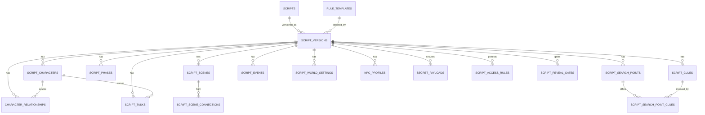
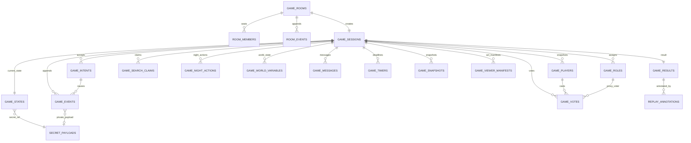

# MysteryVerse 数据库设计

> 文档版本：v1.0
> 状态：数据库设计评审基线
> 上游依据：`docs/MysteryVerse-PRD.md`、`docs/TECH_DESIGN.md`
> 目标数据库：MySQL 8.0+
> 范围：逻辑模型、物理表设计、索引、权限隔离、状态持久化、生命周期、迁移和关键 DDL

> **2026-11-21 架构基线补充**：ADR-003、ADR-009、ADR-010 为 Accepted；
> ADR-001、ADR-004、ADR-006、ADR-007、ADR-008 为 Proposed。
> Proposed 表结构与状态语义在负责人确认前不得作为迁移依据。

> **2026-11-25 DQ-21 批准补充**：MySQL 是 Run/Step/Checkpoint Metadata 权威源，
> Redis 提供 Owner Lease，MySQL `owner_lease_expires_at + fencing_token`
> 负责权威写入保护。首版 Checkpoint 加密正文使用 MySQL Blob；DQ-21 相关表由
> `00009_ai_runtime_persistence.sql` 创建。

---

## 0. 设计结论与 TECH_DESIGN 修正建议

### 0.1 设计结论

1. 在线业务权威数据统一存放在 MySQL。Redis 只承担会话缓存、在线状态、租约、Pub/Sub、短期缓存和任务流，不作为游戏权威状态。
2. Go 核心服务拥有 `mv_core` 仓库的业务写权限；Python AI 服务只拥有独立 `mv_ai` schema，不得直接写房间、游戏、投票、角色和结算表。
3. 游戏状态采用“当前状态 + 不可变事件 + 周期快照”的组合。当前状态用于低延迟读取，事件用于重连、回放和重建，快照用于缩短恢复路径。
4. 私密内容不放入可被普通搜索或通用查询读取的明文列。D2-D4 数据进入加密载荷表或加密对象，所有客户端数据由 Go 服务端投影生成。
5. 三种玩法共享房间、席位、玩家、角色分配、事件、投票、消息、结算和权限基础；模式差异由 Schema 版本化的 JSON、模式专用表和三套规则引擎共同承载。
6. 不建立通用 `game_logs` 表。游戏行为日志以 `game_events` 为权威轨迹，聊天内容以 `game_messages` 为业务内容表，运维审计进入 `audit_logs`，技术日志进入可观测平台。
7. 大文件、生成候选包、GamePackage、快照正文和复盘导出不直接塞入 MySQL。MySQL 保存引用、哈希、版本、可见性和生命周期元数据。

### 0.2 TECH_DESIGN 中的数据库问题与建议

| 问题 | 风险 | 本设计处理 |
| --- | --- | --- |
| TECH_DESIGN 使用 `projects/project_versions`，PRD 使用 `Project/ProjectVersion`，任务要求 `scripts/script_versions` | 同义聚合重复建模，容易形成双份内容体系 | 将作者创作项目和可玩内容统一为 `scripts`，发布快照统一为 `script_versions`；不再另建 `projects` |
| `game_current_state` 与 `game_secret_state` 被描述为两个表，但未说明与版本、事件序号和模式状态的关系 | 容易双写或版本不一致 | 使用 `game_sessions` 保存权威版本和事件序号，`game_states` 保存当前公共状态，`secret_payloads` 保存加密运行时私密状态 |
| `VisibilityProjection` 若按每个事件、每个受众持久化 | 数据量按事件数乘以玩家数增长，且可从事件可见性推导 | 不持久化逐玩家投影副本；保存事件可见范围、揭示门控和运行时 viewer manifest，投影按请求生成 |
| `GenerationArtifact.candidate JSON` 若直接进普通 JSON 列 | 大产物导致表膨胀、备份变慢、权限难控 | MySQL 只保存 artifact 类型、对象哈希、对象 URI、Schema 和接受状态，正文进入对象存储 |
| `game_logs` 与 `game_events` 容易被并行设计 | 同一事实双写，重连与复盘难以判断权威来源 | 删除冗余 `game_logs` 概念，拆分 `game_events`、`game_messages`、`audit_logs` 三类不同职责 |
| AI 输入、完整上下文和模型输出若默认明文入库 | 高敏感内容泄露、日志检索扩大攻击面 | AI 元数据在 `mv_ai`；完整上下文只保存短期加密载荷或摘要和哈希，普通 trace 不保存正文 |
| 部分唯一约束依赖“WHERE”部分索引 | MySQL 不支持 PostgreSQL 风格部分唯一索引 | 使用生成列 + `UNIQUE`、状态条件更新和事务校验落地 |
| NPC 记忆仅按 `npcId` 关联 | 不同对局中的同名 NPC 记忆串线 | 运行期使用 `game_npcs` 实例和强制 `game_id`；Phase 3 持久世界另建 world scope，不直接把 game memory 扩成全局 |

### 0.3 命名映射

| PRD / TECH_DESIGN 概念 | 数据库实体 |
| --- | --- |
| Project | `scripts` |
| ProjectVersion / GamePackage | `script_versions` + `generation_artifacts` + 对象存储引用 |
| StoryBibleVersion | `story_bible_versions` |
| CanonFact | `story_facts` |
| GameBlueprint | `script_versions.blueprint_json` + 模式结构化表 |
| Room | `game_rooms` |
| RoomMember / Seat | `room_members` |
| GameInstance | `game_sessions` |
| GameState | `game_states` + 加密 `secret_payloads` |
| IntentRecord | `game_intents` |
| GameEvent | `game_events` |
| ChatMessage | `game_messages` |
| NPCState | `game_npcs` |
| NPCMemory | `npc_memories` |
| AIRun | `agent_runs` |
| AIStep | `agent_steps` |

---

## 1. 数据库选型

### 1.1 选型总表

| 存储 | 选型 | 权威范围 | 不允许承担 |
| --- | --- | --- | --- |
| MySQL 8.0+ | 主数据库 | 用户、社交、内容版本、剧本结构化对象、房间、对局、状态版本、事件、投票、消息、NPC 记忆、复盘、社区、审计、AI 元数据 | 大文件、长文本生成候选、模型上下文全文默认存储 |
| Redis 7.0+ | 非权威缓存与任务流 | 会话缓存、在线状态、owner lease、计时器快速调度、Pub/Sub、Streams、短期 NPC 记忆、热投影 | 唯一游戏状态、唯一结算、唯一事件日志 |
| S3 兼容对象存储 | 非结构化资产 | 原始文档、GamePackage、生成产物、图片、状态快照、记忆快照、复盘导出 | 公开 Bucket、无 ACL 的永久 URL |
| 进程内存 | 短生命周期缓存 | 当前单局引擎状态、连接索引、短期 NPC 工作记忆 | 跨实例共享、崩溃恢复依据 |
| OpenTelemetry / 日志平台 | 技术观测 | trace、指标、采样日志、告警 | 游戏权威状态、完整私密正文 |

### 1.2 MySQL 版本与基础参数

- MySQL 8.0.30 及以上，InnoDB。
- 默认字符集 `utf8mb4`，排序规则统一为 `utf8mb4_0900_ai_ci`。
- ID 使用 26 字符 ULID，使用 ASCII binary collation，避免自增 ID 暴露业务规模和枚举房间。
- 权威时间统一存 UTC `DATETIME(3)`，由服务端时钟写入。
- 事务隔离级别建议 `READ-COMMITTED`，游戏命令依赖显式行锁和版本条件，不依赖间隙锁行为。
- SQL 访问层使用 `sqlc + database/sql`，所有关键事务 SQL 可审查。
- 迁移工具使用 `goose`，生产环境不在应用启动时自动改 Schema。

### 1.3 Schema 与账号隔离

| Schema | Owner | 内容 | 访问策略 |
| --- | --- | --- | --- |
| `mv_core` | Go | 用户、内容、房间、游戏、事件、NPC 运行态元数据、社区、运营 | API 只读业务视图；Runtime/Worker 受控读写；Python 无写权限 |
| `mv_ai` | Python AI | Prompt、Agent Run、Step、Tool Call、Usage、Checkpoint、AI 评测 | Python 读写自有表；Go 仅通过内部 API 或受限只读账号查询 |
| `mv_audit` | 平台安全/Worker | 不可变审计归档、事故快照引用 | 专用追加账号；普通业务账号只能写事件，不能改历史 |

建议数据库账号：

| 账号 | 权限 |
| --- | --- |
| `mv_api_ro` | 读取用户、公开内容、房间和配置表的受限视图，不读取 `secret_payloads` |
| `mv_runtime_rw` | 读写房间、游戏、事件、状态、意图、投票、计时器和投影所需表 |
| `mv_secret_rw` | 仅 Runtime 内的 SecretService 可访问 `secret_payloads`，需 KMS 密钥 |
| `mv_content_rw` | 内容、工坊、版本、发布和生成任务 |
| `mv_ai_rw` | 仅 `mv_ai` schema |
| `mv_worker_rw` | Outbox、快照、清理、归档和聚合任务 |
| `mv_ops_ro` | 脱敏运营视图和审批后的临时审计查询 |
| `mv_migrator` | Schema 迁移 DDL |

---

## 2. 实体设计原则

### 2.1 关系型表、JSON 与独立业务表的分工

| 方式 | 解决的问题 | 使用范围 | 禁止做法 |
| --- | --- | --- | --- |
| 关系型表 | 身份、所有权、成员关系、版本、外键、唯一约束、事务并发、权限作用域、可审计状态 | 用户、脚本版本、角色、房间、玩家、游戏事件、投票、消息、结果、好友 | 不把核心唯一键、状态、时间、外键埋在 JSON |
| JSON 扩展字段 | 模式私有但结构稳定的配置、条件表达式、动作白名单、少量非检索型展示信息 | 房间模式配置、规则模板参数、阶段出口条件、RPG 条件、结算摘要 | 不把全部业务实体、全量角色本、完整聊天历史塞入一个大 JSON |
| 独立业务表 | 高频查询、强唯一约束、原子争抢、权限边界、审计追踪或跨模式共享的规则事实 | `game_votes`、`game_search_claims`、`game_night_actions`、`npc_memories`、`agent_runs`、`llm_usage_records` | 不为每个字段拆表，也不让模式表复制公共房间和事件基础设施 |

### 2.2 三种模式的数据承载

| 层 | 剧本杀 | 狼人杀 | RPG |
| --- | --- | --- | --- |
| 公共关系表 | `game_rooms`、`game_sessions`、`game_players`、`game_events`、`game_votes` | 同左 | 同左 |
| 内容结构化表 | `script_characters`、`script_clues`、`script_search_points`、`script_phases` | 主题与角色包装进入 `scripts/script_versions`，核心规则引用 `rule_templates` | `script_scenes`、`npc_profiles`、`script_tasks`、`script_world_settings` |
| 模式专用表 | `game_search_claims` | `game_night_actions`、`rule_templates` | `game_world_variables`、`game_npcs` |
| 模式 JSON | 搜证点规则、回合动作白名单、真相揭示配置 | 身份池、行动顺序、平票和技能优先级 | 世界条件 DSL、任务条件、结局条件、地图扩展元数据 |
| View 投影 | 角色本、私人线索、搜证次数、投票进度 | 隐藏身份、阵营频道、夜间结果、技能链 | 场景可见性、玩家背包、NPC 关系、任务与结局 |

### 2.3 不建立的冗余实体

- 不建立独立 `projects` 再与 `scripts` 并存。
- 不建立 `game_logs` 复制 `game_events`。
- 不建立按 viewer 全量展开的 `game_event_projections`。
- 不建立只有 `id + JSON` 的通用业务实体表。
- 不把每名玩家每局的完整状态同时写入多份 MySQL 表；Redis 投影和客户端投影不作为权威。
- 不把 Prompt 全文、系统上下文和模型思维链默认保存到 `mv_core`。

---

## 3. 完整数据表清单

### 3.1 用户与社交

| 表 | 业务用途 | 生命周期 | MVP |
| --- | --- | --- | --- |
| `users` | 平台账号、状态、风控、登录摘要 | 长期，软删除 | 是 |
| `auth_identities` | 第三方或手机号/邮箱身份绑定，避免把认证方式写进用户主表 | 账号存续期 | 是 |
| `user_sessions` | 服务端会话、设备、撤销状态和 CSRF 摘要 | 短期 | 是 |
| `user_profiles` | 昵称、头像、简介、语言、隐私设置和公开资料 | 账号存续期 | 是 |
| `friendships` | 双方唯一好友关系、申请状态、备注 | 长期 | 好友完整能力 Phase 2 |
| `user_blocks` | 有向拉黑关系，影响邀请、好友和私聊 | 长期 | Phase 2 |
| `user_statistics` | 可按用户重建的对局与创作统计 | 长期，异步聚合 | 是 |

### 3.2 内容、工坊与剧本结构化

| 表 | 业务用途 | 生命周期 | MVP |
| --- | --- | --- | --- |
| `source_documents` | 原始上传文件元数据、哈希、格式和扫描状态 | 项目存续期，删除后冷静期清理 | 是 |
| `generation_jobs` | 解析、结构化、生成、修复、复盘等异步任务 | 长期，保留任务摘要 | 是 |
| `generation_job_steps` | 工作流节点进度、重试、检查和产物引用 | 与任务同周期 | 是 |
| `generation_artifacts` | 生成候选、校验报告和候选包的 staging 元数据 | 候选到发布后保留摘要 | 是 |
| `scripts` | 稳定的创作项目与可玩内容聚合，映射 PRD Project | 长期，软删除 | 是 |
| `script_versions` | 草稿、命名版本和不可变发布版本 | 发布版本长期 | 是 |
| `story_bible_versions` | 结构化故事圣经版本及对象存储引用 | 与引用版本同周期 | 是 |
| `story_facts` | Canon 事实、来源定位、置信度、锁定和生成来源 | 与故事圣经同周期 | 是 |
| `secret_payloads` | D2-D4 加密载荷、密钥版本、哈希和保留策略 | 随 scope 生命周期 | 是 |
| `script_access_rules` | 内容对象和字段级 ACL 例外、作者/审核访问规则 | 与版本同周期 | 是 |
| `script_reveal_gates` | 阶段揭示门控定义与条件 | 与版本同周期 | 是 |
| `script_characters` | 剧本角色、公开资料、角色类型和加密私密内容引用 | 与版本同周期 | 是 |
| `character_relationships` | 有向人物关系、公开描述和加密秘密 | 与版本同周期 | 是 |
| `script_scenes` | 剧情场景或 RPG 场景/地点节点 | 与版本同周期 | 是 |
| `script_scene_connections` | 场景或地点之间的有向可达边和条件 | 与版本同周期 | RPG Phase 2 |
| `script_phases` | 阶段顺序、进入/退出条件、时限、保底动作和动作白名单 | 与版本同周期 | 是 |
| `script_clues` | 线索卡、公开描述、可见性、重复性和加密私密内容 | 与版本同周期 | 是 |
| `script_search_points` | 搜证点、阶段、次数、冲突策略和可见角色 | 与版本同周期 | 是 |
| `script_search_point_clues` | 搜证点与可获得线索的关系 | 与版本同周期 | 是 |
| `script_tasks` | 个人目标、阵营目标、RPG 任务、分支和结局任务 | 与版本同周期 | 是 |
| `script_events` | 故事时间线与 Canon 事件，不用于在线对局事件 | 与版本同周期 | 是 |
| `script_world_settings` | 世界规则、势力、资源、禁忌和初始变量定义 | 与版本同周期 | RPG Phase 2 |
| `npc_profiles` | 可复用 NPC 内容定义、人设、知识边界和初始关系 | 与版本同周期 | RPG Phase 2 |
| `rule_templates` | 版本化狼人杀及通用规则模板 | 长期不可变 | 狼人杀 Phase 2 |
| `script_tags` | 内容标签字典 | 长期 | 是 |
| `script_tag_links` | 剧本与标签关系，用于筛选和搜索 | 与剧本同周期 | 是 |

### 3.3 房间与游戏运行时

| 表 | 业务用途 | 生命周期 | MVP |
| --- | --- | --- | --- |
| `game_rooms` | 房间、模式、可见性、房间码、内容版本和开局前状态 | 长期，可按策略归档 | 是 |
| `room_members` | 房间成员、席位、房主、准备、在线摘要和 AI 席位 | 与房间同周期 | 是 |
| `room_events` | 等待/准备/房主转移等房间事件与 `room_seq` | 与房间同周期 | 是 |
| `room_messages` | 等待房聊天消息与独立 `chat_seq` | 房间关闭后按策略保留 | 是 |
| `invitation_tokens` | 房间邀请 token hash、使用上限、过期和撤销 | 短期到房间关闭 | 是 |
| `game_sessions` | 单局权威控制行、引擎版本、当前版本、事件序号和 owner 审计摘要 | 长期，复盘依据 | 是 |
| `game_players` | 开局席位快照、参与身份、连接状态和运行时角色引用 | 与对局同周期 | 是 |
| `game_roles` | 玩家、AI 或 NPC 的隐藏角色/身份分配 | 与对局同周期 | 是 |
| `game_states` | 当前公共状态信封和加密运行时状态引用 | 与对局同周期 | 是 |
| `game_events` | 不可变权威游戏事件、可见性、揭示门控和加密载荷引用 | 长期 | 是 |
| `game_intents` | 玩家/AI 意图、幂等键、期望版本、结果和事件范围 | 与对局同周期，可按策略归档 | 是 |
| `game_votes` | 投票/弃权/改票与有效状态，支持并发唯一约束 | 长期 | 是 |
| `game_search_claims` | 独占线索争抢与重复线索领取记录 | 长期 | 是 |
| `game_night_actions` | 狼人杀夜晚行动收集与按技能唯一约束 | 长期 | Phase 2 |
| `game_world_variables` | RPG 可查询世界变量和条件引擎当前值 | 与对局同周期 | Phase 2-3 |
| `game_messages` | 房间和游戏聊天、系统消息、AI 消息、可见范围和审核状态 | 公聊长期，私聊短期 | 是 |
| `game_timers` | 阶段截止、暂停剩余时长、timer 幂等键 | 对局结束后保留审计摘要 | 是 |
| `game_snapshots` | 当前状态快照元数据、对象引用、版本、序号和哈希 | 按快照策略 | 是 |
| `game_viewer_manifests` | 开局时生成的 viewer 权限清单版本和对象引用 | 与对局同周期 | 是 |
| `game_results` | 不可变规则结算结果与模式化结果摘要 | 长期 | 是 |
| `replay_reports` | 结构化复盘报告和 AI 点评状态 | 长期 | 是 |
| `replay_annotations` | AI 点评片段及引用事件，不改变结算 | 长期 | 否，P1 |
| `outbox_events` | 事务性 Outbox，异步发布和重试 | 短期 | 是 |

### 3.4 NPC 与记忆

| 表 | 业务用途 | 生命周期 | MVP |
| --- | --- | --- | --- |
| `game_npcs` | 对局内 NPC 实例、场景位置、目标、情绪和可见状态 | 与对局同周期 | Phase 2 |
| `npc_relationships` | 对局内 NPC 对玩家/角色/势力的关系和来源 | 与对局同周期 | Phase 2 |
| `npc_memories` | 游戏作用域内的长期记忆、来源事件、置信度、重要性 | 对局结束 + 保留期 | Phase 2 |
| `npc_conversation_summaries` | 对局内对话滚动摘要和版本 | 短期到中期 | Phase 2 |
| `npc_memory_snapshots` | 记忆快照元数据和对象存储引用 | 短期 | Phase 2 |

### 3.5 AI 运行时

| 表 | 业务用途 | 生命周期 | MVP |
| --- | --- | --- | --- |
| `prompt_versions` | Prompt 模板、版本、哈希、负责人和变更原因 | 长期 | 是 |
| `agent_runs` | 一次 DM、NPC、生成节点或复盘执行的主记录 | 长期摘要 | 是 |
| `agent_steps` | Agent 步骤、节点状态、Schema 和重试 | 中期 | 是 |
| `agent_messages` | Agent 运行的输入/输出消息摘要或加密正文引用 | 短期到中期 | 是 |
| `agent_tool_calls` | 工具调用、参数摘要、授权 scope、状态和耗时 | 中期 | 是 |
| `llm_usage_records` | 每次模型请求的 Token、成本和延迟 | 长期聚合 | 是 |
| `context_manifests` | 实际注入实体、来源、可见性和哈希 | 中期 | 是 |
| `agent_checkpoints` | LangGraph 持久检查点元数据和引用 | 与任务同周期 | 是 |
| `safety_events` | 输入/输出安全拦截、注入检测和处置 | 长期 | 是 |
| `ai_evaluation_runs` | 离线评测、回归和模型路由比较 | 长期 | P1 |

### 3.6 社区与运营

| 表 | 业务用途 | 生命周期 | MVP |
| --- | --- | --- | --- |
| `script_publications` | 版本发布渠道、审核、上架/下架历史 | 长期 | 是 |
| `script_reviews` | 完成对局后的评分与可选短评，用户与版本唯一 | 长期 | 评论评分 P1 |
| `script_comments` | 社区评论、剧透标记、父评论和审核状态 | 长期 | P1 |
| `script_favorites` | 用户收藏剧本或世界的唯一关系 | 长期 | P1 |
| `share_links` | 剧本、房间、复盘分享 token 哈希和撤销 | 短期 | 是 |
| `reports` | 举报对象、证据定位、状态和处置 | 长期 | 是 |
| `moderation_cases` | 审核/举报/申诉工单和版本级结论 | 长期 | 是 |
| `audit_logs` | 高风险操作和敏感访问的追加写审计 | 法规与争议周期 | 是 |
| `incidents` | 游戏/任务运行时事故、冻结、诊断和恢复 | 长期 | 是 |
| `feature_configs` | 版本化功能开关和分环境/分房间配置 | 长期 | 是 |
| `user_sanctions` | 禁言、封禁、范围、期限、撤销和管理员来源 | 长期 | 是 |

---

## 4. ER 图

### 4.1 领域总览

```mermaid
erDiagram
    USERS ||--o{ AUTH_IDENTITIES : binds
    USERS ||--o{ USER_SESSIONS : owns
    USERS ||--|| USER_PROFILES : has
    USERS ||--o{ FRIENDSHIPS : participates
    USERS ||--o{ USER_BLOCKS : blocks
    USERS ||--o{ SCRIPTS : creates
    USERS ||--o{ ROOM_MEMBERS : joins
    USERS ||--o{ GAME_PLAYERS : plays
    USERS ||--o{ SCRIPT_REVIEWS : writes
    USERS ||--o{ SCRIPT_COMMENTS : writes
    USERS ||--o{ SCRIPT_FAVORITES : favorites

    SCRIPTS ||--o{ SOURCE_DOCUMENTS : contains
    SCRIPTS ||--o{ SCRIPT_VERSIONS : versions
    SCRIPTS ||--o{ GENERATION_JOBS : runs
    GENERATION_JOBS ||--o{ GENERATION_JOB_STEPS : has
    GENERATION_JOBS ||--o{ GENERATION_ARTIFACTS : produces
    SCRIPT_VERSIONS ||--o{ STORY_BIBLE_VERSIONS : structures
    STORY_BIBLE_VERSIONS ||--o{ STORY_FACTS : contains
    SCRIPT_VERSIONS ||--o{ SCRIPT_CHARACTERS : defines
    SCRIPT_VERSIONS ||--o{ SCRIPT_SCENES : defines
    SCRIPT_VERSIONS ||--o{ SCRIPT_CLUES : defines
    SCRIPT_VERSIONS ||--o{ SCRIPT_TASKS : defines
    SCRIPT_VERSIONS ||--o{ SCRIPT_EVENTS : defines
    SCRIPT_VERSIONS ||--o{ NPC_PROFILES : defines
    SCRIPT_VERSIONS ||--o{ SCRIPT_PUBLICATIONS : publishes

    SCRIPT_VERSIONS ||--o{ GAME_ROOMS : starts
    GAME_ROOMS ||--o{ ROOM_MEMBERS : contains
    GAME_ROOMS ||--o{ ROOM_EVENTS : emits
    GAME_ROOMS ||--|| GAME_SESSIONS : runs
    GAME_SESSIONS ||--o{ GAME_PLAYERS : has
    GAME_SESSIONS ||--o{ GAME_ROLES : assigns
    GAME_SESSIONS ||--|| GAME_STATES : holds
    GAME_SESSIONS ||--o{ GAME_EVENTS : emits
    GAME_SESSIONS ||--o{ GAME_INTENTS : receives
    GAME_SESSIONS ||--o{ GAME_VOTES : records
    GAME_SESSIONS ||--o{ GAME_MESSAGES : contains
    GAME_SESSIONS ||--o{ GAME_SNAPSHOTS : snapshots
    GAME_SESSIONS ||--o{ GAME_NPCS : hosts
    GAME_NPCS ||--o{ NPC_MEMORIES : remembers
    GAME_SESSIONS ||--|| GAME_RESULTS : settles
    GAME_RESULTS ||--o{ REPLAY_REPORTS : reviews

    AGENT_RUNS ||--o{ AGENT_STEPS : has
    AGENT_RUNS ||--o{ AGENT_MESSAGES : contains
    AGENT_RUNS ||--o{ AGENT_TOOL_CALLS : calls
    AGENT_RUNS ||--o{ LLM_USAGE_RECORDS : consumes
    AGENT_RUNS ||--o{ CONTEXT_MANIFESTS : injects
    PROMPT_VERSIONS ||--o{ AGENT_RUNS : selected_by
```



### 4.2 内容与版本



### 4.3 游戏运行时与权限投影



---

## 5. 字段类型与命名约定

### 5.1 标准列

为减少重复，后续字段表使用以下标准列约定。除明确说明外，业务表都包含对应列。

| 类别 | 标准列 | 说明 |
| --- | --- | --- |
| 主键 | `id CHAR(26) CHARACTER SET ascii COLLATE ascii_bin` | ULID，表级主键；纯关联表可使用复合主键 |
| 可变业务表 | `created_at DATETIME(3) NOT NULL DEFAULT CURRENT_TIMESTAMP(3)`、`updated_at DATETIME(3) NOT NULL DEFAULT CURRENT_TIMESTAMP(3) ON UPDATE CURRENT_TIMESTAMP(3)` | UTC |
| 乐观锁 | `row_version INT UNSIGNED NOT NULL DEFAULT 1` | 仅可变聚合或编辑实体使用 |
| 软删除 | `deleted_at DATETIME(3) NULL` | 用户、剧本、评论等可恢复实体使用 |
| 追加写表 | `created_at DATETIME(3)` | 事件、审计、usage、outbox 不提供 `updated_at` 业务更新 |
| 哈希 | `BINARY(32)` | SHA-256 原始二进制，比 64 字符十六进制节省空间 |
| 加密载荷 | `VARBINARY` / `MEDIUMBLOB` + `key_id` + `nonce` | 应用层信封加密，不依赖数据库函数解密 |
| 金额与成本 | `DECIMAL(18,8)` | 供应商成本，不使用浮点数 |
| Token 数 | `BIGINT UNSIGNED` | 输入、输出、缓存 Token |

### 5.2 枚举和约束

- 状态字段使用短 `VARCHAR(32)` 加 `CHECK` 约束，避免 MySQL `ENUM` 演进困难。
- 敏感级统一 `sensitivity TINYINT UNSIGNED`，取值 `0..4`，分别对应 D0-D4。
- `visibility_scope` 建议取值：`public`、`authenticated`、`project`、`invite`、`room`、`role`、`role_group`、`player`、`runtime`、`audit`。
- JSON 字段必须带 `schema_version`，应用写入前使用 JSON Schema/Pydantic 校验。
- 所有外键默认 `ON DELETE RESTRICT`；需要级联的纯关联行采用显式归档/清理任务，不在生产使用大范围 `CASCADE`。
- 私密正文不得进入普通索引、全文索引或数据库审计日志。

---

## 6. 表字段定义

### 6.0 阅读说明

- 每张表都包含第 5.1 节规定的 `id` 和对应时间标准列，因此字段表只列业务字段；纯关联表明确标注复合主键。
- `FK` 表示设计外键，`UQ` 表示唯一键，`IX` 表示必须建立索引，`CK` 表示 `CHECK` 约束。
- `NULL` 列只有在该字段确实可选时出现；未写 `NULL` 的字段默认 `NOT NULL`。
- 所有 `JSON` 列只在应用完成 Schema 校验后写入；敏感 JSON 不直接存普通 JSON 列，而进入 `secret_payloads` 密文。

### 6.1 用户与社交表

#### 6.1.1 `users`

| 字段 | 类型 | 约束 | 业务说明 |
| --- | --- | --- | --- |
| `public_no` | `CHAR(12) CHARACTER SET ascii` | `UQ` | 对外展示的不可枚举用户编号 |
| `status` | `VARCHAR(20)` | `CK(status IN ('pending','active','suspended','disabled','deleted'))`，`IX` | 全局账号状态 |
| `risk_level` | `TINYINT UNSIGNED` | `DEFAULT 0` | 风控等级 |
| `terms_version` | `VARCHAR(32)` |  | 最近同意协议版本 |
| `privacy_version` | `VARCHAR(32)` |  | 最近同意隐私政策版本 |
| `last_login_at` | `DATETIME(3)` | `NULL`，`IX` | 最后成功登录时间 |
| `deleted_at` | `DATETIME(3)` | `NULL`，`IX` | 注销与清理状态 |

索引：`UNIQUE(public_no)`、`INDEX(status, created_at)`。

#### 6.1.2 `auth_identities`

| 字段 | 类型 | 约束 | 业务说明 |
| --- | --- | --- | --- |
| `user_id` | `CHAR(26)` | `FK users.id`，`IX` | 归属用户 |
| `provider` | `VARCHAR(32)` | `UQ(provider, provider_subject)` | `phone`、`email`、`oidc` 等 |
| `provider_subject` | `VARCHAR(191)` | `UQ(provider, provider_subject)` | Provider 内唯一主体 |
| `identifier_hash` | `BINARY(32)` | `UQ(provider, identifier_hash)` | 规范化手机号/邮箱的 HMAC |
| `identifier_hint` | `VARCHAR(64)` |  | 脱敏展示，如 `138****0000` |
| `password_hash` | `VARCHAR(255)` | `NULL` | Argon2id PHC 哈希；非密码 Provider 为空，禁止存明文 |
| `verified_at` | `DATETIME(3)` | `NULL` | 验证完成时间 |
| `is_primary` | `TINYINT(1)` | `DEFAULT 0` | 主登录方式 |
| `status` | `VARCHAR(20)` | `CK` | `active`、`revoked`、`locked` |

#### 6.1.3 `user_sessions`

| 字段 | 类型 | 约束 | 业务说明 |
| --- | --- | --- | --- |
| `user_id` | `CHAR(26)` | `FK users.id`，`IX(user_id, expires_at)` | 会话用户 |
| `session_token_hash` | `BINARY(32)` | `UQ` | Session Token 哈希，不存原文 |
| `csrf_token_hash` | `BINARY(32)` |  | CSRF Token 哈希 |
| `device_label` | `VARCHAR(128)` | `NULL` | 设备摘要，不含广告标识 |
| `ip_hash` | `BINARY(32)` | `NULL` | IP 的 HMAC |
| `user_agent_hash` | `BINARY(32)` | `NULL` | User-Agent 哈希 |
| `expires_at` | `DATETIME(3)` | `IX` | 过期时间 |
| `last_seen_at` | `DATETIME(3)` |  | 最近访问 |
| `revoked_at` | `DATETIME(3)` | `NULL`，`IX` | 主动/安全撤销 |
| `revoke_reason` | `VARCHAR(64)` | `NULL` | 撤销原因 |

#### 6.1.4 `user_profiles`

| 字段 | 类型 | 约束 | 业务说明 |
| --- | --- | --- | --- |
| `user_id` | `CHAR(26)` | `FK users.id`，`UQ` | 一人一份资料 |
| `nickname` | `VARCHAR(64)` | `IX(nickname)` | 可重复昵称，对外配合 `public_no` |
| `avatar_uri` | `VARCHAR(512)` | `NULL` | 受控对象存储引用 |
| `bio` | `VARCHAR(500)` | `NULL` | 公开简介 |
| `locale` | `VARCHAR(16)` |  | 如 `zh-CN` |
| `timezone` | `VARCHAR(64)` |  | 展示时区，不用于权威游戏时钟 |
| `preferences_json` | `JSON` |  | 题材、模式、语言等 UI 偏好，不含权限判定 |
| `privacy_json` | `JSON` |  | 历史、战绩、在线状态、好友申请、私聊可见性 |
| `moderation_status` | `VARCHAR(20)` | `CK` | 昵称/头像审核状态 |
| `row_version` | `INT UNSIGNED` | `DEFAULT 1` | 乐观锁 |

`privacy_json` 必须由服务端解析为固定布尔/枚举字段，未知字段拒绝。

#### 6.1.5 `friendships`

| 字段 | 类型 | 约束 | 业务说明 |
| --- | --- | --- | --- |
| `user_low_id` | `CHAR(26)` | `FK users.id`，`UQ(user_low_id,user_high_id)` | 字典序较小用户 |
| `user_high_id` | `CHAR(26)` | `FK users.id`，`UQ(user_low_id,user_high_id)` | 字典序较大用户 |
| `requested_by` | `CHAR(26)` | `FK users.id` | 发起申请者 |
| `status` | `VARCHAR(20)` | `CK(status IN ('pending','accepted','rejected','removed'))`，`IX` | 好友状态 |
| `low_note` | `VARCHAR(64)` | `NULL` | 低 ID 用户的备注 |
| `high_note` | `VARCHAR(64)` | `NULL` | 高 ID 用户的备注 |
| `requested_at` | `DATETIME(3)` |  | 申请时间 |
| `responded_at` | `DATETIME(3)` | `NULL` | 处理时间 |

约束：`CHECK(user_low_id < user_high_id)`；同一对用户仅一条关系记录。

#### 6.1.6 `user_blocks`

| 字段 | 类型 | 约束 | 业务说明 |
| --- | --- | --- | --- |
| `blocker_user_id` | `CHAR(26)` | `FK users.id`，`UQ(blocker_user_id,blocked_user_id)` | 拉黑者 |
| `blocked_user_id` | `CHAR(26)` | `FK users.id`，`UQ(blocker_user_id,blocked_user_id)` | 被拉黑者 |
| `reason_code` | `VARCHAR(32)` | `NULL` | 分类原因 |
| `note` | `VARCHAR(255)` | `NULL` | 用户私有备注，不向对方展示 |

#### 6.1.7 `user_statistics`

| 字段 | 类型 | 约束 | 业务说明 |
| --- | --- | --- | --- |
| `user_id` | `CHAR(26)` | `FK users.id`，`UQ` | 统计所属用户 |
| `games_started` | `INT UNSIGNED` | `DEFAULT 0` | 开局参与次数 |
| `games_completed` | `INT UNSIGNED` | `DEFAULT 0` | 正常完成次数 |
| `games_won` | `INT UNSIGNED` | `DEFAULT 0` | 胜局数 |
| `script_murder_games` | `INT UNSIGNED` | `DEFAULT 0` | 剧本杀场次 |
| `werewolf_games` | `INT UNSIGNED` | `DEFAULT 0` | 狼人杀场次 |
| `rpg_games` | `INT UNSIGNED` | `DEFAULT 0` | RPG 场次 |
| `experience` | `BIGINT UNSIGNED` | `DEFAULT 0` | 经验 |
| `level` | `INT UNSIGNED` | `DEFAULT 1` | 等级 |
| `stats_json` | `JSON` |  | 可重建的模式细分统计 |
| `calculated_at` | `DATETIME(3)` |  | 最近聚合时间 |

#### 6.1.8 `idempotency_records`

| 字段 | 类型 | 约束 | 业务说明 |
| --- | --- | --- | --- |
| `scope` | `VARCHAR(64)` | `UQ(scope,actor_scope,idempotency_key)` | 例如 `identity.register`、`room.create` |
| `actor_scope` | `VARCHAR(96)` | `UQ(...)` | 用户 ID 或匿名请求的 IP 哈希作用域 |
| `idempotency_key` | `VARCHAR(128)` | `UQ(...)` | HTTP `Idempotency-Key` |
| `request_hash` | `BINARY(32)` |  | 规范化请求 SHA-256；同键不同 hash 返回冲突 |
| `status` | `VARCHAR(16)` | `CK` | `pending`、`completed`、`failed` |
| `response_status` | `SMALLINT UNSIGNED` | `NULL` | 首次成功状态码 |
| `response_json` | `JSON` | `NULL` | 仅保存非秘密安全响应摘要 |
| `resource_type` | `VARCHAR(64)` | `NULL` | 资源类型 |
| `resource_id` | `CHAR(26)` | `NULL` | 资源纯 ULID |
| `expires_at` | `DATETIME(3)` | `IX` | 幂等记录保留截止 |

不得在幂等响应中保存 Session Token、CSRF Token、邀请 token 原文或任何 D2-D4 正文。

### 6.2 内容、工坊与安全载荷

#### 6.2.1 `source_documents`

| 字段 | 类型 | 约束 | 业务说明 |
| --- | --- | --- | --- |
| `script_id` | `CHAR(26)` | `FK scripts.id`，`IX` | 所属创作项目 |
| `uploaded_by` | `CHAR(26)` | `FK users.id` | 上传者 |
| `storage_uri` | `VARCHAR(1024)` |  | 隔离区或正式 Bucket 对象 URI |
| `storage_key_hash` | `BINARY(32)` | `UQ` | 规范化对象键 HMAC，避免长 URI 索引 |
| `original_filename` | `VARCHAR(255)` |  | 原始文件名，仅作者/审计可见 |
| `mime_type` | `VARCHAR(128)` |  | 服务端验证后的真实类型 |
| `byte_size` | `BIGINT UNSIGNED` |  | 文件大小 |
| `sha256` | `BINARY(32)` | `UQ(script_id,sha256)` | 内容哈希 |
| `page_count` | `INT UNSIGNED` | `NULL` | 页数 |
| `character_count` | `BIGINT UNSIGNED` | `NULL` | 字符数 |
| `detected_language` | `VARCHAR(16)` | `NULL` | 检测语言 |
| `scan_status` | `VARCHAR(24)` | `CK`，`IX` | `pending`、`clean`、`infected`、`failed` |
| `parse_status` | `VARCHAR(24)` | `CK`，`IX` | `uploaded`、`queued`、`parsing`、`usable`、`partial`、`failed` |
| `retention_class` | `VARCHAR(32)` |  | 原件保留策略 |

#### 6.2.2 `generation_jobs`

| 字段 | 类型 | 约束 | 业务说明 |
| --- | --- | --- | --- |
| `script_id` | `CHAR(26)` | `FK scripts.id`，`IX` | 任务项目 |
| `source_document_id` | `CHAR(26)` | `FK source_documents.id`，`NULL` | 文档来源，可空 |
| `job_type` | `VARCHAR(32)` | `IX(job_type,status)` | `parse`、`structure`、`generate`、`repair`、`review` |
| `target_mode` | `VARCHAR(24)` | `NULL` | 目标模式 |
| `workflow_key` | `VARCHAR(64)` |  | LangGraph 工作流标识 |
| `workflow_version` | `VARCHAR(32)` |  | 工作流代码版本 |
| `schema_version` | `VARCHAR(32)` |  | Graph State/Package Schema |
| `status` | `VARCHAR(32)` | `CK`，`IX` | `queued`、`running`、`waiting_human`、`partial`、`succeeded`、`failed`、`cancelled` |
| `progress_bp` | `SMALLINT UNSIGNED` | `CK(progress_bp BETWEEN 0 AND 10000)` | 进度万分比 |
| `progress_seq` | `BIGINT UNSIGNED` | `DEFAULT 0` | `ai_progress` 流序号，支持重连快照 |
| `idempotency_key` | `VARCHAR(128)` | `UQ(script_id,job_type,idempotency_key)` | 防止重复任务和扣费 |
| `request_params_json` | `JSON` |  | 不可变任务参数快照 |
| `requested_by` | `CHAR(26)` | `FK users.id` | 发起用户 |
| `started_at` | `DATETIME(3)` | `NULL` | 开始时间 |
| `finished_at` | `DATETIME(3)` | `NULL` | 结束时间 |
| `error_code` | `VARCHAR(64)` | `NULL` | 稳定错误码 |
| `error_summary` | `VARCHAR(500)` | `NULL` | 脱敏错误摘要 |

#### 6.2.3 `generation_job_steps`

| 字段 | 类型 | 约束 | 业务说明 |
| --- | --- | --- | --- |
| `job_id` | `CHAR(26)` | `FK generation_jobs.id`，`UQ(job_id,step_key)` | 所属任务 |
| `step_key` | `VARCHAR(64)` | `UQ(job_id,step_key)` | 节点稳定键 |
| `sequence_no` | `INT UNSIGNED` | `IX(job_id,sequence_no)` | 展示与执行顺序 |
| `node_type` | `VARCHAR(32)` |  | parse、model、validate、human_review 等 |
| `status` | `VARCHAR(24)` | `CK`，`IX(job_id,status)` | 节点状态 |
| `weight_bp` | `SMALLINT UNSIGNED` |  | 对总进度权重 |
| `progress_bp` | `SMALLINT UNSIGNED` |  | 当前节点进度 |
| `attempt_no` | `SMALLINT UNSIGNED` | `DEFAULT 0` | 已执行次数 |
| `max_attempts` | `SMALLINT UNSIGNED` |  | 最大次数 |
| `agent_run_id` | `CHAR(26)` | `NULL`，逻辑引用 `mv_ai.agent_runs.id` | 对应 AI Run |
| `artifact_id` | `CHAR(26)` | `FK generation_artifacts.id`，`NULL` | 节点产物 |
| `started_at` | `DATETIME(3)` | `NULL` | 开始时间 |
| `finished_at` | `DATETIME(3)` | `NULL` | 结束时间 |
| `error_code` | `VARCHAR(64)` | `NULL` | 错误码 |

#### 6.2.4 `generation_artifacts`

| 字段 | 类型 | 约束 | 业务说明 |
| --- | --- | --- | --- |
| `job_id` | `CHAR(26)` | `FK generation_jobs.id`，`IX` | 所属任务 |
| `step_id` | `CHAR(26)` | `FK generation_job_steps.id`，`NULL` | 产出节点 |
| `script_id` | `CHAR(26)` | `FK scripts.id`，`IX` | 所属项目 |
| `artifact_type` | `VARCHAR(48)` | `UQ(job_id,step_id,artifact_type,content_hash)` | `story_bible`、`game_package`、`validation_report`、`image` |
| `schema_version` | `VARCHAR(32)` |  | 产物 Schema |
| `storage_uri` | `VARCHAR(1024)` |  | 对象存储 URI |
| `storage_key_hash` | `BINARY(32)` | `UQ` | 规范化对象键 HMAC |
| `content_hash` | `BINARY(32)` | `UQ(job_id,step_id,artifact_type,content_hash)` | SHA-256 |
| `byte_size` | `BIGINT UNSIGNED` |  | 大小 |
| `validation_status` | `VARCHAR(24)` | `CK` | `pending`、`passed`、`blocked`、`warning` |
| `acceptance_status` | `VARCHAR(24)` | `IX` | `staging`、`accepted`、`rejected`、`discarded` |
| `created_by_type` | `VARCHAR(24)` |  | `python_workflow`、`human`、`system` |
| `expires_at` | `DATETIME(3)` | `NULL` | staging 清理时间 |

#### 6.2.5 `scripts`

| 字段 | 类型 | 约束 | 业务说明 |
| --- | --- | --- | --- |
| `owner_user_id` | `CHAR(26)` | `FK users.id`，`IX` | 创作者 |
| `public_slug` | `VARCHAR(96)` | `NULL`，`UQ` | 公开详情 URL 稳定标识 |
| `title` | `VARCHAR(160)` | `IX(title)` | 内容标题 |
| `summary` | `VARCHAR(1000)` | `NULL` | 无剧透简介 |
| `game_type` | `VARCHAR(24)` | `CK`，`IX` | `script_murder`、`werewolf`、`rpg` |
| `source_kind` | `VARCHAR(24)` |  | `official`、`original`、`licensed`、`private_trial` |
| `rights_type` | `VARCHAR(24)` |  | `original`、`authorized`、`public_domain`、`private_only` |
| `status` | `VARCHAR(24)` | `CK`，`IX` | `draft`、`validating`、`review`、`published`、`unlisted`、`soft_deleted` |
| `cover_asset_uri` | `VARCHAR(1024)` | `NULL` | 封面对象 |
| `language` | `VARCHAR(16)` | `IX` | 主语言 |
| `content_rating` | `VARCHAR(16)` |  | `all`、`12+`、`16+`、`18+` |
| `min_players` | `TINYINT UNSIGNED` |  | 最小人数 |
| `max_players` | `TINYINT UNSIGNED` | `CK(min_players <= max_players)` | 最大人数 |
| `duration_minutes` | `SMALLINT UNSIGNED` |  | 预计时长 |
| `difficulty` | `VARCHAR(16)` | `IX` | 难度 |
| `ai_assisted_ratio_bp` | `SMALLINT UNSIGNED` | `CK BETWEEN 0 AND 10000` | AI 辅助比例 |
| `active_draft_version_id` | `CHAR(26)` | `NULL`，逻辑 FK `script_versions.id` | 当前编辑版本 |
| `published_version_id` | `CHAR(26)` | `NULL`，逻辑 FK `script_versions.id`，`IX` | 当前公开版本 |
| `deleted_at` | `DATETIME(3)` | `NULL`，`IX` | 软删除 |

约束：`game_type` 与 `active_draft_version_id` 必须一致；当前公开版本必须属于同一 `script_id`。

#### 6.2.6 `script_versions`

| 字段 | 类型 | 约束 | 业务说明 |
| --- | --- | --- | --- |
| `script_id` | `CHAR(26)` | `FK scripts.id`，`UQ(script_id,version_no)` | 所属项目 |
| `version_no` | `INT UNSIGNED` | `UQ(script_id,version_no)` | 人工可读版本号 |
| `version_kind` | `VARCHAR(20)` | `CK` | `draft`、`release`、`rollback` |
| `status` | `VARCHAR(24)` | `CK`，`IX(script_id,status)` | `draft`、`validating`、`review`、`published_private`、`published_public`、`unlisted`、`archived` |
| `schema_version` | `VARCHAR(32)` |  | GamePackage Schema |
| `workflow_version` | `VARCHAR(32)` |  | 生成/编译工作流版本 |
| `base_version_id` | `CHAR(26)` | `FK script_versions.id`，`NULL` | 克隆或回退来源 |
| `rule_template_id` | `CHAR(26)` | `FK rule_templates.id`，`NULL` | 狼人杀等受控规则模板 |
| `blueprint_json` | `JSON` |  | 非私密结构配置与模式路由 |
| `package_uri` | `VARCHAR(1024)` | `NULL` | 编译后的 GamePackage 对象 |
| `package_key_hash` | `BINARY(32)` | `NULL`，`UQ` | 规范化包对象键 HMAC |
| `package_hash` | `BINARY(32)` | `NULL` | 包内容哈希 |
| `manifest_json` | `JSON` | `NULL` | 资产清单、章节和对象数量摘要 |
| `validation_report_uri` | `VARCHAR(1024)` | `NULL` | 校验报告对象 |
| `validation_status` | `VARCHAR(24)` | `IX` | `pending`、`passed`、`warning`、`blocked` |
| `blocking_issue_count` | `INT UNSIGNED` | `DEFAULT 0` | 阻断问题数 |
| `created_by` | `CHAR(26)` | `FK users.id` | 创建人 |
| `frozen_at` | `DATETIME(3)` | `NULL` | 发布版本冻结时间 |
| `published_at` | `DATETIME(3)` | `NULL`，`IX` | 首次发布时间 |
| `row_version` | `INT UNSIGNED` | `DEFAULT 1` | 草稿乐观锁 |

约束：`status` 为发布类时，`package_uri`、`package_hash`、`frozen_at` 必须非空；发布后禁止更新结构化对象。

#### 6.2.7 `story_bible_versions`

| 字段 | 类型 | 约束 | 业务说明 |
| --- | --- | --- | --- |
| `script_version_id` | `CHAR(26)` | `FK script_versions.id`，`IX` | 对应剧本版本 |
| `source_document_id` | `CHAR(26)` | `FK source_documents.id`，`NULL` | 原文来源 |
| `version_no` | `INT UNSIGNED` | `UQ(script_version_id,version_no)` | 故事圣经版本 |
| `status` | `VARCHAR(24)` | `CK` | `draft`、`confirmed`、`superseded` |
| `storage_uri` | `VARCHAR(1024)` |  | 完整 StoryBible 对象 |
| `storage_key_hash` | `BINARY(32)` | `UQ` | 规范化对象键 HMAC |
| `content_hash` | `BINARY(32)` |  | 完整性 |
| `schema_version` | `VARCHAR(32)` |  | 结构版本 |
| `summary_json` | `JSON` |  | 实体计数、来源统计和缺失章节摘要 |
| `created_by_job_id` | `CHAR(26)` | `FK generation_jobs.id`，`NULL` | 生成来源 |

#### 6.2.8 `story_facts`

| 字段 | 类型 | 约束 | 业务说明 |
| --- | --- | --- | --- |
| `story_bible_version_id` | `CHAR(26)` | `FK story_bible_versions.id`，`UQ(story_bible_version_id,fact_key)` | 所属故事圣经 |
| `fact_key` | `VARCHAR(96)` | `UQ(story_bible_version_id,fact_key)` | 稳定事实键 |
| `fact_type` | `VARCHAR(32)` | `IX` | `character`、`relationship`、`timeline`、`world`、`truth` |
| `title` | `VARCHAR(160)` |  | 可审计标题 |
| `authority_class` | `VARCHAR(24)` | `CK` | `source_fact`、`confirmed_canon`、`ai_inference`、`pending_author` |
| `confidence` | `DECIMAL(5,4)` | `CK BETWEEN 0 AND 1` | 置信度 |
| `source_refs_json` | `JSON` |  | 文件、页/段、原文片段哈希 |
| `structured_value_json` | `JSON` | `NULL` | 非私密结构化值 |
| `secret_payload_id` | `CHAR(26)` | `FK secret_payloads.id`，`NULL` | 敏感事实正文 |
| `sensitivity` | `TINYINT UNSIGNED` | `CK` | D0-D4 |
| `is_locked` | `TINYINT(1)` | `DEFAULT 0` | 禁止 Repair 覆盖 |

#### 6.2.9 `secret_payloads`

| 字段 | 类型 | 约束 | 业务说明 |
| --- | --- | --- | --- |
| `scope_type` | `VARCHAR(32)` | `UQ(scope_type,scope_id,owner_type,owner_id,purpose_code,version_no)` | `script_version`、`game`、`generation_job`、`game_message`、`npc_memory` |
| `scope_id` | `CHAR(26)` | `UQ(...)`，`IX(scope_type,scope_id)` | 作用域 ID，跨类型不设物理 FK |
| `owner_type` | `VARCHAR(32)` | `UQ(...)` | `character`、`clue`、`truth`、`game_state`、`event`、`message` |
| `owner_id` | `CHAR(26)` | `UQ(...)`，`IX(owner_type,owner_id)` | 所属对象 |
| `purpose_code` | `VARCHAR(48)` | `UQ(...)` | `private_script`、`truth`、`runtime_secret`、`npc_private_memory` |
| `version_no` | `INT UNSIGNED` | `UQ(...)` | 密文载荷版本 |
| `sensitivity` | `TINYINT UNSIGNED` | `CK`，`IX` | D2-D4 |
| `visibility_scope` | `VARCHAR(32)` | `IX` | 允许读取的对象范围 |
| `schema_version` | `VARCHAR(32)` |  | 解密后 JSON Schema |
| `key_id` | `VARCHAR(128)` |  | KMS/信封密钥版本，不存密钥正文 |
| `nonce` | `VARBINARY(24)` |  | AEAD nonce |
| `ciphertext` | `MEDIUMBLOB` |  | 加密载荷 |
| `content_hash` | `BINARY(32)` |  | 明文规范化后的哈希 |
| `compression` | `VARCHAR(16)` | `DEFAULT 'none'` | `none`、`gzip` |
| `retention_class` | `VARCHAR(32)` | `IX` | 生命周期策略 |
| `expires_at` | `DATETIME(3)` | `NULL`，`IX` | 可选过期时间 |

此表只允许 `SecretService` 账号访问。普通内容/API Repository 只能保存和传递 `secret_payload_id`，不得 SELECT 正文列。

#### 6.2.10 `script_access_rules`

| 字段 | 类型 | 约束 | 业务说明 |
| --- | --- | --- | --- |
| `script_version_id` | `CHAR(26)` | `FK script_versions.id`，`UQ(...)` | 所属版本 |
| `rule_key` | `VARCHAR(96)` | `UQ(script_version_id,rule_key)` | 稳定规则键 |
| `subject_type` | `VARCHAR(24)` | `UQ(...)` | `owner`、`character`、`faction`、`auditor` |
| `subject_ref_id` | `CHAR(26)` | `NULL`，`IX` | 主体对象 ID |
| `object_type` | `VARCHAR(32)` | `UQ(...)` | `character`、`clue`、`event`、`task` |
| `object_id` | `CHAR(26)` | `UQ(...)`，`IX(object_type,object_id)` | 目标对象 |
| `field_path` | `VARCHAR(255)` | `UQ(...)` | 字段级 JSON path 或 `*` |
| `access_mode` | `VARCHAR(16)` | `CK` | `read`、`manage`、`deny` |
| `reveal_gate_id` | `CHAR(26)` | `FK script_reveal_gates.id`，`NULL` | 阶段揭示约束 |
| `condition_json` | `JSON` | `NULL` | 非核心 ABAC 条件，必须 Schema 校验 |
| `sensitivity` | `TINYINT UNSIGNED` |  | 规则保护级别 |

#### 6.2.11 `script_reveal_gates`

| 字段 | 类型 | 约束 | 业务说明 |
| --- | --- | --- | --- |
| `script_version_id` | `CHAR(26)` | `FK script_versions.id`，`UQ(script_version_id,gate_key)` | 所属版本 |
| `gate_key` | `VARCHAR(96)` | `UQ(script_version_id,gate_key)` | 运行期门控键 |
| `phase_id` | `CHAR(26)` | `FK script_phases.id`，`NULL` | 关联阶段 |
| `condition_json` | `JSON` |  | 白名单条件表达式 |
| `applies_to_object_type` | `VARCHAR(32)` | `NULL` | 可空表示通用 |
| `applies_to_object_id` | `CHAR(26)` | `NULL` | 目标对象 |
| `default_open` | `TINYINT(1)` | `DEFAULT 0` | 尚未触发时是否开放 |
| `sensitivity` | `TINYINT UNSIGNED` |  | D2-D4 |

#### 6.2.12 `script_characters`

| 字段 | 类型 | 约束 | 业务说明 |
| --- | --- | --- | --- |
| `script_version_id` | `CHAR(26)` | `FK script_versions.id`，`UQ(script_version_id,character_key)` | 所属版本 |
| `character_key` | `VARCHAR(96)` | `UQ(script_version_id,character_key)` | 内容内稳定键 |
| `display_name` | `VARCHAR(96)` | `IX(script_version_id,display_name)` | 角色名 |
| `role_class` | `VARCHAR(24)` | `CK` | `player_role`、`npc`、`faction_leader` |
| `public_profile` | `TEXT` |  | 公开身份和介绍 |
| `public_goals_json` | `JSON` |  | 可公开目标摘要 |
| `attributes_json` | `JSON` |  | 年龄、性别、职业等检索型元数据 |
| `private_payload_id` | `CHAR(26)` | `FK secret_payloads.id`，`UQ` | 私人剧本、秘密、目标和关系 |
| `visibility_scope` | `VARCHAR(32)` | `IX` | 默认 `role` |
| `sensitivity` | `TINYINT UNSIGNED` |  | 通常 D2 |
| `source_refs_json` | `JSON` | `NULL` | 原文来源 |
| `generated_origin` | `VARCHAR(24)` | `CK` | `source`、`confirmed`、`inferred`、`pending` |
| `locked_fields_json` | `JSON` | `NULL` | 禁止 Repair 修改的字段路径 |
| `sort_order` | `INT UNSIGNED` |  | 编辑器顺序 |

#### 6.2.13 `character_relationships`

| 字段 | 类型 | 约束 | 业务说明 |
| --- | --- | --- | --- |
| `script_version_id` | `CHAR(26)` | `FK script_versions.id`，`UQ(...)` | 所属版本 |
| `source_character_id` | `CHAR(26)` | `FK script_characters.id`，`UQ(...)` | 有向关系源 |
| `target_character_id` | `CHAR(26)` | `FK script_characters.id`，`UQ(...)` | 有向关系目标 |
| `relation_type` | `VARCHAR(48)` | `UQ(...)` | 亲友、债务、敌对、秘密等 |
| `public_description` | `VARCHAR(1000)` | `NULL` | 可公开描述 |
| `private_payload_id` | `CHAR(26)` | `FK secret_payloads.id`，`NULL` | 私密认知、秘密、证据 |
| `visibility_scope` | `VARCHAR(32)` | `IX` | 可见范围 |
| `reveal_gate_id` | `CHAR(26)` | `FK script_reveal_gates.id`，`NULL` | 揭示门控 |
| `source_refs_json` | `JSON` | `NULL` | 原文来源 |
| `metadata_json` | `JSON` | `NULL` | 强度、证据、UI 信息 |

#### 6.2.14 `script_scenes`

| 字段 | 类型 | 约束 | 业务说明 |
| --- | --- | --- | --- |
| `script_version_id` | `CHAR(26)` | `FK script_versions.id`，`UQ(script_version_id,scene_key)` | 所属版本 |
| `scene_key` | `VARCHAR(96)` | `UQ(...)` | 场景/地点稳定键 |
| `scene_type` | `VARCHAR(24)` | `IX` | `story_scene`、`rpg_location`、`search_area` |
| `title` | `VARCHAR(160)` |  | 场景标题 |
| `public_description` | `TEXT` |  | 公共描述 |
| `entry_conditions_json` | `JSON` | `NULL` | 进入条件 |
| `visibility_scope` | `VARCHAR(32)` | `IX` | 可见范围 |
| `sensitivity` | `TINYINT UNSIGNED` |  | D0-D4 |
| `private_payload_id` | `CHAR(26)` | `FK secret_payloads.id`，`NULL` | 隐藏场景信息 |
| `assets_json` | `JSON` | `NULL` | 背景图、地图坐标和视觉元数据 |
| `metadata_json` | `JSON` | `NULL` | 非关键扩展 |
| `is_start` | `TINYINT(1)` | `DEFAULT 0` | 是否起始节点 |
| `sort_order` | `INT UNSIGNED` |  | 编辑器排序 |

#### 6.2.15 `script_scene_connections`

| 字段 | 类型 | 约束 | 业务说明 |
| --- | --- | --- | --- |
| `script_version_id` | `CHAR(26)` | `FK script_versions.id`，`UQ(...)` | 所属版本 |
| `from_scene_id` | `CHAR(26)` | `FK script_scenes.id`，`UQ(...)` | 起点 |
| `to_scene_id` | `CHAR(26)` | `FK script_scenes.id`，`UQ(...)` | 终点 |
| `connection_type` | `VARCHAR(24)` | `UQ(...)` | `move`、`teleport`、`secret_path` |
| `requirement_json` | `JSON` | `NULL` | 道具、任务、队伍、时间条件 |
| `visibility_scope` | `VARCHAR(32)` |  | 是否公开显示 |
| `metadata_json` | `JSON` | `NULL` | 距离、方向、UI |

#### 6.2.16 `script_phases`

| 字段 | 类型 | 约束 | 业务说明 |
| --- | --- | --- | --- |
| `script_version_id` | `CHAR(26)` | `FK script_versions.id`，`UQ(script_version_id,phase_key)` | 所属版本 |
| `phase_key` | `VARCHAR(96)` | `UQ(...)` | 运行期阶段键 |
| `phase_type` | `VARCHAR(24)` | `IX` | read、opening、search、private_chat、discussion、final_statement、vote、settlement、replay、night |
| `sequence_no` | `INT UNSIGNED` | `IX(script_version_id,sequence_no)` | 顺序 |
| `title` | `VARCHAR(160)` |  | 阶段显示名 |
| `entry_condition_json` | `JSON` | `NULL` | 进入条件 |
| `exit_condition_json` | `JSON` | `NULL` | 退出条件 |
| `timeout_seconds` | `INT UNSIGNED` | `NULL` | 服务端权威时限 |
| `fallback_action` | `VARCHAR(64)` |  | 到时保底动作 |
| `allowed_actions_json` | `JSON` |  | 动作白名单 |
| `visibility_scope` | `VARCHAR(32)` |  | 阶段展示范围 |
| `is_terminal` | `TINYINT(1)` | `DEFAULT 0` | 终止阶段 |

#### 6.2.17 `script_clues`

| 字段 | 类型 | 约束 | 业务说明 |
| --- | --- | --- | --- |
| `script_version_id` | `CHAR(26)` | `FK script_versions.id`，`UQ(script_version_id,clue_key)` | 所属版本 |
| `clue_key` | `VARCHAR(96)` | `UQ(...)` | 线索稳定键 |
| `title` | `VARCHAR(160)` |  | 线索标题 |
| `public_text` | `TEXT` | `NULL` | 被发现后的公开文本 |
| `clue_type` | `VARCHAR(24)` | `IX` | `public`、`private`、`physical`、`testimony` |
| `is_repeatable` | `TINYINT(1)` | `DEFAULT 0` | 是否可由多人获得 |
| `max_discoveries` | `INT UNSIGNED` | `NULL` | 可重复时最大领取次数 |
| `visibility_scope` | `VARCHAR(32)` | `IX` | 默认可见范围 |
| `sensitivity` | `TINYINT UNSIGNED` |  | D1-D3 |
| `reveal_gate_id` | `CHAR(26)` | `FK script_reveal_gates.id`，`NULL` | 揭示门控 |
| `private_payload_id` | `CHAR(26)` | `FK secret_payloads.id`，`NULL` | 私密正文和隐藏事实 |
| `related_fact_ids_json` | `JSON` | `NULL` | Canon fact ID 列表 |
| `source_refs_json` | `JSON` | `NULL` | 原文来源 |
| `sort_order` | `INT UNSIGNED` |  | 展示顺序 |

#### 6.2.18 `script_search_points`

| 字段 | 类型 | 约束 | 业务说明 |
| --- | --- | --- | --- |
| `script_version_id` | `CHAR(26)` | `FK script_versions.id`，`UQ(script_version_id,point_key)` | 所属版本 |
| `point_key` | `VARCHAR(96)` | `UQ(...)` | 搜证点稳定键 |
| `phase_id` | `CHAR(26)` | `FK script_phases.id`，`IX` | 开放阶段 |
| `scene_id` | `CHAR(26)` | `FK script_scenes.id`，`NULL` | 场景位置 |
| `title` | `VARCHAR(160)` |  | 搜证点名称 |
| `public_description` | `VARCHAR(1000)` |  | 玩家可见描述 |
| `max_searches` | `INT UNSIGNED` |  | 全局或按玩家解释由 `metadata_json` 明确 |
| `conflict_policy` | `VARCHAR(24)` | `CK` | `first_wins`、`repeatable`、`queue` |
| `visibility_scope` | `VARCHAR(32)` |  | 可见角色/阶段 |
| `reveal_gate_id` | `CHAR(26)` | `FK script_reveal_gates.id`，`NULL` | 门控 |
| `metadata_json` | `JSON` | `NULL` | 次数维度、UI 和可见提示 |

#### 6.2.19 `script_search_point_clues`

| 字段 | 类型 | 约束 | 业务说明 |
| --- | --- | --- | --- |
| `script_version_id` | `CHAR(26)` | `FK script_versions.id`，`PK(search_point_id,clue_id)` | 防跨版本错误关联 |
| `search_point_id` | `CHAR(26)` | `FK script_search_points.id`，`PK(...)` | 搜证点 |
| `clue_id` | `CHAR(26)` | `FK script_clues.id`，`PK(...)` | 可获得线索 |
| `weight` | `INT UNSIGNED` | `DEFAULT 1` | 随机/优先级权重 |
| `is_default` | `TINYINT(1)` | `DEFAULT 0` | 是否默认揭示 |
| `metadata_json` | `JSON` | `NULL` | 条件与展示说明 |

#### 6.2.20 `script_tasks`

| 字段 | 类型 | 约束 | 业务说明 |
| --- | --- | --- | --- |
| `script_version_id` | `CHAR(26)` | `FK script_versions.id`，`UQ(script_version_id,task_key)` | 所属版本 |
| `task_key` | `VARCHAR(96)` | `UQ(...)` | 任务稳定键 |
| `task_type` | `VARCHAR(32)` | `IX` | `personal_goal`、`faction_goal`、`rpg_quest`、`ending` |
| `owner_character_id` | `CHAR(26)` | `FK script_characters.id`，`NULL` | 个人目标所属角色 |
| `faction_key` | `VARCHAR(64)` | `NULL` | 阵营目标 |
| `parent_task_id` | `CHAR(26)` | `FK script_tasks.id`，`NULL` | 任务树 |
| `title` | `VARCHAR(160)` |  | 任务标题 |
| `public_description` | `VARCHAR(1500)` | `NULL` | 可公开描述 |
| `secret_payload_id` | `CHAR(26)` | `FK secret_payloads.id`，`NULL` | 隐藏目标与提示 |
| `goal_condition_json` | `JSON` |  | 可达、计数、状态白名单条件 |
| `reward_json` | `JSON` | `NULL` | 经验、物品、世界状态 |
| `failure_json` | `JSON` | `NULL` | 失败/过期后果 |
| `visibility_scope` | `VARCHAR(32)` | `IX` | 可见范围 |
| `reveal_gate_id` | `CHAR(26)` | `FK script_reveal_gates.id`，`NULL` | 门控 |
| `sort_order` | `INT UNSIGNED` |  | 编辑器排序 |

#### 6.2.21 `script_events`

| 字段 | 类型 | 约束 | 业务说明 |
| --- | --- | --- | --- |
| `script_version_id` | `CHAR(26)` | `FK script_versions.id`，`UQ(script_version_id,event_key)` | 所属版本 |
| `event_key` | `VARCHAR(96)` | `UQ(...)` | Canon 事件稳定键 |
| `title` | `VARCHAR(160)` |  | 事件标题 |
| `occurs_at_text` | `VARCHAR(128)` | `NULL` | 不确定或叙事化时间 |
| `relative_order` | `INT` | `IX(script_version_id,relative_order)` | 时间线排序 |
| `participants_json` | `JSON` |  | 角色、NPC、势力 ID |
| `scene_id` | `CHAR(26)` | `FK script_scenes.id`，`NULL` | 地点 |
| `cause_text` | `VARCHAR(1000)` | `NULL` | 公开因果摘要 |
| `result_text` | `VARCHAR(1000)` | `NULL` | 公开结果摘要 |
| `visibility_scope` | `VARCHAR(32)` | `IX` | 可见范围 |
| `reveal_gate_id` | `CHAR(26)` | `FK script_reveal_gates.id`，`NULL` | 揭示门控 |
| `private_payload_id` | `CHAR(26)` | `FK secret_payloads.id`，`NULL` | 隐藏因果、参与者和证据 |
| `source_refs_json` | `JSON` | `NULL` | 原文来源 |

不要将本表与 `game_events` 混用：本表是创作内容时间线，`game_events` 是对局运行事实。

#### 6.2.22 `script_world_settings`

| 字段 | 类型 | 约束 | 业务说明 |
| --- | --- | --- | --- |
| `script_version_id` | `CHAR(26)` | `FK script_versions.id`，`UQ(script_version_id,setting_key)` | 所属版本 |
| `setting_key` | `VARCHAR(96)` | `UQ(...)` | 世界规则/变量定义键 |
| `category` | `VARCHAR(32)` | `IX` | `rule`、`faction`、`resource`、`taboo`、`variable` |
| `title` | `VARCHAR(160)` |  | 名称 |
| `public_description` | `TEXT` | `NULL` | 公开设定 |
| `rules_json` | `JSON` | `NULL` | 受控规则和类型定义 |
| `initial_value_json` | `JSON` | `NULL` | 初始值 |
| `visibility_scope` | `VARCHAR(32)` |  | 可见范围 |
| `sensitivity` | `TINYINT UNSIGNED` |  | D0-D4 |
| `secret_payload_id` | `CHAR(26)` | `FK secret_payloads.id`，`NULL` | 隐藏设定 |
| `source_refs_json` | `JSON` | `NULL` | 原文来源 |

#### 6.2.23 `npc_profiles`

| 字段 | 类型 | 约束 | 业务说明 |
| --- | --- | --- | --- |
| `script_version_id` | `CHAR(26)` | `FK script_versions.id`，`UQ(script_version_id,npc_key)` | 所属内容版本 |
| `npc_key` | `VARCHAR(96)` | `UQ(...)` | NPC 内容键 |
| `display_name` | `VARCHAR(96)` |  | 名称 |
| `public_profile` | `TEXT` |  | 公开人设 |
| `persona_json` | `JSON` |  | 性格、表达、价值观 |
| `goals_json` | `JSON` |  | 当前/长期目标 |
| `knowledge_scope_json` | `JSON` |  | 知识边界定义，不含真实秘密正文 |
| `initial_relationship_json` | `JSON` | `NULL` | 初始态度/关系 |
| `visibility_scope` | `VARCHAR(32)` |  | 默认可见范围 |
| `sensitivity` | `TINYINT UNSIGNED` |  | D1-D4 |
| `secret_payload_id` | `CHAR(26)` | `FK secret_payloads.id`，`NULL` | 私密背景和已知秘密 |
| `tool_policy_json` | `JSON` |  | 允许工具/披露白名单 |
| `sort_order` | `INT UNSIGNED` |  | 编辑器顺序 |

#### 6.2.24 `rule_templates`

| 字段 | 类型 | 约束 | 业务说明 |
| --- | --- | --- | --- |
| `template_key` | `VARCHAR(64)` | `UQ(template_key,version_no)` | 如 `werewolf_classic_9` |
| `version_no` | `INT UNSIGNED` | `UQ(template_key,version_no)` | 模板版本 |
| `game_type` | `VARCHAR(24)` | `IX(game_type,status)` | 主要 `werewolf`，可扩展其他模式 |
| `name` | `VARCHAR(160)` |  | 模板显示名 |
| `status` | `VARCHAR(20)` | `CK` | `draft`、`active`、`retired` |
| `schema_version` | `VARCHAR(32)` |  | 配置 Schema |
| `engine_version` | `VARCHAR(32)` |  | 支持该模板的引擎版本范围 |
| `config_json` | `JSON` |  | 身份池、行动顺序、技能、平票和胜负参数 |
| `owner_user_id` | `CHAR(26)` | `FK users.id`，`NULL` | 平台/策划负责人 |
| `content_hash` | `BINARY(32)` | `UQ` | 审核和回归定位 |
| `published_at` | `DATETIME(3)` | `NULL` | 激活时间 |

激活后的行不可原地修改；规则变化创建新 `version_no`。

#### 6.2.25 `script_tags`

| 字段 | 类型 | 约束 | 业务说明 |
| --- | --- | --- | --- |
| `namespace` | `VARCHAR(24)` | `UQ(namespace,tag_key)` | `genre`、`mood`、`audience` |
| `tag_key` | `VARCHAR(64)` | `UQ(namespace,tag_key)` | 稳定键 |
| `display_name` | `VARCHAR(64)` |  | 展示名 |
| `status` | `VARCHAR(20)` | `IX` | `active`、`hidden` |
| `metadata_json` | `JSON` | `NULL` | 排序、别名和本地化 |

#### 6.2.26 `script_tag_links`

| 字段 | 类型 | 约束 | 业务说明 |
| --- | --- | --- | --- |
| `script_id` | `CHAR(26)` | `FK scripts.id`，`PK(script_id,tag_id)` | 剧本 |
| `tag_id` | `CHAR(26)` | `FK script_tags.id`，`PK(...)` | 标签 |
| `source` | `VARCHAR(20)` |  | `manual`、`ai_suggested`、`official` |
| `weight` | `SMALLINT UNSIGNED` | `DEFAULT 100` | 推荐和排序权重 |

#### 6.2.27 Task 7 最小内容管理扩展

Task 7 迁移 `00008_script_content_management.sql` 在不改变既有权威模型方向的前提下补充：

| 表/字段 | 类型 | 约束 | 业务说明 |
| --- | --- | --- | --- |
| `scripts.row_version` | `INT UNSIGNED` | `DEFAULT 1` | 剧本元数据乐观并发 |
| `script_versions.validation_report_json` | `JSON` | `NULL` | 最近一次结构化校验报告；不覆盖 `manifest_json` 的包摘要职责 |
| `script_chapters` | 表 | `UQ(script_version_id,chapter_key)`、`UQ(script_version_id,sequence_no)` | 章节顺序、摘要和来源；按版本隔离 |
| `script_phases.chapter_id` | `CHAR(26)` | `FK script_chapters.id`，`NULL` | 阶段所属章节；用于引用和可达性基础校验 |
| `script_phases.row_version` | `INT UNSIGNED` | `DEFAULT 1` | 草稿对象版本 |
| `script_characters.row_version` | `INT UNSIGNED` | `DEFAULT 1` | 草稿对象版本 |
| `script_clues.row_version` | `INT UNSIGNED` | `DEFAULT 1` | 草稿对象版本 |
| `script_search_points.row_version` | `INT UNSIGNED` | `DEFAULT 1` | 草稿对象版本 |
| `script_endings` | 表 | `UQ(script_version_id,ending_key)` | 结局标题、描述、条件引用、可见性；条件 DSL 未批准时非空内容阻断发布 |
| `script_assets` | 表 | `UQ(script_version_id,asset_key)` | 受控 URI、MIME、哈希、大小、可见性和敏感级别 |
| `script_publications` | 表 | `UQ(script_id,script_version_id,channel)`、`UQ(active_publication_key)` | 发布渠道、原子 active 记录、下架原因和状态 |

版本不可变性仍由 `script_versions.frozen_at`、发布状态和内容表只允许 Draft 写入的应用规则共同保证。发布事务只更新版本冻结字段、publication 和 `scripts.published_version_id`，失败时指针不变化。下架只把 publication/version 转为不可新开局状态；已绑定该版本的历史 `game_sessions` 继续按 runtime Loader 读取。

`script_chapters`、`script_endings` 和 `script_assets` 是 Task 7 为已确认的产品对象补齐的承载表；不代表 ViewerManifest、条件 DSL、投票策略或 SecretPayload AAD 已冻结。

### 6.3 房间与游戏运行时

#### 6.3.1 `game_rooms`

| 字段 | 类型 | 约束 | 业务说明 |
| --- | --- | --- | --- |
| `room_code_hash` | `BINARY(32)` | `UQ` | 房间码 HMAC，不存可枚举明文 |
| `host_user_id` | `CHAR(26)` | `FK users.id`，`IX` | 当前房主 |
| `script_version_id` | `CHAR(26)` | `FK script_versions.id`，`IX` | 开局锁定的内容版本 |
| `game_type` | `VARCHAR(24)` | `IX(game_type,status)` | 三种模式 |
| `rule_template_id` | `CHAR(26)` | `FK rule_templates.id`，`NULL` | 狼人杀等规则模板 |
| `title` | `VARCHAR(120)` |  | 房间标题 |
| `visibility` | `VARCHAR(20)` | `CK`，`IX` | `private`、`public`、`password`、`invite_only` |
| `password_hash` | `VARBINARY(255)` | `NULL` | 房间密码哈希，不存明文 |
| `capacity_min` | `TINYINT UNSIGNED` |  | 最低开局人数 |
| `capacity_max` | `TINYINT UNSIGNED` | `CK(capacity_min <= capacity_max)` | 最大席位数 |
| `mode_config_json` | `JSON` |  | 模式与房间配置快照 |
| `mode_config_schema_version` | `VARCHAR(32)` |  | JSON Schema |
| `privacy_policy_version` | `VARCHAR(32)` |  | 开局接受的隐私/告知版本 |
| `status` | `VARCHAR(24)` | `CK`，`IX` | `waiting`、`starting`、`in_game`、`paused`、`settling`、`result_ready`、`closed`、`cancelled`、`aborted` |
| `current_event_seq` | `BIGINT UNSIGNED` | `DEFAULT 0` | 房间事件流最后序号 |
| `started_at` | `DATETIME(3)` | `NULL` | 开局时间 |
| `closed_at` | `DATETIME(3)` | `NULL` | 关闭时间 |
| `expires_at` | `DATETIME(3)` | `NULL`，`IX` | 等待房间过期 |
| `row_version` | `INT UNSIGNED` | `DEFAULT 1` | 房间并发控制 |

`mode_config_json` 示例：

```json
{
  "schemaVersion": "1.0.0",
  "maxAiPlayers": 0,
  "pausePolicy": "majority_vote",
  "chatPolicy": { "public": true, "private": true },
  "mode": {
    "type": "script_murder",
    "searchRounds": 2,
    "allowPrivateChat": true
  }
}
```

#### 6.3.1.1 `invitation_tokens`

| 字段 | 类型 | 约束 | 业务说明 |
| --- | --- | --- | --- |
| `room_id` | `CHAR(26)` | `FK game_rooms.id`，`IX` | 目标房间 |
| `created_by` | `CHAR(26)` | `FK users.id` | 创建者 |
| `token_hash` | `BINARY(32)` | `UQ` | 邀请 token 哈希，不保存明文 |
| `purpose` | `VARCHAR(24)` | `CK` | `room_invite` |
| `max_uses` | `INT UNSIGNED` | `DEFAULT 1` | 最大兑换次数 |
| `use_count` | `INT UNSIGNED` | `DEFAULT 0` | 已兑换次数 |
| `expires_at` | `DATETIME(3)` | `IX` | 过期时间 |
| `revoked_at` | `DATETIME(3)` | `NULL` | 撤销时间 |
| `invitee_rule_json` | `JSON` | `NULL` | 可选账号范围 |

索引：`UNIQUE(token_hash)`、`INDEX(room_id,expires_at)`、`INDEX(created_by,created_at)`。
兑换必须用行锁或条件更新保证 `use_count < max_uses`。

#### 6.3.2 `room_members`

| 字段 | 类型 | 约束 | 业务说明 |
| --- | --- | --- | --- |
| `room_id` | `CHAR(26)` | `FK game_rooms.id`，`UQ(room_id,seat_no)` | 房间 |
| `user_id` | `CHAR(26)` | `FK users.id`，`NULL` | AI 席位为空 |
| `participant_kind` | `VARCHAR(16)` | `CK` | `human`、`ai`、`spectator` |
| `seat_no` | `TINYINT UNSIGNED` | `NULL`，`UQ(room_id,seat_no)` | 玩家席位；观战为空 |
| `room_role` | `VARCHAR(16)` | `CK` | `host`、`player`、`spectator` |
| `member_status` | `VARCHAR(20)` | `CK` | `joined`、`ready`、`disconnected`、`left`、`kicked` |
| `ready_at` | `DATETIME(3)` | `NULL` | 准备时间 |
| `joined_at` | `DATETIME(3)` |  | 加入时间 |
| `left_at` | `DATETIME(3)` | `NULL`，`IX` | 离开时间 |
| `connection_state` | `VARCHAR(20)` |  | 在线状态摘要，Redis 仍是实时来源 |
| `disconnected_at` | `DATETIME(3)` | `NULL` | 掉线开始 |
| `ai_actor_ref` | `VARCHAR(96)` | `NULL` | AI 玩家配置/人格引用 |
| `active_user_id` | `CHAR(26)` | `GENERATED`，`UQ(room_id,active_user_id)` | 仅未离开成员参与唯一约束 |
| `active_seat_no` | `TINYINT UNSIGNED` | `GENERATED`，`UQ(room_id,active_seat_no)` | 仅未离开成员参与席位唯一约束；历史席位可保留 |
| `row_version` | `INT UNSIGNED` | `DEFAULT 1` | 准备与席位更新 |

约束：`participant_kind='human'` 时 `user_id` 非空；同一房间一个用户最多一个有效席位。

#### 6.3.3 `room_events`

| 字段 | 类型 | 约束 | 业务说明 |
| --- | --- | --- | --- |
| `room_id` | `CHAR(26)` | `FK game_rooms.id`，`UQ(room_id,seq)` | 房间 |
| `seq` | `BIGINT UNSIGNED` | `UQ(room_id,seq)`，`IX` | 房间流严格单调 |
| `event_type` | `VARCHAR(96)` | `IX(room_id,event_type)` | 加入、准备、房主转移、关闭 |
| `actor_type` | `VARCHAR(20)` | `NULL` | user/system |
| `actor_id` | `CHAR(26)` | `NULL` | 操作主体 |
| `visibility_scope` | `VARCHAR(24)` | `IX` | `room`、`player`、`runtime` |
| `visibility_json` | `JSON` | `NULL` | 可见成员/角色 |
| `payload_json` | `JSON` |  | 不含 D2-D4 秘密 |
| `payload_hash` | `BINARY(32)` |  | 完整性 |
| `occurred_at` | `DATETIME(3)` |  | 业务时间 |

房间流与 `game_events` 分离，客户端分别保存 `last_room_seq`、
`last_room_chat_seq` 与 `last_game_seq`。

#### 6.3.3.1 `room_messages`

| 字段 | 类型 | 约束 | 业务说明 |
| --- | --- | --- | --- |
| `room_id` | `CHAR(26)` | `FK game_rooms.id`，`UQ(room_id,chat_seq)` | 房间 |
| `event_id` | `CHAR(26)` | `UQ` | `room_chat` 消息信封事件 ID |
| `chat_seq` | `BIGINT UNSIGNED` | `UQ(room_id,chat_seq)`，`IX` | 等待房聊天独立序号 |
| `sender_user_id` | `CHAR(26)` | `FK users.id`，`IX` | 发送者 |
| `client_message_id` | `CHAR(26)` | `UQ(room_id,sender_user_id,client_message_id)` | 客户端幂等 ID |
| `idempotency_key_hash` | `BINARY(32)` | `UQ(room_id,sender_user_id,idempotency_key_hash)` | HTTP 幂等键哈希，不存原文 |
| `message_type` | `VARCHAR(16)` | `CK` | MVP 为 `text` |
| `content_text` | `TEXT` | 长度校验 | D1 聊天正文 |
| `content_hash` | `BINARY(32)` |  | 正文完整性 |
| `moderation_status` | `VARCHAR(20)` | `CK`，`IX` | `pending|allowed|rejected|redacted` |
| `schema_version` | `SMALLINT UNSIGNED` | `DEFAULT 1` | 消息载荷契约版本 |
| `deleted_at` | `DATETIME(3)` | `NULL` | 软删除 |
| `sent_at` | `DATETIME(3)` | `IX` | 权威发送时间 |

`chat_seq` 与 `room_events.seq`、`game_events.seq` 完全独立。等待房消息不得伪造
`game_id`，WebSocket 使用 `stream=room_chat`。

#### 6.3.4 `game_sessions`

| 字段 | 类型 | 约束 | 业务说明 |
| --- | --- | --- | --- |
| `room_id` | `CHAR(26)` | `FK game_rooms.id`，`UQ` | 一房一局 |
| `game_type` | `VARCHAR(24)` | `IX` | 模式快照 |
| `script_version_id` | `CHAR(26)` | `FK script_versions.id` | 固定内容版本 |
| `rule_template_id` | `CHAR(26)` | `FK rule_templates.id`，`NULL` | 固定规则模板 |
| `engine_key` | `VARCHAR(64)` |  | 模式引擎标识 |
| `engine_version` | `VARCHAR(32)` | `IX` | 规则代码版本 |
| `package_uri` | `VARCHAR(1024)` |  | 开局包对象 |
| `package_hash` | `BINARY(32)` |  | 包完整性 |
| `schema_version` | `VARCHAR(32)` |  | 运行 Schema |
| `status` | `VARCHAR(24)` | `CK`，`IX` | `starting`、`running`、`paused`、`settling`、`completed`、`aborted` |
| `state_version` | `BIGINT UNSIGNED` | `DEFAULT 0` | 每次成功状态变更严格递增 |
| `current_event_seq` | `BIGINT UNSIGNED` | `DEFAULT 0` | 当前最后成功事件序号 |
| `state_hash` | `BINARY(32)` |  | 当前状态哈希 |
| `owner_fencing_token` | `BIGINT UNSIGNED` | `DEFAULT 0` | owner 迁移 fencing 审计值 |
| `started_at` | `DATETIME(3)` |  | 开局时间 |
| `ended_at` | `DATETIME(3)` | `NULL`，`IX` | 结束时间 |
| `settle_reason` | `VARCHAR(64)` | `NULL` | 正常/异常结束原因 |
| `row_version` | `INT UNSIGNED` | `DEFAULT 1` | 非状态路径的乐观锁 |

这是单局命令事务的锁定行。客户端 `expectedVersion` 必须与 `state_version` 比较。

#### 6.3.5 `game_players`

| 字段 | 类型 | 约束 | 业务说明 |
| --- | --- | --- | --- |
| `game_session_id` | `CHAR(26)` | `FK game_sessions.id`，`UQ(game_session_id,seat_no)` | 对局 |
| `room_member_id` | `CHAR(26)` | `FK room_members.id`，`UQ` | 开局席位来源 |
| `user_id` | `CHAR(26)` | `FK users.id`，`NULL`，`UQ(game_session_id,user_id)` | AI/NPC 为空 |
| `seat_no` | `TINYINT UNSIGNED` | `UQ(game_session_id,seat_no)` | 玩家席号 |
| `participant_kind` | `VARCHAR(16)` | `CK` | `human`、`ai_player`、`npc` |
| `display_name_snapshot` | `VARCHAR(96)` |  | 开局显示名 |
| `runtime_status` | `VARCHAR(20)` | `IX(game_session_id,runtime_status)` | `active`、`dead`、`eliminated`、`left`、`托管` |
| `connection_state` | `VARCHAR(20)` |  | 最近连接状态摘要 |
| `joined_at` | `DATETIME(3)` |  | 开局参与时间 |
| `left_at` | `DATETIME(3)` | `NULL` | 离线/退出时间 |
| `result_summary_json` | `JSON` | `NULL` | 结算后个人公开摘要 |

`user_id` 唯一约束只对非空值生效；AI 席位不占用户唯一槽。

#### 6.3.6 `game_roles`

| 字段 | 类型 | 约束 | 业务说明 |
| --- | --- | --- | --- |
| `game_session_id` | `CHAR(26)` | `FK game_sessions.id`，`UQ(game_session_id,role_instance_key)` | 对局 |
| `role_instance_key` | `VARCHAR(96)` | `UQ(...)` | 每个身份实例的稳定键 |
| `player_id` | `CHAR(26)` | `FK game_players.id`，`NULL`，`UQ(game_session_id,player_id)` | 绑定玩家或 AI 席位 |
| `role_source_type` | `VARCHAR(24)` | `IX` | `script_character`、`werewolf_template`、`rpg_character` |
| `source_character_id` | `CHAR(26)` | `FK script_characters.id`，`NULL` | 剧本角色来源 |
| `faction_key` | `VARCHAR(64)` | `IX(game_session_id,faction_key)` | 阵营 |
| `team_key` | `VARCHAR(64)` | `NULL` | 特殊队伍 |
| `assignment_status` | `VARCHAR(20)` | `CK` | `assigned`、`revealed`、`revoked` |
| `secret_payload_id` | `CHAR(26)` | `FK secret_payloads.id` | 私密身份、技能、阵营信息 |
| `public_reveal_state` | `VARCHAR(24)` |  | `hidden`、`role_revealed`、`full_revealed` |
| `assigned_at` | `DATETIME(3)` |  | 分配时间 |
| `revealed_at` | `DATETIME(3)` | `NULL` | 揭示时间 |

`secret_payload_id` 不应被普通 DTO 读取。身份分配结果只在 Runtime/投影服务中解密。

#### 6.3.7 `game_states`

| 字段 | 类型 | 约束 | 业务说明 |
| --- | --- | --- | --- |
| `game_session_id` | `CHAR(26)` | `FK game_sessions.id`，`UQ` | 当前状态属于单局 |
| `public_state_json` | `JSON` |  | 公共/房间状态信封，不含 D2-D4 正文 |
| `secret_payload_id` | `CHAR(26)` | `FK secret_payloads.id` | 引擎私有状态、隐藏资源、随机审计信息 |
| `schema_version` | `VARCHAR(32)` |  | 状态 Schema |
| `phase_key` | `VARCHAR(96)` | `IX` | 当前阶段快照 |
| `phase_started_at` | `DATETIME(3)` | `NULL` | 阶段开始 |
| `phase_deadline_at` | `DATETIME(3)` | `NULL`，`IX` | 权威截止 |
| `state_hash` | `BINARY(32)` |  | 与 `game_sessions.state_hash` 校验一致 |
| `last_event_seq` | `BIGINT UNSIGNED` |  | 与会话当前序号的快照校验值 |
| `materializer_version` | `VARCHAR(32)` |  | 投影/状态物化器版本 |

状态更新时，`game_states.last_event_seq` 必须等于 `game_sessions.current_event_seq`，用于检测事务外写入。

#### 6.3.8 `game_events`

| 字段 | 类型 | 约束 | 业务说明 |
| --- | --- | --- | --- |
| `game_session_id` | `CHAR(26)` | `FK game_sessions.id`，`UQ(game_session_id,seq)` | 所属对局 |
| `seq` | `BIGINT UNSIGNED` | `UQ(game_session_id,seq)`，`IX` | 单局内严格单调 |
| `event_type` | `VARCHAR(96)` | `IX(game_session_id,event_type)` | 如 `game.clue.revealed` |
| `event_category` | `VARCHAR(24)` | `IX` | `room`、`phase`、`action`、`adjudication`、`narrative`、`incident` |
| `actor_type` | `VARCHAR(20)` | `NULL` | `player`、`npc`、`dm`、`system` |
| `actor_id` | `CHAR(26)` | `NULL` | 主体 ID，可为逻辑引用 |
| `intent_id` | `CHAR(26)` | `FK game_intents.id`，`NULL` | 因果意图 |
| `caused_by_event_id` | `CHAR(26)` | `FK game_events.id`，`NULL` | 因果事件 |
| `visibility_scope` | `VARCHAR(24)` | `IX` | `public`、`role`、`role_group`、`player`、`runtime`、`audit` |
| `visibility_json` | `JSON` | `NULL` | 可见角色/用户/阵营，禁止由客户端修改 |
| `sensitivity` | `TINYINT UNSIGNED` | `CK` | D0-D4 |
| `reveal_gate_key` | `VARCHAR(96)` | `NULL` | 揭示门控键 |
| `payload_json` | `JSON` | `NULL` | 仅 D0/D1 可公开事件载荷 |
| `secret_payload_id` | `CHAR(26)` | `FK secret_payloads.id`，`NULL` | D2-D4 加密载荷 |
| `payload_hash` | `BINARY(32)` |  | 原始载荷规范化哈希 |
| `schema_version` | `VARCHAR(32)` |  | 事件 Schema |
| `occurred_at` | `DATETIME(3)` |  | 服务端业务时间 |
| `recorded_at` | `DATETIME(3)` |  | 入库时间 |

约束：`payload_json` 与 `secret_payload_id` 至少一个非空；`visibility_scope` 不是 `public` 时不得只依赖 `payload_json` 含未加密 D2-D4 字段。

#### 6.3.9 `game_intents`

| 字段 | 类型 | 约束 | 业务说明 |
| --- | --- | --- | --- |
| `game_session_id` | `CHAR(26)` | `FK game_sessions.id`，`UQ(game_session_id,idempotency_key)` | 对局 |
| `idempotency_key` | `VARCHAR(128)` | `UQ(...)` | 客户端/AI 幂等键 |
| `actor_type` | `VARCHAR(20)` |  | `player`、`npc`、`dm`、`system` |
| `actor_id` | `CHAR(26)` | `IX(actor_type,actor_id)` | 玩家/角色/AI actor |
| `intent_type` | `VARCHAR(64)` | `IX(game_session_id,intent_type,created_at)` | 意图类型 |
| `client_request_id` | `VARCHAR(128)` | `NULL`，`UQ(game_session_id,client_request_id)` | 传输层请求标识 |
| `payload_json` | `JSON` | `NULL` | D0/D1 结构化参数 |
| `secret_payload_id` | `CHAR(26)` | `FK secret_payloads.id`，`NULL` | 私密参数 |
| `payload_hash` | `BINARY(32)` |  | 幂等冲突比较 |
| `expected_version` | `BIGINT UNSIGNED` |  | 客户端最后状态版本 |
| `status` | `VARCHAR(20)` | `IX(game_session_id,status)` | `accepted`、`rejected`、`retryable_conflict`、`executed` |
| `result_code` | `VARCHAR(64)` | `NULL` | 规则错误/成功码 |
| `result_summary_json` | `JSON` | `NULL` | 最小可重复响应 |
| `response_secret_payload_id` | `CHAR(26)` | `FK secret_payloads.id`，`NULL` | 私密响应 |
| `event_start_seq` | `BIGINT UNSIGNED` | `NULL` | 首个事件序号 |
| `event_end_seq` | `BIGINT UNSIGNED` | `NULL` | 最后事件序号 |
| `trace_id` | `VARCHAR(64)` | `IX` | 跨服务追踪 |
| `finished_at` | `DATETIME(3)` | `NULL` | 完成时间 |

相同幂等键 + 不同 `payload_hash` 返回 `IDEMPOTENCY_CONFLICT`，不执行新状态变更。

#### 6.3.10 `game_votes`

| 字段 | 类型 | 约束 | 业务说明 |
| --- | --- | --- | --- |
| `game_session_id` | `CHAR(26)` | `FK game_sessions.id`，`UQ(...)` | 对局 |
| `round_key` | `VARCHAR(96)` | `UQ(...)` | 轮次/投票类型稳定键 |
| `voter_player_id` | `CHAR(26)` | `FK game_players.id`，`UQ(...)` | 投票玩家/角色 |
| `target_player_id` | `CHAR(26)` | `FK game_players.id`，`NULL` | 目标玩家 |
| `target_role_id` | `CHAR(26)` | `FK game_roles.id`，`NULL` | 目标身份 |
| `ballot_type` | `VARCHAR(32)` | `UQ(...)` | `exile`、`murder_final`、`policy` |
| `is_abstain` | `TINYINT(1)` | `DEFAULT 0` | 弃权 |
| `effective_status` | `VARCHAR(20)` | `IX(game_session_id,round_key,effective_status)` | `pending`、`valid`、`superseded`、`invalid` |
| `intent_id` | `CHAR(26)` | `FK game_intents.id`，`NULL` | 原始意图 |
| `event_id` | `CHAR(26)` | `FK game_events.id`，`NULL` | 最终投票事件 |
| `cast_at` | `DATETIME(3)` |  | 服务端接收时间 |
| `row_version` | `INT UNSIGNED` | `DEFAULT 1` | 改票控制 |

每轮每个投票人最多一个当前有效行；改票更新同一行并保留历史事件。

#### 6.3.11 `game_search_claims`

| 字段 | 类型 | 约束 | 业务说明 |
| --- | --- | --- | --- |
| `game_session_id` | `CHAR(26)` | `FK game_sessions.id`，`UQ(game_session_id,clue_id,claim_slot)` | 对局 |
| `search_point_id` | `CHAR(26)` | `FK script_search_points.id`，`IX` | 搜证点 |
| `clue_id` | `CHAR(26)` | `FK script_clues.id`，`UQ(...)` | 线索 |
| `claim_slot` | `INT UNSIGNED` | `UQ(...)` | 独占线索固定为 1；重复线索为 1..N |
| `claimant_player_id` | `CHAR(26)` | `FK game_players.id`，`IX` | 领取玩家 |
| `status` | `VARCHAR(20)` | `CK` | `claimed`、`revoked`、`compensated` |
| `intent_id` | `CHAR(26)` | `FK game_intents.id`，`UQ` | 领取意图 |
| `event_id` | `CHAR(26)` | `FK game_events.id` | 领取事件 |
| `claimed_at` | `DATETIME(3)` |  | 领取时间 |

`UNIQUE(game_session_id,clue_id,claim_slot)` 是最后一份独占线索的数据库级防线。

#### 6.3.12 `game_night_actions`

| 字段 | 类型 | 约束 | 业务说明 |
| --- | --- | --- | --- |
| `game_session_id` | `CHAR(26)` | `FK game_sessions.id`，`UQ(...)` | 对局 |
| `round_no` | `INT UNSIGNED` | `UQ(...)` | 夜晚轮次 |
| `night_phase_key` | `VARCHAR(96)` | `IX` | 夜晚阶段 |
| `actor_role_id` | `CHAR(26)` | `FK game_roles.id`，`UQ(...)` | 技能/行动者 |
| `skill_key` | `VARCHAR(64)` | `UQ(...)` | 技能键 |
| `target_role_id` | `CHAR(26)` | `FK game_roles.id`，`NULL` | 目标身份 |
| `action_status` | `VARCHAR(20)` | `IX` | `submitted`、`resolved`、`no_action` |
| `payload_json` | `JSON` | `NULL` | 非私密行动参数 |
| `secret_payload_id` | `CHAR(26)` | `FK secret_payloads.id`，`NULL` | 私密参数/结果 |
| `intent_id` | `CHAR(26)` | `FK game_intents.id`，`UQ` | 意图 |
| `resolved_event_id` | `CHAR(26)` | `FK game_events.id`，`NULL` | 结算事件 |
| `sequence_no` | `INT UNSIGNED` | `IX(game_session_id,round_no,sequence_no)` | 结算顺序 |

此表只在 WerewolfEngine 启用；唯一约束防止同一角色同一技能在同一夜重复提交。

#### 6.3.13 `game_world_variables`

| 字段 | 类型 | 约束 | 业务说明 |
| --- | --- | --- | --- |
| `game_session_id` | `CHAR(26)` | `FK game_sessions.id`，`UQ(game_session_id,variable_key)` | 对局/世界实例 |
| `variable_key` | `VARCHAR(96)` | `UQ(...)` | 世界变量键 |
| `value_type` | `VARCHAR(16)` | `CK` | `number`、`bool`、`string`、`json` |
| `numeric_value` | `DECIMAL(20,6)` | `NULL` | 数值型值 |
| `bool_value` | `TINYINT(1)` | `NULL` | 布尔值 |
| `string_value` | `VARCHAR(500)` | `NULL` | 字符串值 |
| `json_value` | `JSON` | `NULL` | 复合值 |
| `visibility_scope` | `VARCHAR(24)` | `IX` | 公共/队伍/玩家/运行 |
| `last_event_seq` | `BIGINT UNSIGNED` |  | 最后一次变化事件 |
| `row_version` | `INT UNSIGNED` | `DEFAULT 1` | 条件引擎并发 |

条件引擎只读取已注册变量键和类型；禁止通过 SQL 或任意表达式访问。

#### 6.3.14 `game_messages`

| 字段 | 类型 | 约束 | 业务说明 |
| --- | --- | --- | --- |
| `room_id` | `CHAR(26)` | `FK game_rooms.id`，`IX(room_id,sent_at)` | 房间 |
| `game_session_id` | `CHAR(26)` | `FK game_sessions.id`，`NULL`，`IX` | 对局中消息 |
| `client_message_id` | `VARCHAR(128)` | `NULL`，`UQ(room_id,sender_type,sender_id,client_message_id)` | 幂等 |
| `sender_type` | `VARCHAR(20)` |  | `user`、`ai_player`、`npc`、`dm`、`system` |
| `sender_id` | `CHAR(26)` | `NULL` | 用户/玩家/NPC/AI actor |
| `message_type` | `VARCHAR(24)` | `IX(game_session_id,message_type)` | `public`、`private`、`system`、`npc_dialog`、`dm` |
| `visibility_scope` | `VARCHAR(24)` | `IX` | 服务端校验后的可见范围 |
| `recipient_json` | `JSON` | `NULL` | 允许的用户/角色/阵营 ID 列表 |
| `content_text` | `TEXT` | `NULL` | 仅 D0/D1 明文内容 |
| `secret_payload_id` | `CHAR(26)` | `FK secret_payloads.id`，`NULL` | D2 私聊/私密内容 |
| `content_hash` | `BINARY(32)` |  | 去重和审核定位 |
| `room_event_id` | `CHAR(26)` | `FK room_events.id`，`NULL` | 等待房间消息对应房间事件 |
| `event_id` | `CHAR(26)` | `FK game_events.id`，`NULL` | 对应聊天事件信封 |
| `moderation_status` | `VARCHAR(20)` | `IX` | `pending`、`allowed`、`blocked`、`redacted` |
| `sent_at` | `DATETIME(3)` | `IX` | 服务端发送时间 |
| `deleted_at` | `DATETIME(3)` | `NULL` | 软删除/清理标记 |

约束：同一消息不能同时用明文和密文正文。私聊正文默认设置更短生命周期。

#### 6.3.15 `game_timers`

| 字段 | 类型 | 约束 | 业务说明 |
| --- | --- | --- | --- |
| `game_session_id` | `CHAR(26)` | `FK game_sessions.id`，`UQ(game_session_id,timer_key)` | 对局 |
| `timer_key` | `VARCHAR(96)` | `UQ(...)` | 阶段/轮次 timer 键 |
| `phase_key` | `VARCHAR(96)` | `IX` | 所属阶段 |
| `deadline_at` | `DATETIME(3)` | `IX` | 权威截止 |
| `paused_at` | `DATETIME(3)` | `NULL` | 暂停时间 |
| `remaining_ms_at_pause` | `BIGINT UNSIGNED` | `NULL` | 暂停剩余时长 |
| `status` | `VARCHAR(20)` | `IX` | `scheduled`、`paused`、`fired`、`cancelled` |
| `expected_state_version` | `BIGINT UNSIGNED` |  | 触发时的版本期望 |
| `fired_event_id` | `CHAR(26)` | `FK game_events.id`，`NULL` | 触发事件 |
| `row_version` | `INT UNSIGNED` | `DEFAULT 1` | 暂停/恢复并发 |

#### 6.3.16 `game_snapshots`

| 字段 | 类型 | 约束 | 业务说明 |
| --- | --- | --- | --- |
| `game_session_id` | `CHAR(26)` | `FK game_sessions.id`，`UQ(game_session_id,event_seq)` | 对局 |
| `event_seq` | `BIGINT UNSIGNED` | `UQ(...)` | 快照覆盖到的事件尾 |
| `state_version` | `BIGINT UNSIGNED` |  | 快照对应状态版本 |
| `snapshot_type` | `VARCHAR(24)` |  | `critical_phase`、`periodic`、`pause`、`owner_transfer`、`settlement` |
| `schema_version` | `VARCHAR(32)` |  | 快照 Schema |
| `engine_version` | `VARCHAR(32)` |  | 引擎兼容 |
| `state_hash` | `BINARY(32)` |  | 语义完整性 |
| `snapshot_hash` | `BINARY(32)` |  | 对象完整性 |
| `storage_uri` | `VARCHAR(1024)` |  | 压缩/加密快照对象 |
| `storage_key_hash` | `BINARY(32)` | `UQ` | 规范化对象键 HMAC |
| `inline_state_json` | `JSON` | `NULL` | 小快照可内联；不得含 D2-D4 正文 |
| `secret_payload_id` | `CHAR(26)` | `FK secret_payloads.id`，`NULL` | 小快照私密部分 |
| `is_valid` | `TINYINT(1)` | `DEFAULT 1` | 校验状态 |
| `created_by` | `VARCHAR(32)` |  | `runtime`、`worker`、`incident` |

#### 6.3.17 `game_viewer_manifests`

| 字段 | 类型 | 约束 | 业务说明 |
| --- | --- | --- | --- |
| `game_session_id` | `CHAR(26)` | `FK game_sessions.id`，`UQ(game_session_id,viewer_type,viewer_id,manifest_version)` | 对局 |
| `viewer_type` | `VARCHAR(20)` | `UQ(...)` | `player`、`npc`、`dm`、`auditor` |
| `viewer_id` | `CHAR(26)` | `UQ(...)` | 用户/玩家/NPC/Run ID |
| `player_id` | `CHAR(26)` | `FK game_players.id`，`NULL` | 玩家对应 |
| `role_id` | `CHAR(26)` | `FK game_roles.id`，`NULL` | 角色绑定 |
| `manifest_version` | `INT UNSIGNED` | `UQ(...)` | 权限清单版本 |
| `manifest_uri` | `VARCHAR(1024)` |  | 完整对象/字段权限清单对象 |
| `manifest_hash` | `BINARY(32)` |  | 完整性 |
| `scope_summary_json` | `JSON` |  | 常用 scope、禁止实体类型和 hash |
| `created_at` | `DATETIME(3)` |  | 生成时间 |
| `expires_at` | `DATETIME(3)` | `NULL` | 可选短期 |

完整 viewer manifest 可能较大，正文进入对象存储；DB 保存版本、哈希和常用摘要。服务端投影不能仅依赖客户端 scope 字段。

#### 6.3.18 `game_results`

| 字段 | 类型 | 约束 | 业务说明 |
| --- | --- | --- | --- |
| `game_session_id` | `CHAR(26)` | `FK game_sessions.id`，`UQ` | 一局唯一结算 |
| `final_state_version` | `BIGINT UNSIGNED` |  | 结算状态版本 |
| `final_event_seq` | `BIGINT UNSIGNED` |  | 结算事件尾 |
| `result_code` | `VARCHAR(64)` |  | 规则结果码 |
| `winner_team_json` | `JSON` |  | 胜方、阵营或结局 |
| `summary_json` | `JSON` |  | 结构化结算摘要，不含私聊全文 |
| `details_uri` | `VARCHAR(1024)` | `NULL` | 大结算对象 |
| `details_hash` | `BINARY(32)` | `NULL` | 对象哈希 |
| `result_hash` | `BINARY(32)` | `UQ` | 结算不可变校验 |
| `settled_at` | `DATETIME(3)` |  | 结算时间 |

结算事务只允许插入一次；异常终止也生成 `aborted` 结果。

#### 6.3.19 `replay_reports`

| 字段 | 类型 | 约束 | 业务说明 |
| --- | --- | --- | --- |
| `game_session_id` | `CHAR(26)` | `FK game_sessions.id`，`IX` | 对局 |
| `result_id` | `CHAR(26)` | `FK game_results.id`，`UQ` | 对应结算 |
| `report_type` | `VARCHAR(24)` |  | `structured`、`ai_assisted`、`incident` |
| `status` | `VARCHAR(20)` | `IX` | `queued`、`generating`、`ready`、`failed`、`degraded` |
| `timeline_uri` | `VARCHAR(1024)` | `NULL` | 结构化时间线对象 |
| `timeline_hash` | `BINARY(32)` | `NULL` | 完整性 |
| `summary_text` | `TEXT` | `NULL` | 不改变结论的摘要 |
| `ai_run_id` | `CHAR(26)` | `NULL`，逻辑引用 `mv_ai.agent_runs.id` | 复盘 Agent |
| `visibility_scope` | `VARCHAR(24)` |  | 参与者可见 |
| `error_code` | `VARCHAR(64)` | `NULL` | 失败码 |
| `finished_at` | `DATETIME(3)` | `NULL` | 完成时间 |

#### 6.3.20 `replay_annotations`

| 字段 | 类型 | 约束 | 业务说明 |
| --- | --- | --- | --- |
| `replay_report_id` | `CHAR(26)` | `FK replay_reports.id`，`IX` | 复盘 |
| `event_id` | `CHAR(26)` | `FK game_events.id`，`UQ(replay_report_id,event_id,annotation_type)` | 引用权威事件 |
| `annotation_type` | `VARCHAR(32)` | `UQ(...)` | `explain`、`reasoning`、`turning_point` |
| `sequence_no` | `INT UNSIGNED` | `IX` | 展示顺序 |
| `content_text` | `TEXT` | `NULL` | 公开点评 |
| `secret_payload_id` | `CHAR(26)` | `FK secret_payloads.id`，`NULL` | 私密视角点评 |
| `agent_run_id` | `CHAR(26)` | `NULL` | 生成来源 |
| `safety_status` | `VARCHAR(20)` |  | `passed`、`blocked` |

#### 6.3.21 `outbox_events`

| 字段 | 类型 | 约束 | 业务说明 |
| --- | --- | --- | --- |
| `aggregate_type` | `VARCHAR(32)` | `IX(aggregate_type,aggregate_id)` | `game`、`room`、`generation_job` |
| `aggregate_id` | `CHAR(26)` | `IX(...)` | 聚合 ID |
| `event_type` | `VARCHAR(96)` | `IX(event_type,status)` | Outbox 事件类型 |
| `dedupe_key` | `VARCHAR(160)` | `UQ` | 防止重复 Outbox |
| `payload_json` | `JSON` |  | 不含 D2-D4 正文的发布引用 |
| `status` | `VARCHAR(20)` | `IX(status,available_at)` | `pending`、`published`、`failed` |
| `attempts` | `INT UNSIGNED` | `DEFAULT 0` | 重试次数 |
| `available_at` | `DATETIME(3)` | `IX` | 下次可领取 |
| `locked_by` | `VARCHAR(64)` | `NULL` | Worker 租约 |
| `locked_until` | `DATETIME(3)` | `NULL` | 领取截止 |
| `published_at` | `DATETIME(3)` | `NULL` | 发布成功 |

### 6.4 NPC 与记忆

#### 6.4.1 `game_npcs`

| 字段 | 类型 | 约束 | 业务说明 |
| --- | --- | --- | --- |
| `game_session_id` | `CHAR(26)` | `FK game_sessions.id`，`UQ(game_session_id,npc_instance_key)` | 所属对局 |
| `npc_instance_key` | `VARCHAR(96)` | `UQ(...)` | 对局实例键，不等同于内容 `npc_key` |
| `script_npc_profile_id` | `CHAR(26)` | `FK npc_profiles.id` | 内容来源 |
| `current_scene_id` | `CHAR(26)` | `FK script_scenes.id`，`NULL`，`IX` | 当前场景 |
| `display_name_snapshot` | `VARCHAR(96)` |  | 开局快照 |
| `current_goal` | `VARCHAR(500)` | `NULL` | 当前目标摘要 |
| `emotion_state` | `VARCHAR(64)` | `NULL` | 当前情绪 |
| `public_state_json` | `JSON` | `NULL` | 当前公开状态 |
| `secret_payload_id` | `CHAR(26)` | `FK secret_payloads.id`，`NULL` | 私有知识、隐藏目标、工具策略 |
| `visibility_scope` | `VARCHAR(32)` | `IX` | 场景/房间/私聊 |
| `runtime_status` | `VARCHAR(20)` | `IX` | `active`、`away`、`disabled` |
| `last_event_seq` | `BIGINT UNSIGNED` |  | 状态最后变化 |
| `row_version` | `INT UNSIGNED` | `DEFAULT 1` | 并发更新 |

`game_session_id` 是 NPC 记忆隔离的根约束；不同游戏不能共享同一个运行期 NPC 记忆行。

#### 6.4.2 `npc_relationships`

| 字段 | 类型 | 约束 | 业务说明 |
| --- | --- | --- | --- |
| `game_npc_id` | `CHAR(26)` | `FK game_npcs.id`，`UQ(game_npc_id,subject_type,subject_id)` | NPC 实例 |
| `subject_type` | `VARCHAR(20)` | `UQ(...)` | `player`、`character`、`faction`、`npc` |
| `subject_id` | `CHAR(26)` | `UQ(...)`，`IX` | 关系对象 |
| `relationship_label` | `VARCHAR(64)` | `NULL` | 关系标签 |
| `attitude` | `SMALLINT` | `CHECK BETWEEN -100 AND 100` | 态度 |
| `trust` | `SMALLINT` | `CHECK BETWEEN -100 AND 100` | 信任 |
| `fear` | `SMALLINT` | `CHECK BETWEEN -100 AND 100` | 恐惧 |
| `source_event_id` | `CHAR(26)` | `FK game_events.id`，`NULL`，`IX` | 最近变化来源 |
| `visibility_scope` | `VARCHAR(24)` |  | 关系可见范围 |
| `last_event_seq` | `BIGINT UNSIGNED` |  | 对应权威事件 |
| `row_version` | `INT UNSIGNED` | `DEFAULT 1` | 乐观锁 |

所有关系变化必须绑定来源事件；模型只能提交候选，最终写入由服务端规则确认。

#### 6.4.3 `npc_memories`

| 字段 | 类型 | 约束 | 业务说明 |
| --- | --- | --- | --- |
| `game_session_id` | `CHAR(26)` | `FK game_sessions.id`，`IX(game_session_id,game_npc_id,importance)` | 强制游戏作用域 |
| `game_npc_id` | `CHAR(26)` | `FK game_npcs.id`，`IX(game_npc_id,importance)` | NPC 实例 |
| `owner_actor_scope` | `VARCHAR(96)` | `IX` | 可读取该记忆的主体范围 |
| `memory_type` | `VARCHAR(32)` | `IX` | `fact`、`dialog`、`inference`、`rumor`、`promise`、`emotion` |
| `authority_class` | `VARCHAR(24)` | `CK` | `fact`、`player_claim`、`inference`、`rumor` |
| `record_version` | `INT UNSIGNED` | `DEFAULT 1`，`IX` | 权威记忆版本，追加式更新 |
| `importance` | `TINYINT UNSIGNED` | `CHECK BETWEEN 0 AND 100`，`IX` | 检索/压缩优先级 |
| `confidence` | `DECIMAL(5,4)` | `CHECK BETWEEN 0 AND 1` | 置信度 |
| `summary_secret_payload_id` | `CHAR(26)` | `FK secret_payloads.id`，`UQ` | 记忆摘要正文 |
| `source_event_ids_json` | `JSON` |  | 来源权威事件 ID |
| `source_type` | `VARCHAR(24)` |  | event/dialog/inference/rumor |
| `occurred_at` | `DATETIME(3)` | `IX` | 记忆中事件发生时间 |
| `valid_from` | `DATETIME(3)` |  | 生效时间 |
| `valid_until` | `DATETIME(3)` | `NULL` | 失效时间 |
| `expires_at` | `DATETIME(3)` | `NULL`，`IX` | 生命周期 |
| `supersedes_memory_id` | `CHAR(26)` | `FK npc_memories.id`，`NULL` | 替代关系 |
| `dedupe_key` | `VARCHAR(160)` | `UQ(game_session_id,game_npc_id,dedupe_key)` | 合并重复记忆 |
| `sensitivity` | `TINYINT UNSIGNED` | `CK`，`IX` | D2-D4 |
| `access_scope` | `VARCHAR(32)` |  | `npc_only`、`role`、`runtime` |

禁止只按 `npc_profiles.npc_key` 查询记忆。所有记忆查询必须带 `game_session_id + game_npc_id`。
Go 是 `npc_memories` 和关系变化的唯一权威写入者。Python 只生成并通过内部 API 提交
`MemoryCandidate`，不得直接写本表或 `secret_payloads`。

#### 6.4.4 `npc_conversation_summaries`

| 字段 | 类型 | 约束 | 业务说明 |
| --- | --- | --- | --- |
| `game_session_id` | `CHAR(26)` | `FK game_sessions.id`，`UQ(...)` | 对局 |
| `game_npc_id` | `CHAR(26)` | `FK game_npcs.id`，`UQ(...)` | NPC |
| `participant_scope` | `VARCHAR(96)` | `UQ(...)`，`IX` | 玩家/队伍/公开范围 |
| `summary_version` | `INT UNSIGNED` | `UQ(...)` | 增量摘要版本 |
| `summary_secret_payload_id` | `CHAR(26)` | `FK secret_payloads.id` | 摘要正文 |
| `from_event_seq` | `BIGINT UNSIGNED` |  | 覆盖起点 |
| `to_event_seq` | `BIGINT UNSIGNED` |  | 覆盖终点 |
| `token_count` | `INT UNSIGNED` |  | 预算控制 |
| `expires_at` | `DATETIME(3)` | `NULL`，`IX` | 短期保留 |

#### 6.4.5 `npc_memory_snapshots`

| 字段 | 类型 | 约束 | 业务说明 |
| --- | --- | --- | --- |
| `game_session_id` | `CHAR(26)` | `FK game_sessions.id`，`IX` | 对局 |
| `game_npc_id` | `CHAR(26)` | `FK game_npcs.id`，`IX` | NPC |
| `actor_scope` | `VARCHAR(96)` | `IX` | 主体范围 |
| `snapshot_version` | `INT UNSIGNED` | `UQ(game_npc_id,actor_scope,snapshot_version)` | 版本 |
| `event_seq` | `BIGINT UNSIGNED` |  | 覆盖事件尾 |
| `schema_version` | `VARCHAR(32)` |  | 快照格式 |
| `storage_uri` | `VARCHAR(1024)` |  | 加密对象 |
| `storage_key_hash` | `BINARY(32)` | `UQ` | 规范化对象键 HMAC |
| `snapshot_hash` | `BINARY(32)` |  | 完整性 |
| `key_id` | `VARCHAR(128)` |  | 加密密钥版本 |
| `memory_count` | `INT UNSIGNED` |  | 快照记忆数 |
| `is_valid` | `TINYINT(1)` | `DEFAULT 1` | 校验 |

### 6.5 AI 运行时

AI 表默认位于 `mv_ai`。下列 `script_id`、`script_version_id`、`room_id`、`game_session_id` 是逻辑引用；跨 schema 不建立物理外键，以避免 Python 账号获得 `mv_core` 锁权限。Go 通过内部 API 或受限视图查询。

#### 6.5.1 `prompt_versions`

| 字段 | 类型 | 约束 | 业务说明 |
| --- | --- | --- | --- |
| `prompt_key` | `VARCHAR(96)` | `UQ(prompt_key,version_no)` | Prompt 稳定键 |
| `version_no` | `INT UNSIGNED` | `UQ(...)` | 版本 |
| `status` | `VARCHAR(20)` | `IX` | `draft`、`active`、`retired` |
| `owner_user_id` | `CHAR(26)` | `IX` | 负责人 |
| `source_uri` | `VARCHAR(1024)` |  | 版本化模板对象或仓库制品 |
| `content_hash` | `BINARY(32)` | `UQ` | 模板哈希 |
| `schema_version` | `VARCHAR(32)` |  | 变量 Schema |
| `change_reason` | `VARCHAR(500)` |  | 变更原因 |
| `approved_by` | `CHAR(26)` | `NULL` | 审核人 |
| `activated_at` | `DATETIME(3)` | `NULL` | 激活时间 |

#### 6.5.2 `agent_runs`

| 字段 | 类型 | 约束 | 业务说明 |
| --- | --- | --- | --- |
| `parent_run_id` | `CHAR(26)` | `FK agent_runs.id`，`NULL` | 并行/子节点 |
| `task_type` | `VARCHAR(32)` | `IX(task_type,status)` | dm、npc、generation、review、memory |
| `workflow_key` | `VARCHAR(64)` | `NULL` | LangGraph 工作流 |
| `workflow_version` | `VARCHAR(32)` | `NULL` | 代码版本 |
| `script_id` | `CHAR(26)` | `NULL`，`IX` | 逻辑引用 `mv_core.scripts.id` |
| `script_version_id` | `CHAR(26)` | `NULL`，`IX` | 逻辑引用内容版本 |
| `room_id` | `CHAR(26)` | `NULL`，`IX` | 逻辑引用房间 |
| `game_session_id` | `CHAR(26)` | `NULL`，`IX(game_session_id,created_at)` | 逻辑引用对局 |
| `actor_type` | `VARCHAR(20)` |  | dm/npc/ai_player/author/system |
| `actor_id` | `CHAR(26)` | `NULL` | 业务主体 |
| `prompt_version_id` | `CHAR(26)` | `FK prompt_versions.id`，`NULL` | 主 Prompt |
| `model_route_key` | `VARCHAR(64)` |  | 路由策略键 |
| `model_route_version` | `VARCHAR(32)` |  | 路由版本 |
| `idempotency_scope` | `VARCHAR(160)` | `UQ(task_type,idempotency_scope,idempotency_key)` | project/game/actor 作用域键，不能为空 |
| `idempotency_key` | `VARCHAR(128)` | `UQ(task_type,idempotency_scope,idempotency_key)` | 防止重复执行 |
| `status` | `VARCHAR(24)` | `IX` | `queued`、`running`、`waiting_human`、`succeeded`、`failed`、`cancelled` |
| `retry_count` | `SMALLINT UNSIGNED` | `DEFAULT 0` | 重试次数 |
| `accepted_status` | `VARCHAR(20)` | `NULL` | `accepted`、`rejected`、`ignored` |
| `trace_id` | `VARCHAR(64)` | `IX` | trace |
| `correlation_id` | `VARCHAR(64)` | `NULL` | 调用链关联 |
| `schema_version` | `VARCHAR(32)` |  | Run Schema |
| `tenant_id` | `VARCHAR(64)` | `NULL` | 内部租户 scope |
| `execution_version` | `BIGINT UNSIGNED` | `DEFAULT 0` | 乐观状态版本 |
| `current_step_no` | `INT UNSIGNED` | `DEFAULT 0` | 当前 Step |
| `owner_id` | `VARCHAR(128)` | `NULL` | Runtime 实例身份 |
| `fencing_token` | `BIGINT UNSIGNED` | `DEFAULT 0` | 单调写入保护 |
| `owner_lease_expires_at` | `DATETIME(3)` | `NULL` | DB 权威 Lease 到期 |
| `runtime_deadline_at` | `DATETIME(3)` | `NULL` | 运行期限 |
| `started_at` | `DATETIME(3)` | `NULL` | 开始 |
| `finished_at` | `DATETIME(3)` | `NULL`，`IX` | 结束 |
| `cancelled_at` | `DATETIME(3)` | `NULL` | 取消时间 |
| `duration_ms` | `INT UNSIGNED` | `NULL` | 总耗时 |
| `failure_category` | `VARCHAR(64)` | `NULL` | 异常类别 |
| `failure_summary` | `VARCHAR(500)` | `NULL` | 脱敏错误 |

#### 6.5.3 `agent_steps`

| 字段 | 类型 | 约束 | 业务说明 |
| --- | --- | --- | --- |
| `agent_run_id` | `CHAR(26)` | `FK agent_runs.id`，`UQ(agent_run_id,step_no)` | 运行 |
| `step_no` | `INT UNSIGNED` | `UQ(...)` | 步骤顺序 |
| `step_type` | `VARCHAR(24)` | `IX` | `model`、`tool`、`guard`、`validate`、`human` |
| `node_key` | `VARCHAR(96)` | `NULL` | 工作流节点 |
| `status` | `VARCHAR(20)` | `IX` | `running`、`succeeded`、`failed`、`skipped` |
| `input_digest` | `BINARY(32)` | `NULL` | 输入摘要哈希 |
| `output_digest` | `BINARY(32)` | `NULL` | 输出摘要哈希 |
| `schema_version` | `VARCHAR(32)` |  | 输入/输出 Schema |
| `schema_valid` | `TINYINT(1)` | `NULL` | Schema 校验 |
| `token_count` | `BIGINT UNSIGNED` | `NULL` | 本步 Token |
| `duration_ms` | `INT UNSIGNED` | `NULL` | 耗时 |
| `error_code` | `VARCHAR(64)` | `NULL` | 错误 |

#### 6.5.4 `agent_messages`

| 字段 | 类型 | 约束 | 业务说明 |
| --- | --- | --- | --- |
| `agent_run_id` | `CHAR(26)` | `FK agent_runs.id`，`UQ(agent_run_id,message_index)` | 运行 |
| `agent_step_id` | `CHAR(26)` | `FK agent_steps.id`，`NULL` | 步骤 |
| `message_index` | `INT UNSIGNED` | `UQ(...)` | 顺序 |
| `message_role` | `VARCHAR(20)` |  | `system`、`user`、`assistant`、`tool` |
| `content_summary` | `VARCHAR(1000)` | `NULL` | 脱敏摘要 |
| `content_hash` | `BINARY(32)` |  | 完整内容哈希 |
| `content_ciphertext` | `LONGBLOB` | `NULL` | 短期加密正文 |
| `key_id` | `VARCHAR(128)` | `NULL` | 加密密钥版本 |
| `nonce` | `VARBINARY(24)` | `NULL` | AEAD nonce |
| `schema_version` | `VARCHAR(32)` |  | 消息 Schema |
| `input_tokens` | `INT UNSIGNED` | `NULL` | 输入 Token |
| `output_tokens` | `INT UNSIGNED` | `NULL` | 输出 Token |
| `redaction_level` | `VARCHAR(20)` |  | `none`、`summary_only`、`hash_only` |
| `expires_at` | `DATETIME(3)` | `NULL`，`IX` | 正文清理 |

#### 6.5.5 `agent_tool_calls`

| 字段 | 类型 | 约束 | 业务说明 |
| --- | --- | --- | --- |
| `agent_run_id` | `CHAR(26)` | `FK agent_runs.id`，`UQ(agent_run_id,call_index)` | 运行 |
| `agent_step_id` | `CHAR(26)` | `FK agent_steps.id`，`NULL` | 步骤 |
| `call_index` | `INT UNSIGNED` | `UQ(...)` | 顺序 |
| `tool_name` | `VARCHAR(96)` | `IX` | 白名单工具 |
| `authorized_subject` | `VARCHAR(191)` |  | 服务端授权主体 |
| `authorized_scope_json` | `JSON` |  | game/project/actor scope |
| `arguments_digest` | `BINARY(32)` |  | 参数摘要 |
| `arguments_summary` | `VARCHAR(1000)` | `NULL` | 脱敏摘要 |
| `result_digest` | `BINARY(32)` | `NULL` | 结果摘要 |
| `result_summary` | `VARCHAR(1000)` | `NULL` | 脱敏摘要 |
| `status` | `VARCHAR(20)` | `IX` | `started`、`succeeded`、`failed`、`denied` |
| `started_at` | `DATETIME(3)` |  | 开始 |
| `finished_at` | `DATETIME(3)` | `NULL` | 结束 |
| `duration_ms` | `INT UNSIGNED` | `NULL` | 耗时 |
| `error_code` | `VARCHAR(64)` | `NULL` | 错误 |

#### 6.5.6 `llm_usage_records`

| 字段 | 类型 | 约束 | 业务说明 |
| --- | --- | --- | --- |
| `agent_run_id` | `CHAR(26)` | `FK agent_runs.id`，`IX(agent_run_id,created_at)` | 运行 |
| `agent_step_id` | `CHAR(26)` | `FK agent_steps.id`，`NULL` | 步骤 |
| `provider` | `VARCHAR(64)` | `IX(provider,created_at)` | 模型供应商 |
| `model_key` | `VARCHAR(96)` | `IX` | 模型标识 |
| `model_route_version` | `VARCHAR(32)` |  | 路由版本 |
| `request_id` | `VARCHAR(128)` | `NULL`，`IX` | 供应商请求 ID |
| `input_tokens` | `BIGINT UNSIGNED` | `DEFAULT 0` | 输入 |
| `output_tokens` | `BIGINT UNSIGNED` | `DEFAULT 0` | 输出 |
| `cached_input_tokens` | `BIGINT UNSIGNED` | `DEFAULT 0` | 缓存输入 |
| `reasoning_tokens` | `BIGINT UNSIGNED` | `DEFAULT 0` | 推理 Token |
| `image_units` | `DECIMAL(18,4)` | `DEFAULT 0` | 图片用量 |
| `cost_amount` | `DECIMAL(18,8)` | `DEFAULT 0` | 成本 |
| `cost_currency` | `CHAR(3)` |  | ISO 币种 |
| `first_token_ms` | `INT UNSIGNED` | `NULL` | 首 Token 延迟 |
| `duration_ms` | `INT UNSIGNED` |  | 总耗时 |
| `status` | `VARCHAR(20)` | `IX` | `succeeded`、`failed`、`timeout`、`blocked` |
| `error_code` | `VARCHAR(64)` | `NULL` | 错误 |
| `created_at` | `DATETIME(3)` |  | 请求完成/记录时间 |

#### 6.5.7 `context_manifests`

| 字段 | 类型 | 约束 | 业务说明 |
| --- | --- | --- | --- |
| `agent_run_id` | `CHAR(26)` | `FK agent_runs.id`，`IX` | 运行 |
| `entity_type` | `VARCHAR(32)` | `IX(entity_type,entity_id)` | character/clue/event/memory |
| `entity_id` | `CHAR(26)` | `IX(...)` | 注入实体 |
| `source_type` | `VARCHAR(24)` |  | script/game/event/memory |
| `visibility_scope` | `VARCHAR(32)` |  | 注入时可见范围 |
| `sensitivity` | `TINYINT UNSIGNED` |  | D0-D4 |
| `reveal_gate_key` | `VARCHAR(96)` | `NULL` | 注入时门控 |
| `fields_digest` | `BINARY(32)` |  | 注入字段集合哈希 |
| `content_hash` | `BINARY(32)` |  | 注入切片哈希 |
| `token_estimate` | `INT UNSIGNED` | `NULL` | 预算 |
| `sequence_no` | `INT UNSIGNED` | `IX(agent_run_id,sequence_no)` | 顺序 |

允许一个 Run 多行，但每行只记录实际注入实体 ID 和摘要，不保存完整切片正文。

#### 6.5.8 `agent_checkpoints`

| 字段 | 类型 | 约束 | 业务说明 |
| --- | --- | --- | --- |
| `thread_id` | `VARCHAR(128)` | `UQ(thread_id,checkpoint_no)` | LangGraph Thread |
| `checkpoint_no` | `INT UNSIGNED` | `UQ(...)` | 检查点 |
| `job_type` | `VARCHAR(32)` | `IX` | parse/generate/review |
| `script_id` | `CHAR(26)` | `NULL`，`IX` | 逻辑引用剧本项目 |
| `agent_run_id` | `CHAR(26)` | `FK agent_runs.id`，`NULL` | Run |
| `workflow_version` | `VARCHAR(32)` |  | 工作流版本 |
| `schema_version` | `VARCHAR(32)` |  | Graph State Schema |
| `state_uri` | `VARCHAR(1024)` | `NULL` | 大检查点对象 |
| `state_ciphertext` | `MEDIUMBLOB` | `NULL` | 小型加密检查点 |
| `key_id` | `VARCHAR(128)` | `NULL` | 密钥版本 |
| `state_hash` | `BINARY(32)` |  | 完整性 |
| `status` | `VARCHAR(20)` | `IX` | `valid`、`superseded`、`incompatible` |

#### 6.5.9 `safety_events`

| 字段 | 类型 | 约束 | 业务说明 |
| --- | --- | --- | --- |
| `agent_run_id` | `CHAR(26)` | `FK agent_runs.id`，`NULL` | 运行 |
| `game_session_id` | `CHAR(26)` | `NULL`，逻辑引用对局 | 游戏 |
| `stage` | `VARCHAR(20)` | `IX` | `input`、`tool`、`output`、`artifact` |
| `category` | `VARCHAR(32)` | `IX` | injection、secret_leak、harmful、schema_abuse |
| `severity` | `TINYINT UNSIGNED` | `CK` | 0-4 |
| `action_taken` | `VARCHAR(32)` |  | `blocked`、`rewritten`、`flagged`、`allowed` |
| `entity_hashes_json` | `JSON` | `NULL` | 敏感实体哈希，不存实体名 |
| `detail_summary` | `VARCHAR(1000)` | `NULL` | 脱敏说明 |
| `review_status` | `VARCHAR(20)` | `IX` | `open`、`reviewed`、`false_positive` |

#### 6.5.10 `ai_evaluation_runs`

| 字段 | 类型 | 约束 | 业务说明 |
| --- | --- | --- | --- |
| `dataset_key` | `VARCHAR(96)` | `IX(dataset_key,created_at)` | 评测集 |
| `dataset_version` | `VARCHAR(32)` |  | 数据集版本 |
| `prompt_version_id` | `CHAR(26)` | `FK prompt_versions.id`，`NULL` | 被测 Prompt |
| `model_route_version` | `VARCHAR(32)` |  | 模型路由 |
| `agent_version` | `VARCHAR(32)` |  | Agent 版本 |
| `sample_count` | `INT UNSIGNED` |  | 样本数 |
| `status` | `VARCHAR(20)` | `IX` | `running`、`passed`、`failed`、`cancelled` |
| `metrics_json` | `JSON` |  | 准确率、Schema、成本、安全指标 |
| `conclusion` | `VARCHAR(1000)` | `NULL` | 发布结论 |
| `finished_at` | `DATETIME(3)` | `NULL` | 完成 |

#### 6.5.11 `agent_step_attempts`

| 字段 | 类型 | 约束 | 业务说明 |
| --- | --- | --- | --- |
| `agent_step_id` | `CHAR(26)` | `FK agent_steps.id`，`UQ(step_id,attempt_no)` | Step |
| `attempt_no` | `SMALLINT UNSIGNED` | `UQ(...)` | 尝试序号 |
| `status` | `VARCHAR(20)` | `IX` | running、succeeded、failed、cancelled |
| `input_digest` / `output_digest` | `BINARY(32)` | `NULL` | 输入输出摘要 |
| `started_at` / `finished_at` | `DATETIME(3)` |  | 时间 |
| `failure_category` / `failure_summary` |  | `NULL` | 脱敏失败信息 |

#### 6.5.12 `agent_recovery_attempts`

| 字段 | 类型 | 约束 | 业务说明 |
| --- | --- | --- | --- |
| `agent_run_id` | `CHAR(26)` | `FK agent_runs.id`，`UQ(run_id,attempt_no)` | 同 Run 恢复 |
| `attempt_no` | `SMALLINT UNSIGNED` | `UQ(...)` | 恢复序号 |
| `recovery_checkpoint_id` | `CHAR(26)` | `FK agent_checkpoints.id` | 恢复源 |
| `previous_owner_id` / `new_owner_id` | `VARCHAR(128)` |  | Owner 迁移 |
| `fencing_token` | `BIGINT UNSIGNED` |  | 接管 Fence |
| `status` | `VARCHAR(20)` | `IX` | started、succeeded、failed、cancelled |
| `trigger_category` | `VARCHAR(64)` |  | owner_failure/manual |

#### 6.5.13 `runtime_audit_records`

独立于 Run 删除，默认保留 180 天。保存 Run/Step/Recovery ID、Tenant、事件类别、
Actor、结果、失败类别、Correlation ID 与脱敏摘要，不保存完整 Payload。
该表不对 `agent_runs` 建物理外键，以便 Run 清理后 Audit 仍可查询。

#### 6.5.14 `agent_idempotency_records`

| 字段 | 类型 | 约束 | 业务说明 |
| --- | --- | --- | --- |
| `idempotency_scope` / `idempotency_key` | `VARCHAR` | `UQ` | 幂等作用域 |
| `request_hash` | `BINARY(32)` |  | 冲突检测 |
| `run_id` | `CHAR(26)` | `FK agent_runs.id` | 关联 Run |
| `expires_at` | `DATETIME(3)` | `IX` | 默认 7 天 |

#### 6.5.15 `runtime_cleanup_jobs`

记录清理 Job、Resource、状态、Attempt、时间、失败类别。Cleanup 使用小批量事务，
不得通过 Cascade Delete 绕过引用、Recovery 或 Audit 检查。

### 6.6 社区与运营

#### 6.6.1 `script_publications`

| 字段 | 类型 | 约束 | 业务说明 |
| --- | --- | --- | --- |
| `script_id` | `CHAR(26)` | `FK scripts.id`，`UQ(script_id,script_version_id,channel)` | 剧本 |
| `script_version_id` | `CHAR(26)` | `FK script_versions.id`，`UQ(...)` | 发布版本 |
| `channel` | `VARCHAR(24)` | `UQ(...)` | `private`、`invite`、`public` |
| `status` | `VARCHAR(24)` | `IX` | `draft`、`submitted`、`approved`、`published`、`unlisted`、`rejected` |
| `submitted_by` | `CHAR(26)` | `FK users.id` | 提交人 |
| `reviewed_by` | `CHAR(26)` | `FK users.id`，`NULL` | 审核人 |
| `moderation_case_id` | `CHAR(26)` | `FK moderation_cases.id`，`NULL` | 审核工单 |
| `published_at` | `DATETIME(3)` | `NULL`，`IX` | 上架时间 |
| `unlisted_at` | `DATETIME(3)` | `NULL` | 下架时间 |
| `review_note` | `VARCHAR(1000)` | `NULL` | 非敏感审核说明 |
| `active_publication_key` | `VARCHAR(160)` | `NULL`，`UQ` | 同版本同渠道仅一个当前有效发布 |

#### 6.6.2 `script_reviews`

| 字段 | 类型 | 约束 | 业务说明 |
| --- | --- | --- | --- |
| `script_id` | `CHAR(26)` | `FK scripts.id`，`IX(script_id,status)` | 剧本 |
| `script_version_id` | `CHAR(26)` | `FK script_versions.id`，`UQ(user_id,script_version_id)` | 被评版本 |
| `user_id` | `CHAR(26)` | `FK users.id`，`UQ(...)` | 用户 |
| `game_session_id` | `CHAR(26)` | `FK game_sessions.id`，`NULL` | 完成对局证明 |
| `rating` | `TINYINT UNSIGNED` | `CHECK BETWEEN 1 AND 5` | 分数 |
| `review_text` | `VARCHAR(2000)` | `NULL` | 可选短评 |
| `contains_spoiler` | `TINYINT(1)` | `DEFAULT 0` | 剧透标记 |
| `status` | `VARCHAR(20)` | `IX` | `pending`、`published`、`hidden`、`rejected` |
| `moderation_case_id` | `CHAR(26)` | `FK moderation_cases.id`，`NULL` | 审核 |

#### 6.6.3 `script_comments`

| 字段 | 类型 | 约束 | 业务说明 |
| --- | --- | --- | --- |
| `script_id` | `CHAR(26)` | `FK scripts.id`，`IX(script_id,created_at)` | 剧本 |
| `user_id` | `CHAR(26)` | `FK users.id`，`IX` | 作者 |
| `parent_comment_id` | `CHAR(26)` | `FK script_comments.id`，`NULL` | 回复 |
| `body` | `VARCHAR(4000)` |  | 评论正文，发布前审核 |
| `contains_spoiler` | `TINYINT(1)` | `DEFAULT 0`，`IX` | 剧透折叠 |
| `status` | `VARCHAR(20)` | `IX` | `pending`、`published`、`hidden`、`deleted` |
| `moderation_case_id` | `CHAR(26)` | `FK moderation_cases.id`，`NULL` | 审核 |

#### 6.6.4 `script_favorites`

| 字段 | 类型 | 约束 | 业务说明 |
| --- | --- | --- | --- |
| `user_id` | `CHAR(26)` | `FK users.id`，`PK(user_id,script_id)` | 用户 |
| `script_id` | `CHAR(26)` | `FK scripts.id`，`PK(...)` | 剧本 |
| `collection_name` | `VARCHAR(64)` | `NULL` | 用户分类 |
| `created_at` | `DATETIME(3)` |  | 收藏时间 |

#### 6.6.5 `share_links`

| 字段 | 类型 | 约束 | 业务说明 |
| --- | --- | --- | --- |
| `owner_user_id` | `CHAR(26)` | `FK users.id`，`IX` | 创建者 |
| `object_type` | `VARCHAR(32)` | `IX(object_type,object_id)` | script/room/replay |
| `object_id` | `CHAR(26)` | `IX(...)` | 目标对象 |
| `token_hash` | `BINARY(32)` | `UQ` | 分享 token 哈希 |
| `visibility_scope` | `VARCHAR(24)` |  | 不扩大原始权限 |
| `max_uses` | `INT UNSIGNED` | `NULL` | 使用上限 |
| `use_count` | `INT UNSIGNED` | `DEFAULT 0` | 已使用 |
| `expires_at` | `DATETIME(3)` | `IX` | 过期 |
| `revoked_at` | `DATETIME(3)` | `NULL` | 撤销 |

#### 6.6.6 `reports`

| 字段 | 类型 | 约束 | 业务说明 |
| --- | --- | --- | --- |
| `reporter_user_id` | `CHAR(26)` | `FK users.id`，`IX` | 举报人 |
| `object_type` | `VARCHAR(32)` | `IX(object_type,object_id)` | 用户/消息/剧本/房间/事件 |
| `object_id` | `CHAR(26)` | `IX(...)` | 对象 |
| `reason_code` | `VARCHAR(48)` | `IX(reason_code,status)` | 分类 |
| `details` | `VARCHAR(2000)` | `NULL` | 用户说明 |
| `evidence_json` | `JSON` | `NULL` | 事件、字段路径、内容版本引用 |
| `status` | `VARCHAR(20)` | `IX(status,created_at)` | `open`、`triaged`、`resolved`、`rejected` |
| `assigned_to` | `CHAR(26)` | `NULL` | 处理人 |

#### 6.6.7 `moderation_cases`

| 字段 | 类型 | 约束 | 业务说明 |
| --- | --- | --- | --- |
| `object_type` | `VARCHAR(32)` | `IX(object_type,object_id,status)` | 内容、用户、消息、版本 |
| `object_id` | `CHAR(26)` | `IX(...)` | 目标 |
| `script_version_id` | `CHAR(26)` | `FK script_versions.id`，`NULL` | 内容版本 |
| `source` | `VARCHAR(24)` |  | upload/generation/report/appeal |
| `case_type` | `VARCHAR(32)` |  | content_rights/safety/abuse/quality |
| `severity` | `TINYINT UNSIGNED` | `CK` | 0-4 |
| `status` | `VARCHAR(20)` | `IX` | `open`、`reviewing`、`approved`、`rejected`、`appealed`、`closed` |
| `decision` | `VARCHAR(64)` | `NULL` | 结论码 |
| `reason` | `VARCHAR(2000)` | `NULL` | 审核理由 |
| `reviewer_user_id` | `CHAR(26)` | `FK users.id`，`NULL` | 审核人 |
| `second_reviewer_user_id` | `CHAR(26)` | `FK users.id`，`NULL` | 双人复核 |
| `closed_at` | `DATETIME(3)` | `NULL` | 关闭 |

#### 6.6.8 `audit_logs`

| 字段 | 类型 | 约束 | 业务说明 |
| --- | --- | --- | --- |
| `actor_type` | `VARCHAR(24)` | `IX(actor_type,actor_id,created_at)` | user/service/admin |
| `actor_id` | `CHAR(26)` | `IX(...)` | 操作者 |
| `action` | `VARCHAR(96)` | `IX(action,created_at)` | 发布、下架、敏感读取等 |
| `object_type` | `VARCHAR(32)` | `IX(object_type,object_id)` | 对象 |
| `object_id` | `CHAR(26)` | `IX(...)` | 对象 ID |
| `scope_json` | `JSON` | `NULL` | project/room/game scope |
| `request_id` | `VARCHAR(64)` | `NULL` | 请求 |
| `trace_id` | `VARCHAR(64)` | `NULL`，`IX` | trace |
| `before_digest` | `BINARY(32)` | `NULL` | 前状态摘要，不存全文 |
| `after_digest` | `BINARY(32)` | `NULL` | 后状态摘要 |
| `reason` | `VARCHAR(1000)` | `NULL` | 操作理由 |
| `ip_hash` | `BINARY(32)` | `NULL` | IP HMAC |
| `created_at` | `DATETIME(3)` | `IX` | 审计时间 |

本表只追加，不提供业务 UPDATE/DELETE。高风险 D3/D4 访问必须写入本表。

#### 6.6.9 `incidents`

| 字段 | 类型 | 约束 | 业务说明 |
| --- | --- | --- | --- |
| `incident_type` | `VARCHAR(48)` | `IX` | state_mismatch/privacy_leak/ai_leak/settlement |
| `room_id` | `CHAR(26)` | `NULL`，`IX` | 房间 |
| `game_session_id` | `CHAR(26)` | `NULL`，`IX` | 对局 |
| `generation_job_id` | `CHAR(26)` | `NULL` | 工坊任务 |
| `severity` | `TINYINT UNSIGNED` | `CK` | 0-4 |
| `status` | `VARCHAR(20)` | `IX(status,created_at)` | `open`、`frozen`、`diagnosing`、`recovered`、`terminated` |
| `trigger_summary` | `VARCHAR(1000)` |  | 触发指标/错误 |
| `assigned_to` | `CHAR(26)` | `NULL` | 处理人 |
| `frozen_at` | `DATETIME(3)` | `NULL` | 冻结时间 |
| `resolution` | `VARCHAR(2000)` | `NULL` | 处置结论 |
| `closed_at` | `DATETIME(3)` | `NULL` | 关闭 |

#### 6.6.10 `feature_configs`

| 字段 | 类型 | 约束 | 业务说明 |
| --- | --- | --- | --- |
| `config_key` | `VARCHAR(96)` | `UQ(config_key,scope_type,scope_id,version_no)` | 开关键 |
| `scope_type` | `VARCHAR(24)` | `UQ(...)` | global/env/project/room/game_type |
| `scope_id` | `VARCHAR(96)` | `UQ(...)` | 作用域 |
| `version_no` | `INT UNSIGNED` | `UQ(...)` | 版本 |
| `value_json` | `JSON` |  | 开关值 |
| `status` | `VARCHAR(20)` | `IX` | `draft`、`active`、`retired` |
| `approved_by` | `CHAR(26)` | `NULL` | 审批人 |
| `effective_at` | `DATETIME(3)` | `NULL` | 生效 |
| `checksum` | `BINARY(32)` |  | 配置完整性 |

#### 6.6.11 `user_sanctions`

| 字段 | 类型 | 约束 | 业务说明 |
| --- | --- | --- | --- |
| `user_id` | `CHAR(26)` | `FK users.id`，`IX` | 被处置用户 |
| `sanction_type` | `VARCHAR(20)` | `CK` | `mute|suspend` |
| `scope` | `VARCHAR(32)` | `IX` | 平台/房间等作用域 |
| `scope_ref_id` | `CHAR(26)` | `NULL` | 房间等范围引用 |
| `reason_code` | `VARCHAR(64)` | `IX` | 稳定原因码 |
| `reason_text` | `VARCHAR(500)` |  | 脱敏说明 |
| `created_by` | `CHAR(26)` | `FK users.id` | 管理员 |
| `starts_at` | `DATETIME(3)` |  | 生效时间 |
| `expires_at` | `DATETIME(3)` | `NULL`，`IX` | 失效时间 |
| `revoked_at` | `DATETIME(3)` | `NULL` | 撤销时间 |
| `revoked_by` | `CHAR(26)` | `NULL` | 撤销管理员 |

创建/撤销必须写 `audit_logs` 和 Outbox；禁言/封禁在 REST 与 WebSocket 写操作前生效。

---

## 7. 唯一约束与索引设计

### 7.1 核心唯一约束

| 表 | 唯一键 | 目的 |
| --- | --- | --- |
| `users` | `UNIQUE(public_no)` | 对外用户编号唯一 |
| `auth_identities` | `UNIQUE(provider, provider_subject)`；`UNIQUE(provider, identifier_hash)` | 防止同一认证主体绑定多个账号 |
| `user_sessions` | `UNIQUE(session_token_hash)` | 会话去重 |
| `user_profiles` | `UNIQUE(user_id)` | 一人一份资料 |
| `friendships` | `UNIQUE(user_low_id, user_high_id)` | 两个用户最多一条好友关系 |
| `user_blocks` | `UNIQUE(blocker_user_id, blocked_user_id)` | 拉黑关系唯一 |
| `source_documents` | `UNIQUE(storage_key_hash)`；`UNIQUE(script_id, sha256)` | 对象与重复文件识别 |
| `generation_jobs` | `UNIQUE(script_id, job_type, idempotency_key)` | 生成任务幂等 |
| `generation_job_steps` | `UNIQUE(job_id, step_key)` | 同一节点只记录一个运行状态 |
| `generation_artifacts` | `UNIQUE(job_id, step_id, artifact_type, content_hash)`；`UNIQUE(storage_key_hash)` | staging 重复注册与对象键唯一 |
| `scripts` | `UNIQUE(public_slug)` | 公开 URL 稳定 |
| `script_versions` | `UNIQUE(script_id, version_no)`；`UNIQUE(package_key_hash)` | 版本号与包对象键唯一 |
| `story_bible_versions` | `UNIQUE(script_version_id, version_no)`；`UNIQUE(storage_key_hash)` | 故事圣经版本与对象键唯一 |
| `story_facts` | `UNIQUE(story_bible_version_id, fact_key)` | Canon 事实键唯一 |
| `secret_payloads` | `UNIQUE(scope_type,scope_id,owner_type,owner_id,purpose_code,version_no)` | 防止同一对象重复密文 |
| `script_access_rules` | `UNIQUE(script_version_id,rule_key)`；`UNIQUE(script_version_id,subject_type,subject_ref_id,object_type,object_id,field_path)` | ACL 规则唯一 |
| `script_reveal_gates` | `UNIQUE(script_version_id, gate_key)` | 门控键唯一 |
| `script_characters` | `UNIQUE(script_version_id, character_key)` | 角色键唯一 |
| `character_relationships` | `UNIQUE(script_version_id, source_character_id, target_character_id, relation_type)` | 有向关系唯一 |
| `script_scenes` | `UNIQUE(script_version_id, scene_key)` | 场景键唯一 |
| `script_scene_connections` | `UNIQUE(script_version_id, from_scene_id, to_scene_id, connection_type)` | 防止重复边 |
| `script_phases` | `UNIQUE(script_version_id, phase_key)`；`UNIQUE(script_version_id, sequence_no)` | 阶段键与顺序唯一 |
| `script_clues` | `UNIQUE(script_version_id, clue_key)` | 线索键唯一 |
| `script_search_points` | `UNIQUE(script_version_id, point_key)` | 搜证点键唯一 |
| `script_search_point_clues` | `PRIMARY KEY(search_point_id,clue_id)` | 关系唯一 |
| `script_tasks` | `UNIQUE(script_version_id, task_key)` | 任务键唯一 |
| `script_events` | `UNIQUE(script_version_id, event_key)` | Canon 事件键唯一 |
| `script_world_settings` | `UNIQUE(script_version_id, setting_key)` | 世界设定键唯一 |
| `npc_profiles` | `UNIQUE(script_version_id, npc_key)` | 内容 NPC 键唯一 |
| `rule_templates` | `UNIQUE(template_key, version_no)`；`UNIQUE(content_hash)` | 规则模板可追溯 |
| `script_tags` | `UNIQUE(namespace, tag_key)` | 标签键唯一 |
| `script_tag_links` | `PRIMARY KEY(script_id, tag_id)` | 标签关系唯一 |
| `game_rooms` | `UNIQUE(room_code_hash)` | 房间码查找唯一 |
| `invitation_tokens` | `UNIQUE(token_hash)` | 邀请 token 不可重复 |
| `room_members` | `UNIQUE(room_id,seat_no)`；`UNIQUE(room_id,active_user_id)` | 一个席位一人，同一用户仅一个有效席位 |
| `room_events` | `UNIQUE(room_id,seq)` | 房间事件单调 |
| `room_messages` | `UNIQUE(room_id,chat_seq)`；`UNIQUE(room_id,sender_user_id,client_message_id)` | 聊天顺序与发送幂等 |
| `game_sessions` | `UNIQUE(room_id)` | 一房一局 |
| `game_players` | `UNIQUE(game_session_id,seat_no)`；`UNIQUE(game_session_id,user_id)` | 席位与用户唯一 |
| `game_roles` | `UNIQUE(game_session_id, role_instance_key)`；`UNIQUE(game_session_id, player_id)` | 身份分配唯一 |
| `game_states` | `UNIQUE(game_session_id)` | 当前状态一行 |
| `game_events` | `UNIQUE(game_session_id, seq)` | 事件序号权威唯一 |
| `game_intents` | `UNIQUE(game_session_id, idempotency_key)`；`UNIQUE(game_session_id, client_request_id)` | 意图幂等 |
| `game_votes` | `UNIQUE(game_session_id, round_key, voter_player_id, ballot_type)` | 每轮每人一票 |
| `game_search_claims` | `UNIQUE(game_session_id, clue_id, claim_slot)` | 独占线索原子争抢 |
| `game_night_actions` | `UNIQUE(game_session_id,round_no,actor_role_id,skill_key)` | 同一夜晚技能不重复 |
| `game_world_variables` | `UNIQUE(game_session_id, variable_key)` | 世界变量唯一 |
| `game_messages` | `UNIQUE(room_id,sender_type,sender_id,client_message_id)` | 消息幂等 |
| `game_timers` | `UNIQUE(game_session_id, timer_key)` | timer 唯一 |
| `game_snapshots` | `UNIQUE(game_session_id, event_seq)`；`UNIQUE(storage_key_hash)` | 同序号快照与对象键唯一 |
| `game_viewer_manifests` | `UNIQUE(game_session_id,viewer_type,viewer_id,manifest_version)` | viewer ACL 版本唯一 |
| `game_results` | `UNIQUE(game_session_id)`；`UNIQUE(result_hash)` | 一局一结算 |
| `replay_reports` | `UNIQUE(result_id)` | 一份结算一个主复盘 |
| `replay_annotations` | `UNIQUE(replay_report_id,event_id,annotation_type)` | 同一事件点评不重复 |
| `outbox_events` | `UNIQUE(dedupe_key)` | 事务 Outbox 去重 |
| `game_npcs` | `UNIQUE(game_session_id,npc_instance_key)` | 对局 NPC 实例唯一 |
| `npc_relationships` | `UNIQUE(game_npc_id,subject_type,subject_id)` | NPC 对同一对象一条关系 |
| `npc_memories` | `UNIQUE(game_session_id,game_npc_id,dedupe_key)` | 记忆去重 |
| `npc_conversation_summaries` | `UNIQUE(game_session_id,game_npc_id,participant_scope,summary_version)` | 摘要版本唯一 |
| `npc_memory_snapshots` | `UNIQUE(game_npc_id,actor_scope,snapshot_version)`；`UNIQUE(storage_key_hash)` | 快照版本与对象键唯一 |
| `prompt_versions` | `UNIQUE(prompt_key,version_no)`；`UNIQUE(content_hash)` | Prompt 版本与内容唯一 |
| `agent_runs` | `UNIQUE(task_type,idempotency_scope,idempotency_key)` | AI 执行幂等 |
| `agent_steps` | `UNIQUE(agent_run_id,step_no)` | 步骤顺序唯一 |
| `agent_messages` | `UNIQUE(agent_run_id,message_index)` | 消息顺序唯一 |
| `agent_tool_calls` | `UNIQUE(agent_run_id,call_index)` | 工具顺序唯一 |
| `agent_checkpoints` | `UNIQUE(thread_id,checkpoint_no)` | LangGraph 检查点唯一 |
| `script_publications` | `UNIQUE(script_id,script_version_id,channel)`；`UNIQUE(active_publication_key)` | 同版本同渠道唯一 |
| `script_reviews` | `UNIQUE(user_id,script_version_id)` | 同用户同版本一评 |
| `script_favorites` | `PRIMARY KEY(user_id,script_id)` | 收藏唯一 |
| `share_links` | `UNIQUE(token_hash)` | 分享 token 不可重复 |
| `feature_configs` | `UNIQUE(config_key,scope_type,scope_id,version_no)` | 配置版本唯一 |

### 7.2 部分唯一约束的 MySQL 落地

MySQL 不支持 PostgreSQL 的部分唯一索引。以下场景使用生成列：

```sql
active_user_id CHAR(26) CHARACTER SET ascii COLLATE ascii_bin
  GENERATED ALWAYS AS (
    CASE WHEN left_at IS NULL AND user_id IS NOT NULL THEN user_id ELSE NULL END
  ) STORED,
UNIQUE KEY uk_room_active_user (room_id, active_user_id)
```

同样方式用于：

- 房间当前有效成员。
- 当前有效发布记录。
- 当前有效会话和设备撤销状态。

### 7.3 必建索引

#### 用户与内容

| 索引 | 用途 |
| --- | --- |
| `auth_identities(user_id,status)` | 账号登录方式查询 |
| `user_sessions(user_id,expires_at)` | 会话列表与清理 |
| `user_profiles(nickname)` | 用户搜索前缀/精确查找 |
| `friendships(user_low_id,status)`、`friendships(user_high_id,status)` | 好友列表 |
| `scripts(game_type,status,published_version_id)` | 大厅按模式和可用性 |
| `scripts(owner_user_id,status,updated_at)` | 我的剧本 |
| `script_versions(script_id,status,version_no)` | 版本历史和当前发布 |
| `script_tag_links(tag_id,script_id)` | 标签反向检索 |
| `story_facts(story_bible_version_id,fact_type,authority_class)` | 结构化查询 |
| `script_characters(script_version_id,sort_order)` | 编辑器角色列表 |
| `character_relationships(script_version_id,source_character_id)`、`(script_version_id,target_character_id)` | 关系图遍历 |
| `script_clues(script_version_id,visibility_scope)` | 角色视角内容读取 |
| `script_phases(script_version_id,sequence_no)` | 阶段流程加载 |
| `generation_jobs(script_id,status,created_at)` | 任务列表 |
| `generation_job_steps(job_id,status,sequence_no)` | 进度页 |
| `generation_artifacts(job_id,acceptance_status)` | staging 选择 |

#### 游戏与实时

| 索引 | 用途 |
| --- | --- |
| `game_rooms(visibility,game_type,status,expires_at)` | 公开房间大厅 |
| `game_rooms(host_user_id,status)` | 房主管理 |
| `room_members(room_id,member_status)` | 等待页席位 |
| `room_members(user_id,joined_at)` | 继续游玩 |
| `room_events(room_id,seq)` | 房间流补偿 |
| `game_sessions(status,updated_at)` | Worker 活跃局扫描 |
| `game_players(user_id,joined_at)` | 历史记录 |
| `game_roles(game_session_id,faction_key)` | 阵营和身份投影 |
| `game_events(game_session_id,seq)` | 重连增量 |
| `game_events(game_session_id,occurred_at)` | 时间线 |
| `game_events(game_session_id,event_type)` | 事件筛选 |
| `game_intents(actor_type,actor_id,created_at)` | 玩家命令排查 |
| `game_votes(game_session_id,round_key,effective_status)` | 票型查询 |
| `game_search_claims(game_session_id,search_point_id,status)` | 搜证冲突 |
| `game_night_actions(game_session_id,round_no,sequence_no)` | 狼人杀行动链 |
| `game_world_variables(game_session_id,visibility_scope)` | RPG 条件与状态 |
| `game_messages(game_session_id,sent_at,id)` | 游标分页 |
| `game_messages(room_id,sent_at,id)` | 等待房间聊天 |
| `game_timers(status,deadline_at)` | 计时器调度 |
| `game_snapshots(game_session_id,created_at)` | 最近有效快照 |
| `npc_memories(game_session_id,game_npc_id,importance,occurred_at)` | 相关记忆检索 |
| `npc_memories(game_session_id,game_npc_id,expires_at)` | 清理 |

#### AI 与运营

| 索引 | 用途 |
| --- | --- |
| `agent_runs(game_session_id,created_at)` | 对局 AI trace |
| `agent_runs(script_id,created_at)` | 工坊审计 |
| `llm_usage_records(agent_run_id,created_at)` | 单次执行成本 |
| `llm_usage_records(provider,model_key,created_at)` | 成本看板 |
| `context_manifests(agent_run_id,sequence_no)` | 注入记录 |
| `safety_events(category,severity,created_at)` | 安全监控 |
| `audit_logs(object_type,object_id,created_at)` | 对象审计 |
| `incidents(status,severity,created_at)` | 事故队列 |
| `reports(status,reason_code,created_at)` | 举报队列 |

### 7.4 索引与字段限制

- 不在 `ciphertext`、`content_ciphertext`、大 `JSON` 或大 `TEXT` 上建立普通索引。
- JSON 内字段只用于低频、非权威判断；高频筛选必须有展开后的普通列或关联表。
- `game_events.visibility_json` 不建全文索引，不用于直接决定可见性；可见性先按结构化 scope 和 viewer manifest 判断，再解析 JSON。
- 同一索引前缀避免包含多个低选择性状态位。
- 订单规模出现后，`game_events`、`game_messages`、`audit_logs` 可按保留策略归档，不先做复杂分区。
- 游戏命令链路禁止查询读副本；历史列表、公开内容搜索和运营报表可使用读副本。

---

## 8. 关联关系与外键规则

### 8.1 主要外键链

| 关系 | 外键 | 删除策略 | 业务解释 |
| --- | --- | --- | --- |
| 用户认证 | `auth_identities.user_id -> users.id` | RESTRICT | 注销不直接删除用户主键 |
| 用户资料 | `user_profiles.user_id -> users.id` | RESTRICT | 资料随账号异步清理 |
| 剧本归属 | `scripts.owner_user_id -> users.id` | RESTRICT | 作者删除账号后保留版权/争议记录 |
| 源文档 | `source_documents.script_id -> scripts.id` | RESTRICT | 版本引用时不可物理删除 |
| 剧本版本 | `script_versions.script_id -> scripts.id` | RESTRICT | 发布版本不可级联删除 |
| 结构化内容 | `script_*.script_version_id -> script_versions.id` | RESTRICT | 版本冻结后不可改 |
| 角色关系 | `character_relationships.source/target_character_id -> script_characters.id` | RESTRICT | 防止悬空角色 |
| 搜证点线索 | `script_search_point_clues.* -> ...` | RESTRICT | 防止不可达线索 |
| 发布记录 | `script_publications.script_version_id -> script_versions.id` | RESTRICT | 审核和版权追溯 |
| 房间 | `game_rooms.script_version_id -> script_versions.id` | RESTRICT | 开局版本固定 |
| 席位 | `room_members.room_id -> game_rooms.id` | RESTRICT | 房间关闭后归档 |
| 房间事件 | `room_events.room_id -> game_rooms.id` | RESTRICT | 房间事件不可变 |
| 对局 | `game_sessions.room_id -> game_rooms.id` | RESTRICT | 一房一局 |
| 玩家 | `game_players.game_session_id -> game_sessions.id` | RESTRICT | 参与历史保留 |
| 身份 | `game_roles.game_session_id -> game_sessions.id` | RESTRICT | 隐藏身份审计 |
| 状态 | `game_states.game_session_id -> game_sessions.id` | RESTRICT | 当前状态一行 |
| 事件 | `game_events.game_session_id -> game_sessions.id` | RESTRICT | 不可级联删除 |
| 意图 | `game_intents.game_session_id -> game_sessions.id` | RESTRICT | 幂等与事故重建 |
| 投票 | `game_votes.game_session_id -> game_sessions.id` | RESTRICT | 结算依据 |
| NPC | `game_npcs.game_session_id -> game_sessions.id` | RESTRICT | 防止记忆跨局 |
| 记忆 | `npc_memories.game_npc_id -> game_npcs.id` | RESTRICT | 作用域强制 |
| 结算 | `game_results.game_session_id -> game_sessions.id` | RESTRICT | 结果永久保留 |
| AI 逻辑引用 | `agent_runs.game_session_id -> mv_core.game_sessions.id` | 无物理 FK | 避免 Python 获得 core 表锁权限 |

### 8.2 逻辑引用

以下关系由 Go/Python 内部 API 校验，不建立跨 schema 物理外键：

- `generation_job_steps.agent_run_id -> mv_ai.agent_runs.id`
- `replay_reports.ai_run_id -> mv_ai.agent_runs.id`
- `agent_runs.script_id/script_version_id/room_id/game_session_id -> mv_core.*`
- `context_manifests.entity_id` 指向内容或游戏对象
- `audit_logs.object_id` 指向多种业务对象
- `outbox_events.aggregate_id` 指向多种聚合

逻辑引用表必须保存不可变 `scope_id`、哈希和 `trace_id`，并通过任务/事故查询 API 校验存在性，避免悬空引用造成业务读取错误。

### 8.3 循环指针

`scripts.active_draft_version_id` 与 `scripts.published_version_id` 指向 `script_versions.id`，而 `script_versions.script_id` 反向引用 `scripts.id`。建议：

1. 先创建 `scripts` 和 `script_versions`。
2. 由应用事务同时设置指针。
3. 若需要数据库级完整性，使用 `ALTER TABLE ... ADD CONSTRAINT` 建循环外键。
4. 生产环境不在大表上频繁验证循环约束，改由审核过的存储过程和事务服务保证。

---

## 9. 多游戏模式隔离设计

### 9.1 共享层

三种模式共享：

- `users`、`user_profiles`、`friendships`。
- `game_rooms`、`room_members`、`room_events`。
- `game_sessions`、`game_players`、`game_roles`。
- `game_events`、`game_intents`、`game_messages`、`game_timers`。
- `game_results`、`replay_reports`、`game_snapshots`。
- `room_members` 的席位和 AI 玩家类型。
- `game_roles` 的通用角色/身份绑定，具体规则由 `role_source_type` 和规则模板解释。

共享层不包含任何模式的胜负 if/else、专属阶段推进或技能链实现；模式引擎只消费统一的 `GameState` 信封和规则配置。

### 9.2 剧本杀

建议专用表：

- `game_search_claims`：独占线索争抢，`claim_slot` 和唯一键是数据库级防线。
- `game_votes`：最终投票和改票。
- `script_search_points`、`script_search_point_clues`：搜证点与线索的静态内容。

建议 JSON：

- `script_phases.allowed_actions_json`：每阶段动作白名单。
- `script_phases.entry/exit_condition_json`：可验证阶段条件。
- `game_rooms.mode_config_json.mode`：搜证轮次、是否私聊等房间非核心配置。
- `game_states.public_state_json.phase`：当前阶段展示信息。

秘密不进入 JSON 公共列，进入 `game_roles.secret_payload_id`、`script_characters.private_payload_id`、`script_clues.private_payload_id` 或事件密文。

### 9.3 狼人杀

建议专用表：

- `rule_templates`：版本化身份池、行动顺序、技能、平票、胜负。
- `game_night_actions`：同一夜同一角色技能唯一，便于审计和并发。
- `game_votes`：放逐、PK、弃权。

建议 JSON：

- `rule_templates.config_json`：身份数量、角色能力、结算优先级和规则变体。
- `game_states.public_state_json`：昼夜、轮次、公开死亡公告和发言顺序。
- `game_events.visibility_json`：仅狼队、预言家本人、女巫等可见的投影。

隐藏身份、阵营和技能私有结果只通过 `game_roles.secret_payload_id` + 服务端 projection 返回。AI Player 与真人玩家共用同一个 `game_intents` / `game_events` 通道，不能获得完整身份表。

### 9.4 RPG

建议专用表：

- `game_world_variables`：条件引擎需要频繁读取的世界变量。
- `game_npcs`、`npc_relationships`、`npc_memories`：场景 NPC 与关系/记忆。
- `script_scenes`、`script_scene_connections`、`script_tasks`、`script_world_settings`：地图、任务和世界规则。

建议 JSON：

- `game_states.public_state_json`：当前场景、队伍可见状态和公开世界摘要。
- `game_world_variables.value_json`：复合世界变量。
- `script_tasks.goal_condition_json`：受控条件 DSL。
- `game_events.payload_json`：已结算的小型公开/场景事件。

玩家位置、背包、个人任务和 NPC 私有知识属于 D2-D3，进入加密状态或由 Go 投影；Phase 3 持久共享世界另建 `world_instances` 作用域，不复用单局 `game_session_id` 记忆行。

---

## 10. JSON 字段设计

### 10.1 JSON 字段登记

| 表.字段 | Schema 主要内容 | 可公开读取 | 写入方 | 校验与版本 |
| --- | --- | --- | --- | --- |
| `user_profiles.preferences_json` | 模式偏好、题材偏好、语言、显示选项 | 本人/公开摘要按隐私设置 | Go | `schemaVersion`，未知字段拒绝 |
| `user_profiles.privacy_json` | 历史、战绩、在线状态、好友申请、私聊可见范围 | 仅本人服务端读取 | Go | 固定枚举；不参与内容审核 |
| `generation_jobs.request_params_json` | 目标模式、人数、时长、风格、OCR 开关、预算 | 作者/审核 | Go | 不可变任务参数快照 |
| `script_versions.blueprint_json` | 模式路由、结构化对象引用、阶段引用和资产索引 | 发布后公开摘要 | Go | Package Schema 版本 |
| `script_versions.manifest_json` | 资产清单、对象数量、章节索引、对象存储引用 | 按发布可见性 | Go | `schemaVersion` + hash |
| `script_characters.attributes_json` | 年龄、性别、职业、别名、排序型标签 | 角色公开视图 | Go | 禁止放私人剧本正文 |
| `script_characters.locked_fields_json` | 编辑器锁定路径数组 | 作者/协作者 | Go | 只允许 JSON Path，不接受任意代码 |
| `script_phases.allowed_actions_json` | 白名单 action 列表、参数类型和可用角色 | 公开或角色投影 | Go | action enum 来自注册表 |
| `script_phases.entry/exit_condition_json` | 受控条件 DSL | 运行时/作者 | Go | 只允许已注册操作符和变量 |
| `script_tasks.goal_condition_json` | 任务目标计数、世界变量、事件条件 | 授权玩家 | Go | DSL 静态校验，不执行任意代码 |
| `script_world_settings.rules_json` | 世界规则、资源类型、禁忌、势力参数 | 授权玩家/作者 | Go | 白名单规则字段 |
| `rule_templates.config_json` | 身份池、行动顺序、技能链、平票和胜负规则 | 公开规则摘要；完整参数仅服务端 | Go/策划 | 模板版本冻结，Go 编译校验 |
| `game_rooms.mode_config_json` | 房间人数、轮次、暂停、AI 席位、模式参数 | 房间成员 | Go | 创建时快照，不随默认配置变化 |
| `game_states.public_state_json` | 当前阶段、计时、公共玩家状态、公开进度 | 房间成员 | Go Runtime | 只含 D0/D1 |
| `game_events.visibility_json` | 可见角色、用户、阵营和 runtime scope | 不直接下发给客户端 | Go Runtime | 由服务端生成，客户端不可修改 |
| `game_events.payload_json` | 已结算事件公开/房间 payload | 按事件 scope | Go Runtime | 事件 Schema 版本 |
| `game_intents.payload_json` | 非私密意图参数 | 本人/审计 | Go Runtime | 意图 Schema 版本 |
| `game_world_variables.json_value` | RPG 复合世界变量 | 按变量 scope | Go Runtime | 变量类型 Schema |
| `agent_tool_calls.authorized_scope_json` | game/project/actor scope | 安全审计 | Python | 仅服务端读取 |
| `ai_evaluation_runs.metrics_json` | 准确率、Token、成本、安全指标 | 算法/运营摘要 | Python | 评测报告 Schema |

### 10.2 `mode_config_json` 三种模式示例

剧本杀：

```json
{
  "schemaVersion": "1.0.0",
  "mode": "script_murder",
  "searchRounds": 2,
  "privateChatEnabled": true,
  "pausePolicy": "host_request_majority_vote",
  "hintBudget": { "l1": 6, "l2": 2, "l3": 1 },
  "revealPolicy": { "showVoteCountBeforeClose": false }
}
```

狼人杀：

```json
{
  "schemaVersion": "1.0.0",
  "mode": "werewolf",
  "ruleTemplateKey": "werewolf_classic_9",
  "ruleTemplateVersion": 3,
  "aiPlayerCount": 3,
  "speechSeconds": 90,
  "allowPauseAtNight": false
}
```

RPG：

```json
{
  "schemaVersion": "1.0.0",
  "mode": "rpg",
  "teamMode": "shared_world",
  "npcDialogueVisibility": "scene",
  "worldProgression": "continue_when_quorum_online",
  "turnTimeoutSeconds": 120,
  "allowFreeTextIntent": true
}
```

### 10.3 `public_state_json` 通用信封

```json
{
  "schemaVersion": "1.0.0",
  "gameId": "01J9Z3K4M7Q2R8T5V6W1X10000",
  "gameType": "script_murder",
  "phase": {
    "phaseKey": "search_round_1",
    "startedAt": "2026-11-20T20:00:00Z",
    "deadlineAt": "2026-11-20T20:08:00Z"
  },
  "publicPlayers": [
    {
      "playerId": "player_1",
      "seatNo": 1,
      "displayName": "玩家一",
      "status": "active"
    }
  ],
  "progress": {
    "submittedCount": 2,
    "requiredCount": 6
  },
  "publicFlags": {
    "paused": false,
    "revealGateOpen": false
  }
}
```

规则：

- `gameId`、`schemaVersion`、阶段和计时必须存在。
- `publicPlayers` 只放公开状态，不放身份、阵营、私人目标、药品或技能结果。
- 模式私有且需要高效条件判断的字段进入独立表；不需要查询的私有字段进入加密状态。
- `game_states.public_state_json` 更新时 `last_event_seq` 必须与 `game_sessions.current_event_seq` 对齐。

### 10.4 条件 DSL 约束

`entry_condition_json`、`exit_condition_json`、`goal_condition_json` 使用受控 AST，不允许 SQL、Go、JavaScript、Python 或任意字符串表达式执行。

允许的节点类型：

```json
{
  "op": "all",
  "conditions": [
    { "type": "phase", "phaseKey": "search_round_1", "state": "completed" },
    { "type": "variable", "key": "city_alert", "operator": "gte", "value": 4 },
    { "type": "task", "taskKey": "find_key", "state": "completed" }
  ]
}
```

注册操作符仅包含 `all`、`any`、`not`、`eq`、`neq`、`gt`、`gte`、`lt`、`lte`、`contains`、`exists`。变量和对象 key 必须来自已发布的 `script_world_settings`、`script_tasks`、`script_phases`。

### 10.5 `visibility_json` 结构

```json
{
  "schemaVersion": "1.0.0",
  "users": ["user_1"],
  "players": ["player_2"],
  "roles": ["role_7"],
  "roleGroups": ["faction_wolves"],
  "runtimeOnly": false,
  "revealGateKey": "night_2_close"
}
```

使用规则：

- 数组中的 ID 是授权起点，不是客户端可修改的 ACL。
- 投影服务先校验 viewer 是否在房间、是否有 seat/role，再应用 `visibility_json` 和 `revealGateKey`。
- 如果 `visibility_scope=runtime`，该事件不进入客户端流；只允许 Runtime/AI 授权切片。
- 事件正文含未公开身份或技能结果时，`secret_payload_id` 必须非空。

### 10.6 JSON 禁止事项

- 不用 JSON 代替 `game_roles`、`game_events`、`npc_memories`、`llm_usage_records` 等需要约束和审计的业务表。
- 不把 `script_version_id`、`game_session_id`、`seq`、状态等关键键只埋在 JSON。
- 不把大段私人剧本、完整聊天历史或完整 Prompt 放入普通 JSON。
- 不允许客户端设置 `visibility_json`、`sensitivity` 或 `runtimeOnly`。
- 不允许未知 JSON 字段静默保留；发布和运行 Schema 明确 `additionalProperties: false` 或显式忽略策略。
- 不使用 JSON 全文索引作为权限过滤；权限过滤必须在检索前完成。

---

## 11. 权限隔离策略

### 11.1 数据分级

| 级别 | 数据 | 默认可查询主体 | 存储方式 |
| --- | --- | --- | --- |
| D0 公开 | 公开剧本简介、封面、标签、评分摘要、官方公告 | 游客/所有用户 | 普通列或公开对象 |
| D1 房间共享 | 房间成员名单、公开阶段、公聊、公共线索、公开票数 | 当前房间成员 | 普通列，经 DTO 投影 |
| D2 角色/个人私有 | 角色本、私人线索、私聊、个人任务、玩家背包、NPC 私有记忆 | 本人/指定角色，由服务端校验 | `secret_payloads` 密文或加密对象 |
| D3 运行时机密 | 身份分配、狼人阵营、技能结果、随机种子、未揭示事件、运行私有状态 | Go Runtime、极小权限 Worker | `game_roles.secret_payload_id`、加密状态、加密事件 |
| D4 真相/审计 | 完整凶手/真相、完整身份表、事故证据、法律留存记录 | 作者编辑流程、结算后授权、审批后审计 | 独立密文、对象存储、审计审批 |

### 11.2 可以公开查询与只能服务端读取的数据

| 数据/字段 | 公开查询 | 服务端权限读取 | 禁止客户端直接拿 |
| --- | --- | --- | --- |
| `scripts.title/summary/cover/rating` | 已发布内容可 | 是 | 无 |
| `script_characters.public_profile` | 已发布角色公开视图可 | 是 | 无 |
| `script_characters.private_payload_id` 正文 | 否 | 作者编辑、角色本人开局后、审批审计 | 原始密文、其他角色秘密 |
| `script_clues.public_text` | 揭示后 D1 | 是 | 揭示前隐藏版本 |
| `script_clues.private_payload_id` 正文 | 否 | 发现者/指定角色 | 其他玩家、房主默认不可 |
| `script_tasks.secret_payload_id` 正文 | 否 | 任务所有者/授权角色 | 其他玩家和 DM 无权 |
| `game_roles` 隐藏身份 | 结算/规则允许后揭示 | Runtime + ProjectionService | 普通 API 返回角色表 |
| `game_messages.content_text` 公聊 | 房间成员按 scope | 是 | 无 |
| `game_messages.secret_payload_id` 正文 | 否 | 参与双方/审批审计 | 房主、创作者、普通运营 |
| `npc_memories` | 不直接公开 | 本 NPC 授权切片 | 整表、跨局、完整 source 原文 |
| `agent_messages` 完整上下文 | 否 | 安全审批、短期事故调查 | Prompt、系统消息、私聊全文 |
| `game_results` 规则结论 | 参与者可见/分享脱敏 | 是 | 事故前完整私密数据 |

### 11.3 权限计算顺序

```text
认证会话与账号状态
→ 内容可见性 / 已发布版本
→ 房间成员与有效席位
→ game_session 归属与版本
→ 角色/玩家绑定
→ 对象级 ACL (script_access_rules + game_viewer_manifests)
→ 字段级白名单
→ 阶段 reveal_gate
→ 事件 visibility_scope
→ DTO / Projection
→ 访问审计
```

任一步失败即拒绝。前端路由、按钮隐藏、频道名和 Query Key 只改善体验，不构成权限。

### 11.4 私密字段落表方式

1. 私人剧本、角色秘密、私人线索、真相和 NPC 私有知识进入 `secret_payloads`，公共结构化表只保存 `secret_payload_id`。
2. 运行时私密状态进入 `game_states.secret_payload_id`；事件私密载荷进入 `game_events.secret_payload_id`。
3. 私聊正文进入 `game_messages.secret_payload_id`；公聊/系统消息可用 `content_text`。
4. 狼人阵营与身份进入 `game_roles.secret_payload_id`，狼队聊天使用 `visibility_scope=role_group` 和明确 `recipient_json`。
5. NPC 记忆摘要进入 `npc_memories.summary_secret_payload_id`，元数据仍可按 game、NPC、重要性和时间索引。
6. AI 完整上下文进入 `mv_ai.agent_messages.content_ciphertext`，普通列只保存摘要、哈希、Token 和脱敏级别。

数据库账号层面，`mv_api_ro` 不拥有 `secret_payloads` 表 SELECT 权限；只有 `mv_runtime_rw` 内的 SecretService 账号可按 scope 解密。`mv_ai_rw` 不读取 `mv_core.secret_payloads`。

### 11.5 对象存储隔离

- 路径中包含 `script_version_id`、`game_session_id`、`actor_id` 和随机对象 ID。
- 签名 URL 绑定用户、对象、用途和有效期；下载前重新执行服务端 ACL。
- 生成候选位于 staging prefix，未注册前不进入公开 Bucket。
- GameSnapshot 和 MemorySnapshot 使用独立密钥版本，Snapshot Metadata 只存 URI、hash、scope 和 key id。
- CDN 只缓存 D0 公开资产；D2-D4 不走公共 CDN。

### 11.6 缓存隔离

- Redis 游戏缓存 key 必须包含 `gameId`、权限 scope 和状态版本。
- 私密 projection 不写入跨用户共享缓存。
- AI 上下文缓存按 `game/session/actor/sensitivity` 隔离；D2-D4 不跨用户共享。
- 读取缓存前仍校验会话和成员状态；缓存命中不能绕过服务端授权。
- NPC short memory key 至少包含 `gameId + npcInstanceId + actorScope + version`。

### 11.7 权限审计

必须写 `audit_logs` 的操作：

- 作者/审核读取 D2-D4 正文。
- 运营查看私聊、身份表、真相或 AI 完整上下文。
- 发布、下架、删除、审批、事故冻结和恢复。
- 敏感对象签名 URL 生成。
- Prompt、模型路由、规则模板和功能开关变更。
- 人工修改 AI 候选、发布版本和结算结果附件。

审计不记录私密正文，只记录对象 ID、scope、access result、理由摘要和 hash。

---

## 12. 游戏状态持久化与一致性方案

### 12.1 权威状态组成

| 组成 | 表/存储 | 说明 |
| --- | --- | --- |
| 单局控制行 | `game_sessions` | 行锁、`state_version`、`current_event_seq`、`state_hash`、引擎/内容版本 |
| 当前公共状态 | `game_states.public_state_json` | 可查询、可投影、D0/D1 |
| 当前私密状态 | `game_states.secret_payload_id` | 加密的 D2-D4 运行时状态 |
| 模式专用强约束实体 | `game_votes`、`game_search_claims`、`game_night_actions`、`game_world_variables` | 事务、唯一约束和查询 |
| 不可变事件 | `game_events` | 重连、回放、事故重建的权威轨迹 |
| 幂等记录 | `game_intents` | 请求、结果、事件范围 |
| 周期快照 | `game_snapshots` + 对象存储 | 缩短恢复时间 |
| 结算 | `game_results` | 一局一次不可变结果 |

状态版本、事件序号、快照时间均由服务端分配。客户端时间只用于诊断，不参与裁决。

### 12.2 状态版本与事件序号

- `game_sessions.state_version` 仅在规则状态变更或系统状态推进时严格加 1。
- `game_sessions.current_event_seq` 每次追加一批权威游戏事件后按事件数量递增，包括聊天和正式叙事。
- `game_events.seq` 在单局内严格唯一且递增，从 1 开始。
- 一个意图可以生成 0 个或多个事件；状态改变必须至少产生一个权威事件。
- 纯聊天、私聊、AI DM 正式消息和 NPC 正式叙事递增 `event_seq`，不递增 `state_version`。
- 失败校验不改变版本、不消耗资源、不追加成功事件，只可写幂等失败摘要和必要安全事件。
- `game_states.last_event_seq` 表示最后一条实际应用于当前规则状态的事件。
- 状态变更事务后 `game_states.last_event_seq = game_sessions.current_event_seq`。
- 纯消息事务后允许 `game_states.last_event_seq < game_sessions.current_event_seq`。
- `game_snapshots.event_seq` 只表示该快照已经覆盖到的事件尾，不是新的游戏事件。

### 12.3 游戏命令事务

固定锁顺序：

1. 认证和房间成员校验。
2. 查找 `game_intents(game_session_id,idempotency_key)`。
3. `SELECT ... FOR UPDATE` 锁定 `game_sessions` 行。
4. 校验 `expected_version = state_version`。
5. 读取 `game_states`、必要模式专用表和解密后的私密状态。
6. 执行模式引擎 Validate + Apply。
7. 分配事件序号，追加 `game_events`。
8. 更新模式专用强约束表、`game_states` 和当前加密状态引用。
9. 更新 `game_sessions.state_version/current_event_seq/state_hash`。
10. 写 `game_intents` 成功结果和事件范围。
11. 写 `outbox_events`、必要时更新 `game_timers`。
12. Commit。
13. Commit 后投影并广播；广播失败不影响事务结果。

事务内禁止：

- 调用 LLM、OCR、图片、对象存储或外部 HTTP。
- 等待客户端 ACK。
- 对全房间无界消息做同步扇出。
- 在模型输出未完成安全检查前写正式 AI 游戏消息事件。

### 12.4 幂等处理

幂等流程：

1. 客户端发送 `idempotencyKey`、`expectedVersion` 和结构化 payload。
2. 服务端规范化 payload 并计算 `payload_hash`。
3. 若唯一键已存在且 hash 相同，返回 `result_code/result_summary` 或原事件范围。
4. 若唯一键存在但 hash 不同，返回 `IDEMPOTENCY_CONFLICT`。
5. 若不存在，进入状态锁和规则执行。
6. 成功事务同时写 intent 完成状态。
7. WebSocket 重发、HTTP 重试和 Worker 重投都使用同一逻辑。

失败结果可选短时缓存，但不得用失败缓存替代下一次合法的权威版本检查。

### 12.5 并发更新

三层防线：

1. 运行时 per-game mutex，降低同 Pod 争抢。
2. Redis owner lease + fencing token，避免旧 owner 继续写。
3. MySQL `game_sessions` 行锁、`state_version` 条件更新和 `game_events` 唯一键，作为最终正确性防线。

状态更新必须校验 `affected_rows=1`；若版本条件更新失败，返回 `STATE_VERSION_CONFLICT`。Redis 锁丢失不影响 MySQL 一致性，只影响争抢效率。

锁顺序统一为：

```text
game_sessions -> game_states -> mode tables -> game_events -> game_intents -> outbox
```

同一事务不要把 `room_members`、`script_versions` 和 AI 表放在游戏状态锁之后。房间配置在开局时已快照到 session。

### 12.6 状态哈希

`state_hash` 计算输入至少包含：

- `game_session_id`
- `game_type`
- `engine_version`
- `script_version_id`
- `package_hash`
- `state_version`
- `current_event_seq`
- 规范化后的公共状态
- 规范化后的私密状态摘要
- 当前 RNG 审计摘要

哈希算法固定版本并记录在 schema/service 版本中。哈希不直接暴露给客户端，只用于快照、重放和事故诊断。

### 12.7 快照策略

| 触发 | 快照类型 | 建议 |
| --- | --- | --- |
| 每进入关键阶段 | `critical_phase` | 保留最近关键阶段 |
| 每 N 条事件 | `periodic` | MVP 建议 100-300 条可配置 |
| 暂停或 owner 迁移 | `pause` / `owner_transfer` | 立即尝试创建 |
| 结算前 | `settlement` | 确保结果可重建 |
| 定期容灾 | `periodic` | 每局每 5-15 分钟 |

快照内容：

- 通用状态信封。
- 公共状态。
- 加密后的模式私有状态。
- `state_version`、`event_seq`、`state_hash`。
- 内容包版本、引擎版本、Schema 版本。
- RNG 审计信息，不把可推导秘密暴露给客户端。
- 必要的活动 timer、reveal gate 和 viewer manifest 版本引用。

存储：

- 小快照可 `inline_state_json`，私密部分仍走 `secret_payloads`。
- 大快照加密压缩后写对象存储，MySQL 保存 URI、hash、scope、版本和 key id。
- 快照不可变；同 `game_session_id,event_seq` 最多一份。
- 保留最近关键快照 + 按时间抽样快照；过期清理只删快照对象和 metadata，不删事件。
- 快照生成失败不阻塞在线命令；必须记录 incident/metrics，并可从事务后当前状态与事件重建。

### 12.8 恢复流程

1. 读取 `game_sessions`，确认内容/引擎版本。
2. 选择最新有效 `game_snapshots`，校验 `schema_version`、`engine_version`、`state_hash` 和对象 hash。
3. 解密快照私密状态。
4. 读取 `snapshot.event_seq + 1..current_event_seq` 的 `game_events`。
5. 按事件因果和序号重放。
6. 校验重放后的 `state_hash` 与 `game_states/game_sessions`。
7. 若一致，恢复运行时缓存；若不一致，冻结该局并创建 incident。
8. 无快照时从头事件重放；无法重建则安全终止，禁止猜测状态。

Redis 缓存丢失、owner 迁移和进程重启都走同一恢复链路。

### 12.9 断线恢复

客户端保存：

- `lastRoomSeq`
- `lastGameSeq`
- `lastVersion`
- 当前页面/协议版本

服务端：

1. 重新鉴权，校验会话、房间成员和有效席位。
2. 返回最新 viewer projection、`roomSeq`、`gameSeq`、`stateVersion`。
3. 差量小且可见事件连续时，返回 snapshot + 增量事件。
4. 差量过大、事件已归档或权限视图改变时，只返回新快照。
5. 客户端清空旧游戏投影后应用新结果。

事件补偿不能只查 `game_events` 后原样发 payload；必须先按当前 viewer 生成投影。

### 12.10 游戏消息顺序

- 等待房间消息和房间状态事件使用 `room_events.seq`。
- 等待房聊天使用 `room_messages.chat_seq`，与 `room_events.seq`、`game_events.seq` 完全独立。
- 开局后聊天使用 `game_messages`，对应 `game_events.seq`。
- 公聊、私聊和 AI 文本分属不同可见 scope，但同局事件序号统一。
- 客户端不能把客户端接收时间作为权威顺序。
- 私聊不在公共复盘接口直接返回；如需角色视角公开，必须有单独授权规则。
- 消息发送失败保留草稿，不写“已发送”成功消息。

### 12.11 计时器

- `game_timers.deadline_at` 是 MySQL 权威截止。
- Redis ZSET/Stream 只用于快速调度；丢失后由 MySQL 扫描重建。
- Timer Worker 路由到当前 game owner。
- 触发时校验 `timer_key + expected_state_version`，用幂等键重新进入游戏命令链路。
- 暂停保存 `paused_at` 和剩余毫秒；恢复时重设 deadline。
- 客户端倒计时只是展示，不自行推进阶段。

### 12.12 结算事务

结算与普通游戏命令共享单局锁：

1. 锁定 `game_sessions`。
2. 校验最终状态和 `current_event_seq`。
3. 运行 `CheckEnd`/`SettleGame`，生成最终事件。
4. 插入一次 `game_results`。
5. 更新 session 为 `completed/aborted`。
6. 写 `replay_reports` 任务和 Outbox。
7. Commit。

`game_results.game_session_id` 唯一，重复结算会触发数据库冲突，不得覆盖旧结果。

---

## 13. 数据生命周期

### 13.1 建议保留矩阵

| 数据 | 在线保留 | 冷存/归档 | 删除/匿名化 |
| --- | --- | --- | --- |
| `users` / `user_profiles` | 账号存续 | 注销后保留不可识别统计 | 冷静期后清理 PII，保留必要审计引用 |
| `auth_identities` | 账号存续 | 不归档原文标识 | 注销后撤销并清理可删标识 |
| `user_sessions` | 过期后短期 | 通常不归档 | 到期删除或撤销 |
| `source_documents` | 项目存续 | 删除后短冷静期 | 版权/争议策略后清理对象 |
| `script_versions` | 发布期 + 引用对局保留期 | 公开内容可长期 | 软删除，正文按版权撤回 |
| `story_facts` | 引用版本存续 | 与版本 | 随不可引用版本清理 |
| `game_rooms` / `room_members` | 对局结束 + 90-180 天 | 摘要可长期 | 非必要在线行归档 |
| `room_events` | 房间结束后 30-90 天 | 事故相关保留 | 普通等待聊天清理 |
| `game_sessions` | 长期 | 不需大归档 | 保留匿名统计和历史引用 |
| `game_events` | 完成局建议 1 年以上 | 超期归档到加密对象 | 私密事件可更短，公开轨迹保留 |
| `game_intents` | 90-180 天 | 事故相关保留 | 清理请求正文，保留 hash/结果 |
| `game_messages` 公聊 | 与事件同周期 | 可归档 | 用户/法规删除请求 |
| `game_messages` 私聊 | 30-90 天，可配置 | 事故审批后延长 | 到期删除正文，保留 hash/元数据 |
| `game_states` | 对局期间 + 结算后短期 | 不归档 | 结算且快照/事件完整后清理 |
| `game_snapshots` | 最近关键快照 | 超期删除 | 保留 metadata 供事故追踪 |
| `game_results` / `replay_reports` | 长期 | 可导出 | 去标识化保留 |
| `npc_memories` | 对局 + 30-180 天 | 仅测试/事故需要的摘要 | 到期删除密文和索引 |
| `npc_memory_snapshots` | 最近 1-3 份 | 超期删除 | 随记忆清理 |
| `agent_runs` | 180-365 天摘要 | 聚合指标长期 | 清理敏感正文，保留 hash/usage |
| `agent_steps` / `context_manifests` | 30-180 天 | 仅事故保留 | 清理明细，保留指标 |
| `agent_messages` 完整正文 | 7-30 天 | 审批事故快照 | 到期清空 ciphertext |
| `agent_tool_calls` | 90-180 天 | 可选摘要 | 清理参数/结果文本 |
| `llm_usage_records` | 1-3 年 | 成本聚合长期 | 去标识化 |
| `audit_logs` | 法规/争议周期 | 不可变归档 | 不物理删除，按合规策略 |
| `outbox_events` | 7-30 天 | 不归档 | 成功且超过窗口后清理 |

具体天数必须由产品、安全、法务和成本评审确认；文档只定义策略边界。

### 13.2 生命周期任务

Worker 生命周期任务：

- 清理过期 `user_sessions`、`share_links`、`game_timers`、staging artifacts。
- 关闭过期等待房间。
- 清理无人引用的对象存储 staging 对象。
- 归档旧 `game_events` 到加密对象并更新 archive manifest。
- 压缩/清理 `npc_memories` 和旧 memory snapshots。
- 清空过期 `agent_messages.content_ciphertext`，保留摘要和 usage。
- 删除过期私聊正文，保留必要事故 hash 和 moderation 状态。
- 异步执行账号注销：先撤销会话和身份，再清理 PII，保留去标识化审计/统计。
- 清理孤儿 snapshot/artifact，不删除被发布版本或事故记录引用的对象。

### 13.3 删除与撤回

- 用户注销：软删除 `users`，撤销 `auth_identities/user_sessions`，异步清理资料；保留不可识别统计、必要版权/审计记录。
- 剧本删除：软删除 `scripts`，撤回公开 publication，阻止新房间；历史 `script_versions` 和引用对局按保留策略保留。
- 内容下架：修改 `script_publications.status`，不物理删版本。
- 私聊删除：软删除/清理密文，但仍保留事件 seq、hash、参与范围和审计状态。
- 事故冻结：不删除任何状态/事件；创建 `incidents`，停止广播并进入恢复。
- 审计删除：不允许普通业务删除；由合规保留策略和专用归档流程处理。

---

## 14. 数据迁移策略

### 14.1 Schema 迁移

- 使用 `goose` 版本化 SQL 迁移。
- 每个迁移包含 up/down、预检查、回滚说明和预计锁时长。
- 生产迁移先影子/预发环境执行，再灰度。
- 关键表新增非空列采用 expand-contract：
  1. 新增可空列/新表；
  2. 双写；
  3. 后台回填；
  4. 切读；
  5. 加约束；
  6. 清理旧列。

### 14.2 内容 Schema 迁移

GamePackage 使用 SemVer：

- Major：删除/改变语义，必须迁移器或保留旧引擎读取。
- Minor：新增可选字段，旧客户端/引擎忽略策略必须明确。
- Patch：文档、约束或非语义修复。

迁移要求：

- 保存 `source_schema_version`、`target_schema_version`、`migration_key`、`migration_hash`。
- 历史发布会生成新版本或显式迁移对象，不原地修改已发布版本。
- 进行中对局固定原 package/engine。
- 迁移结果必须通过旧 fixture、规则模拟和投影测试。
- 未知 JSON 字段默认拒绝或按 Schema 声明的忽略策略处理，不能版本间随意变化。

### 14.3 数据迁移任务

| 迁移 | 方式 |
| --- | --- |
| 用户登录方式变更 | `auth_identities` 新增 provider，不回写 `users` 主键 |
| 剧本结构化字段升级 | 新 `script_version` + 迁移器 + 差异报告 |
| 房间/游戏状态 Schema 升级 | 新引擎版本只影响新对局；旧对局保留旧读取器 |
| `game_events` 归档 | 对象存储不可变归档 + checkpoint/manifest，在线表保留索引摘要 |
| `npc_memories` 过期/合并 | 写新 memory + `supersedes_memory_id`，不原地覆盖来源 |
| AI Prompt/模型路由变更 | 新建 `prompt_versions`/route version；历史 run 固定版本 |
| 规则模板变更 | 新建 `rule_templates.version_no`，运行中局不切换 |
| 社区评分口径变更 | 保留原 rating，新增 rating_policy_version 汇总视图，不模糊历史口径 |

### 14.4 迁移回滚

- 发布失败不切换 `scripts.published_version_id`。
- 内容迁移失败保留旧 `script_versions` 和旧 package。
- Schema 迁移失败回滚事务和迁移版本；涉及大表时优先可逆的 expand-contract。
- 事件日志不通过回滚删除；错误通过补偿事件修正。
- 快照/对象版本不覆盖；失败生成新 candidate 或标记 discarded。

---

## 15. MVP 与后续扩展数据范围

### 15.1 Phase 1：剧本杀 MVP

必须启用：

- 用户、认证、会话、资料、隐私基础、基础统计。
- `scripts`、`script_versions`、`source_documents`、`generation_jobs/steps/artifacts`。
- `story_bible_versions`、`story_facts`。
- `script_characters`、`character_relationships`、`script_scenes`、`script_phases`、`script_clues`、`script_search_points`、`script_search_point_clues`、`script_tasks`、`script_events`。
- `secret_payloads`、`script_access_rules`、`script_reveal_gates`。
- `game_rooms`、`room_members`、`room_events`、`game_sessions`、`game_players`、`game_roles`。
- `game_states`、`game_events`、`game_intents`、`game_votes`、`game_search_claims`。
- `game_messages`、`game_timers`、`game_snapshots`、`game_viewer_manifests`。
- `game_results`、`replay_reports`、`outbox_events`。
- `prompt_versions`、`agent_runs`、`agent_steps`、`agent_messages`、`agent_tool_calls`、`llm_usage_records`、`context_manifests`、`agent_checkpoints`、`safety_events`。
- 最小 `script_publications`、`reports`、`moderation_cases`、`audit_logs`、`incidents`、`feature_configs`。

Phase 1 可建表但暂不开放：

- `friendships`、`script_reviews`、`script_comments`、`script_favorites`。
- `npc_profiles`、`game_npcs`、`npc_relationships`、`npc_memories` 可先完成 schema，不进入剧本杀运行路径。
- `replay_annotations`、`ai_evaluation_runs`。

### 15.2 Phase 2：狼人杀与 RPG

启用：

- `rule_templates`、`game_night_actions`。
- `npc_profiles`、`game_npcs`、`npc_relationships`、`npc_memories`、`npc_conversation_summaries`、`npc_memory_snapshots`。
- `script_scene_connections`、`script_world_settings`、`game_world_variables`。
- 完整好友、评分、评论、收藏、创作者主页。
- AI 玩家任务、人格路由和 NPC 记忆整理。

### 15.3 Phase 3：持久世界与生态

新增数据范围，不改造 MVP 基础：

- `world_instances`、`world_members`、`world_snapshots`。
- world 级 `game_world_variables` 或 `world_variables`。
- `world_npcs`、world-scoped `npc_memories`。
- 动态事件生成任务、审核工单、推荐特征和向量索引元数据。
- 交易/权利/分成表仅在商业决策确认后进入评审。
- 语音媒体元数据和对象引用，不把音频放进 `game_events`。

### 15.4 明确不进入 MVP 的数据

- 付费订单、分成、退款和税务记录。
- 语音/视频录制和媒体服务状态。
- 原生 App 设备推送与复杂推荐画像。
- 任意规则可视化编辑器生成的未注册规则执行器。
- 专用向量数据库的全量跨用户索引。

---

## 16. 关键 MySQL DDL 示例

### 16.1 基础设置

以下 DDL 是“关键表可执行子集”，不是完整迁移文件。部分外键依赖未在示例中重复展示的内容表（如 `script_clues`、`script_search_points`、`npc_profiles`）；实际迁移必须按完整依赖顺序生成，并在影子库执行。

```sql
CREATE DATABASE IF NOT EXISTS mv_core
  CHARACTER SET utf8mb4
  COLLATE utf8mb4_0900_ai_ci;

CREATE DATABASE IF NOT EXISTS mv_ai
  CHARACTER SET utf8mb4
  COLLATE utf8mb4_0900_ai_ci;

SET NAMES utf8mb4;
SET time_zone = '+00:00';
```

### 16.2 用户与剧本版本

```sql
CREATE TABLE mv_core.users (
  id CHAR(26) CHARACTER SET ascii COLLATE ascii_bin NOT NULL,
  public_no CHAR(12) CHARACTER SET ascii COLLATE ascii_bin NOT NULL,
  status VARCHAR(20) NOT NULL DEFAULT 'active',
  risk_level TINYINT UNSIGNED NOT NULL DEFAULT 0,
  terms_version VARCHAR(32) NULL,
  privacy_version VARCHAR(32) NULL,
  last_login_at DATETIME(3) NULL,
  created_at DATETIME(3) NOT NULL DEFAULT CURRENT_TIMESTAMP(3),
  updated_at DATETIME(3) NOT NULL DEFAULT CURRENT_TIMESTAMP(3)
    ON UPDATE CURRENT_TIMESTAMP(3),
  deleted_at DATETIME(3) NULL,
  PRIMARY KEY (id),
  UNIQUE KEY uk_users_public_no (public_no),
  KEY idx_users_status_created (status, created_at),
  CONSTRAINT ck_users_status CHECK (
    status IN ('pending','active','suspended','disabled','deleted')
  ),
  CONSTRAINT ck_users_risk CHECK (risk_level BETWEEN 0 AND 4)
) ENGINE=InnoDB;

CREATE TABLE mv_core.rule_templates (
  id CHAR(26) CHARACTER SET ascii COLLATE ascii_bin NOT NULL,
  template_key VARCHAR(64) NOT NULL,
  version_no INT UNSIGNED NOT NULL,
  game_type VARCHAR(24) NOT NULL,
  name VARCHAR(160) NOT NULL,
  status VARCHAR(20) NOT NULL,
  schema_version VARCHAR(32) NOT NULL,
  engine_version VARCHAR(32) NOT NULL,
  config_json JSON NOT NULL,
  owner_user_id CHAR(26) CHARACTER SET ascii COLLATE ascii_bin NULL,
  content_hash BINARY(32) NOT NULL,
  published_at DATETIME(3) NULL,
  created_at DATETIME(3) NOT NULL DEFAULT CURRENT_TIMESTAMP(3),
  updated_at DATETIME(3) NOT NULL DEFAULT CURRENT_TIMESTAMP(3)
    ON UPDATE CURRENT_TIMESTAMP(3),
  PRIMARY KEY (id),
  UNIQUE KEY uk_rule_templates_version (template_key, version_no),
  UNIQUE KEY uk_rule_templates_hash (content_hash),
  KEY idx_rule_templates_type_status (game_type, status),
  CONSTRAINT fk_rule_templates_owner
    FOREIGN KEY (owner_user_id) REFERENCES mv_core.users(id)
) ENGINE=InnoDB;

CREATE TABLE mv_core.scripts (
  id CHAR(26) CHARACTER SET ascii COLLATE ascii_bin NOT NULL,
  owner_user_id CHAR(26) CHARACTER SET ascii COLLATE ascii_bin NOT NULL,
  public_slug VARCHAR(96) NULL,
  title VARCHAR(160) NOT NULL,
  summary VARCHAR(1000) NULL,
  game_type VARCHAR(24) NOT NULL,
  source_kind VARCHAR(24) NOT NULL,
  rights_type VARCHAR(24) NOT NULL,
  status VARCHAR(24) NOT NULL,
  cover_asset_uri VARCHAR(1024) NULL,
  language VARCHAR(16) NOT NULL,
  content_rating VARCHAR(16) NOT NULL,
  min_players TINYINT UNSIGNED NOT NULL,
  max_players TINYINT UNSIGNED NOT NULL,
  duration_minutes SMALLINT UNSIGNED NOT NULL,
  difficulty VARCHAR(16) NOT NULL,
  ai_assisted_ratio_bp SMALLINT UNSIGNED NOT NULL DEFAULT 0,
  active_draft_version_id CHAR(26) CHARACTER SET ascii COLLATE ascii_bin NULL,
  published_version_id CHAR(26) CHARACTER SET ascii COLLATE ascii_bin NULL,
  created_at DATETIME(3) NOT NULL DEFAULT CURRENT_TIMESTAMP(3),
  updated_at DATETIME(3) NOT NULL DEFAULT CURRENT_TIMESTAMP(3)
    ON UPDATE CURRENT_TIMESTAMP(3),
  deleted_at DATETIME(3) NULL,
  PRIMARY KEY (id),
  UNIQUE KEY uk_scripts_public_slug (public_slug),
  KEY idx_scripts_owner_status (owner_user_id, status, updated_at),
  KEY idx_scripts_lobby (game_type, status, published_version_id),
  KEY idx_scripts_title (title),
  CONSTRAINT fk_scripts_owner
    FOREIGN KEY (owner_user_id) REFERENCES mv_core.users(id),
  CONSTRAINT ck_scripts_players CHECK (min_players <= max_players),
  CONSTRAINT ck_scripts_ai_ratio CHECK (ai_assisted_ratio_bp BETWEEN 0 AND 10000)
) ENGINE=InnoDB;

CREATE TABLE mv_core.script_versions (
  id CHAR(26) CHARACTER SET ascii COLLATE ascii_bin NOT NULL,
  script_id CHAR(26) CHARACTER SET ascii COLLATE ascii_bin NOT NULL,
  version_no INT UNSIGNED NOT NULL,
  version_kind VARCHAR(20) NOT NULL,
  status VARCHAR(24) NOT NULL,
  schema_version VARCHAR(32) NOT NULL,
  workflow_version VARCHAR(32) NOT NULL,
  base_version_id CHAR(26) CHARACTER SET ascii COLLATE ascii_bin NULL,
  rule_template_id CHAR(26) CHARACTER SET ascii COLLATE ascii_bin NULL,
  blueprint_json JSON NOT NULL,
  package_uri VARCHAR(1024) NULL,
  package_key_hash BINARY(32) NULL,
  package_hash BINARY(32) NULL,
  manifest_json JSON NULL,
  validation_report_uri VARCHAR(1024) NULL,
  validation_status VARCHAR(24) NOT NULL DEFAULT 'pending',
  blocking_issue_count INT UNSIGNED NOT NULL DEFAULT 0,
  created_by CHAR(26) CHARACTER SET ascii COLLATE ascii_bin NOT NULL,
  frozen_at DATETIME(3) NULL,
  published_at DATETIME(3) NULL,
  row_version INT UNSIGNED NOT NULL DEFAULT 1,
  created_at DATETIME(3) NOT NULL DEFAULT CURRENT_TIMESTAMP(3),
  updated_at DATETIME(3) NOT NULL DEFAULT CURRENT_TIMESTAMP(3)
    ON UPDATE CURRENT_TIMESTAMP(3),
  PRIMARY KEY (id),
  UNIQUE KEY uk_script_versions_no (script_id, version_no),
  UNIQUE KEY uk_script_versions_package_key (package_key_hash),
  KEY idx_script_versions_status (script_id, status, version_no),
  KEY idx_script_versions_published (published_at),
  CONSTRAINT fk_script_versions_script
    FOREIGN KEY (script_id) REFERENCES mv_core.scripts(id),
  CONSTRAINT fk_script_versions_base
    FOREIGN KEY (base_version_id) REFERENCES mv_core.script_versions(id),
  CONSTRAINT fk_script_versions_rule
    FOREIGN KEY (rule_template_id) REFERENCES mv_core.rule_templates(id),
  CONSTRAINT fk_script_versions_creator
    FOREIGN KEY (created_by) REFERENCES mv_core.users(id),
  CONSTRAINT ck_script_versions_kind CHECK (
    version_kind IN ('draft','release','rollback')
  ),
  CONSTRAINT ck_script_versions_status CHECK (
    status IN (
      'draft','validating','review','published_private',
      'published_public','unlisted','archived'
    )
  )
) ENGINE=InnoDB;

ALTER TABLE mv_core.scripts
  ADD CONSTRAINT fk_scripts_active_draft
    FOREIGN KEY (active_draft_version_id) REFERENCES mv_core.script_versions(id),
  ADD CONSTRAINT fk_scripts_published_version
    FOREIGN KEY (published_version_id) REFERENCES mv_core.script_versions(id);
```

说明：

- `scripts` 与 `script_versions` 是循环引用，因此指针外键在两张表创建后补齐。
- 发布版本冻结后，应用层禁止更新 `script_versions` 及其结构化子表；数据库可增加触发器或由 `mv_content_rw` 使用专用存储过程实施。
- `package_key_hash` 对规范化对象键做 HMAC，避免对 `VARCHAR(1024)` URI 建超长唯一索引。

### 16.3 加密载荷与角色

```sql
CREATE TABLE mv_core.secret_payloads (
  id CHAR(26) CHARACTER SET ascii COLLATE ascii_bin NOT NULL,
  scope_type VARCHAR(32) NOT NULL,
  scope_id CHAR(26) CHARACTER SET ascii COLLATE ascii_bin NOT NULL,
  owner_type VARCHAR(32) NOT NULL,
  owner_id CHAR(26) CHARACTER SET ascii COLLATE ascii_bin NOT NULL,
  purpose_code VARCHAR(48) NOT NULL,
  version_no INT UNSIGNED NOT NULL DEFAULT 1,
  sensitivity TINYINT UNSIGNED NOT NULL,
  visibility_scope VARCHAR(32) NOT NULL,
  schema_version VARCHAR(32) NOT NULL,
  key_id VARCHAR(128) NOT NULL,
  nonce VARBINARY(24) NOT NULL,
  ciphertext MEDIUMBLOB NOT NULL,
  content_hash BINARY(32) NOT NULL,
  compression VARCHAR(16) NOT NULL DEFAULT 'none',
  retention_class VARCHAR(32) NOT NULL,
  expires_at DATETIME(3) NULL,
  created_at DATETIME(3) NOT NULL DEFAULT CURRENT_TIMESTAMP(3),
  PRIMARY KEY (id),
  UNIQUE KEY uk_secret_payload_object (
    scope_type, scope_id, owner_type, owner_id, purpose_code, version_no
  ),
  KEY idx_secret_payload_scope (scope_type, scope_id),
  KEY idx_secret_payload_owner (owner_type, owner_id),
  KEY idx_secret_payload_expiry (expires_at),
  CONSTRAINT ck_secret_payload_sensitivity CHECK (sensitivity BETWEEN 2 AND 4),
  CONSTRAINT ck_secret_payload_compression CHECK (
    compression IN ('none','gzip')
  )
) ENGINE=InnoDB;

CREATE TABLE mv_core.script_characters (
  id CHAR(26) CHARACTER SET ascii COLLATE ascii_bin NOT NULL,
  script_version_id CHAR(26) CHARACTER SET ascii COLLATE ascii_bin NOT NULL,
  character_key VARCHAR(96) NOT NULL,
  display_name VARCHAR(96) NOT NULL,
  role_class VARCHAR(24) NOT NULL,
  public_profile TEXT NOT NULL,
  public_goals_json JSON NOT NULL,
  attributes_json JSON NOT NULL,
  private_payload_id CHAR(26) CHARACTER SET ascii COLLATE ascii_bin NOT NULL,
  visibility_scope VARCHAR(32) NOT NULL DEFAULT 'role',
  sensitivity TINYINT UNSIGNED NOT NULL DEFAULT 2,
  source_refs_json JSON NULL,
  generated_origin VARCHAR(24) NOT NULL,
  locked_fields_json JSON NULL,
  sort_order INT UNSIGNED NOT NULL DEFAULT 0,
  created_at DATETIME(3) NOT NULL DEFAULT CURRENT_TIMESTAMP(3),
  updated_at DATETIME(3) NOT NULL DEFAULT CURRENT_TIMESTAMP(3)
    ON UPDATE CURRENT_TIMESTAMP(3),
  PRIMARY KEY (id),
  UNIQUE KEY uk_script_characters_key (script_version_id, character_key),
  UNIQUE KEY uk_script_characters_secret (private_payload_id),
  KEY idx_script_characters_list (script_version_id, sort_order),
  KEY idx_script_characters_name (script_version_id, display_name),
  CONSTRAINT fk_script_characters_version
    FOREIGN KEY (script_version_id) REFERENCES mv_core.script_versions(id),
  CONSTRAINT fk_script_characters_secret
    FOREIGN KEY (private_payload_id) REFERENCES mv_core.secret_payloads(id),
  CONSTRAINT ck_script_characters_sensitivity
    CHECK (sensitivity BETWEEN 2 AND 4),
  CONSTRAINT ck_script_characters_origin CHECK (
    generated_origin IN ('source','confirmed','inferred','pending')
  )
) ENGINE=InnoDB;
```

### 16.4 房间、席位与房间事件

```sql
CREATE TABLE mv_core.game_rooms (
  id CHAR(26) CHARACTER SET ascii COLLATE ascii_bin NOT NULL,
  room_code_hash BINARY(32) NOT NULL,
  host_user_id CHAR(26) CHARACTER SET ascii COLLATE ascii_bin NOT NULL,
  script_version_id CHAR(26) CHARACTER SET ascii COLLATE ascii_bin NOT NULL,
  game_type VARCHAR(24) NOT NULL,
  rule_template_id CHAR(26) CHARACTER SET ascii COLLATE ascii_bin NULL,
  title VARCHAR(120) NOT NULL,
  visibility VARCHAR(20) NOT NULL,
  password_hash VARBINARY(255) NULL,
  capacity_min TINYINT UNSIGNED NOT NULL,
  capacity_max TINYINT UNSIGNED NOT NULL,
  mode_config_json JSON NOT NULL,
  mode_config_schema_version VARCHAR(32) NOT NULL,
  privacy_policy_version VARCHAR(32) NOT NULL,
  status VARCHAR(24) NOT NULL DEFAULT 'waiting',
  current_event_seq BIGINT UNSIGNED NOT NULL DEFAULT 0,
  started_at DATETIME(3) NULL,
  closed_at DATETIME(3) NULL,
  expires_at DATETIME(3) NULL,
  row_version INT UNSIGNED NOT NULL DEFAULT 1,
  created_at DATETIME(3) NOT NULL DEFAULT CURRENT_TIMESTAMP(3),
  updated_at DATETIME(3) NOT NULL DEFAULT CURRENT_TIMESTAMP(3)
    ON UPDATE CURRENT_TIMESTAMP(3),
  PRIMARY KEY (id),
  UNIQUE KEY uk_game_rooms_code (room_code_hash),
  KEY idx_game_rooms_lobby (visibility, game_type, status, expires_at),
  KEY idx_game_rooms_host (host_user_id, status),
  CONSTRAINT fk_game_rooms_host
    FOREIGN KEY (host_user_id) REFERENCES mv_core.users(id),
  CONSTRAINT fk_game_rooms_script_version
    FOREIGN KEY (script_version_id) REFERENCES mv_core.script_versions(id),
  CONSTRAINT fk_game_rooms_rule_template
    FOREIGN KEY (rule_template_id) REFERENCES mv_core.rule_templates(id),
  CONSTRAINT ck_game_rooms_capacity CHECK (capacity_min <= capacity_max),
  CONSTRAINT ck_game_rooms_status CHECK (
    status IN (
      'waiting','starting','in_game','paused','settling',
      'result_ready','closed','cancelled','aborted'
    )
  )
) ENGINE=InnoDB;

CREATE TABLE mv_core.room_members (
  id CHAR(26) CHARACTER SET ascii COLLATE ascii_bin NOT NULL,
  room_id CHAR(26) CHARACTER SET ascii COLLATE ascii_bin NOT NULL,
  user_id CHAR(26) CHARACTER SET ascii COLLATE ascii_bin NULL,
  participant_kind VARCHAR(16) NOT NULL,
  seat_no TINYINT UNSIGNED NULL,
  room_role VARCHAR(16) NOT NULL,
  member_status VARCHAR(20) NOT NULL,
  ready_at DATETIME(3) NULL,
  joined_at DATETIME(3) NOT NULL,
  left_at DATETIME(3) NULL,
  connection_state VARCHAR(20) NULL,
  disconnected_at DATETIME(3) NULL,
  ai_actor_ref VARCHAR(96) NULL,
  active_user_id CHAR(26) CHARACTER SET ascii COLLATE ascii_bin
    GENERATED ALWAYS AS (
      CASE
        WHEN left_at IS NULL AND user_id IS NOT NULL THEN user_id
        ELSE NULL
      END
    ) STORED,
  row_version INT UNSIGNED NOT NULL DEFAULT 1,
  created_at DATETIME(3) NOT NULL DEFAULT CURRENT_TIMESTAMP(3),
  updated_at DATETIME(3) NOT NULL DEFAULT CURRENT_TIMESTAMP(3)
    ON UPDATE CURRENT_TIMESTAMP(3),
  PRIMARY KEY (id),
  UNIQUE KEY uk_room_members_seat (room_id, seat_no),
  UNIQUE KEY uk_room_members_active_user (room_id, active_user_id),
  KEY idx_room_members_status (room_id, member_status),
  KEY idx_room_members_user (user_id, joined_at),
  CONSTRAINT fk_room_members_room
    FOREIGN KEY (room_id) REFERENCES mv_core.game_rooms(id),
  CONSTRAINT fk_room_members_user
    FOREIGN KEY (user_id) REFERENCES mv_core.users(id),
  CONSTRAINT ck_room_members_human CHECK (
    participant_kind <> 'human' OR user_id IS NOT NULL
  )
) ENGINE=InnoDB;

CREATE TABLE mv_core.room_events (
  id CHAR(26) CHARACTER SET ascii COLLATE ascii_bin NOT NULL,
  room_id CHAR(26) CHARACTER SET ascii COLLATE ascii_bin NOT NULL,
  seq BIGINT UNSIGNED NOT NULL,
  event_type VARCHAR(96) NOT NULL,
  actor_type VARCHAR(20) NULL,
  actor_id CHAR(26) CHARACTER SET ascii COLLATE ascii_bin NULL,
  visibility_scope VARCHAR(24) NOT NULL,
  visibility_json JSON NULL,
  payload_json JSON NOT NULL,
  payload_hash BINARY(32) NOT NULL,
  occurred_at DATETIME(3) NOT NULL,
  created_at DATETIME(3) NOT NULL DEFAULT CURRENT_TIMESTAMP(3),
  PRIMARY KEY (id),
  UNIQUE KEY uk_room_events_seq (room_id, seq),
  KEY idx_room_events_type (room_id, event_type),
  CONSTRAINT fk_room_events_room
    FOREIGN KEY (room_id) REFERENCES mv_core.game_rooms(id)
) ENGINE=InnoDB;
```

### 16.5 游戏会话、玩家、角色与当前状态

```sql
CREATE TABLE mv_core.game_sessions (
  id CHAR(26) CHARACTER SET ascii COLLATE ascii_bin NOT NULL,
  room_id CHAR(26) CHARACTER SET ascii COLLATE ascii_bin NOT NULL,
  game_type VARCHAR(24) NOT NULL,
  script_version_id CHAR(26) CHARACTER SET ascii COLLATE ascii_bin NOT NULL,
  rule_template_id CHAR(26) CHARACTER SET ascii COLLATE ascii_bin NULL,
  engine_key VARCHAR(64) NOT NULL,
  engine_version VARCHAR(32) NOT NULL,
  package_uri VARCHAR(1024) NOT NULL,
  package_hash BINARY(32) NOT NULL,
  schema_version VARCHAR(32) NOT NULL,
  status VARCHAR(24) NOT NULL,
  state_version BIGINT UNSIGNED NOT NULL DEFAULT 0,
  current_event_seq BIGINT UNSIGNED NOT NULL DEFAULT 0,
  state_hash BINARY(32) NOT NULL,
  owner_fencing_token BIGINT UNSIGNED NOT NULL DEFAULT 0,
  started_at DATETIME(3) NOT NULL,
  ended_at DATETIME(3) NULL,
  settle_reason VARCHAR(64) NULL,
  row_version INT UNSIGNED NOT NULL DEFAULT 1,
  created_at DATETIME(3) NOT NULL DEFAULT CURRENT_TIMESTAMP(3),
  updated_at DATETIME(3) NOT NULL DEFAULT CURRENT_TIMESTAMP(3)
    ON UPDATE CURRENT_TIMESTAMP(3),
  PRIMARY KEY (id),
  UNIQUE KEY uk_game_sessions_room (room_id),
  KEY idx_game_sessions_status (status, updated_at),
  KEY idx_game_sessions_engine (engine_version),
  CONSTRAINT fk_game_sessions_room
    FOREIGN KEY (room_id) REFERENCES mv_core.game_rooms(id),
  CONSTRAINT fk_game_sessions_script_version
    FOREIGN KEY (script_version_id) REFERENCES mv_core.script_versions(id),
  CONSTRAINT fk_game_sessions_rule_template
    FOREIGN KEY (rule_template_id) REFERENCES mv_core.rule_templates(id),
  CONSTRAINT ck_game_sessions_status CHECK (
    status IN ('starting','running','paused','settling','completed','aborted')
  )
) ENGINE=InnoDB;

CREATE TABLE mv_core.game_players (
  id CHAR(26) CHARACTER SET ascii COLLATE ascii_bin NOT NULL,
  game_session_id CHAR(26) CHARACTER SET ascii COLLATE ascii_bin NOT NULL,
  room_member_id CHAR(26) CHARACTER SET ascii COLLATE ascii_bin NOT NULL,
  user_id CHAR(26) CHARACTER SET ascii COLLATE ascii_bin NULL,
  seat_no TINYINT UNSIGNED NOT NULL,
  participant_kind VARCHAR(16) NOT NULL,
  display_name_snapshot VARCHAR(96) NOT NULL,
  runtime_status VARCHAR(20) NOT NULL,
  connection_state VARCHAR(20) NULL,
  joined_at DATETIME(3) NOT NULL,
  left_at DATETIME(3) NULL,
  result_summary_json JSON NULL,
  created_at DATETIME(3) NOT NULL DEFAULT CURRENT_TIMESTAMP(3),
  updated_at DATETIME(3) NOT NULL DEFAULT CURRENT_TIMESTAMP(3)
    ON UPDATE CURRENT_TIMESTAMP(3),
  PRIMARY KEY (id),
  UNIQUE KEY uk_game_players_seat (game_session_id, seat_no),
  UNIQUE KEY uk_game_players_user (game_session_id, user_id),
  UNIQUE KEY uk_game_players_member (room_member_id),
  KEY idx_game_players_user_time (user_id, joined_at),
  KEY idx_game_players_runtime (game_session_id, runtime_status),
  CONSTRAINT fk_game_players_session
    FOREIGN KEY (game_session_id) REFERENCES mv_core.game_sessions(id),
  CONSTRAINT fk_game_players_member
    FOREIGN KEY (room_member_id) REFERENCES mv_core.room_members(id),
  CONSTRAINT fk_game_players_user
    FOREIGN KEY (user_id) REFERENCES mv_core.users(id)
) ENGINE=InnoDB;

CREATE TABLE mv_core.game_roles (
  id CHAR(26) CHARACTER SET ascii COLLATE ascii_bin NOT NULL,
  game_session_id CHAR(26) CHARACTER SET ascii COLLATE ascii_bin NOT NULL,
  role_instance_key VARCHAR(96) NOT NULL,
  player_id CHAR(26) CHARACTER SET ascii COLLATE ascii_bin NULL,
  role_source_type VARCHAR(24) NOT NULL,
  source_character_id CHAR(26) CHARACTER SET ascii COLLATE ascii_bin NULL,
  faction_key VARCHAR(64) NOT NULL,
  team_key VARCHAR(64) NULL,
  assignment_status VARCHAR(20) NOT NULL,
  secret_payload_id CHAR(26) CHARACTER SET ascii COLLATE ascii_bin NOT NULL,
  public_reveal_state VARCHAR(24) NOT NULL DEFAULT 'hidden',
  assigned_at DATETIME(3) NOT NULL,
  revealed_at DATETIME(3) NULL,
  created_at DATETIME(3) NOT NULL DEFAULT CURRENT_TIMESTAMP(3),
  updated_at DATETIME(3) NOT NULL DEFAULT CURRENT_TIMESTAMP(3)
    ON UPDATE CURRENT_TIMESTAMP(3),
  PRIMARY KEY (id),
  UNIQUE KEY uk_game_roles_instance (game_session_id, role_instance_key),
  UNIQUE KEY uk_game_roles_player (game_session_id, player_id),
  KEY idx_game_roles_faction (game_session_id, faction_key),
  CONSTRAINT fk_game_roles_session
    FOREIGN KEY (game_session_id) REFERENCES mv_core.game_sessions(id),
  CONSTRAINT fk_game_roles_player
    FOREIGN KEY (player_id) REFERENCES mv_core.game_players(id),
  CONSTRAINT fk_game_roles_character
    FOREIGN KEY (source_character_id) REFERENCES mv_core.script_characters(id),
  CONSTRAINT fk_game_roles_secret
    FOREIGN KEY (secret_payload_id) REFERENCES mv_core.secret_payloads(id)
) ENGINE=InnoDB;

CREATE TABLE mv_core.game_states (
  id CHAR(26) CHARACTER SET ascii COLLATE ascii_bin NOT NULL,
  game_session_id CHAR(26) CHARACTER SET ascii COLLATE ascii_bin NOT NULL,
  public_state_json JSON NOT NULL,
  secret_payload_id CHAR(26) CHARACTER SET ascii COLLATE ascii_bin NOT NULL,
  schema_version VARCHAR(32) NOT NULL,
  phase_key VARCHAR(96) NOT NULL,
  phase_started_at DATETIME(3) NULL,
  phase_deadline_at DATETIME(3) NULL,
  state_hash BINARY(32) NOT NULL,
  last_event_seq BIGINT UNSIGNED NOT NULL,
  materializer_version VARCHAR(32) NOT NULL,
  created_at DATETIME(3) NOT NULL DEFAULT CURRENT_TIMESTAMP(3),
  updated_at DATETIME(3) NOT NULL DEFAULT CURRENT_TIMESTAMP(3)
    ON UPDATE CURRENT_TIMESTAMP(3),
  PRIMARY KEY (id),
  UNIQUE KEY uk_game_states_session (game_session_id),
  KEY idx_game_states_deadline (phase_deadline_at),
  CONSTRAINT fk_game_states_session
    FOREIGN KEY (game_session_id) REFERENCES mv_core.game_sessions(id),
  CONSTRAINT fk_game_states_secret
    FOREIGN KEY (secret_payload_id) REFERENCES mv_core.secret_payloads(id)
) ENGINE=InnoDB;
```

### 16.6 意图、事件、投票与快照

```sql
CREATE TABLE mv_core.game_intents (
  id CHAR(26) CHARACTER SET ascii COLLATE ascii_bin NOT NULL,
  game_session_id CHAR(26) CHARACTER SET ascii COLLATE ascii_bin NOT NULL,
  idempotency_key VARCHAR(128) NOT NULL,
  actor_type VARCHAR(20) NOT NULL,
  actor_id CHAR(26) CHARACTER SET ascii COLLATE ascii_bin NOT NULL,
  intent_type VARCHAR(64) NOT NULL,
  client_request_id VARCHAR(128) NULL,
  payload_json JSON NULL,
  secret_payload_id CHAR(26) CHARACTER SET ascii COLLATE ascii_bin NULL,
  payload_hash BINARY(32) NOT NULL,
  expected_version BIGINT UNSIGNED NOT NULL,
  status VARCHAR(20) NOT NULL,
  result_code VARCHAR(64) NULL,
  result_summary_json JSON NULL,
  response_secret_payload_id CHAR(26) CHARACTER SET ascii COLLATE ascii_bin NULL,
  event_start_seq BIGINT UNSIGNED NULL,
  event_end_seq BIGINT UNSIGNED NULL,
  trace_id VARCHAR(64) NOT NULL,
  finished_at DATETIME(3) NULL,
  created_at DATETIME(3) NOT NULL DEFAULT CURRENT_TIMESTAMP(3),
  PRIMARY KEY (id),
  UNIQUE KEY uk_game_intents_idempotency (game_session_id, idempotency_key),
  UNIQUE KEY uk_game_intents_request (game_session_id, client_request_id),
  KEY idx_game_intents_actor (actor_type, actor_id, created_at),
  KEY idx_game_intents_status (game_session_id, status),
  CONSTRAINT fk_game_intents_session
    FOREIGN KEY (game_session_id) REFERENCES mv_core.game_sessions(id),
  CONSTRAINT fk_game_intents_secret
    FOREIGN KEY (secret_payload_id) REFERENCES mv_core.secret_payloads(id),
  CONSTRAINT fk_game_intents_response_secret
    FOREIGN KEY (response_secret_payload_id) REFERENCES mv_core.secret_payloads(id),
  CONSTRAINT ck_game_intents_payload CHECK (
    payload_json IS NOT NULL OR secret_payload_id IS NOT NULL
  )
) ENGINE=InnoDB;

CREATE TABLE mv_core.game_events (
  id CHAR(26) CHARACTER SET ascii COLLATE ascii_bin NOT NULL,
  game_session_id CHAR(26) CHARACTER SET ascii COLLATE ascii_bin NOT NULL,
  seq BIGINT UNSIGNED NOT NULL,
  event_type VARCHAR(96) NOT NULL,
  event_category VARCHAR(24) NOT NULL,
  actor_type VARCHAR(20) NULL,
  actor_id CHAR(26) CHARACTER SET ascii COLLATE ascii_bin NULL,
  intent_id CHAR(26) CHARACTER SET ascii COLLATE ascii_bin NULL,
  caused_by_event_id CHAR(26) CHARACTER SET ascii COLLATE ascii_bin NULL,
  visibility_scope VARCHAR(24) NOT NULL,
  visibility_json JSON NULL,
  sensitivity TINYINT UNSIGNED NOT NULL,
  reveal_gate_key VARCHAR(96) NULL,
  payload_json JSON NULL,
  secret_payload_id CHAR(26) CHARACTER SET ascii COLLATE ascii_bin NULL,
  payload_hash BINARY(32) NOT NULL,
  schema_version VARCHAR(32) NOT NULL,
  occurred_at DATETIME(3) NOT NULL,
  recorded_at DATETIME(3) NOT NULL,
  created_at DATETIME(3) NOT NULL DEFAULT CURRENT_TIMESTAMP(3),
  PRIMARY KEY (id),
  UNIQUE KEY uk_game_events_seq (game_session_id, seq),
  KEY idx_game_events_type (game_session_id, event_type),
  KEY idx_game_events_time (game_session_id, occurred_at),
  CONSTRAINT fk_game_events_session
    FOREIGN KEY (game_session_id) REFERENCES mv_core.game_sessions(id),
  CONSTRAINT fk_game_events_intent
    FOREIGN KEY (intent_id) REFERENCES mv_core.game_intents(id),
  CONSTRAINT fk_game_events_cause
    FOREIGN KEY (caused_by_event_id) REFERENCES mv_core.game_events(id),
  CONSTRAINT fk_game_events_secret
    FOREIGN KEY (secret_payload_id) REFERENCES mv_core.secret_payloads(id),
  CONSTRAINT ck_game_events_payload CHECK (
    payload_json IS NOT NULL OR secret_payload_id IS NOT NULL
  ),
  CONSTRAINT ck_game_events_sensitivity CHECK (sensitivity BETWEEN 0 AND 4)
) ENGINE=InnoDB;

CREATE TABLE mv_core.game_votes (
  id CHAR(26) CHARACTER SET ascii COLLATE ascii_bin NOT NULL,
  game_session_id CHAR(26) CHARACTER SET ascii COLLATE ascii_bin NOT NULL,
  round_key VARCHAR(96) NOT NULL,
  voter_player_id CHAR(26) CHARACTER SET ascii COLLATE ascii_bin NOT NULL,
  target_player_id CHAR(26) CHARACTER SET ascii COLLATE ascii_bin NULL,
  target_role_id CHAR(26) CHARACTER SET ascii COLLATE ascii_bin NULL,
  ballot_type VARCHAR(32) NOT NULL,
  is_abstain TINYINT(1) NOT NULL DEFAULT 0,
  effective_status VARCHAR(20) NOT NULL,
  intent_id CHAR(26) CHARACTER SET ascii COLLATE ascii_bin NULL,
  event_id CHAR(26) CHARACTER SET ascii COLLATE ascii_bin NULL,
  cast_at DATETIME(3) NOT NULL,
  row_version INT UNSIGNED NOT NULL DEFAULT 1,
  created_at DATETIME(3) NOT NULL DEFAULT CURRENT_TIMESTAMP(3),
  updated_at DATETIME(3) NOT NULL DEFAULT CURRENT_TIMESTAMP(3)
    ON UPDATE CURRENT_TIMESTAMP(3),
  PRIMARY KEY (id),
  UNIQUE KEY uk_game_votes_ballot (
    game_session_id, round_key, voter_player_id, ballot_type
  ),
  KEY idx_game_votes_tally (game_session_id, round_key, effective_status),
  CONSTRAINT fk_game_votes_session
    FOREIGN KEY (game_session_id) REFERENCES mv_core.game_sessions(id),
  CONSTRAINT fk_game_votes_voter
    FOREIGN KEY (voter_player_id) REFERENCES mv_core.game_players(id),
  CONSTRAINT fk_game_votes_target_player
    FOREIGN KEY (target_player_id) REFERENCES mv_core.game_players(id),
  CONSTRAINT fk_game_votes_target_role
    FOREIGN KEY (target_role_id) REFERENCES mv_core.game_roles(id),
  CONSTRAINT fk_game_votes_intent
    FOREIGN KEY (intent_id) REFERENCES mv_core.game_intents(id),
  CONSTRAINT fk_game_votes_event
    FOREIGN KEY (event_id) REFERENCES mv_core.game_events(id),
  CONSTRAINT ck_game_votes_target CHECK (
    is_abstain = 1 OR target_player_id IS NOT NULL OR target_role_id IS NOT NULL
  )
) ENGINE=InnoDB;

CREATE TABLE mv_core.game_search_claims (
  id CHAR(26) CHARACTER SET ascii COLLATE ascii_bin NOT NULL,
  game_session_id CHAR(26) CHARACTER SET ascii COLLATE ascii_bin NOT NULL,
  search_point_id CHAR(26) CHARACTER SET ascii COLLATE ascii_bin NOT NULL,
  clue_id CHAR(26) CHARACTER SET ascii COLLATE ascii_bin NOT NULL,
  claim_slot INT UNSIGNED NOT NULL,
  claimant_player_id CHAR(26) CHARACTER SET ascii COLLATE ascii_bin NOT NULL,
  status VARCHAR(20) NOT NULL,
  intent_id CHAR(26) CHARACTER SET ascii COLLATE ascii_bin NOT NULL,
  event_id CHAR(26) CHARACTER SET ascii COLLATE ascii_bin NOT NULL,
  claimed_at DATETIME(3) NOT NULL,
  created_at DATETIME(3) NOT NULL DEFAULT CURRENT_TIMESTAMP(3),
  PRIMARY KEY (id),
  UNIQUE KEY uk_search_claims_slot (game_session_id, clue_id, claim_slot),
  KEY idx_search_claims_point (
    game_session_id, search_point_id, status
  ),
  CONSTRAINT fk_search_claims_session
    FOREIGN KEY (game_session_id) REFERENCES mv_core.game_sessions(id),
  CONSTRAINT fk_search_claims_point
    FOREIGN KEY (search_point_id) REFERENCES mv_core.script_search_points(id),
  CONSTRAINT fk_search_claims_clue
    FOREIGN KEY (clue_id) REFERENCES mv_core.script_clues(id),
  CONSTRAINT fk_search_claims_player
    FOREIGN KEY (claimant_player_id) REFERENCES mv_core.game_players(id),
  CONSTRAINT fk_search_claims_intent
    FOREIGN KEY (intent_id) REFERENCES mv_core.game_intents(id),
  CONSTRAINT fk_search_claims_event
    FOREIGN KEY (event_id) REFERENCES mv_core.game_events(id)
) ENGINE=InnoDB;

CREATE TABLE mv_core.game_snapshots (
  id CHAR(26) CHARACTER SET ascii COLLATE ascii_bin NOT NULL,
  game_session_id CHAR(26) CHARACTER SET ascii COLLATE ascii_bin NOT NULL,
  event_seq BIGINT UNSIGNED NOT NULL,
  state_version BIGINT UNSIGNED NOT NULL,
  snapshot_type VARCHAR(24) NOT NULL,
  schema_version VARCHAR(32) NOT NULL,
  engine_version VARCHAR(32) NOT NULL,
  state_hash BINARY(32) NOT NULL,
  snapshot_hash BINARY(32) NOT NULL,
  storage_uri VARCHAR(1024) NOT NULL,
  storage_key_hash BINARY(32) NOT NULL,
  inline_state_json JSON NULL,
  secret_payload_id CHAR(26) CHARACTER SET ascii COLLATE ascii_bin NULL,
  is_valid TINYINT(1) NOT NULL DEFAULT 1,
  created_by VARCHAR(32) NOT NULL,
  created_at DATETIME(3) NOT NULL DEFAULT CURRENT_TIMESTAMP(3),
  PRIMARY KEY (id),
  UNIQUE KEY uk_game_snapshots_seq (game_session_id, event_seq),
  UNIQUE KEY uk_game_snapshots_storage (storage_key_hash),
  KEY idx_game_snapshots_latest (game_session_id, event_seq DESC),
  CONSTRAINT fk_game_snapshots_session
    FOREIGN KEY (game_session_id) REFERENCES mv_core.game_sessions(id),
  CONSTRAINT fk_game_snapshots_secret
    FOREIGN KEY (secret_payload_id) REFERENCES mv_core.secret_payloads(id)
) ENGINE=InnoDB;
```

### 16.7 NPC 记忆

```sql
CREATE TABLE mv_core.game_npcs (
  id CHAR(26) CHARACTER SET ascii COLLATE ascii_bin NOT NULL,
  game_session_id CHAR(26) CHARACTER SET ascii COLLATE ascii_bin NOT NULL,
  npc_instance_key VARCHAR(96) NOT NULL,
  script_npc_profile_id CHAR(26) CHARACTER SET ascii COLLATE ascii_bin NOT NULL,
  current_scene_id CHAR(26) CHARACTER SET ascii COLLATE ascii_bin NULL,
  display_name_snapshot VARCHAR(96) NOT NULL,
  current_goal VARCHAR(500) NULL,
  emotion_state VARCHAR(64) NULL,
  public_state_json JSON NULL,
  secret_payload_id CHAR(26) CHARACTER SET ascii COLLATE ascii_bin NULL,
  visibility_scope VARCHAR(32) NOT NULL,
  runtime_status VARCHAR(20) NOT NULL,
  last_event_seq BIGINT UNSIGNED NOT NULL,
  row_version INT UNSIGNED NOT NULL DEFAULT 1,
  created_at DATETIME(3) NOT NULL DEFAULT CURRENT_TIMESTAMP(3),
  updated_at DATETIME(3) NOT NULL DEFAULT CURRENT_TIMESTAMP(3)
    ON UPDATE CURRENT_TIMESTAMP(3),
  PRIMARY KEY (id),
  UNIQUE KEY uk_game_npcs_instance (game_session_id, npc_instance_key),
  KEY idx_game_npcs_scene (game_session_id, current_scene_id),
  CONSTRAINT fk_game_npcs_session
    FOREIGN KEY (game_session_id) REFERENCES mv_core.game_sessions(id),
  CONSTRAINT fk_game_npcs_profile
    FOREIGN KEY (script_npc_profile_id) REFERENCES mv_core.npc_profiles(id),
  CONSTRAINT fk_game_npcs_scene
    FOREIGN KEY (current_scene_id) REFERENCES mv_core.script_scenes(id),
  CONSTRAINT fk_game_npcs_secret
    FOREIGN KEY (secret_payload_id) REFERENCES mv_core.secret_payloads(id)
) ENGINE=InnoDB;

CREATE TABLE mv_core.npc_memories (
  id CHAR(26) CHARACTER SET ascii COLLATE ascii_bin NOT NULL,
  game_session_id CHAR(26) CHARACTER SET ascii COLLATE ascii_bin NOT NULL,
  game_npc_id CHAR(26) CHARACTER SET ascii COLLATE ascii_bin NOT NULL,
  owner_actor_scope VARCHAR(96) NOT NULL,
  memory_type VARCHAR(32) NOT NULL,
  authority_class VARCHAR(24) NOT NULL,
  importance TINYINT UNSIGNED NOT NULL,
  confidence DECIMAL(5,4) NOT NULL,
  summary_secret_payload_id CHAR(26) CHARACTER SET ascii COLLATE ascii_bin NOT NULL,
  source_event_ids_json JSON NOT NULL,
  source_type VARCHAR(24) NOT NULL,
  occurred_at DATETIME(3) NOT NULL,
  valid_from DATETIME(3) NOT NULL,
  valid_until DATETIME(3) NULL,
  expires_at DATETIME(3) NULL,
  supersedes_memory_id CHAR(26) CHARACTER SET ascii COLLATE ascii_bin NULL,
  dedupe_key VARCHAR(160) NOT NULL,
  sensitivity TINYINT UNSIGNED NOT NULL,
  access_scope VARCHAR(32) NOT NULL,
  created_at DATETIME(3) NOT NULL DEFAULT CURRENT_TIMESTAMP(3),
  PRIMARY KEY (id),
  UNIQUE KEY uk_npc_memories_dedupe (
    game_session_id, game_npc_id, dedupe_key
  ),
  UNIQUE KEY uk_npc_memories_secret (summary_secret_payload_id),
  KEY idx_npc_memories_retrieval (
    game_session_id, game_npc_id, importance, occurred_at
  ),
  KEY idx_npc_memories_expiry (
    game_session_id, game_npc_id, expires_at
  ),
  CONSTRAINT fk_npc_memories_game
    FOREIGN KEY (game_session_id) REFERENCES mv_core.game_sessions(id),
  CONSTRAINT fk_npc_memories_npc
    FOREIGN KEY (game_npc_id) REFERENCES mv_core.game_npcs(id),
  CONSTRAINT fk_npc_memories_secret
    FOREIGN KEY (summary_secret_payload_id) REFERENCES mv_core.secret_payloads(id),
  CONSTRAINT fk_npc_memories_supersedes
    FOREIGN KEY (supersedes_memory_id) REFERENCES mv_core.npc_memories(id),
  CONSTRAINT ck_npc_memories_importance CHECK (importance BETWEEN 0 AND 100),
  CONSTRAINT ck_npc_memories_confidence CHECK (confidence BETWEEN 0 AND 1)
) ENGINE=InnoDB;
```

### 16.8 AI 运行、工具和 Usage

```sql
CREATE TABLE mv_ai.prompt_versions (
  id CHAR(26) CHARACTER SET ascii COLLATE ascii_bin NOT NULL,
  prompt_key VARCHAR(96) NOT NULL,
  version_no INT UNSIGNED NOT NULL,
  status VARCHAR(20) NOT NULL,
  owner_user_id CHAR(26) CHARACTER SET ascii COLLATE ascii_bin NOT NULL,
  source_uri VARCHAR(1024) NOT NULL,
  content_hash BINARY(32) NOT NULL,
  schema_version VARCHAR(32) NOT NULL,
  change_reason VARCHAR(500) NOT NULL,
  approved_by CHAR(26) CHARACTER SET ascii COLLATE ascii_bin NULL,
  activated_at DATETIME(3) NULL,
  created_at DATETIME(3) NOT NULL DEFAULT CURRENT_TIMESTAMP(3),
  updated_at DATETIME(3) NOT NULL DEFAULT CURRENT_TIMESTAMP(3)
    ON UPDATE CURRENT_TIMESTAMP(3),
  PRIMARY KEY (id),
  UNIQUE KEY uk_prompt_versions_version (prompt_key, version_no),
  UNIQUE KEY uk_prompt_versions_hash (content_hash)
) ENGINE=InnoDB;

CREATE TABLE mv_ai.agent_runs (
  id CHAR(26) CHARACTER SET ascii COLLATE ascii_bin NOT NULL,
  parent_run_id CHAR(26) CHARACTER SET ascii COLLATE ascii_bin NULL,
  task_type VARCHAR(32) NOT NULL,
  workflow_key VARCHAR(64) NULL,
  workflow_version VARCHAR(32) NULL,
  script_id CHAR(26) CHARACTER SET ascii COLLATE ascii_bin NULL,
  script_version_id CHAR(26) CHARACTER SET ascii COLLATE ascii_bin NULL,
  room_id CHAR(26) CHARACTER SET ascii COLLATE ascii_bin NULL,
  game_session_id CHAR(26) CHARACTER SET ascii COLLATE ascii_bin NULL,
  actor_type VARCHAR(20) NOT NULL,
  actor_id CHAR(26) CHARACTER SET ascii COLLATE ascii_bin NULL,
  prompt_version_id CHAR(26) CHARACTER SET ascii COLLATE ascii_bin NULL,
  model_route_key VARCHAR(64) NOT NULL,
  model_route_version VARCHAR(32) NOT NULL,
  idempotency_scope VARCHAR(160) NOT NULL,
  idempotency_key VARCHAR(128) NOT NULL,
  status VARCHAR(24) NOT NULL,
  retry_count SMALLINT UNSIGNED NOT NULL DEFAULT 0,
  accepted_status VARCHAR(20) NULL,
  trace_id VARCHAR(64) NOT NULL,
  started_at DATETIME(3) NULL,
  finished_at DATETIME(3) NULL,
  duration_ms INT UNSIGNED NULL,
  error_code VARCHAR(64) NULL,
  error_summary VARCHAR(500) NULL,
  created_at DATETIME(3) NOT NULL DEFAULT CURRENT_TIMESTAMP(3),
  updated_at DATETIME(3) NOT NULL DEFAULT CURRENT_TIMESTAMP(3)
    ON UPDATE CURRENT_TIMESTAMP(3),
  PRIMARY KEY (id),
  UNIQUE KEY uk_agent_runs_idempotency (
    task_type, idempotency_scope, idempotency_key
  ),
  KEY idx_agent_runs_game (game_session_id, created_at),
  KEY idx_agent_runs_script (script_id, created_at),
  KEY idx_agent_runs_status (task_type, status),
  CONSTRAINT fk_agent_runs_parent
    FOREIGN KEY (parent_run_id) REFERENCES mv_ai.agent_runs(id),
  CONSTRAINT fk_agent_runs_prompt
    FOREIGN KEY (prompt_version_id) REFERENCES mv_ai.prompt_versions(id)
) ENGINE=InnoDB;

CREATE TABLE mv_ai.agent_messages (
  id CHAR(26) CHARACTER SET ascii COLLATE ascii_bin NOT NULL,
  agent_run_id CHAR(26) CHARACTER SET ascii COLLATE ascii_bin NOT NULL,
  agent_step_id CHAR(26) CHARACTER SET ascii COLLATE ascii_bin NULL,
  message_index INT UNSIGNED NOT NULL,
  message_role VARCHAR(20) NOT NULL,
  content_summary VARCHAR(1000) NULL,
  content_hash BINARY(32) NOT NULL,
  content_ciphertext LONGBLOB NULL,
  key_id VARCHAR(128) NULL,
  nonce VARBINARY(24) NULL,
  schema_version VARCHAR(32) NOT NULL,
  input_tokens INT UNSIGNED NULL,
  output_tokens INT UNSIGNED NULL,
  redaction_level VARCHAR(20) NOT NULL,
  expires_at DATETIME(3) NULL,
  created_at DATETIME(3) NOT NULL DEFAULT CURRENT_TIMESTAMP(3),
  PRIMARY KEY (id),
  UNIQUE KEY uk_agent_messages_index (agent_run_id, message_index),
  KEY idx_agent_messages_expiry (expires_at),
  CONSTRAINT fk_agent_messages_run
    FOREIGN KEY (agent_run_id) REFERENCES mv_ai.agent_runs(id),
  CONSTRAINT ck_agent_messages_cipher CHECK (
    (content_ciphertext IS NULL AND key_id IS NULL AND nonce IS NULL)
    OR
    (content_ciphertext IS NOT NULL AND key_id IS NOT NULL AND nonce IS NOT NULL)
  )
) ENGINE=InnoDB;

CREATE TABLE mv_ai.agent_tool_calls (
  id CHAR(26) CHARACTER SET ascii COLLATE ascii_bin NOT NULL,
  agent_run_id CHAR(26) CHARACTER SET ascii COLLATE ascii_bin NOT NULL,
  agent_step_id CHAR(26) CHARACTER SET ascii COLLATE ascii_bin NULL,
  call_index INT UNSIGNED NOT NULL,
  tool_name VARCHAR(96) NOT NULL,
  authorized_subject VARCHAR(191) NOT NULL,
  authorized_scope_json JSON NOT NULL,
  arguments_digest BINARY(32) NOT NULL,
  arguments_summary VARCHAR(1000) NULL,
  result_digest BINARY(32) NULL,
  result_summary VARCHAR(1000) NULL,
  status VARCHAR(20) NOT NULL,
  started_at DATETIME(3) NOT NULL,
  finished_at DATETIME(3) NULL,
  duration_ms INT UNSIGNED NULL,
  error_code VARCHAR(64) NULL,
  created_at DATETIME(3) NOT NULL DEFAULT CURRENT_TIMESTAMP(3),
  PRIMARY KEY (id),
  UNIQUE KEY uk_agent_tool_calls_index (agent_run_id, call_index),
  KEY idx_agent_tool_calls_tool (tool_name, created_at),
  CONSTRAINT fk_agent_tool_calls_run
    FOREIGN KEY (agent_run_id) REFERENCES mv_ai.agent_runs(id)
) ENGINE=InnoDB;

CREATE TABLE mv_ai.llm_usage_records (
  id CHAR(26) CHARACTER SET ascii COLLATE ascii_bin NOT NULL,
  agent_run_id CHAR(26) CHARACTER SET ascii COLLATE ascii_bin NOT NULL,
  agent_step_id CHAR(26) CHARACTER SET ascii COLLATE ascii_bin NULL,
  provider VARCHAR(64) NOT NULL,
  model_key VARCHAR(96) NOT NULL,
  model_route_version VARCHAR(32) NOT NULL,
  request_id VARCHAR(128) NULL,
  input_tokens BIGINT UNSIGNED NOT NULL DEFAULT 0,
  output_tokens BIGINT UNSIGNED NOT NULL DEFAULT 0,
  cached_input_tokens BIGINT UNSIGNED NOT NULL DEFAULT 0,
  reasoning_tokens BIGINT UNSIGNED NOT NULL DEFAULT 0,
  image_units DECIMAL(18,4) NOT NULL DEFAULT 0,
  cost_amount DECIMAL(18,8) NOT NULL DEFAULT 0,
  cost_currency CHAR(3) NOT NULL,
  first_token_ms INT UNSIGNED NULL,
  duration_ms INT UNSIGNED NOT NULL,
  status VARCHAR(20) NOT NULL,
  error_code VARCHAR(64) NULL,
  created_at DATETIME(3) NOT NULL DEFAULT CURRENT_TIMESTAMP(3),
  PRIMARY KEY (id),
  KEY idx_llm_usage_run (agent_run_id, created_at),
  KEY idx_llm_usage_provider (provider, model_key, created_at),
  KEY idx_llm_usage_request (request_id),
  CONSTRAINT fk_llm_usage_run
    FOREIGN KEY (agent_run_id) REFERENCES mv_ai.agent_runs(id)
) ENGINE=InnoDB;
```

说明：

- `agent_messages.agent_step_id` 应先创建 `agent_steps` 再补外键；示例为控制篇幅未重复创建 `agent_steps`。
- `mv_ai` 不建立指向 `mv_core` 的外键，避免 Python 账号持有核心业务表锁定权限。
- `agent_messages` 以 `content_hash` 保证可追溯；正文短期加密保存，到期清空密文和密钥引用。

### 16.9 发布与评分

```sql
CREATE TABLE mv_core.script_publications (
  id CHAR(26) CHARACTER SET ascii COLLATE ascii_bin NOT NULL,
  script_id CHAR(26) CHARACTER SET ascii COLLATE ascii_bin NOT NULL,
  script_version_id CHAR(26) CHARACTER SET ascii COLLATE ascii_bin NOT NULL,
  channel VARCHAR(24) NOT NULL,
  status VARCHAR(24) NOT NULL,
  submitted_by CHAR(26) CHARACTER SET ascii COLLATE ascii_bin NOT NULL,
  reviewed_by CHAR(26) CHARACTER SET ascii COLLATE ascii_bin NULL,
  moderation_case_id CHAR(26) CHARACTER SET ascii COLLATE ascii_bin NULL,
  published_at DATETIME(3) NULL,
  unlisted_at DATETIME(3) NULL,
  review_note VARCHAR(1000) NULL,
  active_publication_key VARCHAR(160)
    GENERATED ALWAYS AS (
      CASE
        WHEN status = 'published' THEN CONCAT(script_version_id, ':', channel)
        ELSE NULL
      END
    ) STORED,
  created_at DATETIME(3) NOT NULL DEFAULT CURRENT_TIMESTAMP(3),
  updated_at DATETIME(3) NOT NULL DEFAULT CURRENT_TIMESTAMP(3)
    ON UPDATE CURRENT_TIMESTAMP(3),
  PRIMARY KEY (id),
  UNIQUE KEY uk_script_publications_channel (
    script_id, script_version_id, channel
  ),
  UNIQUE KEY uk_script_publications_active (active_publication_key),
  KEY idx_script_publications_status (status, published_at),
  CONSTRAINT fk_script_publications_script
    FOREIGN KEY (script_id) REFERENCES mv_core.scripts(id),
  CONSTRAINT fk_script_publications_version
    FOREIGN KEY (script_version_id) REFERENCES mv_core.script_versions(id),
  CONSTRAINT fk_script_publications_submitter
    FOREIGN KEY (submitted_by) REFERENCES mv_core.users(id),
  CONSTRAINT fk_script_publications_reviewer
    FOREIGN KEY (reviewed_by) REFERENCES mv_core.users(id)
) ENGINE=InnoDB;

CREATE TABLE mv_core.script_reviews (
  id CHAR(26) CHARACTER SET ascii COLLATE ascii_bin NOT NULL,
  script_id CHAR(26) CHARACTER SET ascii COLLATE ascii_bin NOT NULL,
  script_version_id CHAR(26) CHARACTER SET ascii COLLATE ascii_bin NOT NULL,
  user_id CHAR(26) CHARACTER SET ascii COLLATE ascii_bin NOT NULL,
  game_session_id CHAR(26) CHARACTER SET ascii COLLATE ascii_bin NULL,
  rating TINYINT UNSIGNED NOT NULL,
  review_text VARCHAR(2000) NULL,
  contains_spoiler TINYINT(1) NOT NULL DEFAULT 0,
  status VARCHAR(20) NOT NULL DEFAULT 'pending',
  moderation_case_id CHAR(26) CHARACTER SET ascii COLLATE ascii_bin NULL,
  created_at DATETIME(3) NOT NULL DEFAULT CURRENT_TIMESTAMP(3),
  updated_at DATETIME(3) NOT NULL DEFAULT CURRENT_TIMESTAMP(3)
    ON UPDATE CURRENT_TIMESTAMP(3),
  PRIMARY KEY (id),
  UNIQUE KEY uk_script_reviews_user_version (user_id, script_version_id),
  KEY idx_script_reviews_content (script_id, status, created_at),
  CONSTRAINT fk_script_reviews_script
    FOREIGN KEY (script_id) REFERENCES mv_core.scripts(id),
  CONSTRAINT fk_script_reviews_version
    FOREIGN KEY (script_version_id) REFERENCES mv_core.script_versions(id),
  CONSTRAINT fk_script_reviews_user
    FOREIGN KEY (user_id) REFERENCES mv_core.users(id),
  CONSTRAINT fk_script_reviews_game
    FOREIGN KEY (game_session_id) REFERENCES mv_core.game_sessions(id),
  CONSTRAINT ck_script_reviews_rating CHECK (rating BETWEEN 1 AND 5),
  CONSTRAINT ck_script_reviews_status CHECK (
    status IN ('pending','published','hidden','rejected')
  )
) ENGINE=InnoDB;
```

---

## 17. 落地验收与数据库不变量

### 17.1 需求覆盖检查

| 设计要求 | 数据承载 | 验收点 |
| --- | --- | --- |
| 用户与好友 | `users`、`auth_identities`、`user_profiles`、`friendships`、`user_blocks`、`user_statistics` | 一个用户可绑定多个认证主体；好友对唯一；隐私由服务端读取 |
| 剧本导入、解析、生成、版本 | `source_documents`、`generation_jobs/steps/artifacts`、`scripts`、`script_versions` | 候选不覆盖发布版本；生成任务幂等；发布指针原子切换 |
| 角色、关系、线索、任务 | `script_characters`、`character_relationships`、`script_clues`、`script_tasks`、`script_events` | 角色秘密不进入公共查询；引用完整；来源可追溯 |
| 多人房间 | `game_rooms`、`room_members`、`room_events` | 最后一席并发只成功一个；一个用户一个有效席位 |
| 玩家角色和身份分配 | `game_players`、`game_roles` | 一局一人一身份；隐藏身份与阵营加密 |
| 三种模式 | `game_sessions.game_type`、`mode_config_json`、`rule_templates`、模式专用表 | 公共表不复制模式逻辑；模式专用表有清晰作用域 |
| 实时状态 | `game_states`、`game_timers`、Redis 投影缓存 | MySQL 状态和 timer 截止为权威 |
| 游戏事件历史 | `game_events`、`room_events` | `seq` 唯一递增；错误通过补偿事件，不原地改历史 |
| NPC 记忆 | `game_npcs`、`npc_memories`、`npc_conversation_summaries` | 所有记忆查询强制 game scope；来源事件可追溯 |
| AI Agent 执行 | `agent_runs`、`agent_steps`、`agent_messages`、`agent_tool_calls`、`context_manifests` | Run 可定位 Prompt、模型、Token、耗时、重试和工具 |
| 游戏聊天和消息 | `game_messages`、`room_events`、`game_events` | 私聊仅参与方；消息幂等；可见 scope 服务端计算 |
| 结算和复盘 | `game_results`、`replay_reports`、`replay_annotations` | 一局一次结算；AI 点评不改变结果 |
| 剧本社区 | `script_publications`、`script_reviews`、`script_comments`、`script_favorites` | 公开版本审核；重复评分唯一；剧透标记持久化 |

### 17.2 数据库不变量

上线前必须以集成测试验证：

1. 同一 `room_id` 最多一个 `game_sessions`。
2. 同一 `game_session_id` 的 `game_events.seq` 从 1 连续且无重复。
3. 同一 `game_session_id, idempotency_key` 最多一个执行结果。
4. 相同幂等键不同 payload 返回冲突，不产生新事件。
5. 同一局每个投票人每个 ballot type 最多一个当前有效投票。
6. 独占线索 `claim_slot=1` 只能被一个事务占用。
7. 同一局最多一个 `game_results`。
8. 状态事件后 `game_states.last_event_seq = game_sessions.current_event_seq`；
   纯消息事件后允许 `game_states.last_event_seq <= game_sessions.current_event_seq`。
9. `game_states.state_hash` 与 `game_sessions.state_hash` 一致。
10. `npc_memories.game_session_id` 必须与 `game_npcs.game_session_id` 一致。
11. `npc_memories.source_event_ids_json` 引用的每个事件均属于当前 game 且在该 NPC 可见范围。
12. 任何非 public 输出都不包含 `secret_payloads` 明文、隐藏角色本或完整私聊。
13. 狼人杀 AI 玩家不能读取完整 `game_roles` 身份表或非本阵营夜间结果。
14. `script_versions` 发布后，结构化内容、包 URI、哈希和审核版本不再变化。
15. `room_members` 同一用户在同一房间最多一个未离开席位。
16. `room_messages.room_id + chat_seq` 连续且唯一，不得与 room/game event seq 混用。
17. Python 不得直接写 `mv_core.npc_memories` 或 `secret_payloads`。

### 17.3 并发测试

| 场景 | 预期 |
| --- | --- |
| 两人抢最后席位 | 一个成功，另一个收到 `ROOM_FULL`；不产生重复席位 |
| 多人抢最后独占线索 | 一个写 `game_search_claims` 成功；落败者不扣搜证次数 |
| 同一投票重复提交 | 唯一约束 + intent 幂等返回原结果 |
| 同一游戏两个 Pod 同时推进阶段 | 行锁/版本条件仅一个成功，另一个返回版本冲突 |
| owner lease 丢失后旧 owner 提交 | fencing token 或版本条件阻止写 |
| 两次结算请求 | 一个插入 `game_results`，另一个返回已有结果/冲突 |
| 消息重发 | 同 `client_message_id` 不重复落消息 |
| Snapshot 恢复 | 重放后的 `state_hash` 与当前状态一致 |

### 17.4 权限测试

至少覆盖：

- 改 URL 的 `scriptId`、`gameId`、`userId`。
- 伪造/重放他人 WebSocket 频道或事件 ID。
- 房主、创作者、普通运营尝试读取他人角色本和私聊。
- 狼人杀非狼阵营尝试读取狼队事件。
- RPG NPC 尝试通过工具读取未在场事件。
- 修改 `visibility_json`、`sensitivity` 或客户端 scope。
- 直接拿对象存储 URI 无签名访问。
- 分享链接、导出、复盘和搜索旁路读取 D2-D4 数据。
- AI Prompt 注入要求输出完整身份表或真相。

### 17.5 数据质量与 SLO 验证

- 关键表迁移在 MySQL 8.0.30+ 上执行成功，并可在影子库回滚。
- 事件写入、重连查询、投票聚合、NPC 记忆检索均达到目标延迟。
- 游戏命令 P95 不包含模型调用。
- `game_events`、`game_messages`、`npc_memories`、`llm_usage_records` 在高写入下无锁等待失控。
- 冷归档后复盘、事故查询和分享仍可定位所需事件。
- AI 完整上下文到期清理后，`agent_runs`、usage、safety 和审计仍可查询。
- 用户注销、剧本删除、私聊清理和对象生命周期任务可重试、可审计、无孤儿资源。

### 17.6 待评审决策

以下需要产品、法务、安全和 SRE 联合定稿：

- 登录 Provider 与手机号/邮箱字段是否需要额外合规加密。
- 首发地区、数据驻留和备份跨区要求。
- 私聊、完整 AI 上下文、GameEvent 和审计日志的精确保留天数。
- MySQL 托管方案、读副本、连接池上限和备份 RPO/RTO。
- 是否在 Phase 2 引入消息/事件冷归档自动恢复 API。
- 是否允许创作者或运营在事故中申请临时查看 D2-D4，以及审批时长。
- Phase 3 持久 RPG 世界的 world scope、NPC 记忆共享边界和迁移策略。
- 语音、交易和推荐能力是否进入正式路线图。

---

## 18. 附：设计边界声明

本文只定义数据库和存储方案，不包含业务 Handler、规则引擎实现、Agent Prompt、API 代码或前端逻辑。所有 DDL 为设计示例，最终迁移文件应按依赖顺序拆分，并通过 MySQL 8、`goose`、Schema 校验和集成测试后再进入生产流水线。

