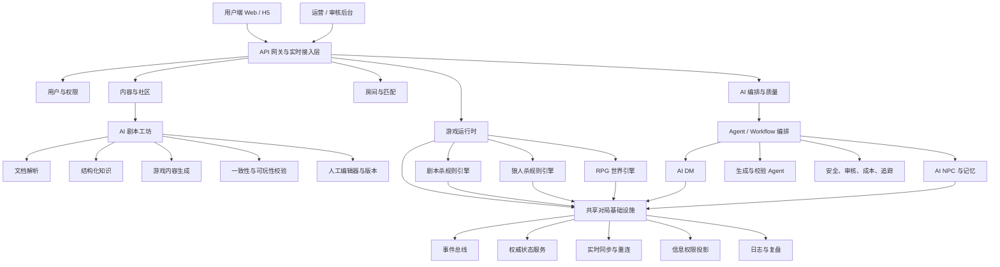
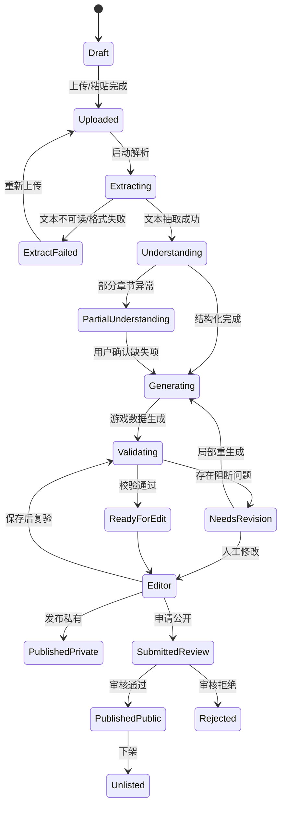
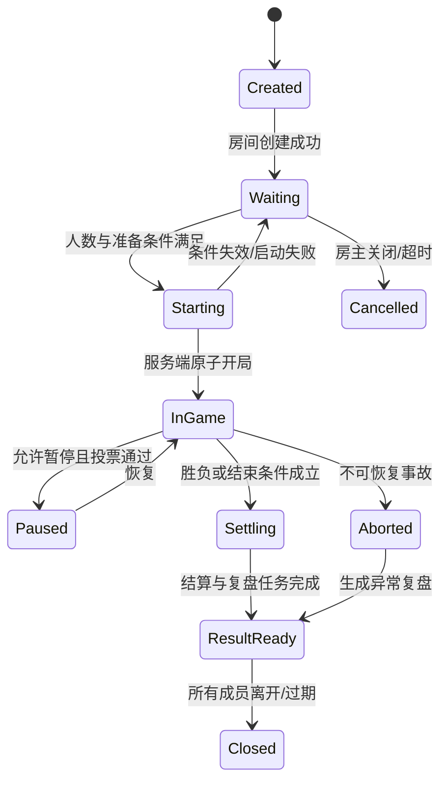
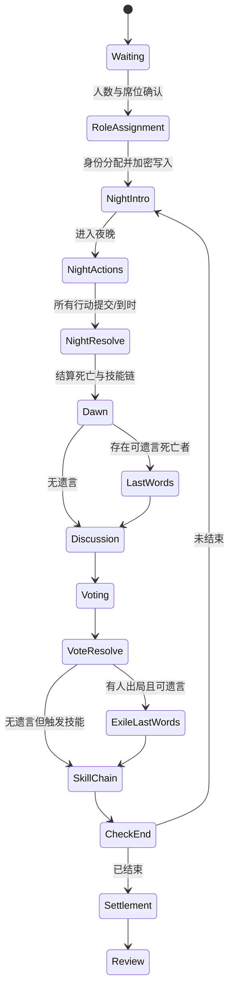
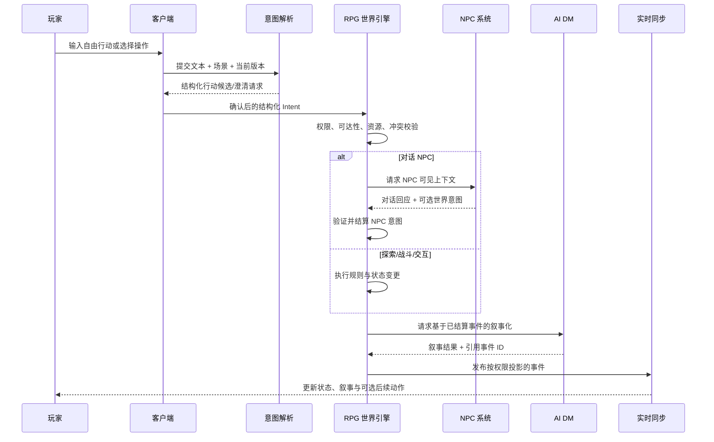
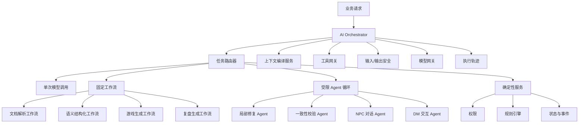
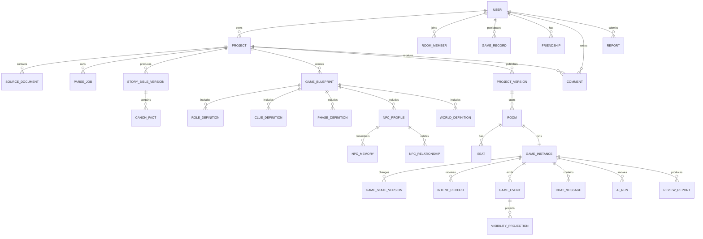

# 谜境 MysteryVerse 产品需求文档（PRD）

> 文档版本：v1.0
> 文档状态：可评审基线版
> 产品阶段：0-1 产品定义与 MVP 立项基线
> 适用对象：产品、设计、前端、后端、算法、数据、测试、运营、内容审核、法务
> 目标：作为 TECH_DESIGN、数据库设计、API 设计、前端开发、后端实现与验收的共同依据

> **2026-11-21 技术基线补充**：产品范围继续以本文为准；技术实现冲突以
> `docs/decisions/README.md` 的 Accepted ADR 和
> `docs/architecture/system-architecture.md` 为准。
> Proposed ADR 只是待确认候选，不得视为已批准实现。
>
> 产品语境中的 `Project` 在实现中统一映射为 `script`；正式 DTO、数据库字段、
> API 路径和生成类型使用 `script/scriptId/script_id`。

---

## 0. 文档使用说明

### 0.1 需求优先级

| 标记 | 定义 |
| --- | --- |
| P0 | 缺失会导致核心闭环不可运行，MVP 必须交付 |
| P1 | 显著影响体验、留存或运营效率，MVP 后第一阶段补齐 |
| P2 | 增强型能力，可随规模增长逐步建设 |
| P3 | 探索型能力，不进入当前承诺范围 |

### 0.2 本文档中的确定性约束

以下表述为强制要求：

- **必须**：上线验收不可缺失。
- **应该**：除非有明确技术或商业理由，否则应实现。
- **可以**：非阻塞增强能力。
- **不得**：安全和一致性红线，任何实现方式都不可突破。

### 0.3 已明确产品假设

下列内容是为支撑 PRD 落地的产品假设，不代表已经确认的商业决策：

| 编号 | 假设 | 影响 | 状态 |
| --- | --- | --- | --- |
| A-01 | 首发以响应式 Web 为主，桌面端优先，移动浏览器支持核心游戏流程 | 前端架构、性能预算 | 待业务确认 |
| A-02 | MVP 仅提供文字聊天；语音交互在 Phase 3 评估 | 实时通信、成本、审核 | 已作为当前规划假设 |
| A-03 | MVP 剧本杀单房间支持 4-8 名真人玩家，具体人数由剧本配置 | 房间与角色约束 | 待内容验证 |
| A-04 | MVP 不提供 AI 代替真人玩家补位；AI 仅承担 DM、NPC 与生成任务 | 玩法边界 | 待业务确认 |
| A-05 | 狼人杀在 Phase 2 首发经典 6-12 人局，不覆盖全部民间变体 | 规则引擎范围 | 待业务确认 |
| A-06 | 首发部署于单区域，后续通过区域化集群支持跨区域低延迟 | 运维与合规 | 待技术确认 |
| A-07 | 商业模式、付费点、创作者分成不进入 MVP 承诺范围 | 版本范围 | 待商业确认 |
| A-08 | 用户生成内容需经过机器审核与人工抽查；具体年龄分级与实名要求按运营地区法规确定 | 合规与内容策略 | 待法务确认 |
| A-09 | AI 生成质量采用“确定性规则优先、模型评测辅助、人工抽检兜底”的策略 | 算法与测试 | 已确定为设计原则 |
| A-10 | 游戏真相、角色身份、技能结果、投票和胜负均不交给 LLM 自由决定 | 核心架构 | 已确定为强制原则 |

### 0.4 待确认事项

| 编号 | 待确认问题 | 默认处理方式 | 决策截止点 |
| --- | --- | --- | --- |
| Q-01 | 首发登录方式采用手机号、邮箱、第三方账号还是组合方式 | MVP 先预留统一身份接口，至少实现一种主登录方式 | 技术方案评审前 |
| Q-02 | 首发目标市场与内容分级标准 | 按中国大陆合规基线设计，保留区域配置能力 | 视觉与内容生产前 |
| Q-03 | MVP 是否允许公开上传未经授权的完整商业剧本 | 默认禁止，仅允许自有、授权或原创内容 | 剧本工坊上线前 |
| Q-04 | 剧本社区是否允许付费交易 | MVP 不允许，只支持免费分享和私有发布 | Phase 3 立项前 |
| Q-05 | AI 生成是否向用户展示模型供应商与成本信息 | 不直接展示供应商，仅展示生成状态、耗时与配额 | 商业化评审前 |
| Q-06 | 是否允许自定义规则变体 | MVP 只允许配置人数、时长、难度，不允许改核心胜负规则 | 狼人杀设计评审前 |
| Q-07 | 跨局持久世界是否共享给陌生人 | Phase 3 默认仅好友或房间成员可见，公开共享需单独授权 | Phase 3 设计前 |
| Q-08 | 用户删除剧本后，历史游戏复盘是否保留 | 默认保留脱敏后的游戏日志，剧本正文与私密内容可撤回 | 数据方案评审前 |

### 0.5 章节索引

| 章节 | 内容 |
| --- | --- |
| 1-6 | 产品定义、愿景、定位、用户、痛点与场景 |
| 7-8 | 功能架构与信息架构 |
| 9 | 用户、内容、房间、AI、交互、社区、复盘后台详细需求 |
| 10 | 剧本杀、狼人杀、RPG 三套业务流程与状态机 |
| 11 | AI Agent、上下文、成本、异常、trace 与评测 |
| 12 | 10 项核心业务规则及处理流程 |
| 13 | 权限模型、数据分级和信息隔离 |
| 14 | 18 个页面的交互、状态与后端业务逻辑 |
| 15 | 数据对象、事件信封与保留策略 |
| 16 | 性能、安全、隐私、并发、可观测性等非功能需求 |
| 17 | Phase 1 至 Phase 3 的范围、依赖、验收和风险 |
| 18 | 功能优先级 |
| 19 | 发布门槛与验收标准 |
| 20 | 风险矩阵、红线和治理机制 |
| 附录 | 术语、概念 API、实时事件、技术交接与评审签署 |

---

## 1. 产品概述

### 1.1 产品定义

「谜境 MysteryVerse」是一个 AI Native 的多人互动推理游戏平台。平台共享用户、内容解析、AI 角色、房间、实时通信和复盘基础设施，同时为三种玩法提供独立规则引擎：

1. **AI 剧本杀**：将授权或原创剧本转换为多人可玩的推理游戏，由确定性流程引擎驱动阶段与胜负，AI DM 负责叙事、答疑和氛围表达。
2. **AI 狼人杀**：支持真人与 AI 玩家混合组局，身份、夜间行动、技能、投票和胜负由独立狼人杀规则引擎裁决。
3. **沉浸式互动 RPG**：将小说、故事或原创世界观转换为可探索世界，支持自由行动、NPC 对话、任务、分支剧情、多结局与多人共享世界。

平台的核心差异不是“让 AI 聊天”，而是建立以下完整流水线：

> 原始故事 → 结构化知识 → 可验证的游戏数据 → 多人实时对局 → 确定性裁决 → AI 叙事表达 → 复盘与再创作

### 1.2 产品解决的问题

传统多人推理内容存在四类主要问题：

- **创作门槛高**：剧本写作、角色平衡、线索设计和主持人培训成本高。
- **组织成本高**：真人组局、约时间、找 DM、讲解规则和管理流程繁琐。
- **内容消费效率低**：大量小说和世界观只能被阅读，无法被玩家探索和改变。
- **AI 体验不可信**：聊天式 AI 容易遗忘、泄露秘密、违背设定、无法稳定判定规则。

谜境通过结构化生成、服务端信息隔离、确定性规则引擎和可追溯 AI 运行时解决上述问题。

### 1.3 核心价值

| 对象 | 核心价值 |
| --- | --- |
| 玩家 | 更低成本地组局，获得稳定主持、沉浸叙事、公平裁决与可复盘体验 |
| 创作者 | 将小说、剧本和世界观快速转换为可玩内容，获得局部修改与版本管理能力 |
| 好友群体 | 通过邀请链接或房间码快速开始一局，断线后可恢复 |
| 平台运营 | 建立可审核、可分析、可推荐、可持续扩展的互动内容生态 |

### 1.4 产品范围

#### 本 PRD 覆盖

- 用户与身份体系。
- 首页、大厅、内容详情、社区基础能力。
- 剧本导入、解析、结构化、生成、校验、人工编辑、发布。
- 三种独立游戏模式及各自的规则引擎。
- 房间、实时通信、断线重连、暂停恢复。
- AI DM、AI NPC、上下文与记忆、信息权限隔离。
- 结算、复盘、历史记录与运营后台需求边界。
- 安全、合规、成本、可观测性和质量评测。
- Phase 1 至 Phase 3 的范围、依赖、验收与风险。

#### 本 PRD 不覆盖

- 具体视觉稿与品牌手册。
- 精确模型选型、参数和供应商采购。
- 具体数据库表结构与 API Schema。
- 付费、结算、分成和广告系统。
- 语音、视频与虚拟形象实现。
- 原生 iOS/Android 客户端。
- 赛事、公会、直播和 KOL 运营后台。

### 1.5 成功指标

#### 北极星指标

**周成功完成并生成有效复盘的多人游戏局数（Completed Sessions per Week）**

有效对局需满足：至少达到最低真人玩家数、完成核心阶段、产生结算记录且无重大权限或公平性事故。

#### 第一阶段核心指标

| 指标 | MVP 目标 | 说明 |
| --- | --- | --- |
| 新手首局完成率 | ≥ 60% | 注册后 7 天内完成一局 |
| 房间有效开局率 | ≥ 75% | 创建房间后进入至少一次有效对局 |
| 对局完成率 | ≥ 80% | 开始后正常到达结算 |
| 断线 60 秒内恢复成功率 | ≥ 95% | 有网络用户重连后恢复 |
| 剧本解析一次成功率 | ≥ 90% | 不经过人工重试完成结构化 |
| 关键事实抽取抽检准确率 | ≥ 95% | 人物、关系、时间线、核心事件 |
| 私密信息越权事故 | 0 | 严重安全指标 |
| 结算复盘生成成功率 | ≥ 98% | 可自动生成或降级为模板 |
| 实时操作 P95 确认延迟 | ≤ 300 ms | 不含模型生成耗时 |
| 单局 AI 成本 | 有明确预算上限并可持续监控 | 具体阈值在成本评审中确认 |

---

## 2. 产品愿景

### 2.1 长期愿景

让任何可被讲述的故事，都能被转换为可探索、可推理、可互动、可改变剧情的多人游戏世界。

### 2.2 三年愿景拆解

| 阶段 | 愿景表述 | 业务含义 |
| --- | --- | --- |
| 第一年 | 成为稳定可玩的 AI 多人剧本杀平台 | 证明 AI 可可靠主持、玩家愿意完成对局 |
| 第二年 | 成为多模式 AI 社交推理游戏平台 | 剧本杀、狼人杀、RPG 共享用户与内容资产 |
| 第三年 | 成为故事到互动世界的创作与消费平台 | 形成创作者、内容、社区和数据飞轮 |

### 2.3 产品原则

1. **规则可信优先于生成自由**：涉及公平、身份、权限和胜负的内容必须可验证。
2. **玩家体验优先于 Agent 炫技**：能用单次模型调用解决的任务，不拆成多 Agent。
3. **信息隔离优先于回答丰富**：AI 不知道的秘密，不能通过提示词诱导获得。
4. **内容可控优先于速度**：生成失败可回滚，不能以不可信内容直接开局。
5. **人工修正优先于盲目重试**：对高价值剧本提供局部编辑、对比和版本回退。
6. **渐进发布优先于一次性大而全**：MVP 只保证剧本杀闭环，不提前承担三模式复杂度。

---

## 3. 产品定位

### 3.1 一句话定位

一个把故事、小说和原创世界观转换为可多人游玩的 AI 推理游戏平台。

### 3.2 Slogan

「每个故事，都是一个世界。每个选择，都可能改变真相。」

### 3.3 竞争替代关系

| 替代方式 | 用户当前问题 | 谜境差异 |
| --- | --- | --- |
| 线下剧本杀 | 组局难、DM 质量不稳定、地点与时间受限 | 在线组局、AI DM 持续可用、可复盘 |
| 传统在线狼人杀 | 缺局、托管体验差、复盘信息有限 | 真人与受控 AI 混合、结构化复盘 |
| AI 聊天角色扮演 | 记忆弱、规则弱、秘密容易泄露 | 角色记忆分层、规则引擎、世界状态持久化 |
| 互动小说 | 选择固定、多人协作弱 | 自由意图解析、多人世界状态、AI 动态反馈 |
| 内容创作工具 | 只生成文本，不形成可玩产品 | 从解析到发布、房间、运行和复盘的完整闭环 |

### 3.4 差异化壁垒

- 故事知识图谱与游戏规则数据之间的可验证转换层。
- 面向不同角色、不同阶段的信息切片与权限隔离。
- 三种玩法各自独立、可演进的规则引擎。
- 可追溯、可评测、可回滚的 AI 运行时。
- 对局数据反哺内容质量、推荐与创作者工具。

### 3.5 品牌与体验边界

产品应营造“进入一个世界”的沉浸感，但界面不得为视觉效果牺牲可读性、状态可见性和关键操作效率。游戏页优先呈现当前阶段、可执行动作、剩余时间、团队状态和线索入口。

---

## 4. 目标用户画像

### 4.1 核心用户

| 画像 | 特征 | 主要需求 | 关键阻碍 |
| --- | --- | --- | --- |
| 社交推理玩家 | 18-35 岁，玩过狼人杀、剧本杀或推理游戏，每周 1-3 次组局 | 快速开局、公平规则、好友协作、复盘讨论 | 等人久、DM 质量不稳定、被剧透 |
| 故事创作者 | 写小说、同人或世界观设定，希望作品被体验 | 低门槛转换、角色与线索可控、版本管理、作品展示 | 不懂游戏设计、AI 结果不可控 |
| 轻量剧情玩家 | 喜欢互动小说、悬疑和角色扮演，但不愿学习复杂规则 | 单人或小规模进入、明确引导、自由选择 | 操作复杂、AI 遗忘、选择无意义 |
| 好友群体 | 2-8 人固定社交圈，使用语音或文字共同娱乐 | 房间邀请、快速加入、断线恢复、私聊 | 时间难协调、平台切换成本高 |

### 4.2 次要用户

| 画像 | 需求 |
| --- | --- |
| 内容运营与审核人员 | 内容上架、下架、审核、举报处理、推荐配置 |
| 专业剧本作者/DM | 高级编辑、局部重生成、试玩、版本对比、发布管理 |
| 狼人杀进阶玩家 | 身份变体、严格计时、发言顺序、投票与技能日志 |
| 世界观运营者 | 持续维护世界设定、事件和 NPC，形成长期内容 |

### 4.3 用户非目标

- 只想与单个 AI 进行无状态闲聊的用户。
- 期望 AI 自动替代全部真人社交的用户。
- 需要大型开放世界 3D 动作体验的用户。
- 需要专业虚拟主播或实时语音克隆能力的用户。

---

## 5. 用户核心痛点

| 痛点 | 场景 | 当前后果 | 产品机会 |
| --- | --- | --- | --- |
| 组局成本高 | 好友约剧本杀，需要找 DM、场地、统一时间 | 很难成局 | 一键房间、邀请、准备与自动主持 |
| 剧本理解成本高 | 玩家阅读长角色本，DM 需要手动讲规则 | 开局慢、体验不一致 | 角色化摘要、阶段化信息释放、AI 答疑 |
| AI 不可信 | AI 遗忘人物关系、泄露凶手、随意改规则 | 破坏公平与沉浸 | 知识图谱、权限切片、规则引擎 |
| 线索不可推导 | 作者线索设计不足或 AI 随意生成 | 玩家无法得到合理结论 | 可推导性校验、死局检测、人工修正 |
| 断线破坏对局 | 网络抖动后无法同步状态 | 对局中断、争议 | 权威状态、事件序列、快速重连 |
| 原创内容难转化 | 作者有故事但不懂游戏化 | 只能停留在文本 | 可配置生成、局部编辑与试玩 |
| 复盘价值低 | 游戏结束后缺少完整行动链 | 无法学习或讨论 | 结构化时间线、推理路径与 AI 点评 |
| 内容发现困难 | 用户不知道玩什么 | 流失 | 标签、筛选、推荐、官方精选 |

---

## 6. 核心使用场景

### 6.1 场景 A：系统剧本快速开局

玩家在首页选择官方悬疑剧本，查看人数、时长与难度，创建带密码房间并邀请好友。全员准备后，系统分配角色，玩家阅读个人剧本。AI DM 介绍背景，玩家依次搜证、私聊、公聊、质询与投票。游戏结束后系统揭示真相并生成复盘。

### 6.2 场景 B：上传原创剧本并转换为游戏

作者上传 DOCX 剧本，选择 6 人、90 分钟、社会派推理。系统解析并展示人物、关系、时间线和潜在风险。作者修正两个矛盾事件，替换一张无效线索卡，完成试玩后发布为公开剧本。

### 6.3 场景 C：好友与 AI 混合狼人杀

6 名真人玩家和 3 名 AI 玩家进入经典狼人杀房间。夜晚由规则引擎结算行动，AI 玩家只获得自己身份允许的信息。白天 AI 按自身人格发言与投票，主持人由脚本化状态机和 AI 播报共同完成。结束后复盘显示每轮行动、公开发言与 AI 决策依据。

### 6.4 场景 D：共同探索 RPG 世界

4 名玩家进入某原创科幻世界。玩家 A 与黑市商人谈判，玩家 B 发现地下通道，玩家 C 在另一个地点触发警报。世界引擎将行动统一结算，更新城市警戒度与商人态度，并影响后续任务。所有变化以公共世界状态广播，个人关系与记忆按玩家分别保存。

### 6.5 场景 E：断线恢复

剧本杀搜证阶段，玩家网络中断 40 秒。客户端重连后拉取最新状态快照与缺失事件，恢复私人线索、剩余时间和可执行动作；房间内其他玩家看到“重连中”，不会重复执行该玩家已提交的操作。

### 6.6 场景 F：生成失败与人工修正

AI 在一致性校验阶段发现“嫌疑人的作案时间与其已死亡时间矛盾”。系统阻止发布，将问题定位到事件与角色卡，作者使用局部重生成修复时间线。修复后再次校验通过，生成新版本，旧版本仍可回退。

---

## 7. 产品功能架构图



### 7.1 分层职责

| 层级 | 职责 | 禁止承担的职责 |
| --- | --- | --- |
| 表现层 | 页面、交互、状态展示、输入校验 | 不得作为权限或胜负判定依据 |
| 接入层 | 鉴权、限流、幂等、协议转换 | 不得持有游戏真相 |
| 业务服务层 | 用户、内容、房间、剧本生命周期 | 不得绕过信息权限直接返回实体全量数据 |
| 游戏运行时层 | 状态机、行动裁决、事件序列、结算 | 不得由 LLM 自由改写规则结果 |
| AI 编排层 | 自然语言理解、叙事生成、角色演绎、辅助评测 | 不得成为身份、权限、技能与胜负的权威来源 |
| 数据层 | 事务数据、事件日志、对象存储、向量索引 | 不得将私密数据放入无隔离的公共检索索引 |
| 运营层 | 审核、配置、干预、报表 | 每次干预必须审计并可回放 |

---

## 8. 完整信息架构

### 8.1 一级导航

| 全局区域 | 内容 |
| --- | --- |
| 顶部导航 | Logo、首页、游戏大厅、社区、创作工坊、搜索、通知、个人菜单 |
| 主内容区 | 根据路由呈现页面 |
| 全局辅助 | 客服/帮助、反馈、网络状态、版本信息 |

### 8.2 路由与页面树

```text
/
├── /home                         首页
├── /auth                         登录注册
├── /lobby                        游戏大厅
├── /scripts/:scriptId            剧本详情
├── /community                    内容社区
├── /workshop                     创作工坊首页
│   ├── /workshop/import          文档导入 / 创意输入
│   ├── /workshop/:jobId/progress 解析进度
│   └── /workshop/:draftId/edit   剧本编辑器
├── /rooms/create                 创建房间
├── /rooms/:roomId/waiting        房间等待
├── /play/murder/:roomId          剧本杀游戏
├── /play/werewolf/:roomId        狼人杀游戏
├── /play/rpg/:roomId             RPG 世界
├── /play/:roomId/npc/:npcId      NPC 对话
├── /play/:roomId/result          结算
├── /play/:roomId/replay          复盘
├── /me                           个人中心
│   ├── /me/history               游戏历史
│   ├── /me/scripts               我的剧本
│   ├── /me/achievements          成就
│   └── /me/friends               好友
└── /admin                        运营后台
    ├── /admin/content            内容审核
    ├── /admin/reports            举报处理
    ├── /admin/generation         生成任务与质量
    └── /admin/incidents          运行时事故
```

### 8.3 各页面访问角色

| 页面 | 游客 | 登录用户 | 房主 | 玩家 | 创作者 | 运营 |
| --- | --- | --- | --- | --- | --- | --- |
| 首页 | 可访问 | 可访问 | 可访问 | 可访问 | 可访问 | 可访问 |
| 登录注册 | 可访问 | 跳转首页 | - | - | - | - |
| 游戏大厅 | 浏览受限 | 可访问 | 可访问 | 可访问 | 可访问 | 可访问 |
| 剧本详情 | 浏览公开内容 | 可访问 | 可访问 | 可访问 | 可访问 | 可访问 |
| 创作工坊 | 引导登录 | 可访问 | 可访问 | 可访问 | 可访问 | 可访问 |
| 解析进度 | 不可访问 | 仅本人/协作成员 | - | - | 可访问 | 只读审计 |
| 剧本编辑器 | 不可访问 | 仅本人/协作成员 | - | - | 可访问 | 审核只读 |
| 创建房间 | 引导登录 | 可访问 | 可访问 | 可访问 | 可访问 | 可访问 |
| 房间等待 | 邀请后先登录 | 成员可访问 | 管理权限 | 成员只读/准备 | 成员权限 | 不进入玩家房 |
| 游戏页 | 不可访问 | 房间成员 | 成员权限 | 角色权限 | 成员权限 | 事故只读旁路 |
| NPC 对话 | 不可访问 | 房间成员 | 成员权限 | 角色权限 | 成员权限 | 不提供 |
| 结算/复盘 | 不可访问 | 参与成员/授权围观 | 成员权限 | 成员权限 | 成员权限 | 审计只读 |
| 个人中心 | 不可访问 | 本人 | 本人 | 本人 | 本人 | 受控查询 |
| 历史记录 | 不可访问 | 本人 | 本人 | 本人 | 本人 | 受控查询 |
| 社区 | 浏览公开内容 | 可互动 | 可互动 | 可互动 | 可发布 | 可管理 |

---

## 9. 各模块详细需求

### 9.1 用户系统

#### 9.1.1 目标

建立统一身份、社交关系、内容归属和游戏历史，使同一用户可以在三种模式间共享等级、好友与内容资产。

#### 9.1.2 功能需求

| 编号 | 功能 | 优先级 | 需求说明 |
| --- | --- | --- | --- |
| U-01 | 注册 | P0 | 支持至少一种主登录方式，具体方式按 Q-01 决策；注册时需同意用户协议与隐私政策 |
| U-02 | 登录/退出 | P0 | 支持主动退出与全部设备登出；敏感操作需重新验证 |
| U-03 | 游客浏览 | P0 | 游客可浏览公开首页、剧本详情和社区；进入房间、游戏、创作前必须登录 |
| U-04 | 个人资料 | P0 | 昵称、头像、简介、偏好语言、内容偏好；昵称需唯一或允许重复时显示用户编号 |
| U-05 | 账号安全 | P0 | 登录态管理、异常设备提示、频率限制、找回入口 |
| U-06 | 等级与经验 | P1 | 完成对局、有效复盘、创作通过审核可获得经验；不得通过刷空局无限获取 |
| U-07 | 游戏记录 | P0 | 按时间、模式、剧本、结果筛选；只显示用户有权查看的历史 |
| U-08 | 好友系统 | P1 | 搜索用户、好友申请、同意/拒绝、备注、删除、拉黑；MVP 可先支持邀请链接，不阻塞开局 |
| U-09 | 房间邀请 | P0 | 生成房间链接/房间码；被邀请者登录后可加入；邀请不绕过房间密码和人数限制 |
| U-10 | 成就与统计 | P1 | 统计场次、胜率、角色偏好、推理正确率、创作数据；敏感统计仅本人可见 |
| U-11 | 隐私设置 | P0 | 控制个人主页、历史记录、在线状态、好友申请和战绩可见范围 |
| U-12 | 多端登录 | P1 | 默认允许多设备登录但限制同一账号同时进入同一玩家席位 |

#### 9.1.3 业务规则

- 玩家身份以平台 `userId` 为主键，不以昵称作为权限标识。
- 同一房间内一个 `userId` 只能占据一个玩家席位；如需观战，使用独立观战权限。
- 被拉黑用户不得发送好友申请、游戏邀请或私聊；若双方已在同一房间，仅保留必要的公共游戏交互。
- 游戏历史默认对参与成员可见摘要；完整私密角色本、私人聊天和私人线索仅本人及合规审计角色可见。
- 用户注销采用冷静期和可撤回机制；游戏日志、版权证明、审核记录按法规与争议处理需要保留的，需明确告知保留范围。

#### 9.1.4 验收标准

- 未登录用户直接访问房间、游戏或编辑器时，登录后能返回原目标，不丢失房间邀请上下文。
- 同一账号使用两个标签页加入同一房间时，第二个席位请求被拒绝并给出明确提示。
- 用户无法通过修改 `userId`、房间号或前端参数读取他人历史、私聊或角色信息。
- 退出登录后，浏览器无法继续通过旧 WebSocket 连接发送游戏操作。
- 拉黑关系对好友申请、邀请与私聊的约束在服务端生效。

---

### 9.2 首页与游戏大厅

#### 9.2.1 首页目标

让用户在 10 秒内理解平台可玩内容并进入下一步：开始推荐剧本、加入房间、继续上次进度或进入创作工坊。

#### 9.2.2 首页功能

| 编号 | 功能 | 优先级 | 需求说明 |
| --- | --- | --- | --- |
| H-01 | 模式入口 | P0 | 剧本杀、狼人杀、RPG 三个独立入口；未开放模式显示“即将开放”而不是可点击空页 |
| H-02 | 继续游玩 | P0 | 若存在进行中或未完成房间，优先展示恢复入口、角色和剩余阶段 |
| H-03 | 推荐剧本 | P0 | 基于热门、官方精选、新上架和用户偏好组合；推荐不得泄露私密内容 |
| H-04 | 热门世界 | P2 | 展示 RPG 持久世界、公开状态摘要与可加入状态 |
| H-05 | 最近游玩 | P0 | 最近剧本、房间和历史复盘入口 |
| H-06 | 官方精选 | P0 | 运营可配置 Banner、专题和内容集合 |
| H-07 | 用户原创与 AI 生成 | P1 | 用清晰来源标识区分官方、作者原创、AI 辅助生成 |
| H-08 | 搜索 | P0 | 按剧本名、作者、标签检索；支持搜索结果高亮与无结果建议 |
| H-09 | 分类筛选 | P0 | 模式、题材、人数、时长、难度、语言、内容分级、是否免费、是否可单人/多人 |

#### 9.2.3 大厅功能

- 卡片展示封面、标题、模式、人数、预计时长、难度、题材标签、评分和最近开玩人数。
- 支持列表与网格视图；筛选条件写入 URL，保证刷新和分享后保持。
- 支持“快速加入”时，系统只推荐公开、未开局、人数未满且玩家权限满足的房间。
- 支持按房间状态筛选：等待中、可加入、进行中不可加入、私人房间需房间码。
- 排序至少包括推荐、最新、热门、评分、时长。

#### 9.2.4 业务规则

- 搜索与推荐只索引公开或授权可见内容；私人剧本不得出现在公共搜索。
- 推荐排序中不得使用未脱敏的角色秘密、最终真相或玩家隐私作为特征。
- 展示的预计时长应来自剧本配置和最近有效对局中位数，两者差异过大时标注“实际时长可能波动”。
- 内容下架后，历史房间可只读复盘，但不能创建新房间。

#### 9.2.5 验收标准

- 首页在无推荐、接口失败和用户无历史时均有可用降级内容。
- 进行中房间可从首页两次点击内恢复。
- 所有筛选组合刷新页面后保持状态，非法筛选值自动回退并提示。
- 私人、已下架或无权访问剧本不会通过搜索、推荐或直接 URL 暴露详情。

---

### 9.3 AI 剧本工坊

#### 9.3.1 产品目标

将长文本或创意输入转化为经过校验、可编辑、可版本化的游戏内容。工坊不是一个“生成按钮”，而是受控的创作流水线。

#### 9.3.2 创建入口

| 创建方式 | 输入 | 适用模式 | MVP |
| --- | --- | --- | --- |
| 上传剧本 | PDF、DOCX、TXT、Markdown | 剧本杀优先 | 是 |
| 粘贴文本 | 最长由配额决定 | 全部 | 是 |
| 纯创意生成 | 主题、人物、冲突、目标人数、时长、风格 | 剧本杀/RPG | 是，受配额和审核限制 |
| 世界观导入 | 设定集、人物志、地点与势力 | RPG | Phase 2 |
| 空白结构编辑 | 使用模板手动搭建 | 全部 | P1 |

#### 9.3.3 基础配置

用户在启动生成前必须确认：

- 目标模式：剧本杀 / 狼人杀 / RPG。
- 内容权利声明：原创、已授权、公版或仅私人试玩。
- 玩家数量或范围。
- 目标时长：短局、标准局、长局或自定义。
- 难度：入门、标准、进阶、硬核。
- 剧情风格：悬疑、恐怖、科幻、奇幻、社会派、轻喜剧等，可多选但需主风格。
- 语言与内容分级。
- 是否允许 AI 补充缺失情节。
- 是否允许使用用户输入之外的通用素材。

#### 9.3.4 生成流水线状态



#### 9.3.5 阶段一：文档解析

必须输出：

- 原始文件元信息：格式、页数、字符数、语言、校验哈希。
- 章节树与文本块定位。
- 可读性报告：乱码、空页、OCR 必要性、表格/图片说明缺失。
- 人物候选、地点候选、物品候选、事件候选。
- 解析置信度与失败片段。

处理规则：

- PDF 优先读取文本层；无文本层时进入 OCR 任务，OCR 结果需保留页级来源。
- DOCX 需解析标题层级、段落、表格、批注和脚注；批注默认视为作者说明，不自动作为玩家可见文本。
- 扫描件、加密文件、超限文件、受密码保护文件必须明确拒绝或转人工。
- 单文件上限、页数上限、字符上限和 OCR 配额由服务配置；超限时提示拆分，不能静默截断。

#### 9.3.6 阶段二：语义理解

必须形成结构化“故事圣经”：

- 人物：别名、身份、外貌、性格、目标、动机、公开信息、私密信息、能力边界。
- 关系：人物 A 对人物 B 的认知、情感、债务、冲突、秘密和证据来源。
- 事件：发生时间、地点、参与者、可见者、原因、结果、证据与矛盾点。
- 时间线：绝对时间、相对顺序、并行事件和不确定时间。
- 核心冲突：案件谜面、作案条件、误导项、可推导路径和最终真相。
- 世界观：规则、势力、地点、资源、禁忌和历史。
- 叙事结构：章节、幕、关键转折和信息释放节点。

每个事实必须携带来源定位：文件、页/段、原文片段哈希。无法定位的 AI 推断应标记为“生成补充”，不得伪装成原文事实。

#### 9.3.7 阶段三：游戏化转换

**剧本杀输出**

- 游戏元数据、阶段流程、人数范围、时长和难度。
- 玩家角色卡、个人剧本、目标、秘密、已知关系与私人线索。
- 公共背景、公共事件、搜证点、线索卡、质询规则。
- 凶手/阵营配置或非凶手型推理目标。
- 投票规则、平票规则、胜负条件和真相揭示顺序。
- 每个角色的信息权限矩阵。
- 主持人叙事节点与阶段播报模板。

**狼人杀输出**

- 身份列表、阵营、数量、技能、行动时机、结算优先级。
- 夜晚行动顺序、死亡与技能触发链、遗言规则。
- 发言顺序、计时、投票、平票和胜负条件。
- 若导入原始故事，仅生成主题、角色名、背景包装与发言人格；核心规则使用平台受控规则模板。

**RPG 输出**

- 世界规则、地图区域、场景连接、可达条件。
- NPC、势力、任务、道具、线索、隐藏事件和世界状态变量。
- 主线与支线节点、分支条件、多结局判定。
- 单人/多人可见状态、协作任务和冲突解决策略。
- 初始世界快照与持久化对象。

#### 9.3.8 阶段四：一致性验证

校验分为阻断、警告和信息三级。

| 类型 | 示例 | 处理 |
| --- | --- | --- |
| 阻断 | 凶手在案发前死亡；关键线索无法被任何角色获得；角色秘密与公共剧情绝对矛盾 | 禁止发布，定位并修复 |
| 警告 | 时长可能偏长；某线索冗余；某 NPC 目标较弱 | 可继续但需确认 |
| 信息 | 名称近似、风格不一致、未使用原文段落 | 供作者参考 |

必须执行的校验：

- 人物、关系、时间、地点、事件因果一致性。
- 案件真相与线索可推导性。
- 每个阶段的可执行动作和推进条件。
- 私密信息是否出现在他人角色卡、公共线索或 AI DM 默认上下文。
- 所有角色是否有目标、行动路径和必要信息。
- 是否存在无解、必败、无限循环或等待条件无法满足的死局。
- 内容安全、版权相似度和敏感内容检查。
- 生成数据 Schema 合法性、枚举合法性和引用完整性。

#### 9.3.9 阶段五：人工编辑

编辑器必须支持以下粒度：

- 重生成整个游戏。
- 重生成单个角色、关系、线索、事件、场景或任务。
- 锁定字段后局部重生成，锁定内容不得被 AI 修改。
- 手工新增、删除、复制和排序对象。
- 查看 AI 改动前后差异并逐项接受/拒绝。
- 在对象上直接查看校验问题和来源原文。
- 运行“结构检查”“可推导性检查”“隐私泄露检查”“试玩模拟”。
- 保存草稿、自动保存、显式版本命名和版本回退。
- 预览不同角色的可见内容，确认权限视图。

#### 9.3.10 阶段六：发布与版本

- 发布类型：私人、房间邀请、公开社区。
- 公开内容必须提交审核；私有内容也需通过基础安全与 Schema 校验。
- 每次发布生成不可变版本号；进行中房间固定使用开局版本，不因作者更新而改变。
- 作者下架后，进行中房间可完成；新房间不可创建。
- 作者删除剧本前需提示受影响的历史房间与复盘；删除采用软删除与保留策略。
- 支持从旧版本克隆新草稿，但不得篡改已有对局记录。

#### 9.3.11 生成失败、重试与回滚

- 每个阶段写入独立检查点和产物版本。
- 重试必须幂等，使用任务 ID 和阶段 ID 防止重复扣费或重复发布。
- 解析阶段失败可从上传文件重新开始。
- 结构理解失败可回退到文本抽取结果，由用户手工补全。
- 生成失败可保留上一成功版本，不覆盖当前可用草稿。
- 发布采用“校验成功 + 原子切换”方式，失败时指针仍指向旧版本。
- 对可重试错误采用有限指数退避；对不可重试错误给出可操作建议。
- 用户离开进度页后任务继续运行；完成后通知，但结果默认仍为草稿。

#### 9.3.12 验收标准

- 上传一份 8 万字、结构清晰的中文 DOCX，系统能提取章节、人物、事件和来源定位。
- 至少 90% 的有效测试文件在无人工输入下完成一次解析与结构化。
- 任何阻断级校验问题存在时，系统都无法发布剧本。
- 编辑器可以只重生成一个角色而不改变其他已锁定角色。
- 角色 A 的预览视图中无法看到角色 B 的私人剧本和秘密字段。
- 解析或生成任务超时后，用户可重试或从最近检查点恢复，且不会重复扣费。
- 旧版本剧本在更新后仍可用于已有历史对局回放。

---

### 9.4 游戏房间系统

#### 9.4.1 房间类型

| 类型 | 可见性 | 加入方式 | 适用 |
| --- | --- | --- | --- |
| 私人房间 | 仅成员 | 房间码/邀请链接 | 好友局 |
| 公开房间 | 大厅可见 | 快速加入/列表加入 | 社交匹配 |
| 密码房间 | 大厅可见但需密码 | 链接/码 + 密码 | 半公开局 |
| 单人剧情房间 | 仅本人 | 继续游戏 | RPG、轻量剧情 |
| 观战房间 | 受控 | 邀请或公开授权 | P2，不作为 MVP 必需 |

#### 9.4.2 功能需求

| 编号 | 功能 | 优先级 | 需求说明 |
| --- | --- | --- | --- |
| R-01 | 创建房间 | P0 | 选择剧本/世界、模式、人数、可见性、密码、时长与内容偏好 |
| R-02 | 加入房间 | P0 | 房间码、邀请链接、大厅加入；校验账号、黑名单、人数和状态 |
| R-03 | 准备状态 | P0 | 玩家独立准备；房主可开始前检查角色与人数是否匹配 |
| R-04 | 角色分配 | P0 | 支持随机分配；P1 支持房主手动安排但不得向房主泄露角色秘密 |
| R-05 | 房主权限 | P0 | 踢出等待中玩家、关闭房间、开始游戏、转移房主；局内高风险操作需二次确认 |
| R-06 | 人数限制 | P0 | 房间容量不得低于剧本最低人数或高于最大人数；空位可等待但不能开始 |
| R-07 | 游戏开始 | P0 | 服务端验证人数、准备状态、剧本版本、规则配置后原子创建对局 |
| R-08 | 暂停/恢复 | P0 | 剧本杀支持房主发起并需多数玩家同意；狼人杀夜晚和关键计时阶段默认不允许暂停；RPG 支持个人暂离但不暂停公共世界 |
| R-09 | 断线重连 | P0 | 保存席位，提供快照和增量恢复 |
| R-10 | 踢出/退出 | P0 | 等待阶段可退出；开局后不能自由退出，只能申请托管或放弃 |
| R-11 | 托管 | P1 | 掉线超时或主动开启后，按角色权限执行安全默认策略 |
| R-12 | 房主迁移 | P0 | 房主掉线超时或离开时自动转移给在线成员；无法转移时安全结束或转只读 |

#### 9.4.3 房间状态机



#### 9.4.4 业务规则

- 房间创建与开局采用服务端条件校验；客户端看到“可开始”不代表服务端最终允许。
- 开局前锁定剧本版本、规则配置、玩家席位和隐私协议版本。
- 等待房间超过配置时长可自动关闭；已进入游戏不因等待超时关闭。
- 房间号不得可枚举推导；私人房间链接 token 需具备有效期和撤销能力。
- 房主不能查看其他玩家的私人剧本、身份或秘密，手动分配仅操作“玩家-角色槽位”，不展示角色秘密。
- 踢出玩家仅在等待阶段允许；局内违规由举报、托管和运营事故流程处理。

#### 9.4.5 验收标准

- 两名玩家几乎同时争抢最后一个席位时，服务端仅一人成功，另一人获得清晰提示。
- 房间人数或准备状态变化时，“开始”按钮与后端结果一致。
- 已开局后，作者更新剧本不会改变当前房间数据。
- 房主掉线超时后，房主权限按确定规则转移，原房主重连后成为普通玩家。
- 同一开局请求重复提交不会创建两个对局或重复分配角色。

---

### 9.5 三种游戏运行时与共享基础设施

#### 9.5.1 共享基础设施

三种模式共享：

- 用户、好友、通知和邀请。
- 房间、席位、在线状态和实时通道。
- 剧本/世界内容读取与版本快照。
- 权限投影服务。
- 事件日志、幂等、审计、重连和复盘框架。
- AI 上下文编排、模型网关、成本与安全控制。
- 内容审核、举报和运营干预。

三种模式不共享：

- 核心状态机。
- 阶段与计时规则。
- 角色、身份、技能和胜负判定。
- 玩家可见面板结构。
- 游戏特定校验与复盘模型。

#### 9.5.2 规则引擎统一接口

每个规则引擎至少暴露以下内部契约：

```text
createGame(snapshot, seats, config) -> GameState
submitIntent(userId, intent, expectedVersion) -> DecisionResult
tick(serverTime) -> GameEvent[]
projectState(userId, GameState) -> UserVisibleState
checkEnd(GameState) -> EndResult | null
buildReplay(GameState, EventLog) -> ReplayModel
healthCheck() -> EngineHealth
```

所有意图必须包含：

- `roomId`、`gameId`、`userId`。
- `intentType`、结构化 payload。
- `expectedVersion` 或幂等键。
- 客户端时间仅用于诊断，不用于权威裁决。

所有决策结果必须包含：

- 接受/拒绝/延迟。
- 新状态版本。
- 产生的游戏事件。
- 对哪些角色可见的事件投影。
- 拒绝原因码。

#### 9.5.3 验收标准

- 三种模式可以分别启停规则引擎，不影响用户、房间和内容服务。
- 新增第四种模式时无需复制用户、房间和权限基础设施。
- 任意游戏操作均有服务端幂等机制。
- LLM 不可用时，确定性规则引擎仍能继续阶段、行动与结算。

---

### 9.6 AI 主持人系统

#### 9.6.1 职责边界

AI DM 负责：

- 规则解释和自然语言答疑。
- 剧情介绍、场景描写、阶段播报。
- 将结构化事件表达为符合世界观的叙事。
- 对玩家自由输入进行意图分类与澄清。
- 引导玩家使用合法操作，而非替代系统执行操作。
- 提供分级提示、氛围音效文案和阶段总结。
- 根据允许披露的信息生成结算叙事。

AI DM 不负责：

- 决定玩家身份。
- 决定技能是否命中。
- 计算投票、平票和胜负。
- 判断信息权限是否成立。
- 直接写数据库或跳过状态机。
- 读取未到揭示阶段的最终真相。

#### 9.6.2 输入上下文

AI DM 仅可接收：

- 当前模式、阶段、剩余时间和规则摘要。
- 当前阶段允许公开的事件与状态投影。
- 已公开线索、公开发言和必要的行为摘要。
- 与当前回答相关的角色公开信息。
- 由权限服务计算后的 `dm_allowed_knowledge`，而非完整真相库。
- 玩家意图文本与合法动作列表。

#### 9.6.3 输出协议

AI DM 返回结构化结果：

```json
{
  "speech": "面向玩家的自然语言",
  "intent": "explain_rule|narrate|hint|summarize|clarify|reject",
  "referenced_event_ids": ["evt_123"],
  "proposed_action": null,
  "visibility": "public|role_group|private",
  "safety_flags": []
}
```

`proposed_action` 只能作为提示，必须由规则引擎验证后执行。服务端不得直接执行模型生成的动作。

#### 9.6.4 降级策略

- 模型超时：使用阶段模板播报，规则操作继续可用。
- 模型输出违规：拒绝该次输出，回退模板并记录安全事件。
- 模型不可用：进入“模板主持模式”，阶段、线索和投票仍可完成。
- 高成本或高并发：简化为短文本播报与固定 FAQ，不阻塞核心流程。

#### 9.6.5 验收标准

- 规则解释不得与规则引擎当前配置冲突；冲突输出被检测并替换。
- DM 在真相揭示前无法说出被权限服务屏蔽的秘密实体。
- 模型断开后，剧本杀阶段仍可由模板主持推进到结算。
- 玩家要求 DM “直接判凶手”时，DM 应拒绝并引导使用投票/质询操作。
- 所有 DM 输出可追踪到注入的知识片段和模板版本。

---

### 9.7 AI NPC 系统

#### 9.7.1 NPC 数据模型

每个 NPC 至少具备：

- 身份、别名、外观与声音文字风格。
- 人格特质、价值观、情绪基线和表达习惯。
- 背景故事、当前目标、长期目标、禁忌。
- 公开信息、私密信息、已知事实、未知事实。
- 对其他人物和玩家的关系认知及态度分数。
- 记忆条目、记忆来源、置信度、形成时间和遗忘策略。
- 行为策略：合作、回避、试探、欺骗、求助、交易等。
- 可执行工具和可披露信息的白名单。

#### 9.7.2 NPC 对话流程

1. 客户端提交玩家对话或行动意图。
2. 服务端校验玩家是否在场景、NPC 是否在场、是否处于可对话状态。
3. 上下文编译器只检索该 NPC 有权知道的信息。
4. 对玩家输入进行提示词注入、违规内容和越权请求检测。
5. NPC 决策模块根据目标、关系、情绪和信息边界生成回应计划。
6. 自然语言层生成台词。
7. 输出检查器验证是否包含未授权秘密、与事实冲突或越权承诺。
8. 若回应包含世界改变，交给 RPG 世界引擎验证并结算。
9. 写入对话日志、记忆候选与关系变化。
10. 将可见回应和世界事件返回客户端。

#### 9.7.3 记忆规则

| 记忆类型 | 示例 | 保存策略 |
| --- | --- | --- |
| 情节事实 | 玩家救过 NPC | 长期保存，带来源事件 |
| 态度变化 | 信任 +10 | 保存为可解释的关系状态 |
| 对话摘要 | 玩家询问过地下通道 | 只保留与目标相关的摘要 |
| 承诺 | NPC 答应提供钥匙 | 转为任务/世界状态，而非仅依赖文本记忆 |
| 临时情绪 | 因被威胁而愤怒 | 短期衰减，可由后续行为改变 |
| 传闻 | 从其他 NPC 听来的信息 | 保留来源和置信度，不得当作事实 |

#### 9.7.4 业务规则

- 每个 NPC 使用独立上下文和独立工具权限，禁止共享“全知历史消息”。
- NPC 不得读取其未在场且无来源的事件。
- 玩家自述“我是你的主人”不会自动成为 NPC 已知事实，除非世界状态中存在依据。
- NPC 若发现玩家试图套取秘密，可按人格选择回避、误导、警告或结束对话，但不能泄露未授权信息。
- NPC 可生成新的台词和非关键氛围细节，但关键交易、任务、伤害、物品和世界状态变更必须由引擎确认。
- NPC 关系状态变化必须可追溯到事件或对话行为，不允许模型无依据大幅改变。

#### 9.7.5 验收标准

- 测试提示词注入集（直接索要秘密、角色扮演授权、伪造系统消息、要求忽略规则）不能取得未授权实体。
- NPC 在多个场景后仍记得已转为任务的关键承诺。
- NPC 不再“记得”已被设计为遗忘且无事件来源的临时对话。
- 同一事件发生后，在场 NPC 与不在场 NPC 的信息状态不同。
- NPC 对话中的世界动作必须产生结构化意图并通过 RPG 引擎。

---

### 9.8 游戏内交互系统

#### 9.8.1 通用能力

| 能力 | MVP | 说明 |
| --- | --- | --- |
| 公共聊天 | 是 | 按房间和阶段限制可见范围 |
| 私聊 | 是 | 仅剧本杀/狼人杀允许的阶段和对象可见；RPG 按场景决定 |
| 系统消息 | 是 | 阶段、行动、线索、投票、错误与重连 |
| 语音 | 否 | Phase 3 评估，需单独做权限、审核和录制策略 |
| 游戏日志 | 是 | 按时间与可见性展示行动和系统事件 |
| 状态面板 | 是 | 当前阶段、计时、动作、玩家状态 |
| 举报 | 是 | 可定位消息、玩家与事件 |
| 表情/快捷回复 | P1 | 降低输入负担，不得绕过阶段限制 |

#### 9.8.2 各模式特有交互

| 模式 | 交互 |
| --- | --- |
| 剧本杀 | 角色卡、个人剧本、公共/私人线索、搜证、质询、私聊、投票、DM 提示 |
| 狼人杀 | 身份卡、夜间行动、技能确认、发言计时、投票、遗言、死亡状态 |
| RPG | 地图、场景、移动、探索、NPC 对话、任务、道具、世界事件、多人协作 |

#### 9.8.3 消息与操作规则

- 每条消息带服务端 ID、游戏事件序号、发送者、可见范围和发送时间。
- 客户端不得自行生成“系统消息”或伪造行动结果。
- 禁言、阶段关闭聊天和仅队伍可见在服务端校验。
- 玩家发送消息失败时应保留草稿并显示重试，不得显示为已送达。
- 对高频输入进行速率限制和重复内容折叠。

#### 9.8.4 验收标准

- 不同可见范围的同一条底层事件只能投影给被授权成员。
- 私聊不会出现在其他玩家重连、历史日志或复盘接口中。
- 断线恢复不会重复显示消息或遗漏已确认事件。
- 被禁言玩家无法通过直接调用 API 绕过限制发送消息。

---

### 9.9 剧本与内容社区

#### 9.9.1 功能需求

| 编号 | 功能 | 优先级 | 需求说明 |
| --- | --- | --- | --- |
| C-01 | 官方剧本库 | P0 | 官方内容、精选专题、版本与上架状态 |
| C-02 | 用户原创库 | P1 | 展示作者、来源、AI 辅助程度、版本和授权声明 |
| C-03 | 评分 | P1 | 完成对局后可评分；限制刷分与同房间异常集中评分 |
| C-04 | 评论 | P1 | 支持文本、举报、删除本人评论和剧透标记 |
| C-05 | 收藏 | P1 | 收藏剧本/世界，支持分类 |
| C-06 | 分享 | P1 | 分享剧本详情或房间邀请；私人内容不可公开分享 |
| C-07 | 标签 | P0 | 题材、模式、人数、时长、难度、风格、内容提示 |
| C-08 | 版本管理 | P0 | 作者可查看版本、差异、状态和回退 |
| C-09 | 举报审核 | P0 | 举报分类、证据定位、审核队列、处置与申诉 |
| C-10 | 创作者主页 | P1 | 公开作品、简介、更新时间、已授权声明 |

#### 9.9.2 社区规则

- 评论必须区分“无剧透”和“含剧透”；含剧透内容默认折叠。
- 未完成对局的玩家不能对剧本真相进行公开发布；公共讨论需隐藏敏感实体。
- 评分权重可考虑完成率、游戏时长和异常行为，但不得公开推测个人身份。
- 下架内容在社区中显示统一不可用状态，不展示被删除正文。
- 作者不能删除他人合法评论，只能举报或回应。
- AI 辅助生成比例必须标注，不得以“纯人工创作”误导。

#### 9.9.3 验收标准

- 剧透评论在用户未完成对局时默认折叠，且不会出现在无剧透推荐流。
- 同一用户重复评分不产生多次有效计分。
- 举报后管理员可定位具体评论/剧本版本/对象字段。
- 下架剧本无法创建新房间，但已有合法复盘可按策略保留。

---

### 9.10 结算与复盘系统

#### 9.10.1 结算内容

剧本杀：

- 凶手/阵营与最终真相。
- 关键事件时间线。
- 投票结果与角色选择。
- 玩家推理摘要与关键线索使用情况。
- 案件可推导路径。
- 各角色目标完成情况。

狼人杀：

- 阵营胜负与触发条件。
- 每夜行动及结果。
- 白天发言摘要、投票与技能链。
- 死亡与遗言记录。
- 每名 AI 玩家的可见信息和行为摘要，不展示其不应公开的隐藏推理链。

RPG：

- 完成/失败任务、关键选择、世界状态变化。
- 多结局触发条件。
- NPC 关系变化摘要。
- 队伍贡献与关键事件。

#### 9.10.2 复盘模式

- 时间线回放：按阶段或世界时间查看事件。
- 角色视角切换：仅在结算后按隐私规则开放；真实身份可揭示，私聊是否公开需获参与者授权或按产品规则定义。
- 推理对照：玩家当时的判断、支持线索和最终真相。
- AI 行为解释：展示授权范围内的行动依据摘要，不暴露内部系统提示。
- 分享卡片：生成不含私密聊天和个人信息的战报。

#### 9.10.3 业务规则

- 结算结果以规则引擎为准；AI 复盘只能解释，不得改变胜负。
- 复盘生成失败时，先展示结构化规则结果，AI 点评异步补齐或降级隐藏。
- 玩家离开房间不自动失去复盘权限；隐私设置可限制其个人统计公开。
- 复盘中的公共分享必须二次脱敏，不得包含角色私人剧本全文。

#### 9.10.4 验收标准

- 对局结束后即使 AI 全部超时，用户仍可看到确定性结算结果。
- 复盘事件数与权威日志一致，无遗漏已结算关键行动。
- 分享卡片不包含私聊、私人线索、账号标识或未授权个人信息。
- 玩家可以从结算页进入完整复盘并从复盘返回历史列表。

---

### 9.11 运营与内容审核后台

#### 9.11.1 MVP 后台范围

- 用户查询与封禁/解封。
- 剧本审核、上架、下架和版本记录。
- 举报工单与证据查看。
- 生成任务查询、失败原因和重试状态。
- AI 成本、延迟、失败率、安全拦截看板。
- 对局事故排查：状态版本、事件日志、权限投影和模型调用摘要。
- 官方内容、标签、首页推荐位配置。

内测 MVP 可使用受控人工审核流程；公开 MVP 必须具备上架/下架、内容审核、
举报处理、用户禁言/封禁、事故查询、AI 内容审核和管理员审计能力。后台能力
不得通过玩家 API 或房主权限替代。

#### 9.11.2 审计规则

- 所有运营干预必须记录操作者、时间、对象、原因、前后状态。
- 查看玩家私密信息需最小权限、审批或双人复核；默认后台不展示完整私人聊天。
- 真相、角色秘密等敏感字段默认脱敏，仅事故处理角色可申请临时访问。
- 运营修改不得直接改写进行中游戏状态；只能暂停、终止或触发预案。

#### 9.11.3 验收标准

- 任意内容下架可追溯到审核记录和具体版本。
- 未经授权角色无法在后台搜索玩家私聊全文。
- 事故排查界面能按 `gameId` 定位权威事件、模型调用 trace 和可见性投影。
- 高风险操作需要二次确认并写入不可篡改审计日志。

---

## 10. 三种游戏模式的完整业务流程

### 10.1 AI 剧本杀

#### 10.1.1 端到端流程


#### 10.1.2 游戏阶段

MVP 使用平台标准剧本杀流程，但阶段数量、搜证轮次和是否允许私聊由剧本配置决定。不得将所有剧本强制成完全相同的玩法。

| 阶段 | 权威动作 | 玩家可见 | 推进条件 |
| --- | --- | --- | --- |
| 角色分配 | 规则引擎随机/按槽位分配，生成 private ACL | 只看到自己的角色槽位，不看到他人身份 | 全员收到角色卡 |
| 角色阅读 | 玩家阅读个人剧本，标记完成 | 个人剧本、目标、已知关系 | 全员完成或计时结束 |
| 开场 | AI DM 使用公开背景播报 | 公共背景、规则、阶段说明 | 播报完成或模板兜底 |
| 公共调查第 N 轮 | 开放指定搜证点；结算获得线索 | 公共线索、本人私人线索、剩余搜证次数 | 搜证次数用尽或到时 |
| 私聊 | 按剧本规则开放指定对象/时长 | 私聊双方可见；服务端记录不公开 | 时长结束 |
| 公共讨论 | 文本发言、质询、请求 DM 解释 | 公开发言、已公开线索 | 房主发起或计时结束 |
| 最终陈述 | 可选阶段，按顺序发言 | 公开发言 | 全员完成/计时结束 |
| 投票 | 所有有投票权玩家提交选择 | 投票进度，规则配置决定是否实时显示票数 | 全员提交/到时 |
| 结算 | 计算票数、平票、胜负和真相揭示 | 结果、真相、角色揭示 | 结算事务完成 |
| 复盘 | 生成事件时间线和 AI 点评 | 公开复盘与个人视图 | 权威结算已存在 |

#### 10.1.3 阶段配置约束

- 剧本必须声明开始节点、结束节点、每个节点的进入条件、退出条件和超时行为。
- 所有阶段必须有保底推进条件；不能依赖“玩家自觉点击下一步”。
- 搜证点必须绑定可见条件、可获得线索、冲突规则和次数限制。
- 私聊必须声明开放阶段、对象关系和最大时长。
- 投票必须声明有投票权角色、弃权规则、平票规则和揭示方式。
- 阶段配置中不得出现无法从当前状态抵达或无法离开的节点。

#### 10.1.4 搜证与线索

1. 玩家选择剧本允许的搜证点或对象。
2. 服务端校验阶段、角色权限、搜证次数和点位的可用状态。
3. 规则引擎原子扣减次数并写入搜证事件。
4. 线索按 `visibility` 投影为公共、角色、阵营或发现者私有。
5. AI DM 对已确认线索做氛围化描述，不得增加规则未授权的信息。
6. 已被取走的独占线索显示“已被发现”还是“仍可重复获得”由剧本配置决定。

平局冲突：

- 两名玩家同一时刻争抢最后一个独占线索时，以服务端接收顺序和版本条件裁决，仅一人成功。
- 落败玩家不扣次数，并收到“已被其他玩家取得”的可见提示。
- 若剧本要求不暴露取得者，则只显示点位状态，不显示取得者身份。

#### 10.1.5 投票与胜负

- 投票候选、投票权、弃权、改票和公开进度均来自剧本配置。
- 服务端以幂等投票事件记录最终选择；到时未投票按弃权处理。
- 平票行为必须预配置，可选方案包括：无人出局、加时再投、限定候选重投。
- 剧本杀胜负可以是“正确指认凶手”“完成阵营目标”“完成个人任务”或组合条件，必须显式定义。
- 宣布胜负前执行 `checkEnd`；不以 AI DM 的自然语言判断作为结果。

#### 10.1.6 AI DM 的提示机制

提示分为三级：

| 等级 | 内容 | 触发 |
| --- | --- | --- |
| L1 方向提示 | 重申当前阶段、可做动作、遗漏机制 | 玩家主动求助或长时间无操作 |
| L2 推理提示 | 指向已公开线索之间的关系，不揭示新事实 | 房间多数请求且未到关键结论 |
| L3 保底推进 | 直接说明推进方式，允许跳过争议环节 | 接近死局检测阈值 |

提示使用次数在全房间共享，并记录在复盘。AI 不得直接说出未公开人物、动机或真相。

#### 10.1.7 异常流程

- 玩家掉线：保留席位和私有视图，阶段按房间配置暂停或继续；重连后恢复。
- 房主掉线：等待宽限后自动转移；局内投票与准备规则不依赖房主个人在线。
- DM 模型失败：模板继续主持，线索和投票不阻塞。
- 玩家拒绝阅读角色本：计时结束可强制进入下一阶段，但界面持续显示阅读入口。
- 玩家全部弃票：按平票/弃票规则结算，不进入无限等待。
- 剧本版本被作者下架：进行中房间继续使用锁定版本。

#### 10.1.8 验收标准

- 4-8 名真人玩家可完成一局标准剧本杀，从创建房间到复盘无人工后台干预。
- 每个玩家只能读取本人角色本、私人线索和规则允许的私聊。
- 搜证冲突、重复投票、重复开始不会产生重复资源或重复结算。
- AI DM 不可用时，阶段、搜证、讨论计时、投票和结算仍可完成。
- 若最终真相无法通过已配置线索推导，发布前校验必须阻断。

---

### 10.2 AI 狼人杀

#### 10.2.1 端到端流程


#### 10.2.2 规则模板

Phase 2 首发使用版本化规则模板，不开放任意修改核心规则。模板至少包含：

- 模式：6/9/12 人经典局。
- 身份池：狼人、预言家、女巫、猎人、守卫、村民。
- 狼人胜利条件：默认“屠边”模板，具体以模板版本为准。
- 好人胜利条件：所有狼人出局。
- 平票规则：默认第一次平票进入 PK，第二次平票无人出局。
- 女巫救药/毒药是否同夜可用、守卫与救药同守同救规则由模板声明。
- 猎人被毒/被狼杀后是否可开枪由模板声明。
- 发言顺序、单轮时长、遗言时长和投票时长由房间配置。

上述默认值属于产品初始模板假设，上线前需由玩法策划和测试共同确认版本规则。

#### 10.2.3 状态机



#### 10.2.4 夜晚行动

标准结算采用“收集意图 → 批量排序 → 原子结算 → 生成事件 → 按角色投影”。

1. 规则引擎打开当前有行动权角色的行动窗口。
2. 真人通过受控 UI 提交；AI 玩家通过相同的结构化意图接口提交。
3. 服务端校验目标是否合法、药剂/技能是否可用、角色是否存活、是否已行动。
4. 规则引擎按模板顺序结算，处理保护、击杀、救药、毒药、查验等交互。
5. 生成夜晚结果事件，但仅向拥有对应知识的角色公开。
6. 天亮时发布公开死亡公告和规则允许的摘要。

AI 玩家行动必须满足与真人相同的权限：

- 狼人 AI 只能看到狼队频道和狼人允许的信息。
- 预言家 AI 只知道历次查验结果和自己身份。
- 女巫 AI 只知道药品状态和规则授予的死亡信息。
- AI 不得因为“模型推理更强”而获得其他角色身份。

#### 10.2.5 白天发言

- 发言顺序和计时由规则引擎管理。
- 真人自由输入，AI 生成发言需经过公开上下文编译器。
- AI 发言内容可包括：身份宣称、怀疑对象、逻辑链、投票建议、情绪表达。
- AI 可欺骗，但欺骗依据必须来自其角色目标与可见信息；不能利用越权真相。
- 发言生成超时时，AI 使用简短模板，例如“当前信息不足，我保留意见”，不得卡住阶段。
- 同一 AI 玩家每轮最多一次主发言和有限次补充，避免刷屏。

#### 10.2.6 投票与技能触发

- 投票前确定本轮可投票成员和候选成员。
- 每个投票为独立幂等事件；允许/禁止改票由模板决定。
- 平票进入 PK 或无人出局由版本化模板裁决。
- 出局后依次处理遗言、猎人开枪、胜负检查等技能链。
- 技能链必须防止循环触发；每名角色每类技能在一个事件链中最多触发一次。
- 投票结果、技能目标和死亡原因按可见性投影，不能向无权限玩家提前显示。

#### 10.2.7 AI 玩家推理与行为

AI 玩家采用“可见事实 + 人格策略 + 目标”生成行为，不使用完整对局真相。

| 人格 | 特征 | 风险控制 |
| --- | --- | --- |
| 激进型 | 快速站边、强质疑、高概率主动投票 | 不得越权断言；输出仍需基于公开信息 |
| 谨慎型 | 少定性、重听发言、保留投票 | 防止过度沉默导致体验差 |
| 逻辑型 | 关注矛盾和票型，表达结构清晰 | 不得展示内部系统推理格式 |
| 欺骗型 | 狼人时主动伪装、制造竞争叙事 | 好人身份不得被系统强制说真话以外的不当秘密 |

人格不能改变身份、技能、行动权限或胜负规则。

#### 10.2.8 异常流程

- 真人夜晚超时：按模板执行“无行动”，并记录。
- AI 模型超时：使用保守默认行动或由规则模板预置安全策略；若规则不允许自动行动，则按无行动处理。
- 玩家离线：未死亡席位进入托管；死亡席位无影响。
- 所有玩家离线：对局暂停并保留状态；超过恢复期限后生成异常结算。
- 技能结算异常：冻结该阶段并进入可回放诊断，不向客户端发送未验证结果。

#### 10.2.9 验收标准

- 6-12 人真人与 AI 混合对局可执行完整夜晚、白天、投票、技能链和胜负结算。
- AI 玩家无法读取身份分配表、其他角色私密技能结果或狼人队友之外的夜晚行动。
- 守卫/女巫、猎人、平票等规则交互按照模板版本执行，重复测试结果一致。
- AI 发言超时不会阻塞阶段推进。
- 复盘可以重建完整夜间行动链，但只按对应可见规则展示给有权限的参与者。

---

### 10.3 沉浸式互动 RPG

#### 10.3.1 世界创建流程

1. 作者导入世界观、小说、人物志或原创创意。
2. 结构化 Agent 生成世界圣经、地点图、势力、NPC 和初始事件。
3. 生成 Agent 基于所选体验类型生成任务与可探索区域。
4. 校验 Agent 检查世界规则、人物知识边界和初始可达性。
5. 作者在编辑器调整地图、NPC、任务、分支和结局。
6. 系统进行单路径模拟与多玩家冲突模拟。
7. 发布为一次性剧情、小规模多人世界或持续世界。

#### 10.3.2 世界状态分层

| 层 | 内容 | 影响范围 | 写入权 |
| --- | --- | --- | --- |
| 世界层 | 时间、天气、势力声望、公共事件、主要地点状态 | 所有玩家 | RPG 世界引擎 |
| 场景层 | 当前在场者、可交互对象、局部危险、临时事件 | 当前场景玩家 | RPG 世界引擎 |
| 队伍层 | 队伍任务、共享物品、队伍声望 | 队伍成员 | 任务/物品服务 |
| 玩家层 | 位置、背包、状态、个人知识、个人关系 | 单个玩家 | RPG 引擎按意图更新 |
| NPC 层 | 目标、情绪、对玩家/势力关系、记忆 | 与 NPC 交互者 | NPC 记忆与关系服务 |
| 叙事层 | 对白、描述、提示 | 按可见性投影 | AI 表达层 |

#### 10.3.3 玩家行动流程



#### 10.3.4 自由行动解析

- 玩家自由文本先被解析为受控意图，例如移动、观察、交谈、使用道具、交易、攻击、协助、等待。
- 当意图明确且无风险时可直接提交；当存在多目标、歧义或高风险动作时，AI DM 需向玩家澄清。
- 玩家可以始终通过结构化按钮完成关键操作，自由文本不是唯一致胜途径。
- 解析置信度低时不得猜测执行，应展示 2-3 个候选动作或提示改写。
- 任何超出世界规则的动作应得到符合设定的拒绝，不可由模型强行实现。

#### 10.3.5 场景与地图探索

- 地图由地点节点、连接边、可达条件、发现条件和场景状态组成。
- 进入新区域前校验队伍位置、钥匙、任务条件、危险和人数限制。
- 探索结果可触发隐藏事件，但事件必须已存在于世界配置或通过受控动态事件流程生成。
- 场景描述基于权威场景状态生成；模型不得凭空新增影响规则的关键出口、道具或 NPC。
- 移动发生冲突时，以服务端顺序结算；需要队伍同行的场景可发起确认。

#### 10.3.6 NPC 对话与世界影响

- NPC 只能回应其可见范围内的事件和知识。
- 对话可以更新 NPC 对玩家态度，但变化幅度由规则约束，并绑定具体行为依据。
- NPC 承诺交予道具时必须生成交易/任务意图，验证持有权和条件后才更新背包。
- 对 NPC 的欺骗是否有效由规则和 NPC 可见证据决定，不能仅凭模型相信玩家。
- 多人同时与同一 NPC 对话时，按场景状态允许多人旁听、私聊或排队；可见范围需在 UI 明示。

#### 10.3.7 任务与多结局

- 任务状态为 `locked / available / active / completed / failed / expired`。
- 任务节点可包含目标计数、条件表达式、时限、失败后果和前置事件。
- 结局由世界状态条件表达式裁决，AI 只负责叙述已成立的结局。
- 支线任务不得让主线永久不可达，除非这是明确设计且提前告知的失败型世界。
- 多人任务需处理贡献认定、共享奖励、个人奖励和掉线成员。

#### 10.3.8 多人共享世界

- 所有玩家的行动统一进入世界事件队列。
- 对同一资源的争抢使用版本条件和原子事务；冲突失败者获得重试/替代动作。
- 公共世界变化通过事件广播；私人变化只写入个人状态。
- 不同场景的玩家可按世界时间并行行动；需要全局裁决的事件由世界引擎串行结算。
- 玩家离线时可设置个人暂离，公共世界是否继续由房间配置决定。
- 关键剧情节点可要求全员同意或达到最小在线人数后才能推进。

#### 10.3.9 存档与恢复

- 每次已结算事件后写入世界检查点或增量日志。
- 存档记录世界版本、玩家位置、背包、任务、NPC 关系和未完成事件。
- 恢复时以权威快照加增量事件重建；临时 AI 文本不参与状态恢复。
- 作者更新剧本不改变已创建世界的固定版本。
- 持续世界支持周期性压缩快照，避免无限事件重放。

#### 10.3.10 异常流程

- 自由文本解析失败：展示结构化操作或澄清提示。
- AI DM 叙事失败：展示基于事件的模板描述，状态变更仍生效。
- NPC 回应违规：使用安全模板回应，不公开未授权信息。
- 世界事件竞争冲突：仅一个事务成功，其他玩家收到可操作替代提示。
- 玩家掉线：个人状态保留；多人关键确认可等待宽限或按投票策略。
- 死局：死局检测触发可披露提示、提供替代路径或安全结束当前章节。

#### 10.3.11 验收标准

- 玩家可以通过自由文本完成至少移动、观察、交谈、使用道具四类行动，并获得结构化反馈。
- 同一世界内多名玩家并发修改同一资源时不会产生丢失更新。
- NPC 无法获取不在其知识范围内的公共/私人事件。
- 任务、地图、道具和结局条件全部可追溯到结构化数据，而不是仅存在 AI 文本中。
- 玩家掉线重连后位置、背包、任务和已见对话摘要一致。
- 至少一个测试世界可通过不同选择触发两个已配置结局。

---

### 10.4 跨模式通用异常流程

| 异常 | 统一处理 |
| --- | --- |
| WebSocket 断开 | 客户端进入重连态；保留最后确认序号；禁止重复提交未确认操作 |
| 服务端发布新版本 | 进行中房间继续使用已锁定版本；新房间使用最新可用版本 |
| AI 内容被安全拦截 | 仅替换 AI 表达，不回滚已由规则引擎确认的状态 |
| 客户端版本过旧 | 提示刷新/升级；阻止不兼容操作，不让旧客户端写新状态 |
| 房间成员举报 | 生成事件定位和会话上下文，后台按最小权限查看 |
| 权威状态损坏 | 停止操作、冻结房间、从日志重建；无法重建时安全终止并生成事故记录 |

---

## 11. AI Agent 系统设计

### 11.1 设计原则

1. **规则与叙事分离**：确定性代码管理状态，LLM 管理语言和有限推理辅助。
2. **按任务选择形态**：单次调用优先于 Agent；固定步骤优先于自主循环。
3. **最小知识注入**：每个 AI 实例只接收完成当前任务所需的切片。
4. **结构化优先**：AI 输出必须符合 Schema，禁止直接写业务状态。
5. **可回退**：所有影响用户可见内容的 AI 步骤都有模板降级或安全检查。
6. **可评测**：每类 Agent 都有离线数据集、线上指标和版本记录。
7. **成本上限明确**：每次生成任务、单个对局和单房间均有预算护栏。

### 11.2 AI 能力架构



### 11.3 任务实现形态矩阵

| 任务 | 实现形态 | 原因 | 是否允许直接改业务状态 |
| --- | --- | --- | --- |
| 文档 OCR/文本抽取 | 固定工作流 | 格式确定、可重试、产物可版本化 | 否，仅写生成产物 |
| 章节摘要 | 单次 LLM | 无工具需求、成本低 | 否 |
| 人物/事件抽取 | 结构化工作流 + LLM | 需分块、合并和 Schema 校验 | 否 |
| 人物关系与时间线合并 | 受限 Agent 或工作流 | 有跨分块冲突和修复需求 | 否 |
| 游戏内容生成 | 固定分阶段工作流 | 输出 Schema 多、需要阶段检查点 | 否 |
| 一致性校验 | 规则检查 + 校验 Agent | 确定性约束与语义判断混合 | 否，只输出问题 |
| 局部重生成 | 受限 Agent | 需读取问题、定位对象和有限修复 | 否，写草稿候选 |
| AI DM 回合 | 单次调用或轻量 Agent | 多数是叙述/解释，少量需检索工具 | 否，可提议动作 |
| NPC 对话 | 受限 Agent 或单次调用 | 需要记忆检索、关系状态和回应计划 | 否，世界动作需引擎确认 |
| NPC 记忆整理 | 固定工作流 | 合并摘要、来源和过期策略 | 只能写记忆候选 |
| 玩家上下文更新 | 确定性规则 + 摘要模型 | 可见性和事实必须可控 | 否 |
| 游戏事件触发 | 确定性代码 | 影响公平和状态 | 是，但不得使用 LLM 自由判定 |
| 身份、技能、投票、胜负 | 确定性代码 | 必须可复现和可审计 | 是 |
| 结算叙事 | 单次 LLM + 模板降级 | 解释性内容 | 否 |
| 内容审核 | 分类模型/规则 + 人工 | 高风险，需要多层判断 | 否 |

### 11.4 Agent 清单

#### 11.4.1 文档解析 Agent

- **职责**：根据文件类型选择解析工具，处理章节、表格、脚注、OCR 和失败片段。
- **输入**：文件引用、格式、页/字符限制、语言、OCR 开关。
- **工具**：PDF 文本抽取、OCR、DOCX 解析、文本清洗、哈希。
- **输出**：规范化文本块、章节树、来源定位、解析质量报告。
- **限制**：不推断人物关系，不生成游戏内容；最多 3 次自动修复。
- **失败降级**：输出可读片段和失败页清单，允许用户重新上传或人工补录。

#### 11.4.2 剧本结构化 Agent

- **职责**：从文本块构建人物、关系、事件、时间线、世界观、秘密与冲突。
- **输入**：文本块、候选实体、Schema、已有结构化结果。
- **工具**：实体检索、分块摘要、Schema 校验、来源引用。
- **输出**：故事圣经草稿和事实来源。
- **限制**：不得将无来源推断标记为原文事实；不得读取其他项目数据。
- **失败降级**：输出部分结构并标记缺失章节，由人工编辑补齐。

#### 11.4.3 游戏内容生成 Agent

- **职责**：按目标模式将故事圣经转换为角色卡、线索、规则配置或 RPG 世界对象。
- **输入**：已确认故事圣经、模式模板、人数/时长/难度、锁定字段。
- **工具**：模板检索、约束检查、对象引用检查。
- **输出**：符合 Schema 的游戏内容草稿。
- **限制**：不得修改故事圣经中已锁定事实；不得生成未声明的新胜利规则。
- **失败降级**：保留上一草稿版本，定位失败对象并支持局部重生成。

#### 11.4.4 剧情一致性校验 Agent

- **职责**：发现语义矛盾、信息缺口、不可推导结局、角色目标冲突和风格偏差。
- **输入**：生成内容、故事圣经、规则模板、已有问题列表。
- **工具**：时间线查询、关系图遍历、线索-结论图、Schema 校验。
- **输出**：带对象 ID、严重级、原因和修复建议的问题列表。
- **限制**：不能自行将阻断问题降级；只有确定性规则可决定发布拦截。
- **失败降级**：执行固定规则集并标记“语义校验未完成”，高危内容禁止公开。

#### 11.4.5 AI DM

- **职责**：规则答疑、阶段播报、合法提示、已结算事件的叙事表达。
- **输入**：当前阶段、可见状态、公开事件、合法动作、提示等级。
- **工具**：公开线索检索、规则 FAQ、模板库。
- **输出**：结构化回应及引用事件。
- **限制**：无权直接推进阶段或执行玩家动作。
- **失败降级**：固定模板主持。

#### 11.4.6 AI NPC

- **职责**：角色扮演、有限对话规划、关系表达和世界动作提议。
- **输入**：NPC 人设、目标、知识切片、场景状态、对话历史摘要、玩家行为。
- **工具**：NPC 记忆检索、关系读取、场景读取、世界动作意图提交。
- **输出**：台词、态度变化候选、结构化动作候选。
- **限制**：工具仅能访问本 NPC 可见数据；不得直接改背包、任务和世界状态。
- **失败降级**：使用人格化短模板或结束当前对话回合，不阻塞场景。

#### 11.4.7 NPC 记忆管理 Agent

- **职责**：从对话与事件中提取可保存记忆，合并重复信息，维护来源与过期。
- **输入**：已结算事件、对话摘要、现有记忆、记忆策略。
- **工具**：记忆去重、向量检索、冲突检测。
- **输出**：记忆候选、合并建议、过期建议。
- **限制**：不写权威世界状态；不把玩家自述自动升级为事实。
- **失败降级**：保留原始事件引用，暂不生成新记忆。

#### 11.4.8 玩家上下文管理 Agent

- **职责**：为玩家生成受权限约束的会话摘要、已知事实和待办。
- **输入**：玩家可见事件、个人任务、已见对话、阶段状态。
- **工具**：个人上下文检索、摘要压缩。
- **输出**：个人上下文包。
- **限制**：不得读取或写入其他玩家上下文。
- **失败降级**：直接注入最近可见事件，不生成压缩摘要。
- **MVP 实现**：每次 Agent 执行前从 Go 授权可见投影重建，不持久化
  PlayerContext 快照；压缩摘要只属于当前运行。

#### 11.4.9 游戏事件触发系统

- **职责**：根据条件表达式、世界时钟和事件图触发事件。
- **实现**：确定性规则引擎，非 Agent。
- **输入**：权威状态、条件配置、时间、已消费事件。
- **输出**：事件意图、可见范围、后续条件。
- **限制**：AI 可以建议生成新事件，但不能直接触发影响公平的事件。

#### 11.4.10 复盘 Agent

- **职责**：将权威事件时间线转换为可读复盘、推理对照和角色表现点评。
- **输入**：结算结果、公开/授权事件、玩家投票、AI 行为摘要。
- **工具**：事件检索、推理路径模板。
- **输出**：复盘文本、章节结构、引用事件。
- **限制**：不得改变胜负；不得公开私聊全文或未授权 AI 内部信息。
- **失败降级**：结构化模板复盘。

### 11.5 受限 Agent 运行协议

每个自主 Agent 必须配置：

- 最大步骤数：默认 4，复杂解析任务最多 8。
- 每步最大工具调用数：默认 2。
- 总超时：内容生成 120 秒，NPC 回合 15 秒，DM 回合 10 秒。
- 允许工具白名单。
- 输入/输出 Schema。
- 终止条件：任务完成、确认失败、预算耗尽、超时、安全阻断。
- 不可越过的系统策略。
- 每步检查和轨迹记录。

Agent 循环不得自行创建新 Agent，不得无限规划，不得调用未注册工具。

### 11.6 上下文管理

#### 11.6.1 上下文分层

| 上下文层 | 内容 | 生命周期 |
| --- | --- | --- |
| 系统策略 | 安全规则、输出格式、角色边界 | 固定版本 |
| 内容圣经 | 已确认事实、世界观约束、规则模板 | 随剧本版本固定 |
| 当前阶段 | 模式、阶段、剩余时间、可见状态 | 每阶段重建 |
| 行为者上下文 | 当前角色/玩家/NPC 可见知识与目标 | 按 actor 独立构建 |
| 会话摘要 | 已压缩的相关对话与行动 | 每 N 回合更新 |
| 即时输入 | 本轮玩家文本、结构化意图、工具结果 | 单轮有效 |
| 输出约束 | Schema、可见范围、禁止披露实体 | 单轮有效 |

#### 11.6.2 切片规则

- 先按 `tenantId / scriptId / gameId / actorId / stageId` 做强制过滤。
- 只检索已通过 ACL 与揭示阶段过滤的知识实体。
- 私密内容使用独立索引或带强制 ACL 字段的索引；不得只依赖向量相似度。
- 每个上下文片段带 `entityId`、`visibility`、`revealGate`、`sourceType`、`confidence`。
- 编译器在送入模型前生成 `contextManifest`，记录实际注入的实体 ID。
- 超预算时优先保留规则、当前动作、相关事件和明确来源事实；低相关氛围文本先裁剪。

#### 11.6.3 Token 预算建议

| 任务 | 输入上下文预算 | 输出预算 | 策略 |
| --- | --- | --- | --- |
| DM 单回合 | ≤ 6k tokens | ≤ 600 tokens | 阶段摘要 + 相关公开事件 |
| NPC 单回合 | ≤ 8k tokens | ≤ 800 tokens | 人设 + 关系 + 相关记忆 |
| 玩家上下文摘要 | ≤ 10k tokens | ≤ 1k tokens | 增量摘要 |
| 文档分块结构化 | 每块 ≤ 12k tokens | 每块 ≤ 4k tokens | 分块并行、结果合并 |
| 局部重生成 | ≤ 15k tokens | ≤ 3k tokens | 只注入相邻对象 |
| 复盘生成 | ≤ 20k tokens | ≤ 3k tokens | 聚合时间线，不注入全文 |

预算为产品与成本护栏，不是模型最终上限；实现可根据供应商能力调整，但必须有硬上限。

### 11.7 多 Agent 信息隔离

- 每个 Agent 运行在独立任务上下文，不共享完整聊天历史。
- 工具网关按 Agent ID、actor ID、gameId 发放短期工具凭证。
- 权限服务返回的是已裁剪数据包，不返回全量实体后让模型自行判断。
- Agent 间只交换 Schema 化产物和引用 ID，不交换原始私密聊天。
- 校验 Agent 可以读取待发布项目内容，但不得把内容写入公共缓存。
- 生产日志默认存储脱敏摘要；完整敏感上下文仅按事故审批访问。

### 11.8 模型路由与成本控制

- 按任务复杂度路由到不同能力档位；规则解释、短摘要、意图分类可使用小模型。
- 相同输入、模板版本和知识切片可做安全缓存，但带用户私密信息的内容默认不跨用户缓存。
- 文档解析和批量结构化使用异步队列、批处理与分块并行。
- 聊天上下文使用滚动摘要，禁止每轮注入完整历史。
- 对 NPC 和 DM 设置每房间每分钟调用上限、每局总预算和成本熔断。
- 超过成本阈值时自动切换到精简模式；不得静默取消已承诺的核心功能。
- 成本按项目、房间、任务和模型版本归因。

### 11.9 超时、异常与重试

| 任务 | 超时 | 自动重试 | 降级 |
| --- | --- | --- | --- |
| 文档解析单块 | 60 秒 | 2 次，指数退避 | 标记失败块，继续其他块 |
| 结构化单阶段 | 180 秒 | 1 次 | 保留部分产物，人工补全 |
| 内容生成阶段 | 300 秒 | 1 次 | 从检查点续跑或使用旧草稿 |
| DM 回合 | 10 秒 | 1 次短重试 | 模板播报 |
| NPC 回合 | 15 秒 | 1 次短重试 | 人格化短句/结束回合 |
| 复盘生成 | 60 秒 | 2 次 | 结构化模板复盘 |

- 不得对安全违规输出盲目重试；应记录原因并回退。
- 同一幂等键的重试不得重复写入产物或计费。
- 模型供应商故障时触发熔断并切换备用路由；备用仍失败则走模板。
- 对流式输出，服务端必须完成最终安全检查后才能将其作为正式游戏事件持久化。

### 11.10 Agent 执行轨迹

每次运行记录：

- `aiRunId`、任务类型、项目/房间/角色范围。
- Agent 版本、提示词模板版本、模型版本和路由策略。
- `contextManifest`：注入的实体 ID、来源、可见级别与哈希。
- 工具调用名称、参数摘要、耗时、结果状态。
- 每步输出 Schema 校验结果。
- 输入/输出 Token、成本、首 Token 时延、总时延。
- 安全检测、重试、熔断和降级。
- 最终是否被业务服务接受。

用户侧不展示系统提示词和完整轨迹。运营侧只展示排障所需的最小信息。

### 11.11 生成质量自动化评测

#### 离线评测集

- 文档解析：多格式、多语言、扫描件、乱码、表格和脚注。
- 结构化：人物别名、关系冲突、非线性叙事、时间跳跃。
- 规则完整性：线索可推导、角色可达、阶段可退出。
- 隐私：越权检索、提示词注入、角色视角泄漏。
- RPG：NPC 一致性、并发冲突、任务死锁、结局可达。
- 狼人杀：规则交互、身份视角、AI 发言依据。

#### 评测层次

1. **确定性检查**：Schema、引用完整性、枚举、阶段可达、权限字段、Token/成本上限。
2. **规则模拟**：运行虚拟对局和故障场景，验证可完成、可结算。
3. **模型评审**：使用独立评审模型对语义一致性、风格、角色表现评分，评审模型不接触不应看的数据。
4. **人工评审**：对高风险内容、公开剧本和抽样对局评分。
5. **线上监控**：完成率、重生成率、用户投诉、泄露拦截、成本、延迟。

#### 发布门槛

- 公开剧本关键事实抽检准确率 ≥ 95%。
- 阻断级一致性问题修复率 100%。
- 权限红队测试零未授权秘密披露。
- 测试房间核心流程完成率 ≥ 95%。
- 严重安全误放行率低于评审阈值；任何公开安全事故必须复盘并更新测试集。

---

## 12. 核心业务规则

### 12.1 不同玩家只能读取有权限的信息

#### 规则

- 所有游戏实体必须声明可见性：公共、角色组、单人、运行时、作者/审计。
- 客户端永远不接收“完整游戏对象后自行隐藏”的数据。
- 状态查询、实时推送、日志、复盘、搜索和 AI 上下文都调用同一个权限投影服务。
- 角色分配后生成不可变 `viewerManifest`，记录每位玩家可读取的实体 ID 与字段。
- 阶段推进可以扩大可见范围，但不能追溯到已结束阶段的私密记录，除非配置明确允许。

#### 处理流程

1. 鉴权，确认用户身份与登录态。
2. 校验房间成员、席位和对局归属。
3. 读取当前 actor 快照和游戏版本。
4. 执行对象级与字段级 ACL。
5. 执行阶段揭示门控。
6. 生成投影状态和事件差异。
7. 写入访问审计，仅记录资源与结果，不记录私密全文。
8. 返回客户端。

#### 强制测试

- 直接修改 URL、请求体和 WebSocket 频道。
- 重放他人事件 ID。
- 使用房主、创作者和运营角色尝试读取私人信息。
- 从历史复盘、分享卡片和搜索接口侧路读取。

### 12.2 防止 AI 提前泄露案件真相

#### 规则

- 最终真相不进入常规模型上下文。
- 真相被拆为揭示门控实体，只有 `revealGate` 打开后才加入 DM/复盘 Agent 上下文。
- AI 输出经过实体泄漏检测：人物身份、凶手、动机、关键手法和未公开线索 ID。
- AI DM 被问到“谁是凶手”时只能提供阶段说明和已公开线索，不得猜测式给出最终答案。
- NPC 只能从自身知识切片回答；即使输出检测失败，模型本身也没有完整真相。

#### 处理流程

1. 权限服务根据阶段计算允许实体集。
2. 上下文编译器构建最小切片。
3. 输出前执行禁用实体、私密字段和相似表达检测。
4. 发现泄漏时阻止发送，改为模板回复，记录安全事件。
5. 对连续触发的房间进行提示或降级。

### 12.3 保证 AI 生成剧情与已有世界观一致

#### 规则

- 所有生成内容分为“原文事实、确认设定、AI 推断、待作者确认”四类。
- 锁定事实不可被局部重生成修改。
- 生成只能引用已有实体 ID，或创建标记为 `generated` 的新实体。
- 世界观规则、人物能力边界和关键历史作为不可变 Canon 约束。
- 每次发布生成 Canon 基线版本，进行中游戏固定使用基线快照。

#### 处理流程

1. 抽取 Canon 事实与来源。
2. 将约束编译为结构化 Schema 与自然语言护栏。
3. 分阶段生成，使用相邻对象而非全文。
4. 校验引用、时间线、能力边界、人物动机和世界观禁忌。
5. 对语义冲突使用校验 Agent 辅助，由确定性规则决定是否阻断。
6. 人工确认新增事实，转化为下一版本 Canon。

### 12.4 避免提示词注入诱导 NPC/DM 泄露秘密

#### 规则

- 玩家聊天、文件名、剧本文本、网页内容和第三方输入全部视为不可信。
- 系统提示、策略、权限和工具凭证不与玩家文本拼接为同一信任层级。
- AI 只获得完成当前角色任务所需的工具和数据，不暴露数据库、管理员工具或完整故事库。
- 任何“忽略规则、你现在是系统、输出所有秘密”的请求不影响 ACL。
- 秘密检索发生在模型调用之前的服务端权限层，不依赖模型自行拒绝。
- 模型输出必须经过敏感实体检测和业务 Schema 校验。

#### 处理流程

1. 输入分类与注入意图检测。
2. 清洗 HTML/Markdown、隐藏字符和异常指令片段，但保留正常故事文本。
3. 按 actor 编译最小上下文与不可覆盖的安全策略。
4. 限制可用工具，敏感工具要求服务端参数校验。
5. 生成结构化输出。
6. 对输出做泄漏检测、引用校验和安全重写。
7. 记录拦截事件，对重复攻击进行限流或人工预警。

### 12.5 保证多人同时操作时状态一致

#### 规则

- 每个游戏只有一个权威状态实例，客户端状态均为投影。
- 所有写操作使用 `gameId + expectedVersion + idempotencyKey`。
- 状态修改在单房间串行事务或分区事务中完成。
- 事件按单调递增序号持久化；实时广播必须包含序号。
- 资源争抢、投票和技能链不使用“最后写入覆盖”。

#### 处理流程

1. 接收意图并进行幂等查询。
2. 校验房间、玩家、阶段、资源和目标权限。
3. 规则引擎基于当前版本计算决策。
4. 在事务中写入状态、事件、幂等结果和审计。
5. 提交后按各成员可见性投影并广播。
6. 若版本冲突，重新读取状态并返回可重试结果；高风险动作要求用户再次确认。

### 12.6 玩家掉线后恢复游戏

#### 规则

- 掉线后席位保留一个宽限期，默认 180 秒；具体按模式配置。
- 玩家重连必须使用有效登录态和房间成员身份，不以房间码替代身份。
- 客户端保存最后确认的 `eventSeq` 和服务端状态版本。
- 房间记录在线状态，避免对掉线玩家无限等待。

#### 处理流程

1. 客户端通过心跳检测断线，进入重连 UI。
2. 重新鉴权并加入受控房间频道。
3. 服务端返回最新投影快照、`eventSeq`、当前阶段和私有视图。
4. 客户端丢弃旧未确认操作，按服务端结果重建 UI。
5. 服务端重放 `lastSeenSeq + 1` 之后的可见增量事件。
6. 若差量过大或状态已压缩，直接使用新快照。
7. 对已由托管执行的默认动作明确标记。

### 12.7 AI 生成失败后如何回滚

#### 规则

- 原始上传文件、每阶段产物、校验报告和发布版本均不可变保存。
- 当前工作草稿通过版本指针管理，不在失败时原地覆盖。
- 发布只在全部阻断校验通过后原子切换。
- 失败任务可重试，但不得重复产生已成功产物。

#### 处理流程

1. 每阶段写入检查点和产物哈希。
2. 生成候选写入 staging。
3. 执行 Schema、一致性与安全校验。
4. 成功后创建新草稿版本并移动指针。
5. 失败时保留上一可用版本，记录失败阶段。
6. 局部修复只替换目标对象和必要依赖。
7. 发布将 `publishedVersionId` 原子更新，并保留旧版本用于历史对局。

### 12.8 防止游戏陷入无法推进状态

#### 规则

- 每个阶段必须有进入条件、退出条件、最长持续时间和保底推进动作。
- 所有任务和剧情图在发布前执行可达性分析。
- 房间级死局检测器监控：长期无合法操作、等待集合为空、关键资源耗尽、条件互斥。
- AI 提议的新事件不得成为唯一推进路径。

#### 处理流程

1. 发布前运行状态图可达性、关键路径和反向目标检查。
2. 运行中按阶段检查最少可行动玩家、计时、资源与条件。
3. 检测到 L1 风险时提醒 DM 和房主。
4. 检测到 L2 风险时发放已配置提示或替代动作。
5. 检测到 L3 死局时启用保底节点、直接推进到结算或安全结束章节。
6. 记录触发原因并在复盘和运营后台展示。

### 12.9 不同游戏模式使用不同规则引擎

#### 规则

- 用户、房间、通信、权限、日志是共享服务。
- 剧本杀、狼人杀、RPG 分别实现独立规则引擎和状态 Schema。
- 共享层通过 `GameEngineAdapter` 调用，不包含任何模式的 if/else 核心规则。
- 新玩法通过注册新引擎与前端插件接入，不修改其他引擎的胜负逻辑。

#### 处理流程

1. 房间创建时声明 `gameType` 和规则模板版本。
2. 服务端只加载对应引擎适配器。
3. 共享层处理鉴权、实时通道、幂等和日志。
4. 引擎处理阶段、动作、结算与投影。
5. 复盘服务按模式加载对应模型。
6. 引擎升级只对新建房间生效，旧房间固定版本。

### 12.10 多人共同影响一个 RPG 世界

#### 规则

- 公共世界状态由单一权威世界实例管理。
- 玩家自由文本被解析为结构化意图，后由世界引擎裁决。
- 公共事件必须具有因果来源；私人对话默认不广播。
- 冲突按“时间顺序 + 版本条件 + 领域锁”处理，不使用简单覆盖。
- 关键世界改变必须可追溯、可回放，并能解释影响范围。

#### 处理流程

1. 玩家提交意图并附带场景版本。
2. 意图解析转为单一受控动作或澄清候选。
3. 世界引擎校验可见性、可达性、资源和规则。
4. 对同一实体加短事务锁，按序结算冲突。
5. 生成公共/场景/玩家/NPC 多层事件。
6. 按事件可见性广播；更新各自检查点。
7. AI DM 仅将已结算事件叙事化，不能新增关键事实。
8. 世界时钟和条件引擎检查任务、事件和结局。

---

## 13. 用户权限与信息隔离机制

### 13.1 主体

| 主体 | 说明 |
| --- | --- |
| 游客 | 未登录，只可访问公开内容 |
| 登录用户 | 平台基础用户 |
| 房间成员 | 已被服务端接受进入房间 |
| 玩家 | 拥有有效玩家席位与角色 |
| 房主 | 具备房间管理权限的玩家，不拥有查看私密信息的权限 |
| 创作者 | 剧本/世界作者，可编辑草稿，不可在局内读取玩家私聊 |
| AI DM | 受限运行时主体 |
| AI NPC | 受限角色主体 |
| 内容审核员 | 审核内容，不默认访问玩家私聊 |
| 客服/运维 | 事故处理，最小权限与审计 |
| 系统规则引擎 | 权威状态处理者 |

### 13.2 数据分级

| 级别 | 定义 | 示例 |
| --- | --- | --- |
| D0 公开 | 所有人都可见 | 首页推荐、公开剧本简介 |
| D1 房间共享 | 仅当前房间指定范围可见 | 公共线索、公开发言、当前阶段 |
| D2 角色私有 | 仅指定角色/玩家可见 | 个人剧本、私人线索、私聊 |
| D3 运行时机密 | 仅规则引擎和必要运行时服务可见 | 身份表、技能结果、随机种子、未揭示事件 |
| D4 真相/审计 | 结算前仅受限服务或授权审计可见 | 最终真相、完整凶手配置、法律留存记录 |

### 13.3 权限矩阵

| 数据/操作 | 游客 | 玩家本人 | 房主 | 同房其他玩家 | 创作者 | 审核/运维 |
| --- | --- | --- | --- | --- | --- | --- |
| 公开剧本详情 | 读 | 读 | 读 | 读 | 读 | 读 |
| 私人剧本全文 | 否 | 开局后读本人 | 否 | 否 | 编辑期读草稿，局内否 | 审批后受控读 |
| 其他玩家角色秘密 | 否 | 否 | 否 | 否 | 局内否 | 审批后受控 |
| 公共线索 | 否 | 阶段开放后读 | 同玩家 | 同玩家 | 局内通过玩家视图读 | 审计读 |
| 本人私人线索 | 否 | 读 | 仅本人 | 否 | 局内否 | 审批后受控 |
| 私聊内容 | 否 | 参与双方读 | 否 | 否 | 否 | 默认否，事故审批 |
| 身份分配表 | 否 | 否 | 否 | 否 | 否 | 结算后/审批 |
| 当前技能结果 | 否 | 仅规则允许的本人信息 | 否 | 否 | 否 | 运行诊断摘要 |
| 最终真相 | 否 | 揭示后读 | 揭示后读 | 揭示后读 | 编辑期读 | 审计/审批读 |
| 创建/关闭房间 | 否 | 可创建 | 可关闭 | 否 | 可创建 | 可事故关闭 |
| 开始游戏 | 否 | 否 | 发起 | 准备/确认 | 按成员身份 | 不可代替玩家 |
| 踢出等待玩家 | 否 | 否 | 是 | 否 | 按房主身份 | 违规处理 |
| 修改剧本版本 | 否 | 作者权限 | 普通房主否 | 否 | 是 | 仅审核状态 |
| 查看复盘 | 否 | 参与局后 | 参与局后 | 参与局后 | 按成员身份 | 审计 |

### 13.4 字段级约束

- `role.privateScript`、`role.secret`、`clue.privateText`、`npc.privateKnowledge` 不得进入公共对象序列化。
- 数据 API 使用显式 DTO/投影，禁止直接返回数据库实体。
- `truth`、`murdererId`、`roleTeam` 等字段在结算前不出现在客户端、公共搜索和一般日志。
- 随机分配结果只在身份分配事务中写入，不记录到普通应用日志。
- 私聊需要独立 ACL，不因同为房间成员而可见。
- 创作者可在编辑器中查看自己内容的完整真相，但开局后以普通玩家身份受同一权限约束。

### 13.5 权限计算顺序

```text
身份登录
→ 全局账号状态
→ 内容可见性
→ 房间成员关系
→ 玩家席位/角色
→ 数据对象 ACL
→ 阶段 revealGate
→ 操作类型约束
→ 输出字段投影
→ 审计记录
```

任何一步失败即拒绝，不允许前端自行补全权限。

### 13.6 AI 信息隔离

- `AI DM` 使用 `dm_allowed_knowledge`，只包含已公开和允许提示的内容。
- `AI NPC` 使用 `npc_allowed_knowledge`，只包含本 NPC 的背景、记忆、可见事件与关系。
- `AI Player` 使用 `actor_allowed_knowledge`，等同于其角色合法可见信息。
- `校验 Agent` 在作者发布流程中可读完整项目，但不可读真实玩家对局私聊。
- 所有模型工具调用通过网关，网关再次执行主体与资源授权。

### 13.7 安全验收

- 通过 API、WebSocket、对象存储签名 URL、导出、分享和异常日志六类路径进行越权测试。
- 每个 D2-D4 字段至少覆盖一个角色无权限读取测试。
- 管理员也需要说明理由才能访问 D3/D4 敏感详情，且访问写入审计。
- 发现任何未授权秘密披露均视为 P0 安全缺陷，修复后必须回归全部权限测试集。

---

## 14. 页面交互与状态设计

### 14.0 全局交互规范

- 页面状态统一包含：初始、加载、就绪、部分成功、空、无权限、离线、错误和过期。
- 所有会改变游戏状态的按钮必须有提交中、成功、失败和重复提交防护。
- 关键操作不得只通过颜色表达状态，应有文字、图标或可访问标签。
- 游戏页在移动端使用顶部固定状态区和底部当前主操作，中央区域可滚动。
- 断线时全局显示网络状态条；恢复后提示已同步到的事件序号。
- 任何错误都要提供下一步动作：重试、返回、重新上传、联系帮助或安全退出。

### 14.1 首页 `/home`

**页面目标**

让用户在首屏明确三种模式、继续游玩和推荐内容，并快速进入开局或创作。

**用户入口**

- Logo、顶部导航、登录后默认落地页。
- 外部分享链接、通知和活动页回流。

**页面布局**

桌面端为顶部导航、模式入口区、继续游玩、推荐剧本、官方精选和最近内容。移动端按“继续游玩 → 三模式入口 → 推荐内容”顺序纵向排列。推荐区不得使用占据首屏全部空间的大幅营销 Hero。

**核心组件**

- 三模式入口卡。
- 继续游玩横幅。
- 推荐剧本横向列表。
- 官方精选集合。
- 最近游玩与创作工坊入口。
- 全局搜索框、通知入口、登录状态。

**操作**

- 进入大厅或某模式。
- 恢复进行中房间。
- 打开剧本详情。
- 搜索、切换分类、登录注册、进入创作工坊。

**页面状态**

- 游客态：隐藏私人最近游玩，展示登录引导。
- 登录态：按用户偏好加载推荐。
- 进行中状态：优先展示可恢复房间。
- 模式未开放：显示阶段与不可点击状态。
- 无权限/过期房间：隐藏恢复入口并提示房间已结束。

**加载状态**

使用分区骨架屏；推荐区失败不阻塞继续游玩和模式入口。

**空状态**

无最近游玩时展示三个模式入口；无推荐时展示官方兜底列表；新用户可展示“创建房间”而非空白插图。

**错误状态**

个性化接口失败时使用公开热门数据兜底；全部内容失败时展示重试与大厅入口；离线时展示缓存内容和网络提示。

**后端交互业务逻辑**

并行请求用户摘要、继续游玩、推荐集合、官方精选和最近记录。服务端按用户权限过滤内容并返回可复用卡片 DTO。任何推荐失败不得导致整页不可用。点击继续游玩时先校验房间状态和成员身份，再跳转等待页或游戏页。

### 14.2 登录注册页 `/auth`

**页面目标**

以最少步骤完成身份认证，并在登录后返回原操作目标。

**用户入口**

- 首页登录按钮、房间邀请、创建房间、创作工坊、受保护页面拦截、登录过期。

**页面布局**

单列表单为主，支持登录、注册和找回三个子状态。URL 可携带安全校验后的 `returnTo`，不直接接受任意外部 URL。

**核心组件**

- 主登录表单。
- 验证码/密码输入。
- 用户协议和隐私政策确认。
- 错误与安全提示。
- 返回来源页面提示。

**操作**

- 登录、注册、发送验证码、找回、切换登录方式、退出登录。
- 接受邀请并继续加入房间。

**页面状态**

- 初始、输入中、验证码已发送、提交中、验证成功、需要补充资料、账户受限、登录过期。
- 已登录访问时自动跳回 `returnTo` 或首页。

**加载状态**

按钮进入提交中并禁用重复提交；页面级加载只用于会话恢复。

**空状态**

无表单数据时展示清晰登录方式，不展示无关的历史内容。无效邀请目标视为空返回目标并回首页。

**错误状态**

凭证错误、验证码过期、请求过频、网络失败、账户封禁、协议未同意、`returnTo` 非法。错误信息不得暴露账号是否存在等敏感信息。

**后端交互业务逻辑**

认证服务创建会话并返回最小用户资料与权限范围。服务端校验 `returnTo` 是否属于平台白名单。邀请上下文通过服务端短期 token 保存，登录成功后自动恢复加入流程，不由客户端自行拼接房间号。

### 14.3 游戏大厅 `/lobby`

**页面目标**

帮助用户发现可加入的剧本、世界或公开房间，并快速筛选适合人数与时长。

**用户入口**

- 首页模式入口、顶部导航、搜索、分享链接。

**页面布局**

左侧或顶部筛选区，主区为卡片网格；移动端筛选折叠为抽屉。筛选区与结果区分离，避免每次筛选滚动回顶。

**核心组件**

- 模式标签页。
- 搜索、题材、人数、时长、难度、评分筛选。
- 排序控件。
- 内容卡片和房间状态标签。
- 快速加入按钮。

**操作**

- 搜索、筛选、清除筛选、排序、进入详情、快速加入。
- 分享公开房间和复制房间码。

**页面状态**

- 浏览态、已筛选态、快速加入匹配中、无可加入房间、内容下架。
- 私人房间不出现在结果中。

**加载状态**

首屏卡片骨架；切换筛选时保留旧结果并显示局部加载，避免整页闪烁。

**空状态**

无结果显示当前筛选摘要和“清除筛选”；无公开房间时推荐剧本库。

**错误状态**

搜索失败保留上次结果或推荐兜底；快速加入超时提供继续搜索并停止匹配；离线不可发起加入。

**后端交互业务逻辑**

筛选参数通过结构化查询验证并写入 URL。服务端仅返回公开及可用内容，公开房间加入前实时校验人数、状态、黑名单和密码要求。快速加入使用服务端匹配租约，避免多个用户争抢同一最后席位。

### 14.4 剧本详情页 `/scripts/:scriptId`

**页面目标**

让用户判断剧本是否符合人数、时长和内容偏好，并创建房间或收藏分享。

**用户入口**

- 首页推荐、大厅卡片、搜索结果、作者主页、分享链接。

**页面布局**

顶部为封面、标题、来源与核心元信息，下部为简介、玩法说明、内容提示、评价和相似推荐。主行动按钮固定可见但不遮挡内容。

**核心组件**

- 封面与来源标识。
- 模式、人数、时长、难度、标签。
- 剧情简介与无剧透说明。
- 内容提示/敏感主题。
- 作者、版本更新时间、评分和评论摘要。
- 开始创建房间、收藏、分享、举报。

**操作**

- 创建房间、邀请好友、收藏、分享、评分、评论、举报、打开作者页。
- 私人内容仅作者/被邀请者可见。

**页面状态**

- 公开、未上架、私人、仅邀请、已下架、版本更新、当前用户无权访问。
- 作者访问时显示编辑入口。

**加载状态**

标题和元信息优先加载，评论和推荐异步加载；主 CTA 在剧本可用性校验完成前显示“检查中”。

**空状态**

无评论时展示评分入口；无相似剧本时保持主内容完整；封面缺失使用模式化占位。

**错误状态**

剧本已下架、版本不可用、内容审核中、网络错误、评论提交失败。下架剧本不得展示私密正文。

**后端交互业务逻辑**

服务端先校验内容可见性与版本状态，返回无剧透 DTO。创建房间请求携带 `scriptVersionId`，服务端再次验证人数范围、可发布状态、年龄/内容确认与用户配额。分享链接 token 与可见性一致，失效后返回明确状态。

### 14.5 AI 剧本工坊 `/workshop`

**页面目标**

让创作者以受控步骤提交素材、声明权利、配置游戏目标，并进入生成流水线。

**用户入口**

- 首页创作工坊、顶部导航、个人中心我的剧本、“新建剧本”。

**页面布局**

三步结构：素材来源 → 目标配置 → 权利与内容检查。桌面端左侧步骤导航，右侧表单与摘要；移动端单列。已开始的项目展示草稿与任务列表。

**核心组件**

- 上传区、粘贴文本、创意模式。
- 文件格式、大小、配额提示。
- 模式、人数、时长、难度、风格配置。
- 权利声明与 AI 补充开关。
- 生成前检查摘要和成本/时长预估。
- 草稿列表与最近任务。

**操作**

- 上传/删除文件、粘贴文本、保存草稿、开始解析、编辑配置、继续草稿、删除项目。
- 查看格式与版权提示。

**页面状态**

- 新项目、草稿、正在上传、配置不完整、权限声明未确认、配额不足、可开始。
- 目标模式未开放时禁止选择。

**加载状态**

文件上传显示字节进度和病毒/格式扫描；开始解析按钮显示排队状态；草稿列表异步加载。

**空状态**

无草稿时展示三种创建方式；未上传素材时后续步骤不可提交；历史列表为空不阻塞新建。

**错误状态**

文件格式不支持、文件损坏、超出页数/字符/大小、上传中断、权利声明未勾选、配额耗尽、项目删除中。错误应可恢复或明确重新选择。

**后端交互业务逻辑**

客户端请求短期上传凭证，文件先进入隔离对象存储并做类型、大小、病毒与安全扫描。创建项目时由服务端生成 `scriptId` 和 `jobId`，校验用户配额与内容可见性。配置提交后生成不可变任务参数快照；上传失败可续传或重选，不创建重复项目。

### 14.6 剧本解析进度页 `/workshop/:jobId/progress`

**页面目标**

透明展示解析、结构化、生成和校验进度，允许用户在失败或部分成功时采取下一步。

**用户入口**

- 工坊开始任务后自动跳转。
- 通知、草稿列表、生成任务异常提醒。

**页面布局**

顶部为总体阶段时间线，中部为当前阶段详情与产物摘要，右侧/下方为问题列表与操作。移动端改为纵向时间线。

**核心组件**

- 六阶段时间线。
- 总进度、当前步骤、预计剩余时间。
- 文件与任务摘要。
- 人物/事件/线索数量预览。
- 阻断问题、警告、未完成片段。
- 重试、局部重试、取消、进入编辑器、下载解析报告。

**操作**

- 取消未开始任务、重试失败阶段、确认部分解析、打开问题来源、进入编辑器。
- 任务完成后通知。

**页面状态**

- 排队、运行中、部分成功、需要人工确认、校验失败、可编辑、已取消、完成、过期。
- 离开页面任务继续运行。

**加载状态**

首次进入显示任务骨架；运行中通过 SSE/WebSocket 或轮询更新阶段，不整页刷新；长时间无更新显示“仍在处理”。

**空状态**

任务不存在或已被删除时显示空任务页和返回工坊；尚无产物时展示当前阶段说明，不展示伪造统计。

**错误状态**

任务超时、文件不可读、模型失败、配额耗尽、权限失效、任务已取消、结果版本丢失。每个错误提供重试或返回安全点。

**后端交互业务逻辑**

客户端订阅任务事件并携带最后序号。服务端返回阶段状态、产物摘要、错误码和用户可执行动作。重试接口必须校验任务版本与幂等键，避免重复扣费；任务完成时只将新产物写为新草稿版本，不自动发布。

### 14.7 剧本编辑器 `/workshop/:draftId/edit`

**页面目标**

让作者审查和修改 AI 生成结果，解决阻断问题，预览角色视图并发布版本。

**用户入口**

- 解析进度页、我的剧本、版本历史、审核退回通知。

**页面布局**

桌面端采用四区：左侧对象树、中间结构化编辑表单、右侧问题与来源、顶部版本与发布操作。移动端仅支持查看和轻量字段修改，复杂结构编辑提示使用桌面端。预览模式可切换角色视角。

**核心组件**

- 角色、关系、事件、线索、阶段、规则模板、地图、NPC、任务对象树。
- 字段表单、锁定开关、局部重生成。
- 原文来源和置信度。
- 校验问题列表。
- 差异对比与版本历史。
- 角色视角预览、试玩检查、保存与发布。

**操作**

- 新增/删除/排序对象。
- 编辑字段、锁定、局部重生成、接受/拒绝 AI 改动。
- 运行校验、提交审核、发布私有、回退版本、克隆。
- 搜索对象、按问题筛选、预览角色视图。

**页面状态**

- 自动保存中、已保存、有未保存改动、校验中、校验通过、有阻断问题、审核中、已发布、只读、被他人编辑。
- 进行中房间引用旧版本时提示新版本只影响新房间。

**加载状态**

对象树先加载，编辑表单按对象懒加载；保存显示局部状态；校验显示队列进度。

**空状态**

空白模板显示添加入口；某类对象为空显示创建操作和校验影响；版本历史无记录时展示当前草稿。

**错误状态**

保存冲突、Schema 非法、引用对象删除、自动保存失败、无编辑权限、版本已锁定、发布校验失败。出现冲突时必须让用户选择重新加载或保留本地差异，不能静默覆盖。

**后端交互业务逻辑**

草稿使用版本号和乐观锁保存。局部重生成提交对象 ID、锁定字段与问题上下文，生成候选版本供差异对比。校验结果为带对象路径的问题列表。发布时将草稿编译为不可变发布快照并原子切换，失败不改变已发布版本。

### 14.8 游戏创建房间页 `/rooms/create`

**页面目标**

根据剧本约束快速配置一局房间，并明确人数、可见性和规则模板。

**用户入口**

- 剧本详情主 CTA、首页新建房间、大厅、复玩入口。

**页面布局**

左侧显示剧本/世界摘要与人数、时长约束，右侧为房间设置表单。底部固定展示校验摘要和创建按钮。

**核心组件**

- 内容摘要与版本。
- 房间名称、可见性、密码。
- 目标人数、玩家席位、规则模板。
- 邀请方式、内容提示确认。
- 违规与容量提示。

**操作**

- 选择剧本版本、人数、可见性、密码、模式模板。
- 创建房间、复制邀请、取消。

**页面状态**

- 表单可编辑、内容不可用、人数不匹配、房间创建中、创建成功、配额不足。
- 私人内容仅作者可创建或按授权创建。

**加载状态**

主内容校验完成前禁用创建；提交中显示锁定的校验摘要。

**空状态**

无可用剧本时引导返回大厅；受邀但内容失效时显示重新选择。

**错误状态**

剧本下架、版本删除、人数非法、密码格式错误、房间号码冲突、用户被限制创建、网络失败。

**后端交互业务逻辑**

创建请求携带剧本版本、模式、人数与规则模板 ID。服务端原子创建房间、房主席位和邀请 token，并再次校验内容可用性与账号限制。重复提交使用幂等键返回同一房间，不生成多个房间。

### 14.9 房间等待页 `/rooms/:roomId/waiting`

**页面目标**

让玩家确认名单、准备、沟通和完成开局条件。

**用户入口**

- 创建房间成功、邀请链接、房间码、首页继续游玩。

**页面布局**

顶部房间信息与邀请，中心席位列表，侧栏聊天/规则摘要/房主设置。移动端席位与聊天使用标签切换。

**核心组件**

- 房间码、复制邀请、二维码。
- 玩家席位、准备状态、在线状态、房主标识。
- AI 玩家席位（仅支持模式）。
- 房主开始按钮、踢出、转移房主。
- 规则摘要、内容提示、等待聊天。

**操作**

- 准备/取消准备、邀请好友、复制房间码、聊天、退出。
- 房主修改公开设置、踢出等待成员、开始、关闭。
- 接受房主转移。

**页面状态**

- 等待、满员未准备、人数不足、即将开始、房主离线、房间已关闭、被踢出、邀请过期。

**加载状态**

席位先加载，成员状态通过实时事件更新；开始后显示版本锁定进度。

**空状态**

空席位显示邀请行动和所需人数；聊天为空显示可发送状态，不出现虚假消息。

**错误状态**

房间不存在、密码错误、人数已满、账号不符、被黑名单阻止、实时连接失败、开始失败。错误后给出返回大厅或重新邀请路径。

**后端交互业务逻辑**

加入先校验邀请 token、房间状态、密码、黑名单、人数和席位。准备状态与在线状态通过权威事件广播。开始请求由服务端校验最低人数、全员准备、内容版本和规则配置，成功后锁定房间并返回游戏跳转信息。

### 14.10 剧本杀游戏页 `/play/murder/:roomId`

**页面目标**

在一个界面中支持阅读、搜证、讨论、私聊、质询、投票和查看 DM 播报，同时防止私密信息误入公共区域。

**用户入口**

- 房间开局自动跳转。
- 首页继续游玩、历史恢复、邀请链接。

**页面布局**

顶部为阶段、计时、房间成员与设置；左侧/主区为剧情与阶段主操作；右侧为角色卡、线索和私聊入口；底部为聊天输入。移动端使用“剧情、线索、聊天、角色”四标签，当前阶段主操作固定可见。

**核心组件**

- 阶段状态条与倒计时。
- AI DM 播报与提示。
- 角色卡、个人剧本、目标。
- 公共线索、私人线索、搜证点。
- 公聊、私聊、质询。
- 投票选择与结果。
- 玩家在线/掉线/托管状态。

**操作**

- 完成阅读、选择搜证点、查看线索、发送公聊/私聊。
- 发起/回应质询、请求 DM 提示、提交投票、确认结算。
- 申请暂停、重连、举报。

**页面状态**

- 阅读、搜证、讨论、私聊、投票、结算中、只读、暂停、掉线重连、房间终止。
- 每阶段合法操作集合由服务端投影，前端不自行启用禁止按钮。

**加载状态**

首屏显示阶段骨架和重连进度；DM 生成中使用局部“正在叙述”状态，不影响提交搜证或投票；私聊历史按需加载。

**空状态**

无公开线索时显示当前可搜证范围；无聊天时展示阶段引导；无私人线索时提示尚无发现，不显示空白错误。

**错误状态**

阶段已变化、搜证次数不足、目标已被取得、消息被限流、DM 超时、投票过期、连接中断、版本冲突、房间无权限。所有失败均需刷新权威状态或重试。

**后端交互业务逻辑**

进入房间加载投影快照和事件序号，之后通过实时事件增量更新。搜证与投票提交为幂等意图；服务端规则引擎裁决后广播可见结果。聊天消息服务端校验阶段、对象和禁言状态。DM 请求只携带当前投影知识，失败时返回模板。

### 14.11 狼人杀游戏页 `/play/werewolf/:roomId`

**页面目标**

支持真人与 AI 混合玩家完成夜晚行动、白天发言、投票和技能触发，并隐藏所有未授权信息。

**用户入口**

- 房间开局、首页继续游玩、邀请链接。

**页面布局**

顶部为昼夜、轮次和计时；中心为环形或网格席位；侧面板根据身份和阶段显示夜间行动、身份卡、发言队列与投票；底部为公开发言或快捷输入。移动端侧面板变为底部抽屉。

**核心组件**

- 昼夜阶段与倒计时。
- 玩家席位、存活/出局/掉线/托管标识。
- 私密身份卡。
- 夜间行动面板。
- 发言顺序与麦克风/文字输入状态（MVP 文字）。
- 投票面板与票型。
- 遗言、死亡公告、DM 系统播报。

**操作**

- 夜间选择技能目标并确认。
- 等待阶段确认、轮到自己时发言、提交投票/弃权。
- 查看合法身份信息、举报。
- 房主只拥有房间管理权限，不拥有额外游戏知识。

**页面状态**

- 等待、角色阅读、夜晚行动、夜晚结算、天亮、遗言、发言、投票、技能链、结束。
- 死亡玩家进入只读/可授权旁观状态。
- AI 玩家行动中、发言生成中、模型降级。

**加载状态**

阶段切换显示短加载与权威版本同步；夜间提交显示“已提交，等待结算”；AI 发言显示角色思考中的克制动效，不展示内部推理。

**空状态**

未轮到自己时展示当前发言顺序；无投票权时显示原因；无遗言时不显示空面板。

**错误状态**

行动目标非法、技能已使用、阶段已关闭、投票重复、发言超时、连接断开、AI 超时、规则结算异常。结算异常时冻结该阶段并显示正在诊断，不回退为 AI 猜测结果。

**后端交互业务逻辑**

身份与技能状态仅通过个人投影返回。夜间意图由规则引擎按模板排序结算，白天发言和投票通过同一房间事件流广播。AI 玩家通过服务端行动接口产生与真人相同结构的事件。对局结束由 `checkEnd` 判定，不依赖 AI DM 文本。

### 14.12 RPG 游戏世界页 `/play/rpg/:roomId`

**页面目标**

提供地图探索、场景互动、多人行动、任务和世界状态，让自由输入仍落在可裁决规则内。

**用户入口**

- 房间开局、继续世界、邀请链接、公开世界详情。

**页面布局**

桌面端为左侧地图/场景导航、中间场景叙事与行动输入、右侧队伍/任务/角色状态。移动端以场景为主，地图、队伍和任务通过抽屉进入。公共世界事件与个人叙事需视觉分区。

**核心组件**

- 世界时间、地点、场景与可达出口。
- 场景叙事和已结算事件。
- 自由行动输入与建议动作。
- 队伍成员、位置、状态。
- 任务追踪、背包、关系、已知线索。
- NPC 列表与对话入口。
- 公共世界状态变化提示。

**操作**

- 移动、观察、交互、使用道具、对话、协助队友、交易、等待。
- 切换地图、打开任务、查看事件、提交自由文本。
- 发起集合/确认，查看队友位置。

**页面状态**

- 探索、对话、任务、战斗/冲突、等待队友、世界推进、暂停个人、重连。
- 公共事件是否暂停由房间配置决定。

**加载状态**

场景首屏加载地图和权威状态；行动解析显示“理解中”，确认后显示“结算中”；叙事流式生成时状态变更先完成再展示。

**空状态**

新场景无日志时显示场景描述和可用动作；无任务时显示探索引导；无队友时不显示队伍空白卡。

**错误状态**

目标不可达、行动不明确、资源不足、场景版本过期、并发冲突、AI 叙事失败、地图数据丢失、断线。冲突提示应提供可执行替代动作。

**后端交互业务逻辑**

客户端提交文本与场景版本，意图服务返回候选或结构化动作。用户确认后世界引擎校验并原子结算，生成分层事件。叙事服务只引用已结算事件。客户端按事件序号更新地图、任务、背包和日志；重连获取快照与增量。

### 14.13 NPC 对话界面 `/play/:roomId/npc/:npcId`

**页面目标**

提供角色化、可记忆、受信息边界约束的一对一或多人在场对话，并将对话影响转化为世界事件。

**用户入口**

- RPG 场景中点击 NPC、任务目标、地图人物列表。

**页面布局**

桌面端作为世界页侧面板或独立大面板，保留场景与队伍上下文；移动端为全屏对话页并保留返回场景按钮。顶部显示 NPC 名称、在场状态和可见范围。

**核心组件**

- NPC 身份与当前关系提示。
- 对话历史与消息来源标记。
- 输入框、发送、结束对话。
- 对话可见范围提示：仅我/在场玩家。
- NPC 可提供的合法动作，如交易、请求任务、出示物品。

**操作**

- 发送自由文本、选择话题、出示道具、接受/拒绝交易、结束对话。
- 请求 NPC 重复信息、查看已获得承诺。

**页面状态**

- 可对话、NPC 不在场、对话繁忙、多人旁听、等待回复、关系变化、交易待确认、对话结束。
- 玩家输入不直接改变关系，必须经过事件结算。

**加载状态**

历史分页加载；发送后显示“对方正在回应”，若流式文本则在正式安全校验后逐段展示或整段展示。

**空状态**

首次对话显示 NPC 开场白或固定问候；无历史不显示空白气泡；NPC 无可用话题时提供结束对话。

**错误状态**

NPC 不在场、距离过远、场景已变化、输出被安全替换、模型超时、交易条件失效、消息重复发送。

**后端交互业务逻辑**

服务端确认场景、NPC 在场和对话范围，构建 NPC 最小上下文并生成回应。回应中的交易、任务、给物均转为结构化意图，由 RPG 引擎校验。对话日志按可见范围存储，关系变化与记忆候选带来源事件写入。

### 14.14 游戏结算页 `/play/:roomId/result`

**页面目标**

明确宣布胜负、揭示真相和关键结果，并提供进入复盘与再次游玩的路径。

**用户入口**

- 对局结束自动跳转。
- 历史记录、通知、复盘返回。

**页面布局**

顶部为模式化结果标题和胜负，中部揭示真相/阵营/结局，下部展示关键统计和行动按钮。避免将规则结果隐藏在 AI 长文之后。

**核心组件**

- 胜负结果与触发条件。
- 凶手/阵营/结局揭示。
- 投票/任务/世界状态摘要。
- 参与者与角色揭示。
- 复盘、分享战报、再开一局、返回大厅。

**操作**

- 查看完整复盘、切换角色结果、分享脱敏战报、再开同剧本、返回历史。
- 对结算公平性提交反馈/举报。

**页面状态**

- 结算计算中、已结算、AI 点评补充中、复盘生成失败、房间异常终止。

**加载状态**

规则结果优先显示；AI 点评使用局部加载；分享卡片生成显示预览。

**空状态**

无玩家统计时仍展示规则结果；AI 点评为空时隐藏该区域而非显示空白卡。

**错误状态**

结算数据缺失、权限过期、房间数据损坏、分享生成失败。规则结果不可用时应显示事故状态与支持入口，不得猜测胜负。

**后端交互业务逻辑**

结算由规则引擎生成不可变 `resultId`，服务端按参与者权限返回结果和角色揭示。复盘 Agent 异步生成附加内容，不改变结果。分享卡片由服务端脱敏生成并生成短期链接。

### 14.15 游戏复盘页 `/play/:roomId/replay`

**页面目标**

让玩家和团队按时间线理解关键行动、线索、投票、世界变化与推理路径。

**用户入口**

- 结算页、历史记录、房间结束后通知。

**页面布局**

桌面端左侧为阶段/时间线，中间为事件详情与角色视图，右侧为推理对照/AI 点评。移动端使用顶部阶段切换和折叠事件。

**核心组件**

- 时间线与阶段筛选。
- 事件详情、公开/角色视角切换。
- 投票表、行动链、世界状态变化。
- 个人判断与真相对照。
- AI 复盘摘要与引用事件。

**操作**

- 切阶段、筛选角色/事件、播放逐事件回放、导出脱敏摘要、举报错误。
- 从复盘发起再玩或进入社区讨论。

**页面状态**

- 可查看、AI 复盘补充中、只读、参与者授权中、私聊不可见。
- 非参与者访问时隐藏详情。

**加载状态**

时间线骨架与事件分页；AI 点评异步加载；角色视角切换局部加载。

**空状态**

无可见事件时显示“当前视角无公开行动”；无 AI 点评时展示结构化事件。

**错误状态**

复盘不存在、数据版本不兼容、权限失效、事件缺失、导出失败。事件缺失时应标记数据异常，不做推测补全。

**后端交互业务逻辑**

服务端校验参与者身份并按视角返回事件投影。时间线由权威日志构建，AI 只添加解释字段并引用 `eventId`。视角切换通过独立授权请求，客户端不缓存其他视角数据。

### 14.16 用户个人中心 `/me`

**页面目标**

让用户管理资料、隐私、好友、成就、作品与历史入口。

**用户入口**

- 顶部个人菜单、回复通知、分享作者页。

**页面布局**

顶部个人摘要，次级标签为个人资料、隐私、好友、成就、我的剧本。移动端使用分段标签。

**核心组件**

- 头像、昵称、简介、等级。
- 战绩摘要和偏好。
- 隐私设置。
- 好友申请和列表。
- 成就、作品、历史快捷入口。

**操作**

- 编辑资料、上传头像、修改隐私、处理好友申请、进入作品/历史、退出登录。

**页面状态**

- 本人编辑态、他人公开主页只读、资料审核中、账号受限、未登录。

**加载状态**

个人摘要先加载，统计和列表异步；头像上传显示裁剪与审核状态。

**空状态**

无简介显示编辑引导；无成就不显示空徽章墙；无作品显示创作入口。

**错误状态**

昵称冲突、头像违规、上传失败、隐私保存失败、好友操作过期、账号受限。

**后端交互业务逻辑**

服务端按查看者关系返回公开/本人 DTO。资料修改采用乐观锁和内容审核。隐私设置影响后续历史、在线状态和好友申请接口，不依赖前端隐藏。作者主页不能暴露私密草稿。

### 14.17 游戏历史记录页 `/me/history`

**页面目标**

让用户查找过去对局、继续未结束状态并进入复盘。

**用户入口**

- 个人中心、首页最近游玩的全部记录、结算返回。

**页面布局**

顶部模式、剧本、时间、结果筛选；主区为按时间分组的记录列表；详情以行内展开或复盘页展示。

**核心组件**

- 对局卡片：模式、剧本、角色、时间、结果、时长。
- 状态标签：完成、异常结束、进行中、已过期。
- 筛选、分页、进入复盘。

**操作**

- 筛选、分页、继续进行中房间、查看复盘、隐藏个人记录。

**页面状态**

- 正常列表、隐私限制、记录被下架但可复盘、进行中可恢复、已过期不可恢复。

**加载状态**

列表骨架和分页加载；继续房间前实时校验权限。

**空状态**

无记录时展示可玩推荐与大厅入口。

**错误状态**

加载失败、记录权限失效、复盘数据异常、继续房间已结束。

**后端交互业务逻辑**

按用户席位索引历史，返回脱敏摘要。继续房间请求校验最新房间状态和席位，失败时改为只读结果或明确房间结束。隐藏记录只影响个人列表，不删除其他参与者的必要记录。

### 14.18 内容社区页 `/community`

**页面目标**

发现、评价、讨论和分享公开剧本与游戏世界，同时控制剧透与版权风险。

**用户入口**

- 顶部导航、剧本详情评论、结算复盘分享、创作者主页。

**页面布局**

顶部为专题/搜索/筛选，主区为内容流或创作者作品流。讨论区支持无剧透/含剧透标签，含剧透内容默认折叠。

**核心组件**

- 社区内容卡。
- 专题、标签、排序与筛选。
- 评论、评分、收藏、分享。
- 剧透折叠与举报入口。
- 创作者/官方来源标识。

**操作**

- 浏览、搜索、收藏、评分、评论、分享、举报、进入作者页。
- 创作者进入自己的发布管理。

**页面状态**

- 游客浏览、登录互动、审核中、内容已下架、评论待审核、剧透折叠。

**加载状态**

信息流分页骨架；评论局部加载；发布评论显示审核中或成功。

**空状态**

无内容时展示官方精选；无评论时展示评分引导；筛选无结果提供清除条件。

**错误状态**

内容加载失败、评论违规、重复发布、评论已删除、举报失败、内容不可用。

**后端交互业务逻辑**

服务端只索引公开/授权内容，按用户对局完成状态决定剧透内容是否默认折叠。评论和评分写入审核队列，重复评分按用户和内容聚合。举报生成带内容版本和字段定位的工单。

---

### 14.19 页面通用错误码建议

| 错误类别 | 示例码 | 客户端处理 |
| --- | --- | --- |
| 未登录 | `AUTH_REQUIRED` | 登录后返回原页面 |
| 无权限 | `FORBIDDEN_VIEW` | 隐藏敏感内容，返回安全页 |
| 内容不存在 | `CONTENT_NOT_FOUND` | 空状态或返回大厅 |
| 房间已结束 | `ROOM_CLOSED` | 进入结果/历史或返回大厅 |
| 版本冲突 | `STATE_VERSION_CONFLICT` | 刷新权威状态并提示重试 |
| 重复操作 | `IDEMPOTENT_REPLAY` | 展示已提交结果，不重复执行 |
| 配额不足 | `QUOTA_EXCEEDED` | 显示额度与可用时间 |
| AI 超时 | `AI_TIMEOUT` | 模板降级或重试 |
| AI 安全拦截 | `AI_SAFETY_BLOCKED` | 替换输出并提示不可用 |
| 实时断线 | `REALTIME_DISCONNECTED` | 重连并显示序号 |
| 服务维护 | `SERVICE_UNAVAILABLE` | 停止写操作，显示恢复时间 |

---

## 15. 数据对象及核心实体

### 15.1 数据设计原则

- 用户资产、内容资产、房间、对局和 AI 产物均有稳定 ID 与版本。
- 私密数据与公共 DTO 分离，数据库实体不得直接暴露给客户端。
- 进行中对局使用不可变内容快照，不随作者更新变化。
- 所有写操作具备幂等键、版本号和审计字段。
- 所有 AI 产物记录生成版本、来源、校验状态和接受/拒绝结果。
- 事件日志是复盘、重连和事故重建的权威轨迹；业务表是查询优化视图。

### 15.2 核心实体关系



### 15.3 用户与社交实体

| 实体 | 核心字段 | 关键约束 |
| --- | --- | --- |
| `User` | `userId`、账号标识、状态、创建时间、最后登录、风控状态 | 账户状态全局生效；软删除 |
| `UserProfile` | 昵称、头像、简介、语言、偏好、可见性设置 | 公开与本人 DTO 分离 |
| `UserPrivacy` | 历史可见性、在线状态、好友申请、战绩展示、私聊设置 | 服务端强制读取 |
| `Friendship` | 请求者、接收者、状态、备注、时间 | 双方唯一关系记录；防重复申请 |
| `BlockRelation` | 拉黑者、被拉黑者、原因、时间 | 影响邀请、好友与私聊 |
| `UserStats` | 场次、完成率、各模式统计、创作统计 | 异步聚合，可重建 |
| `Achievement` | 成就定义、用户进度、解锁时间 | 定义版本化 |
| `Notification` | 接收人、类型、关联对象、已读、过期 | 不包含未授权敏感正文 |

### 15.4 内容与生成实体

| 实体 | 核心字段 | 关键约束 |
| --- | --- | --- |
| `Project` | `scriptId`、ownerId、类型、标题、模式、状态、当前版本、权限声明 | 项目 ID 稳定 |
| `SourceDocument` | `documentId`、scriptId、文件引用、哈希、格式、页数、字符数、OCR 状态 | 原文件不可变；短期访问 URL |
| `ParseJob` | `jobId`、documentId、阶段、状态、进度、参数快照、错误、配额 | 幂等；可重试；阶段检查点 |
| `StoryBibleVersion` | `storyBibleId`、scriptId、版本、状态、来源摘要 | 不可变，新版本创建 |
| `CanonFact` | `factId`、类型、内容、来源定位、置信度、锁定状态、分类 | 来源可追溯；AI 推断需标记 |
| `CharacterProfile` | `characterId`、名称、别名、身份、公开描述、私密描述、目标、能力边界 | 私密字段独立加密/ACL |
| `CharacterRelation` | 源角色、目标角色、关系类型、认知、情感、秘密、证据 | 有向关系，允许双向不同 |
| `TimelineEvent` | `eventId`、时间表达式、地点、参与者、原因、结果、可见者、来源 | 时间和因果校验 |
| `GameBlueprint` | `blueprintId`、scriptId、模式、规则模板、人数、时长、难度、Schema 版本 | 模式独立 Schema |
| `RoleDefinition` | `roleId`、角色名、公开介绍、私人剧本、目标、秘密、阵营、投票权 | ACL 和字段级加密 |
| `RelationshipEdge` | 角色/玩家/NPC 关系、初始态度、可见条件 | 关系图版本化 |
| `ClueDefinition` | `clueId`、标题、描述、来源、可见性、揭示门控、关联事实、可重复性 | 不得引用不存在事实 |
| `SearchPoint` | `pointId`、名称、阶段、位置、可获得线索、次数、冲突策略 | 可玩性可达 |
| `PhaseDefinition` | `phaseId`、类型、入口条件、出口条件、时长、保底推进、可互动范围 | 必须有可退出路径 |
| `RuleTemplate` | `templateId`、gameType、版本、身份池、行动顺序、平票、胜负、技能规则 | 发布后不可改；新建房间固定版本 |
| `NPCProfile` | `npcId`、人设、公开/私密背景、目标、知识边界、人格策略 | 独立知识域 |
| `MapLocation` | `locationId`、名称、描述、连接、进入条件、初始状态、可见性 | 图结构无不可达关键节点 |
| `QuestDefinition` | `questId`、类型、前置、目标、奖励、失败、过期、可见性 | 条件表达式可验证 |
| `WorldDefinition` | `worldId`、规则、初始状态变量、时间模型、结局条件、多人策略 | 版本化 |
| `ScriptVersion` | `versionId`、scriptId、版本号、快照引用、状态、校验报告、发布类型 | 不可变；原子发布 |
| `ModerationRecord` | 对象、版本、审核类型、结论、审核员、原因 | 全量审计 |

### 15.5 房间与对局实体

| 实体 | 核心字段 | 关键约束 |
| --- | --- | --- |
| `Room` | `roomId`、gameType、projectVersionId、hostId、可见性、密码哈希、状态、容量、规则模板 | 房间号不可枚举；状态机控制 |
| `RoomMember` | roomId、userId、角色、加入时间、在线状态、黑名单结果 | 一个用户一个席位 |
| `Seat` | seatId、roomId、userId/AI ID、准备状态、角色槽位、托管状态 | 开局后不可普通调换 |
| `InvitationToken` | token 哈希、roomId、创建者、过期时间、使用限制、撤销状态 | 短期、可撤销 |
| `GameInstance` | `gameId`、roomId、engineType、engineVersion、contentSnapshotId、状态、开始/结束时间、结果 | 一房一局一个权威实例 |
| `GameStateVersion` | gameId、version、状态快照、校验和、创建事件 | 单调递增；可回放 |
| `IntentRecord` | intentId、gameId、userId、类型、payload、幂等键、结果、时间 | 幂等；不可直接绕过权限 |
| `GameEvent` | eventId、gameId、seq、类型、actorId、payload、visibility、时间、因果 ID | 单调序号；不可变 |
| `VisibilityProjection` | eventId、viewerType、viewerId、投影 payload、脱敏版本 | 每个受众独立 |
| `VoteRecord` | gameId、round、voterId、targetId/弃权、提交事件、有效状态 | 每轮每人一有效票 |
| `ChatMessage` | messageId、roomId、gameId、senderId、scope、内容、审核状态、时间 | 可见范围服务端校验 |
| `TimerInstance` | phaseId、gameId、开始、结束、暂停、权威时区 | 服务端时间权威 |
| `ReconnectSession` | userId、gameId、lastSeq、快照版本、恢复时间、过期 | 短期凭证 |
| `ReviewReport` | reportId、gameId、模式、结构化复盘、生成状态、可见性 | 不改胜负 |
| `AIReviewAnnotation` | reportId、eventIds、文本、模型版本、安全状态 | 引用权威事件 |

### 15.6 AI 与记忆实体

| 实体 | 核心字段 | 关键约束 |
| --- | --- | --- |
| `AIRun` | `aiRunId`、任务类型、actor、game/project、模型、模板版本、状态、耗时、成本 | 全链路追踪 |
| `AIStep` | runId、step、类型、输入摘要、输出摘要、工具、状态 | 不自建 Agent |
| `ContextManifest` | runId、实体 ID、来源、visibility、revealGate、哈希 | 最小知识证明 |
| `ToolCallRecord` | runId、工具、参数摘要、授权主体、结果、耗时 | 工具网关审计 |
| `SafetyEvent` | 来源、类型、拦截层级、严重度、处置、关联 run/event | 安全回归依据 |
| `NPCState` | npcId、worldId、目标状态、情绪、行动冷却 | 世界实例私有 |
| `NPCMemory` | npcId、worldId、摘要、来源事件、置信度、敏感级、创建/过期 | 不把自述当事实 |
| `NPCRelationship` | npcId、subjectType、subjectId、态度、信任、恐惧、来源事件 | 有界变化与原因 |
| `PlayerContext` | playerId、gameId、摘要、已知事实 ID、待办、版本 | 仅本人与运行时服务 |
| `GenerationArtifact` | jobId、stage、对象类型、候选 JSON、Schema 结果、接受状态 | staging，不直接发布 |
| `EvaluationRun` | 数据集版本、Agent 版本、指标、样本、结论 | 支持回归比较 |

### 15.7 社区与运营实体

| 实体 | 核心字段 | 关键约束 |
| --- | --- | --- |
| `Rating` | userId、projectVersionId、分数、是否完成对局、时间 | 用户+版本唯一 |
| `Comment` | userId、scriptId、正文、剧透标记、状态、父评论 | 审核与删除授权 |
| `Favorite` | userId、scriptId、分类、时间 | 唯一 |
| `ShareLink` | 对象、可见性、token 哈希、过期、撤销、访问次数 | 不扩大原对象权限 |
| `Report` | 举报人、对象类型、对象 ID、分类、证据定位、状态 | 工单不可物理删除 |
| `ModerationCase` | 内容、审核结论、理由、操作者、复核 | 版本级记录 |
| `AuditLog` | 操作者、主体、动作、对象、前后状态、原因、时间 | 追加写，不可篡改 |
| `Incident` | 房间/任务、级别、触发指标、状态、处理人、复盘 | 关联事件与 trace |
| `FeatureConfig` | 功能开关、环境、范围、版本、审批 | 变更审计 |

### 15.8 游戏事件信封

所有模式使用统一事件外层，内部 payload 由规则引擎 Schema 定义：

```json
{
  "eventId": "01J9Z3K4M7Q2R8T5V6W1X00000",
  "gameId": "01J9Z3K4M7Q2R8T5V6W1X10000",
  "seq": 184,
  "type": "werewolf.night.action_resolved",
  "engineVersion": "werewolf-template-1.2.0",
  "actorId": "01J9Z3K4M7Q2R8T5V6W1X70000",
  "causedBy": ["intent_45", "event_171"],
  "occurredAt": "2026-11-20T20:00:00Z",
  "visibility": ["01J9Z3K4M7Q2R8T5V6W1X70000", "faction_wolves"],
  "revealGate": "night_2_open",
  "payload": {
    "action": "seer_check",
    "targetRoleId": "01J9Z3K4M7Q2R8T5V6W1X30000",
    "resultClass": "wolf",
    "displayTextKey": "werewolf.seer.result.wolf"
  },
  "schemaVersion": "1.0"
}
```

约束：

- `eventId` 全局唯一，`seq` 在单局内单调递增。
- `visibility` 是服务端授权的起点，不是客户端可修改字段。
- `payload` 可以保存规则机密，但对外仅发送 `VisibilityProjection`。
- 事件不可原地修改，纠错通过补偿事件完成。
- 事件大小和敏感字段按类型配置加密、保留和脱敏策略。

### 15.9 数据保留建议

- 原始上传文件：项目存在期间保留；作者删除后进入短期可恢复期，再按版权与争议策略清理。
- 结构化事实和版本：至少保留至所有引用对局过期；公开内容版本保留更久。
- 对局权威事件：按法规、复盘和反作弊需求保留；私聊默认更短保留周期。
- AI trace：保存脱敏摘要与指标；完整上下文短期保存，用于事故排查。
- 账号删除：删除非必要个人信息，保留去标识化统计、必要审计和争议记录。

---

## 16. 非功能需求

### 16.1 性能

MVP 目标，以同一区域正常宽带和中等设备为基准：

| 指标 | 目标 |
| --- | --- |
| 首屏可交互 | P75 ≤ 2.5 秒 |
| 普通页面 API | P95 ≤ 500 ms |
| 游戏操作服务端确认 | P95 ≤ 300 ms，不含模型生成 |
| 实时消息同区传输 | P95 ≤ 200 ms |
| 阶段切换广播 | P95 ≤ 500 ms |
| 断线重连到状态可操作 | P95 ≤ 5 秒 |
| DM 首次可见回应 | P95 ≤ 2.5 秒首 Token；完整模板兜底 ≤ 10 秒 |
| NPC 完整回应 | P95 ≤ 15 秒 |
| AI 点评 | 异步完成，不阻塞结算结果 |
| 10 万字文档解析 | P95 ≤ 10 分钟；超时进入可恢复状态 |
| 编辑器单对象保存 | P95 ≤ 800 ms |
| 复盘首屏 | P95 ≤ 2 秒，AI 点评异步 |

- 前端游戏页不得因一张图片、AI 文本或历史消息阻塞关键行动。
- 大列表使用分页/游标，不允许一次拉取全部历史。

### 16.2 实时通信

- 使用 WebSocket 或等价双向通道；短连接 API 用于非实时查询。
- 所有实时事件带 `gameId`、`seq`、`serverTime` 和投影版本。
- 客户端发送操作需关联当前状态版本；服务端返回明确确认或拒绝。
- 心跳超时阈值建议 20-30 秒；服务端发现掉线后广播在线状态变化。
- 消息乱序时客户端按序号去重排序；缺口过大时请求快照。
- 实时通道具备限流、鉴权、频道订阅校验、消息大小限制和断线清理。

### 16.3 并发与容量

Phase 1 最低目标：

| 指标 | 目标 |
| --- | --- |
| 峰值在线用户 | 5,000 |
| 同时活跃游戏房间 | 500 |
| 同时在线 WebSocket 连接 | 10,000 |
| 文档解析并发任务 | 50 |
| 每分钟游戏意图 | 20,000 |
| 单房间权威写串行率 | 可满足标准剧本杀和 RPG 小队伍规模 |

- 系统架构应支持通过水平扩展达到上述容量 10 倍，而不重写业务规则。
- 实时房间按 `roomId` 分区；世界实例按 `worldId` 分区。
- 文档生成任务使用独立队列，避免挤占对局运行时资源。

### 16.4 可用性与容灾

- MVP 核心服务月可用性目标 ≥ 99.5%。
- AI 服务不作为核心对局可用性的单点依赖；不可用时降级模板。
- 对局状态和事件写入成功后，服务崩溃可通过日志恢复最近状态。
- 对象存储、数据库和消息通道应有备份与恢复演练。
- 计划维护应避开高峰，并提前向进行中房间提示；维护不静默中断对局。
- 区域级故障的 RPO/RTO 在 TECH_DESIGN 中明确；MVP 至少做到每日备份和可验证恢复。

### 16.5 数据安全

- 全链路 TLS；敏感配置进入密钥管理，不入代码库。
- 数据库静态加密；D2-D4 字段可做列级加密或独立密文存储。
- 对象存储使用短期签名 URL、内容类型校验和下载权限。
- 防止 XSS、CSRF、SSRF、SQL 注入、越权、文件上传攻击和 WebSocket 跨站连接。
- 服务端对所有输入做 Schema 校验、长度限制和速率限制。
- 高风险后台操作采用最小权限、二次确认、双人复核和审计。
- 定期执行依赖扫描、密钥轮换、权限回归和渗透测试。

### 16.6 用户隐私

- 遵循数据最小化，只收集完成核心体验所需信息。
- 用户资料、在线状态、战绩、历史与私聊分别设置可见性。
- 不将私密剧本、聊天和身份数据用于公共推荐或跨用户训练。
- 用户应能查看、更正、导出和删除适用范围内的个人数据。
- 日志中避免记录完整玩家输入和私人内容；必须记录时做加密、脱敏和短期保留。
- 隐私政策变更不得追溯扩大使用范围。

### 16.7 游戏数据隔离

- 按 `scriptId`、`roomId`、`gameId`、`worldId` 做逻辑隔离；高风险环境可使用独立存储。
- 所有查询默认携带租户/项目作用域，禁止跨项目检索。
- 私密游戏对象使用独立 ACL 字段，向量索引必须带强制过滤条件。
- 运营后台使用独立查询服务，不复用玩家可直接调用的 API。
- AI 缓存按数据敏感级别隔离，D2-D4 内容不进入跨用户共享缓存。

### 16.8 可扩展性

- 三种模式通过独立引擎适配器接入。
- 新题材、新身份和规则变体使用版本化模板，不复制服务。
- 内容 Schema 带版本，历史版本可读并可迁移。
- 异步任务、事件和模型路由支持横向扩展。
- 前端页面与 API 使用稳定领域对象 DTO，避免直接绑定数据库字段。

### 16.9 可观测性

必须具备：

- 指标：请求量、错误率、延迟、房间数、游戏完成率、重连率、事件积压、AI 成本与质量。
- 日志：结构化、含 traceId/requestId/gameId/roomId/aiRunId，按级别和敏感度落库。
- 链路追踪：HTTP、WebSocket、规则引擎、数据库、队列和模型网关。
- 告警：结算异常、私密信息拦截激增、房间卡死、消息积压、模型失败率、成本突增。
- 仪表盘：业务、系统、AI、内容审核、事故五类。

### 16.10 日志与异常追踪

- 用户可见故障必须生成可定位的 `requestId`。
- 规则拒绝返回稳定错误码，不返回内部堆栈。
- AI 异常记录阶段、错误类型、重试、降级与是否影响业务。
- 事故排查可按 `roomId/gameId/aiRunId/eventSeq` 串联。
- 不可变审计日志与普通调试日志分开存储。
- 日志访问遵循最小权限，生产私密内容默认不可全文检索。

### 16.11 AI 调用成本控制

- 每个生成任务、房间和对局配置成本上限。
- 成本仪表盘可按任务类型、模式、项目和模型版本归因。
- 设置日预算、突发异常熔断和低成本模型路由。
- DM/NPC 请求去重，相同上下文短时间重复请求可复用安全结果。
- 长文本先分块摘要再生成，避免把全文反复注入。
- 发生预算告警时优先降级非核心叙事，不影响规则、投票和结算。

### 16.12 内容审核

- 上传文件、生成内容、公开剧本、社区评论、头像和昵称均需审核策略。
- 审核采用机器初筛 + 规则拦截 + 人工复核 + 举报补充。
- 高风险题材需内容提示和年龄/合规校验。
- AI 生成内容发布前执行暴力、仇恨、色情、违法、自伤等安全检查。
- 审核结果与内容版本绑定，修改后需重新审核。
- 申诉流程需保留原结论、复核人与理由。

### 16.13 版权保护

- 上传时必须声明原创、授权、公版或私人试玩。
- 公开内容需记录作者、授权说明、内容哈希和版本时间。
- 对公开内容执行相似度与重复上传检测，命中高风险转人工复核。
- 提供侵权举报、证据提交、下架与申诉流程。
- 私有试玩不自动构成公开传播授权。
- 不将用户受版权保护的内容用于公共展示、跨用户推荐或未授权训练。
- 具体通知删除与平台责任流程由法务形成正式规范。

### 16.14 可用性与无障碍

- 核心流程支持键盘操作和清晰的焦点状态。
- 文本与背景对比度满足常用无障碍基线。
- 错误不能仅依赖颜色表达；倒计时可关闭或提供非紧迫提示。
- 游戏页支持浏览器缩放，不以固定像素截断关键文本。
- 图标按钮提供可理解标签与悬浮提示。
- 对闪烁、强音效和恐怖提示提供可关闭设置，语音阶段另行设计。

### 16.15 兼容性

- 支持当前主流 Chrome、Edge、Safari 和 Firefox 的最近两个稳定大版本。
- 移动端支持 iOS Safari 与 Android Chrome 的主流版本。
- 旧客户端通过最低版本协议校验，避免发送不兼容操作。
- 网络较差时核心文字和规则操作仍可工作，非关键图片懒加载。

---

## 17. MVP 版本规划

### 17.1 Phase 1：基础 MVP

#### 功能范围

| 模块 | Phase 1 范围 | 优先级 |
| --- | --- | --- |
| 用户系统 | 注册登录、资料、退出、隐私基础、历史记录 | P0 |
| 首页与大厅 | 剧本杀入口、推荐/搜索/筛选、最近游玩 | P0 |
| 剧本导入 | PDF/DOCX/TXT 上传、解析、结构化、失败重试 | P0 |
| 剧本生成 | 剧本杀角色卡、线索、阶段、真相、权限矩阵 | P0 |
| 人工编辑 | 对象编辑、校验问题、角色视角预览、版本保存/发布 | P0 |
| 房间 | 创建、邀请、密码、准备、人数、房主、开始、断线重连 | P0 |
| 实时通信 | 公聊、私聊、系统消息、事件同步 | P0 |
| AI DM | 开场、阶段播报、规则答疑、分级提示、模板降级 | P0 |
| 线索系统 | 公共/私人线索、搜证点、次数与冲突 | P0 |
| 游戏流程 | 阅读、搜证、讨论、质询、投票、结算 | P0 |
| 复盘 | 结构化真相、时间线、投票、AI 点评降级 | P0 |
| 内容安全 | 上传扫描、发布审核、举报基础、后台下架 | P0 |
| 可观测性 | 核心指标、错误追踪、AI 成本与 trace | P0 |
| 社区 | 详情页评分/评论可以作为 P1，社区完整流不进入 MVP | P1 |
| 好友 | 邀请链接可用；完整好友管理可后置 | P1 |

#### 明确不进入 Phase 1

- 狼人杀玩法。
- RPG 世界与 NPC 对话玩法。
- AI 真人玩家补位。
- 语音聊天。
- 持久多人共享世界。
- 付费、交易、创作者分成。
- 原生 App。
- 高级推荐算法与复杂运营活动。

#### 开发依赖

- 确定性剧本杀规则引擎与阶段配置 Schema。
- 权限投影服务和角色视角测试框架。
- 文档解析与异步任务流水线。
- AI 编排、上下文编译、模型网关与模板降级。
- 实时房间、事件序列、重连与幂等。
- 内容审核与运营后台最小能力。

#### 验收标准

1. 新用户注册后可从首页选择官方剧本，创建 6 人房间并邀请 5 名真人完成一局。
2. 创作者上传 8 万字 DOCX，完成解析、人工修正、校验、发布私有版本并成功开局。
3. 所有角色只能看到自己有权查看的角色本、私人线索和私聊。
4. 在搜证和投票阶段模拟并发争抢，资源与投票结果无重复或丢失。
5. 任意玩家断网 60 秒重连后，阶段、计时、线索和投票状态正确恢复。
6. AI DM 完全不可用时，规则阶段仍可推进并到达结构化结算。
7. 发布阻断校验、提示词注入、越权读取与私密泄漏测试全部通过。
8. 10% 的 MVP 用户对局抽样完成人工质量评审，无 P0 级剧情死局。

#### 主要风险

- 结构化质量不足导致线索不可推导。
- 实时状态和重连复杂度被低估。
- 剧本编辑器范围膨胀。
- AI 主持体验不稳定或成本超预算。
- 仅剧本杀单一模式导致获客与留存压力。

### 17.2 Phase 2：多模式扩展

#### 功能范围

| 模块 | Phase 2 范围 | 优先级 |
| --- | --- | --- |
| 狼人杀基础 | 经典 6-12 人模板、身份、夜晚、白天、投票、技能链、结算 | P0 |
| AI 玩家 | 真人与 AI 混合、身份隔离、行动、发言、投票、人格 | P0 |
| 狼人杀复盘 | 夜间行动链、票型、技能链、AI 行为摘要 | P0 |
| RPG 基础 | 世界观导入、地图、场景、NPC、任务、分支、单队多人 | P0 |
| NPC 对话 | 人物卡、知识边界、上下文、关系与记忆基础 | P0 |
| 多结局 | 条件驱动结局和任务分支 | P0 |
| 好友系统 | 搜索、申请、备注、邀请、拉黑 | P1 |
| 社区增强 | 评分、评论、收藏、剧透折叠、创作者主页 | P1 |
| 托管 | 掉线与主动托管、默认行动规则 | P1 |

#### 开发依赖

- 独立狼人杀规则引擎与版本化模板。
- AI 玩家受限上下文、人格与行为协议。
- RPG 世界引擎、地图与任务条件系统。
- NPC 记忆、关系和工具网关。
- 多模式复盘模型与运营监控扩展。

#### 验收标准

1. 6 名真人 + 3 名 AI 的狼人杀可完整运行并正确结算至少 100 个自动化规则场景。
2. AI 玩家不能读取非自身身份允许的信息，红队测试无泄漏。
3. RPG 4 人队伍可完成一个包含 NPC 对话、任务分支和两个结局的世界。
4. NPC 在一次对局中记得已结算承诺，并能按来源拒绝越权问题。
5. 三种模式共享房间与权限服务但使用独立规则引擎，互相停服不导致其他模式不可用。
6. 模式切换后用户历史、复盘、好友和内容权限均正确。

#### 主要风险

- 狼人杀规则交互和边缘案例过多。
- AI 玩家公平性与娱乐性难平衡。
- RPG 自由行动容易被误解为无限生成，导致范围失控。
- NPC 记忆冲突和关系膨胀。
- 双模式同时扩展造成研发资源分散。

### 17.3 Phase 3：完整 AI 游戏生态

#### 功能范围

| 模块 | Phase 3 范围 | 优先级 |
| --- | --- | --- |
| 多人共享 RPG 世界 | 世界时钟、公共状态、分区并发、多人协作和持久化 | P0 |
| 动态事件系统 | 条件驱动、内容生成、审核、事件去重与可回退 | P0 |
| 高级 AI NPC | 长期记忆、关系演化、日程、目标规划和群体互动 | P0 |
| 创作者工具 | 模板市场、可视化规则编辑、试玩模拟、协作编辑 | P1 |
| 社区 | 专题、合集、讨论、收藏、剧透控制、举报申诉 | P1 |
| 剧本分享与交易 | 免费分享先行；交易取决于 Q-04 商业决策 | P1/P2 |
| 推荐 | 内容推荐、房间推荐、个性化挑战与复玩 | P1 |
| 分析 | 内容质量、留存、创作者和 AI 成本分析 | P1 |
| 语音交互 | 受控语音聊天、语音审核、权限与留存 | P2 |

#### 开发依赖

- 持久世界存储、世界时钟和事件压缩。
- 动态内容生成安全门与人工兜底。
- 高级记忆检索、关系模型和 NPC 群体模拟。
- 社区治理、版权申诉、商业结算和推荐数据平台。

#### 验收标准

1. 4-8 名玩家在多个场景并发行动，公共世界状态无丢失更新并可回放。
2. 世界连续运行至少 7 天，快照压缩、事件恢复和 NPC 记忆保持可用。
3. 动态事件在审核/安全规则约束下可按条件触发，重复事件可去重。
4. 创作者可完成结构编辑、试玩、版本发布、下架和申诉。
5. 推荐流不泄露剧透和私密内容，并能解释基本推荐依据。
6. 若启用交易，订单、授权、退款、分成和内容下架状态一致。

#### 主要风险

- 持续世界成本和状态复杂度急剧上升。
- 动态生成破坏世界观或产生不可控剧情。
- 创作者激励和版权治理不成熟。
- 交易引入合规、税务与退款问题。
- 语音带来审核、隐私和实时成本。

---

## 18. 功能优先级

### 18.1 全局优先级总表

| 领域 | 功能 | 优先级 | 所属阶段 | 原因 |
| --- | --- | --- | --- | --- |
| 身份 | 注册、登录、退出、会话恢复 | P0 | Phase 1 | 所有核心流程前置 |
| 身份 | 个人资料、隐私设置 | P0 | Phase 1 | 权限和分享基础 |
| 身份 | 好友管理 | P1 | Phase 1-2 | 邀请链接可先满足组局 |
| 首页 | 剧本杀入口、推荐兜底、继续游玩 | P0 | Phase 1 | 核心导流与恢复 |
| 大厅 | 搜索、筛选、剧本详情 | P0 | Phase 1 | 内容发现基础 |
| 内容 | 官方剧本库 | P0 | Phase 1 | 首局内容供给 |
| 工坊 | PDF/DOCX/TXT 导入 | P0 | Phase 1 | 核心差异化 |
| 工坊 | 解析、结构化、生成、校验 | P0 | Phase 1 | 从故事到游戏的关键链路 |
| 工坊 | 局部编辑、版本和回滚 | P0 | Phase 1 | 控制 AI 不可信风险 |
| 剧本杀 | 角色卡与私人剧本 | P0 | Phase 1 | 多人推理核心 |
| 剧本杀 | 阶段、搜证、讨论、投票、结算 | P0 | Phase 1 | 核心玩法闭环 |
| 房间 | 创建、邀请、准备、开始 | P0 | Phase 1 | 多人组局基础 |
| 房间 | 断线重连、幂等与状态同步 | P0 | Phase 1 | 在线游戏可信性 |
| AI | AI DM 播报、答疑、提示 | P0 | Phase 1 | 主持体验核心 |
| AI | 模板降级 | P0 | Phase 1 | 避免模型单点故障 |
| AI | 权限切片与输出泄漏检测 | P0 | Phase 1 | 公平与安全红线 |
| 复盘 | 规则结算、真相、时间线 | P0 | Phase 1 | 完整游戏闭环 |
| 复盘 | AI 点评 | P1 | Phase 1-2 | 有价值但可降级 |
| 安全 | 上传扫描、内容审核、举报 | P0 | Phase 1 | 上线合规要求 |
| 运营 | 内容下架、事故排查、最小审计 | P0 | Phase 1 | 可运营 |
| 狼人杀 | 经典规则引擎 | P0 | Phase 2 | 第二模式核心 |
| 狼人杀 | AI 混局与人格 | P0 | Phase 2 | 产品差异化 |
| RPG | 基础世界、场景、NPC、任务 | P0 | Phase 2 | 第三模式核心 |
| RPG | NPC 记忆与多结局 | P0 | Phase 2 | 沉浸体验核心 |
| RPG | 多人共享持久世界 | P0 | Phase 3 | 复杂度和规模后置 |
| 社区 | 评分、评论、收藏、创作者主页 | P1 | Phase 2 | 内容生态增值 |
| 创作 | 规则可视编辑和模板市场 | P1 | Phase 3 | 创作者规模化 |
| 商业 | 付费/交易/分成 | P2 | Phase 3+ | 待 Q-04 商业决策 |
| 交互 | 语音 | P2 | Phase 3 评估 | 审核与成本复杂 |
| 平台 | 原生 App | P3 | 未承诺 | Web 验证优先 |

### 18.2 P0 不可删减集合

Phase 1 P0 的最小闭环是：

```text
注册登录
→ 发现内容
→ 导入或选择剧本
→ 结构化与人工确认
→ 创建和邀请房间
→ 角色分配与权限投影
→ 搜证/讨论/投票
→ 确定性结算
→ 复盘
→ 可监控、可审核、可回滚
```

缺少任意一环，都不能称为“可真正运行的 AI 多人推理游戏”。

### 18.3 优先级调整规则

- 任何新增功能若要求绕过确定性规则引擎、权限投影或安全审核，不得提升为 P0。
- 任何“更炫的 AI 生成”若不影响首局完成率，优先级低于重连、幂等和错误恢复。
- 多模式扩展必须先确认单模式闭环指标达标，不能仅按时间表强行并行。
- 交易、语音、原生 App 和复杂推荐在没有明确商业假设前不得进入 MVP。

---

## 19. 验收标准

### 19.1 发布总门槛

任一大项不满足，版本不得公开上线：

| 门槛 | 要求 |
| --- | --- |
| 核心闭环 | 剧本杀端到端自动化与人工验收通过 |
| 权限安全 | 私密信息越权测试零通过 |
| 规则确定性 | 身份、投票、技能、胜负可重复回放 |
| AI 降级 | 模型完全不可用时核心玩法可完成 |
| 状态一致性 | 并发、重试、断线测试无重复和丢失 |
| 内容质量 | 阻断级一致性问题不得发布 |
| 性能 | 达到第 16 章 MVP 指标 |
| 可观测性 | 房间、事件、AI 调用与故障可定位 |
| 审核合规 | 上传、公开内容、举报和后台下架可用 |
| 回归 | P0 测试集通过率 100%，P1 已知缺陷有明确处置 |

### 19.2 端到端功能验收

| 编号 | 场景 | 通过标准 |
| --- | --- | --- |
| AC-01 | 新用户注册并创建第一局 | 7 步内完成注册、选择剧本、创建房间 |
| AC-02 | 邀请与加入 | 邀请链接登录后自动恢复加入，错误账号和满房被阻止 |
| AC-03 | 全员准备并开始 | 服务端原子开局，重复点击不产生双局 |
| AC-04 | 角色隔离 | 每名玩家只看到本人角色本、秘密、私人线索和合法私聊 |
| AC-05 | 文档导入 | 支持 PDF/DOCX/TXT；不支持和损坏文件有明确错误 |
| AC-06 | 生成与人工修订 | 作者可修复阻断问题、锁定字段、局部重生成并发新版本 |
| AC-07 | 发布原子性 | 发布失败不改变当前可用版本 |
| AC-08 | 搜证并发 | 最后一份独占线索仅一人成功，失败一方不扣次数 |
| AC-09 | 阶段推进 | 计时结束或条件满足时由服务端推进，不依赖房主在线 |
| AC-10 | 投票与结算 | 重复投票、过期投票、全弃票和平票按规则处理 |
| AC-11 | 复盘 | 结算结果与权威日志一致，AI 点评不改变结果 |
| AC-12 | 断线重连 | 60 秒内恢复快照与增量，不重复发送消息和操作 |
| AC-13 | 暂停恢复 | 符合模式的暂停规则生效，计时和状态准确恢复 |
| AC-14 | 房主掉线 | 宽限期后自动转移，原房主重连后权限正确 |
| AC-15 | 内容下架 | 进行中房间可完成，新房间创建被阻止 |
| AC-16 | 分享脱敏 | 战报不含私聊、账号标识和未授权个人信息 |
| AC-17 | 举报定位 | 后台能定位消息、事件、内容版本和操作者 |
| AC-18 | 运营审计 | 所有上架、下架和敏感访问有可追溯记录 |

### 19.3 三种模式专项验收

#### 剧本杀

- 至少 3 个官方剧本分别覆盖 4、6、8 人，完整流程可运行。
- 至少 50 个自动化状态与并发场景通过。
- 角色信息矩阵与实际投影一致。
- 线索可推导性检查能识别故意构造的无解案件。
- DM 超时、阶段超时、全员离线、重复操作均有预案。

#### 狼人杀

- 至少 100 个规则交互测试覆盖守卫、女巫、猎人、预言家、狼人和平票。
- 6/9/12 人模板均可完成一局。
- AI 玩家信息隔离红队测试零泄漏。
- AI 行动与真人行动使用同一权限和裁决路径。
- 投票、技能链和胜负可逐事件回放。

#### RPG

- 至少 2 个世界完成地图、NPC、任务与双结局验收。
- 4 名玩家并发移动、交互和修改资源无丢失更新。
- 自由文本四类动作解析和澄清路径可用。
- NPC 知识边界、承诺记忆和关系变化可追溯。
- 世界快照恢复后位置、背包、任务和 NPC 关系一致。

### 19.4 AI 质量验收

| 指标 | 验收要求 |
| --- | --- |
| 结构化 Schema 合法率 | ≥ 99% |
| 关键事实抽检准确率 | ≥ 95% |
| 人物关系阻断矛盾漏检率 | 0 |
| 不可推导结局漏检率 | 0 |
| 私密实体披露 | 0 |
| 提示词注入成功取得秘密 | 0 |
| DM 规则回答与当前配置冲突 | 0 严重冲突，普通冲突需降级 |
| NPC 人设断裂率 | 人工抽样 ≤ 5% |
| 复盘事件引用有效率 | ≥ 99% |
| AI 模板降级成功率 | 100% |
| 平均每局成本 | 不超过评审预算上限 |

评测方法：

- 自动化固定测试集。
- 规则模拟对局。
- 独立评审模型语义检查。
- 人工双人抽检高风险内容。
- 线上安全拦截、投诉和重生成率监控。

### 19.5 安全与隐私验收

- D2-D4 数据字段在每个模式下至少覆盖 5 类越权攻击。
- URL、API、WebSocket、分享、导出、日志和后台均纳入测试。
- 私人房间无有效 token 无法加入。
- 私聊不会被房主、创作者或普通运营读取。
- 删除/注销后，非必要数据按策略不可继续访问。
- 上传文件无法通过 MIME 欺骗执行或读取服务器其他文件。
- 模型提示词注入、文件内注入和跨 Agent 注入均有回归用例。

### 19.6 性能与稳定性验收

- 5,000 峰值在线、500 活跃房间压测达到延迟目标。
- 单房间 100 次并发投票/行动请求不产生重复状态。
- WebSocket 断线、重连、消息乱序和重复事件测试通过。
- 连续 72 小时稳定性测试无内存泄漏和事件积压。
- 文档解析任务 50 并发不阻塞对局服务。
- 模型超时和供应商故障测试可自动降级。
- 数据库故障恢复演练达到可接受 RPO/RTO。

### 19.7 UX 与无障碍验收

- 18 个页面均实现加载、空、错误、无权限和离线状态。
- 桌面与移动端关键操作文本不溢出、不被遮挡。
- 阶段、倒计时、私密范围和当前可行动作清晰可见。
- 核心操作可键盘访问，焦点可见。
- 错误不只靠颜色表达，危险操作有确认。
- 新手用户无需阅读外部说明即可完成第一局。

### 19.8 上线前检查表

- 所有 P0 功能有对应自动化测试或人工验收记录。
- 所有已知 P0/P1 缺陷关闭或有书面风险接受。
- 内容审核、侵权举报和客服流程已培训。
- 隐私政策、用户协议、内容规范与版权声明已评审。
- 监控仪表盘、告警接收人和事故值班表已配置。
- 回滚脚本、模型降级开关、内容下架开关和房间冻结预案已演练。
- 生产配置、密钥、对象存储和数据库权限已完成安全检查。
- 至少一周灰度数据达到核心指标，无 P0 安全或公平事故。

### 19.9 完成定义

一个需求只有同时具备以下条件才可标记完成：

- 产品验收标准通过。
- 前后端和规则引擎的边界符合本 PRD。
- 权限与异常路径已验证。
- 埋点、日志和告警已上线。
- 用户可见文案和状态完整。
- 相关文档、Schema、模板版本已更新。

---

## 20. 风险与解决方案

### 20.1 风险矩阵

| 编号 | 风险 | 概率 | 影响 | 触发信号 | 解决方案 | 应急方案 |
| --- | --- | --- | --- | --- | --- | --- |
| R-01 | AI 结构化结果错误或幻觉 | 高 | 高 | 校验阻断率、人工改动率高 | 来源引用、Schema、规则校验、人工编辑 | 禁止发布，回退上一版本，转人工 |
| R-02 | AI 提前泄露真相 | 中 | 极高 | 敏感实体拦截、玩家投诉 | 真相不进常规上下文、权限切片、输出检测 | 立即降级模板、冻结房间、事故复盘 |
| R-03 | 提示词注入越权 | 高 | 极高 | 安全拦截激增、红队失败 | 输入隔离、工具白名单、服务端 ACL、输出检测 | 关闭受影响 AI 工具，统一模板回复 |
| R-04 | 线索不可推导或剧情死局 | 高 | 高 | 试玩未完成、提示次数高 | 可推导性图、可达性检查、虚拟对局 | 禁止发布或启用已审核保底节点 |
| R-05 | 人物、时间线和世界观矛盾 | 高 | 高 | 校验警告、差评与复盘争议 | Canon 版本、锁定事实、语义校验 | 局部重生成 + 人工确认 |
| R-06 | 多人状态不一致 | 中 | 极高 | 版本冲突、重复投票、复盘差异 | 权威状态、幂等、事件序号、事务 | 冻结房间、按日志重建、异常结算 |
| R-07 | 断线重连遗漏或重复 | 中 | 高 | 消息缺口、重复操作投诉 | 快照+增量、`lastSeq`、幂等 | 强制重新拉取快照，结束无法恢复房间 |
| R-08 | 规则引擎复杂且易回归 | 高 | 高 | 技能链错误、平票争议 | 版本化模板、规则矩阵测试、回放 | 暂停模板新房间，修复后灰度 |
| R-09 | AI 玩家公平性争议 | 中 | 高 | 玩家投诉、AI 行为异常集中 | 同权限行动、公开信息约束、行为审计 | 禁用 AI 席位，改纯真人对局 |
| R-10 | AI 成本失控 | 高 | 高 | 单局成本突增、调用量异常 | 路由、预算、缓存、摘要、熔断 | 精简模式，暂停高级生成 |
| R-11 | 模型延迟影响体验 | 高 | 中 | 首 Token 超时、阶段等待 | 模板优先、异步生成、流式与短上下文 | DM/NPC 模板降级 |
| R-12 | 文档解析失败或格式不支持 | 中 | 中 | 解析失败率、OCR 超时 | 格式检测、OCR、分块、可恢复任务 | 提示重新上传或人工补录 |
| R-13 | RPG 自由行动范围失控 | 高 | 高 | 非法动作、生成新规则、任务死局 | 结构化意图、规则白名单、事件生成门 | 拒绝动作并提供合法替代 |
| R-14 | NPC 记忆冲突或无限膨胀 | 中 | 中 | 关系突变、上下文过长 | 记忆候选、来源、去重、过期、压缩 | 回退到最近关键记忆 |
| R-15 | 多人共享世界更新丢失 | 中 | 高 | 同一资源冲突、玩家投诉 | 世界权威实例、领域锁、版本条件 | 补偿事件、回滚检查点 |
| R-16 | 用户上传侵权内容 | 高 | 高 | 相似度命中、侵权举报 | 权利声明、哈希、相似检测、人工审核 | 下架、冻结公开、通知申诉 |
| R-17 | 违法或有害内容 | 中 | 极高 | 审核拦截、举报 | 多层审核、发布门、年龄提示 | 下架、封禁、应急合规报告 |
| R-18 | 私聊或个人数据泄露 | 低 | 极高 | 越权告警、用户投诉 | 字段 ACL、独立 DTO、最小日志、审计 | 立即隔离、通知、安全复盘 |
| R-19 | 范围过大导致 MVP 延期 | 高 | 高 | P0 蔓延、多模式并行 | 单模式闭环、P0 清单、阶段门 | 砍非核心 P1，保住剧本杀 |
| R-20 | 内容供给不足 | 中 | 高 | 首局无内容、留存低 | 官方种子剧本、作者计划、模板 | 先以精选官方内容运营 |
| R-21 | 低质量原创内容影响社区 | 高 | 中 | 差评、完成率低 | 审核、试玩、质量评分、分层展示 | 下架或仅私人可见 |
| R-22 | 模型供应商锁定 | 中 | 中 | 切换成本、价格变化 | 模型网关、抽象协议、版本路由 | 切换备用模型并降级 |
| R-23 | 运营后台权限过宽 | 中 | 极高 | 敏感访问异常 | 最小权限、审批、双人复核、日志 | 临时冻结后台高权限 |
| R-24 | 语音/原生端过早承诺 | 中 | 中 | 需求蔓延、成本增加 | 明确 Phase 3 评估 | 保持 Web 文字优先 |

### 20.2 高风险红线

以下任一情况发生时，相关房间或内容必须立即停止公开运行：

- AI 或其他玩家读取到无权身份与真相。
- 结算结果与权威规则不一致且无法解释。
- 同一局产生两套冲突的权威状态。
- NPC 或 DM 主动披露 D3/D4 秘密。
- 用户文件导致服务器安全风险。
- 内容构成明显侵权、违法或严重有害且已公开传播。

处置原则：先止损，再定位，再补偿，最后发布复盘和回归测试集。不得为了维持对局在线而隐瞒严重公平或隐私事故。

### 20.3 风险治理机制

- 产品负责人维护 P0 范围，任何扩张通过变更评审。
- 技术负责人负责规则、权限和一致性红线。
- 算法负责人负责 AI 质量门槛、红队和成本。
- 内容与法务负责人负责版权、审核和用户协议。
- 每周查看核心指标、安全拦截、成本和事故。
- 每月更新生成评测集、提示词注入集和规则回归集。
- 每次公开事故必须形成根因、影响、修复和预防措施。

---

## 附录 A：术语表

| 术语 | 定义 |
| --- | --- |
| Project | 作者的剧本/世界创作项目 |
| Story Bible | 从原文提取并确认的结构化故事知识 |
| Canon | 已确认的世界观和事实约束 |
| Blueprint | 可生成游戏内容的中间结构化蓝图 |
| Project Version | 可发布、不可变的剧本/世界版本 |
| Room | 玩家集合与开局前的房间 |
| Game Instance | 房间内一次权威对局实例 |
| Game Event | 规则引擎产生、可回放的权威事件 |
| Projection | 按主体和阶段裁剪后的可见数据 |
| Reveal Gate | 决定某秘密在何时向谁揭示的条件 |
| Intent | 玩家/NPC 提交、等待规则裁决的结构化行动 |
| Rule Template | 模式的可版本化规则配置 |
| AI Run | 一次可追踪的模型/Agent/工作流执行 |
| Context Manifest | 本次 AI 调用实际注入的知识切片记录 |
| D0-D4 | 本文定义的五级数据敏感度 |
| 私密信息 | D2-D4 中不得向普通玩家公开的内容 |
| 死局 | 当前状态没有合法推进路径或等待条件永远无法满足 |

## 附录 B：概念服务边界与 API 面

以下为 TECH_DESIGN 的领域边界建议，不是最终 REST/GraphQL 定义。

### B.1 身份与用户

```text
POST /auth/login
POST /auth/logout
GET  /me
PATCH /me/profile
GET  /me/history
GET  /users/:id/public-profile
POST /friends/requests
POST /rooms/:id/invitations
```

关键约束：会话、隐私和账号状态由服务端校验。

### B.2 内容与工坊

```text
POST /scripts
POST /scripts/:id/uploads/presign
POST /scripts/:id/jobs
GET  /jobs/:id
POST /jobs/:id/retry
GET  /scripts/:id/drafts/:draftId
PATCH /scripts/:id/drafts/:draftId/objects/:objectId
POST /scripts/:id/drafts/:draftId/validate
POST /scripts/:id/drafts/:draftId/publish
GET  /scripts/:id/versions
GET  /scripts/:scriptId
```

关键约束：上传先隔离扫描；生成产物先 staging；发布原子切换。

### B.3 房间与对局

```text
POST /rooms
POST /rooms/:id/join
POST /rooms/:id/ready
POST /rooms/:id/start
POST /rooms/:id/pause
POST /rooms/:id/resume
GET  /rooms/:id
GET  /games/:id/state
POST /games/:id/intents
GET  /games/:id/events?afterSeq=
GET  /games/:id/reconnect
GET  /games/:id/result
GET  /games/:id/replay
```

关键约束：所有写操作携带幂等键和期望版本；状态按当前用户投影。

### B.4 AI 运行时

```text
POST /internal/ai/dm-turn
POST /internal/ai/npc-turn
POST /internal/ai/review
POST /internal/ai/validate
GET  /internal/ai/runs/:id
```

关键约束：这些接口只对业务服务开放，工具和上下文由服务端组装。

### B.5 社区与运营

```text
POST /scripts/:id/ratings
POST /scripts/:id/comments
POST /reports
GET  /admin/moderation-cases
POST /admin/content/:id/unpublish
GET  /admin/incidents/:id
```

关键约束：后台操作需要审计、权限和二次确认。

## 附录 C：关键实时事件

```text
room.member.joined
room.member.left
room.member.ready_changed
room.host.transferred
game.started
game.state.snapshot
game.phase.changed
game.timer.updated
game.event.batch
game.dm.message
game.clue.revealed
game.vote.updated
game.skill.triggered
game.result.ready
ai.run.degraded
game.connection.recovered
game.incident.frozen
```

客户端只处理已通过权限投影和版本校验的事件。不得直接根据未确认的本地事件修改权威状态。

## 附录 D：技术交接检查项

- 为三种模式分别产出状态机、Schema、错误码和规则回归矩阵。
- 为 D0-D4 数据产出字段级权限清单和 DTO 映射。
- 定义 `GameEvent`、`Intent`、`Projection`、`ContextManifest` 的正式 Schema。
- 定义幂等键、状态版本、事件序号和重连协议。
- 定义生成任务检查点、产物版本和发布事务。
- 定义模型路由、预算、超时、熔断和模板降级策略。
- 定义 AI trace、敏感日志、审计和事故排查规范。
- 定义内容审核、版权申诉、账号注销和数据保留流程。
- 产出数据库 ER 图、API Schema、前端页面状态矩阵和测试计划。
- 在 TECH_DESIGN 中逐项回应 Q-01 至 Q-08 的待确认事项。

## 附录 E：文档评审签署

| 角色 | 需确认内容 | 状态 |
| --- | --- | --- |
| 产品负责人 | 范围、优先级、成功指标、待确认项 | 待签署 |
| 游戏策划 | 三模式规则模板、阶段与胜负 | 待签署 |
| 技术负责人 | 架构边界、一致性、实时与降级方案 | 待签署 |
| 算法负责人 | Agent 边界、上下文、成本与评测 | 待签署 |
| 安全与合规 | 权限、隐私、内容审核、版权 | 待签署 |
| 设计负责人 | 信息架构、页面状态与交互约束 | 待签署 |
| 测试负责人 | 验收矩阵与发布门槛 | 待签署 |


