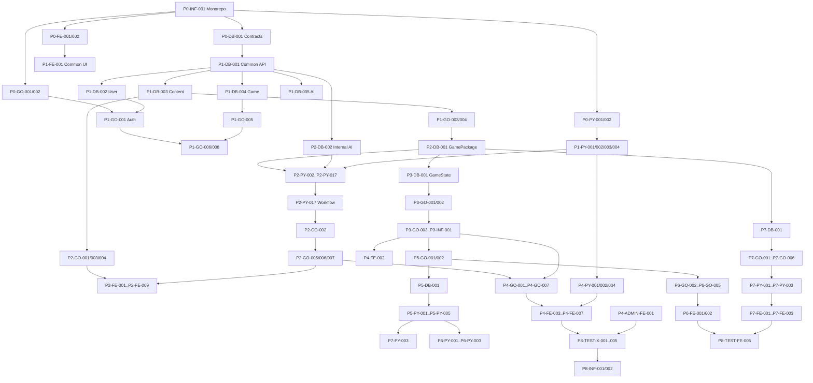

# MysteryVerse 可执行开发任务清单（TASKS）

> 文档版本：v1.0
> 状态：执行基线
> 上游文档：`docs/MysteryVerse-PRD.md`、`docs/TECH_DESIGN.md`、`docs/DATABASE_DESIGN.md`、`docs/API_DESIGN.md`、`docs/UI_DESIGN.md`
> 执行原则：Schema 先行、Go 权威、Pydantic 结构化、前端只消费投影、每任务独立测试、一次只执行一个任务
> 本文件只做任务规划，不代表任何业务代码或运行结果已经实现

> **2026-11-21 架构基线**：当前为 3 项 Accepted、7 项 Proposed。
> 执行任务前必须读取 `docs/architecture/DECISION-BASELINE.md`。
> Proposed 决策获得负责人确认前，依赖它们的任务不得冻结契约或开始联调。

---

## 0. 执行约束

### 0.1 文档路径与基线说明

| 项目 | 结论 |
| --- | --- |
| 用户请求路径 `docs/PRD.md` | 仓库当前不存在；实际 PRD 为 `docs/MysteryVerse-PRD.md` |
| 技术文档引用 | `TECH_DESIGN.md` 已明确以 `docs/MysteryVerse-PRD.md` 为上游 |
| 数据库命名 | 以 `DATABASE_DESIGN.md` 的 `scripts/script_versions` 为最终映射；不再创建独立 `projects` 聚合 |
| API 命名 | 以 `docs/api/`、`API_DESIGN.md` 的 `/api/v1`、`snake_case`、统一信封和 `mvws.v1` 为准 |
| 架构决策 | 以 `docs/architecture/DECISION-BASELINE.md` 为准；只有 Accepted ADR 可强制实现，Proposed 等待负责人确认 |
| UI 已定义但 API 未覆盖的能力 | 必须先补契约或明确禁用状态；禁止前端伪造数据 |

### 0.2 状态标记

| 状态 | 含义 |
| --- | --- |
| `TODO` | 可进入执行，前置已完成 |
| `BLOCKED` | 契约缺失、Proposed 决策未获批准、评审未完成或前置任务未完成 |
| `DOING` | 当前唯一执行中的任务 |
| `DONE` | 实现、测试、验收和文档更新均完成 |
| `DEFERRED` | 不属于当前 MVP 执行窗口，但保留完整定义 |

### 0.3 Coding Agent 单任务协议

1. 一次只领取一个 `TODO` 任务，并将其改为 `DOING`。
2. 执行前阅读任务列出的相关文档和现有代码。
3. 发现文档冲突时停止实现，更新本文件 `§0.1` 或新建评审问题，不得自行选择。
4. 不得更改既定技术选型，不得让 Python 写权威游戏表。
5. 所有 AI 输出必须经过 Pydantic/JSON Schema；所有游戏写操作必须经过 Go Engine。
6. 前端不得承担权限判断、幂等判断或阶段裁决。
7. 完成后运行任务规定的测试，记录命令与结果。
8. 通过验收后更新为 `DONE`，补充实际变更文件、测试证据和剩余风险。

### 0.4 全局 Definition of Done

每个任务的单个 DoD 均叠加以下全局门禁：

1. 代码、迁移、Schema、生成物和本文件状态已同步更新。
2. 单元测试、相关集成测试和失败路径测试通过。
3. 日志不包含 D2-D4 正文、Prompt、Token、Cookie 或密钥。
4. 错误使用统一错误码，不使用裸异常或任意字符串协议。
5. 权限先由服务端计算，客户端只渲染投影。
6. 幂等、版本冲突、超时、取消、重试和降级路径有明确行为。
7. 新增跨语言字段先进入 `packages/contracts`，再生成 Go/TS/Python 类型。
8. 相关文档、API、Schema、迁移和可观测性指标已更新。

### 0.5 文档歧义与阻断处置

| 编号 | 问题 | 默认处置 | 阻塞任务 |
| --- | --- | --- | --- |
| GAP-01 | 首页推荐、官方精选、通知聚合 API 未定义 | 先使用 `S02 + R02` 公开数据兜底；高级聚合不阻塞核心页面 | P1-DB-009 |
| GAP-02 | 草稿和生成任务项目列表无聚合 API | 先按 `S03/S11` 进入单项目；禁止伪造跨项目列表 | P1-DB-006 |
| GAP-03 | 完整游戏历史筛选 API 未定义 | 仅实现 `U04.include=recent_games`；完整历史等待契约 | P1-DB-006、P1-DB-009 |
| GAP-04 | 等待房间聊天接口未定义 | **已由 ADR-006 解决**：实现 `room_messages`、R13/R14 和 `room_chat` 流 | P1-DB-007、P1-GO-009、P4-FE-001 |
| GAP-05 | 成就/通知 API 未定义；运营后台 API 未定义 | 通知/成就保留空状态；**运营后台已由 ADR-007 定为公开 MVP 门禁**，见 `docs/api/admin-api.md` | P1-FE-005、P1-DB-009、P1-ADMIN-001、P4-ADMIN-FE-001 |
| GAP-06 | PRD 使用 Project/ProjectVersion，数据库使用 scripts/script_versions | **已由 ADR-010 收敛**：代码、API、DB 统一 `script/script_version` | P1-DB-003、P2-GO-001 |
| GAP-07 | 文档称 `GameState` 私密状态加密；数据库仅给引用 | 使用 `game_states.secret_payload_id + secret_payloads`，不新增明文表 | P3-GO-001、P3-GO-008 |

---

## 1. 关键依赖门禁

| 门禁 | 必须先完成 | 才能开始 | 原因 |
| --- | --- | --- | --- |
| GATE-DECISION | DQ-01 至 DQ-07 获得负责人确认并更新 ADR 状态 | 冻结受影响 API、DB、WS、AI 上下文契约 | Proposed 方案不能直接进入实现 |
| GATE-SCHEMA | P0-DB-001、P1-DB-003、P2-DB-001 | 所有 LangGraph 生成节点 | 共享 Script/GamePackage Schema 是跨语言唯一真相 |
| GATE-API | P0-DB-001、P1-DB-001 | Go Handler、Python API、前端联调 | OpenAPI/JSON Schema 先于实现 |
| GATE-UI | P0-FE-002 | 所有复杂页面 | 设计 Token、主题、基础组件和状态表面必须先固化 |
| GATE-GAMESTATE | P3-GO-001、P3-GO-002 | Phase 4 与后续规则引擎 | 通用状态模型和 Engine 契约先于具体规则 |
| GATE-WS | P1-DB-001、P1-GO-006、P1-GO-008、P1-GO-009 | 房间等待和多人实时页面 | 先冻结 WS 信封、room/room_chat/game 序号、鉴权和补偿协议 |
| GATE-ADMIN | P1-DB-008、P1-ADMIN-001/002、P4-ADMIN-FE-001 | 公开 MVP 发布 | 上架/下架、举报、处置、事故、AI 审核和审计必须可用 |
| GATE-AI | P2-DB-002、P2-PY-001 至 P2-PY-004 | Go AI 集成和前端 AI 展示 | Python 接口、Graph State 和输出 Schema 必须先稳定 |
| GATE-MEMORY | P5-DB-001、P5-GO-001 | 长期记忆、NPC 记忆和恢复 | 记忆作用域、权威事实接口先于实现 |

### 1.1 Proposed 决策任务门禁

| 决策 | 确认前不得冻结或联调的任务 |
| --- | --- |
| ADR-001 Memory | P5-DB-001、P5-GO-001/002、P5-PY-* |
| ADR-002 WebSocket | P1-DB-001 的 WS 部分、P1-GO-006/008/009、实时前端联调 |
| ADR-004 Event/State | P1-DB-004、P3-DB-001、P3-GO-001 之后的事件与状态链 |
| ADR-005 暂停/恢复 | P3-GO-004、Phase 4 游戏控制与 timer 联调 |
| ADR-006 等待房聊天 | P1-DB-007、P1-GO-009、P4-FE-001 的聊天部分 |
| ADR-007 运营后台 | P1-DB-008、P1-ADMIN-001/002、P4-ADMIN-FE-001、公开 MVP |
| ADR-008 PlayerContext | P4-PY-001/002、P5 上下文与记忆联调 |

### 1.2 AI Runtime DQ 当前状态（2026-11-23 Task 10）

| 决策 | 当前记录状态 | 可继续执行 | 不得执行 |
| --- | --- | --- | --- |
| DQ-18 | APPROVED；正式 Registry IMPLEMENTED/VERIFIED | Contracts Registry、兼容/Replay 策略、Active Demo Schema | 未经逐项批准冻结 AI DM/NPC 业务 Schema |
| DQ-19 | APPROVED；安全基础 IMPLEMENTED/TEST-VERIFIED；生产基础设施 NOT VERIFIED | HMAC、Key ID、nonce、ACL、审计、TLS 客户端测试 | 真实 CA/KMS/Redis 多实例生产验证 |
| DQ-20 | PROPOSED；本地工具 trust 原型 IMPLEMENTED；外部 MCP BLOCKED | 本地白名单工具和拒绝策略 | 接入真实 MCP、开放 egress |
| DQ-21 | PROPOSED；内存 Run 原型 IMPLEMENTED/VERIFIED；持久化 BLOCKED | 生命周期测试和文档设计 | 创建正式 `mv_ai` 迁移、声称可恢复 |
| DQ-22 | PROPOSED；Mock/兼容 HTTP Provider IMPLEMENTED；真实供应商 BLOCKED | Mock、低敏测试、配置校验 | 真实数据外发、自动 fallback、生产 SLA 声明 |

完整候选方案和依赖图见 `docs/architecture/dq-18-22-ai-runtime-design.md`；
GATE-AI 逐项状态见 `docs/architecture/gate-ai-checklist.md`。

### 1.3 Task 11 批准后实施门禁

- **状态**：`DONE`
- **批准证据**：负责人于 2026-11-25 在要求批准后回复“开始执行吧”；仅批准
  DQ-18/DQ-19 候选推荐范围。
- **实际变更**：正式 Contracts Registry、兼容性基线、Active Demo Schema；
  HMAC `mv-hmac-sha256-v1`、Key ID、Key Provider、共享 Nonce Store、scope ACL、
  安全审计、FastAPI TLS 配置和 Go mTLS Client。
- **测试命令**：`./scripts/mv.ps1 check`、`./scripts/contracts.ps1 check`。
- **测试结果**：`./scripts/mv.ps1 check` 全量通过；Contracts 142 定义、
  TypeScript 契约测试 27 项、Web 测试 29 项、Python 测试 48 项，Go/Lint/
  mypy/构建通过。详见 `docs/architecture/task-11-report.md`。
- **验收证据**：`packages/contracts/registry/schema-registry.json`、
  `docs/architecture/contracts-registry.md`、
  `docs/architecture/gate-ai-checklist.md`。
- **剩余风险**：真实 CA、KMS、Redis 多实例和生产 mTLS 部署为 `NOT VERIFIED`；
  DQ-20 至 DQ-22、ADR-001/004/005/008 仍为 Proposed。

可以先行：

- P0-INF-001 及无 Proposed 语义的工程骨架。
- P0-DB-001 的目录、lint、示例和代码生成工具链；不得冻结 Proposed Schema 内容。
- 使用 ADR-003、ADR-009、ADR-010 已批准规范的 Schema、任务和测试准备。

---

## 2. Phase 0：工程初始化

### P0-DOC-001：建立执行基线与契约缺口台账

- **阶段**：Phase 0
- **优先级**：P0
- **类型**：Infrastructure
- **状态**：DONE
- **任务描述**：把路径差异、契约缺口、数据库命名映射和待评审决策转为带状态 ADR、条件架构基线与执行台账。
- **前置依赖**：无
- **相关文档**：PRD §0、TECH_DESIGN §0、DATABASE_DESIGN §0、API_DESIGN §0、UI_DESIGN §13.7、docs/decisions/README.md
- **涉及文件**：`docs/TASKS.md`、`docs/decisions/`、`docs/architecture/open-questions.md`、`AGENTS.md`
- **详细实现内容**：ADR-001 至 ADR-010 状态、Decision Baseline、API/DB 候选规范、Open Questions 和 GAP 映射。
- **API 依赖**：无
- **数据依赖**：无
- **异常场景**：同一问题被重复编号；未决项被实现任务提前假设；文档与代码命名再次分叉。
- **测试要求**：Markdown 结构与链接检查；交叉检查 ADR、GAP、OQ 和任务引用。
- **验收标准**：每条缺口有 Accepted/Proposed 状态、默认处置和阻塞任务；未获批准的 Proposed 明确登记。
- **Definition of Done**：全局 DoD + 缺口台账通过文档评审并能被后续任务直接引用。
- **并行执行条件**：可立即执行，不阻塞其他初始化任务。
- **实际变更**：新建 `docs/decisions/`、`docs/architecture/`、`docs/api/`、`docs/database/`；修订 AGENTS、PRD、TECH、DB、API、UI、TASKS、DESIGN_REVIEW；Task 1 增加 Decision Baseline。
- **测试命令**：PowerShell 文档路径、字段、ID 长度、ADR/GAP 引用静态扫描。
- **测试结果**：通过；无业务代码测试可执行。
- **验收证据**：ADR 状态索引、DECISION-BASELINE、系统架构、Open Questions、本任务台账。
- **剩余风险**：7 项 Proposed 待负责人确认；真实 OpenAPI/JSON Schema、迁移和自动 Markdown lint 尚未创建。

### P0-INF-001：建立 Monorepo 与基础工程目录

- **阶段**：Phase 0
- **优先级**：P0
- **类型**：Infrastructure
- **状态**：DONE
- **任务描述**：初始化 `apps/backend/ai_service/packages/deploy/tests` 多语言 Monorepo 骨架。
- **前置依赖**：P0-DOC-001
- **相关文档**：TECH_DESIGN §14.1-§14.4
- **涉及文件**：`apps/web/`、`backend/`、`ai_service/`、`packages/contracts/`、`deploy/`、`tests/`、根级工具配置
- **详细实现内容**：创建目录、最小 README、版本文件、workspace 配置、统一忽略规则和跨语言任务入口；不创建业务实现。
- **API 依赖**：无
- **数据依赖**：无
- **异常场景**：路径与设计树不一致；workspace 递归扫描第三方目录；包管理器版本漂移。
- **测试要求**：目录断言脚本；全新 clone 后安装和 lint 空工程通过。
- **验收标准**：所有设计目标目录存在；单一命令可识别各语言工程。
- **Definition of Done**：全局 DoD + Monorepo 结构可被 CI 稳定发现。
- **并行执行条件**：可与 P0-DB-001 并行，但契约生成目录需使用本任务路径。
- **实际变更**：根 `README.md`、`Makefile`、`package.json`、`.gitignore`、`.env.example`；`apps/web/`、`backend/`、`ai_service/`、`packages/contracts/`、`deploy/`、`scripts/`、`tests/`。
- **测试命令**：`powershell -NoProfile -ExecutionPolicy Bypass -File scripts/check-structure.ps1`
- **测试结果**：通过。
- **验收证据**：目录断言通过；正式路径采用 `apps/web`、`backend`、`ai_service`，未创建重复 PRD。
- **剩余风险**：MinIO/OTel 和 CI 尚未初始化。

### P0-DB-001：建立唯一契约源与代码生成流水线

- **阶段**：Phase 0
- **优先级**：P0
- **类型**：Database
- **状态**：DONE
- **任务描述**：建立 `packages/contracts` 的目录、lint、示例和代码生成工具链；Proposed Schema 内容等待 GATE-DECISION。
- **前置依赖**：P0-INF-001
- **相关文档**：TECH_DESIGN §4.7、§9.6、§14.8；API_DESIGN §11
- **涉及文件**：`packages/contracts/openapi/`、`packages/contracts/json-schema/`、`packages/contracts/examples/`、`packages/contracts/compatibility/`、`packages/contracts/codegen.yaml`
- **详细实现内容**：建立目录、lint、示例校验、Go/TS/Python 生成命令、生成文件头、漂移检查和 breaking-change 检查入口。
- **API 依赖**：API_DESIGN §1、§11
- **数据依赖**：DATABASE_DESIGN §1、§5
- **异常场景**：源 Schema 与生成物漂移；同一字段三语言命名不一致；非法示例；破坏性变更未拦截。
- **测试要求**：运行 schema lint、示例反序列化、三语言生成和二次生成零 diff。
- **验收标准**：生成目标和工具链固定；CI 可在无业务代码时执行漂移检查；未批准的 WS/事件/内部 AI Schema 不出现在冻结版本中。
- **Definition of Done**：全局 DoD + 契约目录和生成命令文档化。
- **并行执行条件**：可与 P0-GO-001、P0-PY-001、P0-FE-001 并行。
- **实际变更**：单源 Draft 2020-12 Schema、14 个跨领域示例、TypeScript/Go/Python 生成物、Schema 指纹、契约校验器、漂移检查和三端 contract tests。
- **测试命令**：`scripts/contracts.ps1 validate`；`scripts/contracts.ps1 test`；`scripts/contracts.ps1 check`
- **测试结果**：82 个定义与 14 个示例通过；Go 4 tests、Python 4 tests、TypeScript 16 tests passed；重复生成零漂移。
- **验收证据**：`packages/contracts/compatibility/schema-fingerprint.json` 和三端生成文件。
- **剩余风险**：WebSocket、事件、Memory、PlayerContext 契约仍为 Proposed；OpenAPI operation 路径尚未生成。

### P0-GO-001：初始化 Go API、Realtime/Runtime、Worker 骨架

- **阶段**：Phase 0
- **优先级**：P0
- **类型**：Go
- **状态**：DONE
- **任务描述**：建立 Chi + `net/http` 的 API 进程及 Realtime/Runtime、Worker 命令骨架。
- **前置依赖**：P0-INF-001
- **相关文档**：TECH_DESIGN §2.2、§3.3、§14.1-§14.2
- **涉及文件**：`backend/go.mod`、`backend/cmd/api/`、`backend/cmd/realtime-runtime/`、`backend/cmd/worker/`、`backend/internal/platform/`
- **详细实现内容**：三进程入口、依赖注入边界、优雅关闭、健康检查、路由空壳、worker 生命周期和版本输出。
- **API 依赖**：P0-DB-001 的路由生成接口
- **数据依赖**：无
- **异常场景**：端口占用；SIGTERM 时未关闭连接；进程角色误用配置；健康检查误判 ready。
- **测试要求**：进程启动/退出测试；live/ready 区分测试；`go test ./...`。
- **验收标准**：三进程可独立启动和关闭；无业务 Handler。
- **Definition of Done**：全局 DoD + 进程骨架可被 Docker 和本地命令启动。
- **并行执行条件**：可与 P0-PY-001、P0-FE-001 并行。
- **实际变更**：`backend/go.mod`、三进程 `cmd`、配置、日志、HTTP Server、健康检查、统一错误、优雅关闭和单元测试。
- **测试命令**：`go test ./...`；`go vet ./...`；`go build ./cmd/api ./cmd/realtime-runtime ./cmd/worker`
- **测试结果**：通过；API 实际启动并返回 live/ready/API health 200。
- **验收证据**：`/health/live`、`/health/ready`、`/api/v1/health` smoke 通过。
- **剩余风险**：MySQL/Redis 客户端、OpenTelemetry 与真实 WebSocket 尚未实现。

### P0-GO-002：实现 Go 平台层：配置、日志、追踪、MySQL、Redis、错误

- **阶段**：Phase 0
- **优先级**：P0
- **类型**：Go
- **状态**：TODO
- **任务描述**：建立类型化配置、结构化日志、OpenTelemetry、数据库池、Redis 客户端和统一错误映射。
- **前置依赖**：P0-GO-001
- **相关文档**：TECH_DESIGN §5.4-§5.7、§14.5-§14.6；API_DESIGN §1.4、§9
- **涉及文件**：`backend/internal/platform/config/`、`logging/`、`tracing/`、`database/`、`redis/`、`errors/`、`middleware/`
- **详细实现内容**：启动配置校验、Secret 注入接口、`sqlc`/`database/sql`、连接池、Redis URL/TLS、请求 ID、错误信封、panic 恢复和敏感字段过滤。
- **API 依赖**：API_DESIGN 通用响应与错误码
- **数据依赖**：DATABASE_DESIGN §1.2-§1.3
- **异常场景**：缺配置启动；数据库不可用；Redis 超时；error detail 泄漏；trace 断链。
- **测试要求**：配置表驱动测试；错误映射测试；敏感日志快照测试；依赖故障健康检查测试。
- **验收标准**：所有基础依赖有 deadline 和 health；错误响应符合统一信封。
- **Definition of Done**：全局 DoD + 平台层可被后续领域模块复用。
- **并行执行条件**：可与 P0-PY-002 并行，不可先于 P0-GO-001。
- **当前进展（2026-11-21 Task 4）**：已增加 MySQL/Redis 类型化配置、连接池、Ping deadline、事务 helper、稳定错误映射、Redis TLS/URL、Presence/Lease/RateLimit helper、go-redis 与 miniredis 测试；`cmd/migrate`、`sqlc` 查询生成和 Repository 边界已落地。OpenTelemetry、依赖健康检查接线与敏感日志快照仍未完成，因此状态保持 `TODO`。

### P0-PY-001：初始化 FastAPI、LangGraph Worker 与项目结构

- **阶段**：Phase 0
- **优先级**：P0
- **类型**：Python
- **状态**：DONE
- **任务描述**：建立 Python 3.12+ AI API 和 Worker 双运行形态及设计目录。
- **前置依赖**：P0-INF-001
- **相关文档**：TECH_DESIGN §2.5、§7.1-§7.3、§14.3
- **涉及文件**：`ai_service/pyproject.toml`、`ai_service/src/mysteryverse_ai/api/`、`workers/`、`workflows/`、`schemas/`、`tests/`
- **详细实现内容**：FastAPI 入口、Worker 入口、路由空壳、健康检查、格式化/lint/type-check 配置和测试目录。
- **API 依赖**：内部 AI 路径命名约定
- **数据依赖**：无
- **异常场景**：API 与 Worker 共享阻塞循环；未处理 SIGTERM；端口配置错误。
- **测试要求**：API 健康测试；Worker 生命周期测试；`pytest` 空集可运行。
- **验收标准**：FastAPI 与 asyncio Worker 可独立启动和退出。
- **Definition of Done**：全局 DoD + Python 工程可被 CI 和 Docker 构建。
- **并行执行条件**：可与 P0-GO-001、P0-FE-001 并行。
- **实际变更**：`pyproject.toml`、`uv.lock`、FastAPI app、Worker 入口、Settings、JSON 日志、请求 ID、异常处理、健康检查和 LangGraph foundation graph。
- **测试命令**：`uv run --project ai_service pytest ai_service/tests`；`ruff`；`mypy`；`uv build`
- **测试结果**：5 tests passed；Ruff、mypy 和 build 通过；健康接口实际返回 200。
- **验收证据**：`/health/live`、`/health/ready`、`/internal/v1/health` smoke 通过。
- **剩余风险**：Provider、Prompt Registry、Trace 与真实 Worker 队列尚未实现。

### P0-PY-002：实现 Python 平台层：Settings、Pydantic、Provider、Prompt、Trace

- **阶段**：Phase 0
- **优先级**：P0
- **类型**：Python
- **状态**：TODO
- **任务描述**：建立 `pydantic-settings`、结构化日志、OpenTelemetry、LLM Provider 接口、Prompt Registry 和 AI Run trace 骨架。
- **前置依赖**：P0-PY-001
- **相关文档**：TECH_DESIGN §7.4-§7.6、§14.5-§14.6
- **涉及文件**：`providers/`、`prompts/registry/`、`observability/`、`config/`、`schemas/`、`workers/`
- **详细实现内容**：Provider 能力协议、fake provider、模型路由配置、Prompt version 结构、runId/traceId 传播、敏感日志过滤和 deadline 支持。
- **API 依赖**：P0-DB-001 的 AI Run 基础 Schema
- **数据依赖**：DATABASE_DESIGN §6.5
- **异常场景**：Provider 未配置；401/429/5xx；Prompt 版本缺失；日志包含正文。
- **测试要求**：Provider fake contract tests；Settings 校验；日志脱敏测试；trace span 测试。
- **验收标准**：所有模型调用必须经 Provider；Prompt 必须带版本/hash。
- **Definition of Done**：全局 DoD + Python 平台层可被生成和实时 Agent 复用。
- **并行执行条件**：可与 P0-GO-002 并行。
- **当前进展（2026-11-23 Task 8）**：已实现 Provider-neutral 模型协议、Mock 与 OpenAI-compatible Provider、有限重试、Agent trace 数据结构、敏感日志脱敏基础、Settings 和依赖注入。Prompt Registry、完整 OpenTelemetry 与模型路由策略仍未完成，状态保持 `TODO`。

### P0-FE-001：初始化 React/Vite/TypeScript/Tailwind/Zustand/Query/Motion/Router

- **阶段**：Phase 0
- **优先级**：P0
- **类型**：Frontend
- **状态**：DONE
- **任务描述**：建立前端应用壳、路由骨架、Provider、QueryClient、Zustand 分区和测试工具。
- **前置依赖**：P0-INF-001
- **相关文档**：TECH_DESIGN §2.1、§4.1-§4.7；UI_DESIGN §2
- **涉及文件**：`apps/web/src/app/`、`pages/`、`stores/`、`queries/`、`realtime/`、`api/`、`generated/`、`tests/`
- **详细实现内容**：Vite 配置、严格 TypeScript、React Router、TanStack Provider、MotionConfig、错误边界、目录边界和生成类型占位。
- **API 依赖**：P0-DB-001 的生成客户端入口
- **数据依赖**：无
- **异常场景**：路由懒加载失败；Store 持久化私密数据；Query key 缺权限 scope。
- **测试要求**：应用 smoke test；路由渲染测试；TypeScript strict 编译。
- **验收标准**：空应用可启动；不包含业务规则或手写 API DTO。
- **Definition of Done**：全局 DoD + 前端骨架可被后续页面直接扩展。
- **并行执行条件**：可与 Go/Python 初始化并行。
- **实际变更**：`apps/web` 严格 TypeScript、ESLint、Prettier、Vite、Tailwind、Router、Query、Zustand、Motion、HTTP client、Error Boundary、基础应用壳和 Vitest。
- **测试命令**：`npm run lint:web`；`npm run typecheck:web`；`npm run test:web`；`npm run build:web`
- **测试结果**：2 tests passed；Lint、类型检查与生产构建通过；Vite dev server 和 Go 代理 health 200。
- **验收证据**：Web 首页 200；`/api/v1/health` 经 Vite proxy 返回 200。
- **剩余风险**：完整设计 Token、页面路由和 Playwright 尚未实现。

### P0-FE-002：实现设计 Token、双主题、排版、图标和 Motion 基础

- **阶段**：Phase 0
- **优先级**：P0
- **类型**：Frontend
- **状态**：TODO
- **任务描述**：把 UI Design 的 Primitive/Semantic Token、Archive/Paper 主题、字号、间距、圆角、状态色和动效 Token 落到 Tailwind/CSS。
- **前置依赖**：P0-FE-001
- **相关文档**：UI_DESIGN §3、§4.1、§7
- **涉及文件**：`apps/web/src/design-system/tokens.css`、`themes.css`、`tailwind.config.ts`、字体资源、`motion/`
- **详细实现内容**：Token 映射、字体栈与 fallback、Lucide 封装、Focus/Danger/Scope 语义、`prefers-reduced-motion` 和 z-index。
- **API 依赖**：无
- **数据依赖**：无
- **异常场景**：业务组件使用魔法色值；字体失败导致布局跳变；私密范围仅靠颜色。
- **测试要求**：Token snapshot；主题切换截图；无硬编码颜色静态检查；reduced motion 测试。
- **验收标准**：业务组件只消费 Semantic Token；双主题可切换。
- **Definition of Done**：全局 DoD + 视觉 Token 审计通过。
- **并行执行条件**：可与其他 Phase 0 任务并行，Phase 1 UI 页面必须等待本任务。

### P0-INF-002：建立 Docker Compose、环境变量、MinIO、MySQL、Redis、OTel

- **阶段**：Phase 0
- **优先级**：P0
- **类型**：Infrastructure
- **状态**：TODO
- **任务描述**：搭建本地一键开发环境，覆盖 Web、Admin、Go 三进程、Python 两进程、MySQL、Redis、MinIO、OTel Collector。
- **前置依赖**：P0-GO-001、P0-PY-001、P0-FE-001
- **相关文档**：TECH_DESIGN §14.8-§14.9
- **涉及文件**：`deploy/compose/`、`deploy/docker/`、`.env.example`、`scripts/`
- **详细实现内容**：服务定义、健康检查、依赖顺序、migration/bucket 初始化、测试数据库/Bucket、本地卷和公网环境变量白名单。
- **API 依赖**：无
- **数据依赖**：DATABASE_DESIGN §1、§13
- **异常场景**：服务未 ready 即启动；端口冲突；测试数据污染；密钥进入镜像。
- **测试要求**：`docker compose config`；一键启动后全服务健康；重启后数据卷一致。
- **验收标准**：新开发者按 README 可启动并运行 smoke test。
- **Definition of Done**：全局 DoD + 本地环境文档与环境变量清单通过。
- **并行执行条件**：服务定义可与各语言任务并行草拟，最终需三端入口存在。
- **当前进展（2026-11-23 Task 8）**：根 Compose 已增加 Python AI 服务、AI Dockerfile、健康检查和环境变量；Compose YAML 已解析验证。当前执行环境没有 Docker CLI，未虚报镜像构建或容器启动通过；完整 Web/Admin/Go 三进程、MinIO、OTel 仍未补齐。

### P0-INF-003：建立 CI 基础流水线与跨语言门禁

- **阶段**：Phase 0
- **优先级**：P0
- **类型**：Infrastructure
- **状态**：TODO
- **任务描述**：建立 lint、unit、schema drift、contract、migration、security scan、build 和 E2E smoke 流水线骨架。
- **前置依赖**：P0-DB-001、P0-INF-002
- **相关文档**：TECH_DESIGN §14.8；API_DESIGN §11.5
- **涉及文件**：CI 配置、`scripts/ci/`、测试入口和缓存配置
- **详细实现内容**：分层 job、依赖缓存、失败产物、Schema 生成 diff、迁移 dry-run、镜像构建和最小 smoke。
- **API 依赖**：OpenAPI/JSON Schema lint
- **数据依赖**：goose migration 可执行
- **异常场景**：生成器版本不一致；缓存掩盖漂移；测试数据库不可用。
- **测试要求**：故意制造 Schema 漂移应失败；故意 lint 错误应失败；正常基线应通过。
- **验收标准**：PR 必需的 P0 job 全部出现且可重跑。
- **Definition of Done**：全局 DoD + CI 门禁文档化和失败可定位。
- **并行执行条件**：可在各语言工程就绪后完成。

### P0-TEST-001：建立跨语言 Smoke 与测试夹具基线

- **阶段**：Phase 0
- **优先级**：P0
- **类型**：Test
- **状态**：TODO
- **任务描述**：建立 Go/Python/Web 最小 smoke、数据库容器夹具、MinIO 测试 Bucket 和契约 fixture 目录。
- **前置依赖**：P0-INF-002
- **相关文档**：TECH_DESIGN §14.7-§14.9
- **涉及文件**：`tests/contract/`、`tests/e2e/`、`tests/security/`、`backend/*_test.go`、`ai_service/tests/`、`apps/web/tests/`
- **详细实现内容**：健康检查 smoke、测试 ID/时钟/随机数夹具、数据库事务回滚策略和统一测试报告目录。
- **API 依赖**：公共 health API
- **数据依赖**：测试 MySQL/Redis/MinIO
- **异常场景**：测试复用一个数据库；夹具泄漏真实数据；并发测试互相污染。
- **测试要求**：重复运行稳定；失败保留诊断产物；清理测试资源。
- **验收标准**：CI 可在干净环境运行 smoke，并生成三端报告。
- **Definition of Done**：全局 DoD + 测试基线可被 Phase 1 直接复用。
- **并行执行条件**：可在 Phase 0 其他任务接近完成时并行。

---

## 3. Phase 1：公共基础能力

### P1-DB-001：定义通用 OpenAPI、JSON Schema、WS/SSE 公共契约

- **阶段**：Phase 1
- **优先级**：P0
- **类型**：Database
- **状态**：BLOCKED
- **任务描述**：固化统一响应信封、错误信封、分页、幂等头、版本字段、WS envelope、SSE event、状态和 DTO 敏感字段规则。
- **前置依赖**：P0-DB-001
- **相关文档**：API_DESIGN §1-§2、§8.2、§9、§11；TECH_DESIGN §4.7、§9.6
- **涉及文件**：`packages/contracts/openapi/components/common.yaml`、`json-schema/ws-messages/`、`sse-events/`、`examples/`
- **详细实现内容**：定义 `ApiEnvelope/ErrorEnvelope/CursorPage`、公共 headers、WS 字段、SSE id/event、schema_version、敏感字段名拦截。
- **API 依赖**：API_DESIGN 全部通用协议
- **数据依赖**：DATABASE_DESIGN §5
- **异常场景**：不同 operation 使用不同错误结构；WS `sequence` 与 `stream` 缺失；DTO 暴露内部字段。
- **测试要求**：OpenAPI lint；JSON Schema lint；Go/TS/Python 生成；敏感字段扫描；示例校验。
- **验收标准**：所有后续 operation 可引用同一公共组件。
- **Definition of Done**：全局 DoD + GATE-API 通过。
- **并行执行条件**：GATE-API 的前置，必须优先完成。

### P1-DB-002：实现用户、认证、会话、资料与隐私迁移

- **阶段**：Phase 1
- **优先级**：P0
- **类型**：Database
- **状态**：TODO
- **任务描述**：创建 `users/auth_identities/user_sessions/user_profiles/user_statistics` 及索引、约束、软删除和账号状态。
- **前置依赖**：P1-DB-001
- **相关文档**：DATABASE_DESIGN §3.1、§6.1、§7、§16.2；API_DESIGN U01-U06
- **涉及文件**：`backend/migrations/`、`backend/internal/platform/database/`、`backend/internal/contracts/`
- **详细实现内容**：goose up/down、ULID、UTC、唯一约束、`privacy_json` 固定枚举、会话撤销字段和测试 seed。
- **API 依赖**：U01-U06 DTO
- **数据依赖**：无业务前置表
- **异常场景**：重复认证主体；账号状态非法；过期会话查询慢；软删除后唯一冲突。
- **测试要求**：MySQL 8.0.30 迁移正反向；唯一约束；状态 CHECK；隐私 JSON 非法拒绝。
- **验收标准**：空库可迁移，关键约束由数据库层验证。
- **Definition of Done**：全局 DoD + 迁移在影子库通过。
- **并行执行条件**：可与 P1-DB-003 并行，但均依赖 P1-DB-001。
- **当前进展（2026-11-21 Task 5）**：`00001_identity_content.sql` 与 `00006_user_room_flows.sql` 现包含用户、Argon2id 密码哈希、认证主体、会话、CSRF、资料、统计、幂等记录和软删除；迁移正反向与重复 `up` 已在 MySQL 8.0.37 临时实例通过。隐私 JSON 枚举由 Go DTO 校验，数据库账号最小权限测试仍待 P1-DB-001。

### P1-DB-003：实现剧本、生成任务、故事圣经与结构化内容迁移

- **阶段**：Phase 1
- **优先级**：P0
- **类型**：Database
- **状态**：TODO
- **任务描述**：创建 `scripts/script_versions/source_documents/generation_*/story_*/secret_payloads/script_*` 的 MVP 表。
- **前置依赖**：P1-DB-001、P1-DB-002
- **相关文档**：DATABASE_DESIGN §3.2、§6.2、§7、§16.2-§16.3
- **涉及文件**：`backend/migrations/`、`backend/internal/content/`、`backend/internal/workshop/`
- **详细实现内容**：版本指针、冻结规则、加密引用、来源事实、ACL/reveal gate、角色/关系/场景/阶段/线索/搜证点/任务/事件和标签。
- **API 依赖**：S01-S20 内容 DTO
- **数据依赖**：`users`、`secret_payloads`、`rule_templates`
- **异常场景**：同版本重复 key；发布版本被修改；私密正文落普通 JSON；跨版本关联。
- **测试要求**：迁移正反向；所有唯一键；发布冻结触发器/服务校验；敏感列权限测试。
- **验收标准**：MVP 剧本结构化对象均有关系表承载。
- **Definition of Done**：全局 DoD + GATE-SCHEMA 的数据库部分通过。
- **并行执行条件**：可与 P1-DB-004 并行，但生成 Schema 任务需等待本表结构。
- **当前进展（2026-11-21 Task 4）**：已实现 `scripts/script_versions/secret_payloads/rule_templates/script_characters/script_scenes/npc_profiles` 与阶段、揭示门控、线索、搜证点关联表。生成任务、来源文档、故事圣经、关系、任务、内容事件、标签及发布冻结规则仍未实现，状态保持 `TODO`。
- **当前进展（2026-11-23 Task 7）**：新增 `script_chapters`、`script_endings`、`script_assets`、`script_publications`，并为 `scripts`、阶段、角色、线索、搜证点补充 `row_version`，为阶段补充 `chapter_id`，为版本补充 `validation_report_json`。来源文档、生成任务、故事圣经、关系、任务、内容事件和标签仍未实现。

### P1-DB-004：实现房间、游戏、事件、投票、计时器和快照核心迁移

- **阶段**：Phase 1
- **优先级**：P0
- **类型**：Database
- **状态**：BLOCKED
- **任务描述**：创建共享房间/游戏表以及剧本杀 MVP 所需模式表，建立版本、序号、幂等和结算唯一约束。
- **前置依赖**：P1-DB-003
- **相关文档**：DATABASE_DESIGN §3.3、§6.3、§7、§12、§16.4-§16.6
- **涉及文件**：`backend/migrations/`、`backend/internal/room/`、`backend/internal/game/`
- **详细实现内容**：`game_rooms/room_members/room_events/game_sessions/game_players/game_roles/game_states/game_events/game_intents/game_votes/game_search_claims/game_messages/game_timers/game_snapshots/game_viewer_manifests/game_results/replay_reports/outbox_events`。
- **API 依赖**：R01-R12、G01-G08、M01-M08
- **数据依赖**：`script_versions`、`secret_payloads`
- **异常场景**：一房多局；seq 重复；同幂等键异 payload；双结算；有效期唯一。
- **测试要求**：迁移正反向；核心唯一约束；锁顺序集成测试夹具；敏感字段加密引用。
- **验收标准**：数据库不变量 1-9、14-15 可在集成测试中表达。
- **Definition of Done**：全局 DoD + GATE-GAMESTATE 的持久化部分通过。
- **并行执行条件**：可与 P1-DB-005 并行。
- **当前进展（2026-11-21 Task 4）**：候选迁移已覆盖房间、席位、房间事件/聊天、会话、玩家、角色、状态、意图、事件、投票、搜证、消息、计时器、快照、viewer manifest、结算、复盘、Outbox、NPC 与 Memory 元数据；版本条件并发写入、事务回滚、Memory game 作用域约束在 MySQL 集成测试通过。ADR-004 等仍为 Proposed，故任务继续为 `BLOCKED`，不得据此宣称 GATE-GAMESTATE 已通过。

### P1-DB-005：实现 `mv_ai` Prompt、Agent Run、Step、Usage、Safety、Checkpoint 迁移

- **阶段**：Phase 1
- **优先级**：P0
- **类型**：Database
- **状态**：TODO
- **任务描述**：创建 Python 自有 schema 和 Agent trace 表，禁止跨 schema 物理外键到 `mv_core`。
- **前置依赖**：P1-DB-001
- **相关文档**：DATABASE_DESIGN §1.3、§3.5、§6.5、§16.8
- **涉及文件**：`backend/migrations/`、`ai_service/migrations/`、`ai_service/src/mysteryverse_ai/observability/`
- **详细实现内容**：账号权限、逻辑引用、幂等 Run 唯一键、message 加密正文、context manifest、checkpoint、usage 和 safety。
- **API 依赖**：A01、内部 AI Run API
- **数据依赖**：无 `mv_core` 物理 FK
- **异常场景**：Python 获得 core 写权限；完整上下文明文长期留存；Run 重复计费。
- **测试要求**：双 schema 账号权限测试；迁移正反向；唯一键；过期正文清理。
- **验收标准**：Python 仅能访问 `mv_ai`；trace 可定位 Prompt/模型/usage。
- **Definition of Done**：全局 DoD + 最小权限账号通过。
- **并行执行条件**：可与 P1-DB-004 并行。

### P1-DB-006：补齐项目管理与游戏历史查询契约

- **阶段**：Phase 1
- **优先级**：P1
- **类型**：Database
- **状态**：BLOCKED
- **任务描述**：定义作者项目/任务列表和完整游戏历史筛选的 OpenAPI、分页和 DTO。
- **前置依赖**：P1-DB-001、P1-DB-003、P1-DB-004；GAP-02、GAP-03 评审
- **相关文档**：UI_DESIGN §5.16-§5.17、§9.8；API_DESIGN §1、§11
- **涉及文件**：`packages/contracts/openapi/paths/scripts.yaml`、`games.yaml`、`components/schemas/script.yaml`、`game-projection.yaml`
- **详细实现内容**：增加 `GET /me/scripts`、`GET /generation-jobs` 和 `GET /me/games` 类契约；明确权限、排序、游标和脱敏字段。
- **API 依赖**：S03/S11、U04、G06/G07
- **数据依赖**：`scripts/generation_jobs/game_players/game_results`
- **异常场景**：跨 owner 查询；历史含未授权私密；游标越权。
- **测试要求**：OpenAPI lint；权限字段扫描；分页 fixture；前后端生成。
- **验收标准**：UI 不再依赖推断或伪聚合数据。
- **Definition of Done**：全局 DoD + 缺口台账更新为已决策。
- **并行执行条件**：评审通过后可与 Go/FE 实现并行。

### P1-DB-007：补齐等待房聊天数据与契约

- **阶段**：Phase 1
- **优先级**：P0
- **类型**：Database
- **状态**：BLOCKED
- **任务描述**：按 ADR-006 增加 `room_messages`、R13/R14 和 `room_chat` WS 契约。
- **前置依赖**：P1-DB-001、P1-DB-004
- **相关文档**：ADR-006；docs/api/websocket-protocol.md；docs/database/schema-design.md；UI_DESIGN §5.9
- **涉及文件**：`backend/migrations/`、`packages/contracts/openapi/paths/rooms.yaml`、`components/schemas/room.yaml`、`json-schema/ws-messages/`
- **详细实现内容**：`room_messages` 字段/索引、`chat_seq`、client_message_id 幂等、分页、审核状态、软删除和保留策略。
- **API 依赖**：R13/R14、`room_chat` WS fixtures
- **数据依赖**：`room_messages`
- **异常场景**：复用 game seq；伪造 game_id；越权读取；重复发送；聊天阻塞开局。
- **测试要求**：迁移正反向；唯一键；并发发送；游标；权限；契约示例。
- **验收标准**：等待房聊天序号、权限和生命周期与游戏事件完全隔离。
- **Definition of Done**：全局 DoD + GATE-CONTRACT 和数据库不变量通过。
- **并行执行条件**：可与 P1-GO-009 并行契约设计，迁移先于实现。
- **当前进展（2026-11-21 Task 5）**：`room_messages` 已包含独立 `chat_seq`、`event_id`、`client_message_id`/`Idempotency-Key` 幂等、审核状态、正文哈希和软删除；R13/R14、权限、限流与历史测试已通过。真实 `room_chat` WebSocket 契约仍依赖 ADR-002/ADR-006 批准，状态保持 `BLOCKED`。

### P1-DB-008：补齐邀请 token、运营处置与后台审计迁移

- **阶段**：Phase 1
- **优先级**：P0
- **类型**：Database
- **状态**：BLOCKED
- **任务描述**：增加 `invitation_tokens`、`user_sanctions` 及后台审核/举报/事故所需的索引与审计约束。
- **前置依赖**：P1-DB-001、P1-DB-002、P1-DB-004
- **相关文档**：ADR-007；docs/api/admin-api.md；docs/database/schema-design.md
- **涉及文件**：`backend/migrations/`、`packages/contracts/openapi/paths/admin-*.yaml`
- **详细实现内容**：token hash/use count/expiry/revoke；mute/suspend scope/expiry/revoke；audit append-only；后台查询索引。
- **API 依赖**：R07/R08、AD01-AD09
- **数据依赖**：`invitation_tokens/user_sanctions/audit_logs/moderation_cases`
- **异常场景**：邀请超用；处罚无审计；后台越权；私密正文进入索引。
- **测试要求**：迁移正反向；并发兑换；处罚生效；审计不可变；权限字段扫描。
- **验收标准**：公开 MVP 所需处置与审计数据可完整追溯。
- **Definition of Done**：全局 DoD + GATE-ADMIN 数据门禁通过。
- **并行执行条件**：可与 P1-ADMIN-001 并行。
- **当前进展（2026-11-21 Task 4）**：候选迁移已增加 `invitation_tokens/reports/moderation_cases/audit_logs/user_sanctions/incidents`，审计 UPDATE/DELETE 由 MySQL Trigger 拒绝并通过集成测试。并发兑换、处罚生效、Admin API 与最小权限账号仍未完成；ADR-007 未批准，状态保持 `BLOCKED`。

### P1-DB-009：补齐通知、成就与首页高级聚合

- **阶段**：Phase 1
- **优先级**：P1
- **类型**：Database
- **状态**：BLOCKED
- **任务描述**：定义通知、成就和高级首页聚合的正式契约；未决策前不阻塞核心对局。
- **前置依赖**：GAP-01、GAP-05 产品决策
- **相关文档**：UI_DESIGN §9.8；docs/architecture/open-questions.md
- **涉及文件**：后续 OpenAPI、迁移和 UI 契约
- **详细实现内容**：仅在产品确认范围后设计，禁止用统计字段模拟伪实体。
- **API 依赖**：待定
- **数据依赖**：待定
- **异常场景**：通知泄漏私密摘要；成就伪造进度；宽任务阻塞 P0。
- **测试要求**：决策后补充
- **验收标准**：无未决宽聚合任务阻塞核心 MVP。
- **Definition of Done**：产品范围决策完成且契约通过。
- **并行执行条件**：不进入核心 MVP 关键路径。

### P1-GO-001：实现注册/登录/退出、Session、CSRF 与授权中间件

- **阶段**：Phase 1
- **优先级**：P0
- **类型**：Go
- **状态**：DONE
- **任务描述**：实现 U01-U03 和通用鉴权链的服务端 Session 方案。
- **前置依赖**：P1-DB-002、P1-DB-001、P0-GO-002
- **相关文档**：API_DESIGN §2、U01-U03；TECH_DESIGN §5.4、§18.1
- **涉及文件**：`backend/internal/identity/`、`backend/internal/platform/auth/`、`backend/internal/transport/http/`
- **详细实现内容**：身份 Provider 接口、密码/验证码适配边界、HttpOnly Cookie、CSRF、Origin、账号状态、会话撤销和旧 WS 会话失效钩子。
- **API 依赖**：U01-U03
- **数据依赖**：`users/auth_identities/user_sessions`
- **异常场景**：重复注册；错误凭证不泄露账号；CSRF/Origin 失败；Session 被撤销后继续写。
- **测试要求**：单测 + MySQL 集成；限流；并发登录；撤销会话；Cookie/CSRF 安全测试。
- **验收标准**：未登录/受限账号无法执行受保护写操作。
- **Definition of Done**：全局 DoD + 认证链安全测试通过。
- **并行执行条件**：可与 P1-GO-003 和 Python 平台任务并行。
- **实际变更**：新增 `backend/internal/identity/`、Argon2id 密码模块、ULID/内存限流基础、身份 SQLC 查询；实现 U01-U03、Session Cookie、CSRF、Origin、账号状态、登录限流和幂等注册。
- **测试命令**：`go test ./internal/identity -count=1 -v`；`scripts/database.ps1 test`
- **测试结果**：注册、幂等重放、重复账号、错误密码、资料读取/更新、登出、撤销 Session、未登录访问均通过；真实 MySQL 与 HTTP Cookie/CSRF 链路通过。
- **验收证据**：`backend/internal/identity/service_integration_test.go`、`backend/internal/room/http_integration_test.go`。
- **剩余风险**：验证码/OAuth Provider 与 WebSocket 旧连接失效钩子未实现；MVP 当前只开放 email Provider。

### P1-GO-002：实现个人资料、隐私设置与公开主页

- **阶段**：Phase 1
- **优先级**：P0
- **类型**：Go
- **状态**：TODO
- **任务描述**：实现 U04-U06 的本人摘要、资料/隐私更新和公开主页投影。
- **前置依赖**：P1-GO-001
- **相关文档**：API_DESIGN U04-U06；DATABASE_DESIGN §6.1；PRD §13
- **涉及文件**：`backend/internal/profile/`、`backend/internal/identity/`、相关 OpenAPI Handler
- **详细实现内容**：字段白名单、`row_version`、隐私枚举、审核状态、公开 DTO 和 capabilities。
- **API 依赖**：U04-U06
- **数据依赖**：`user_profiles/user_statistics/user_sessions`
- **异常场景**：越权改 `public_no`；未知隐私字段；并发保存；隐私限制下统计泄漏。
- **测试要求**：字段级权限；版本冲突；未知 JSON 拒绝；公开主页脱敏测试。
- **验收标准**：本人/他人视角严格分离。
- **Definition of Done**：全局 DoD + DTO 泄漏扫描通过。
- **并行执行条件**：可与 P1-GO-003 并行。
- **当前进展（2026-11-21 Task 5）**：U04 `GET /api/v1/me` 与 U05 `PATCH /api/v1/me` 已实现，包含隐私枚举、`row_version` 和 moderation 状态；U06 公开主页尚未实现，任务保持 `TODO`。

### P1-GO-003：实现原始文档上传意图、确认与扫描状态

- **阶段**：Phase 1
- **优先级**：P0
- **类型**：Go
- **状态**：TODO
- **任务描述**：实现 S05-S06、对象存储 presigned URL、真实 MIME/大小/哈希校验和隔离扫描状态。
- **前置依赖**：P1-GO-001、P1-DB-003、P0-GO-002
- **相关文档**：API_DESIGN S05-S06；TECH_DESIGN §18.6；DATABASE_DESIGN §6.2.1
- **涉及文件**：`backend/internal/workshop/upload/`、`backend/internal/platform/objectstore/`、`backend/internal/security/`
- **详细实现内容**：上传意图幂等、隔离前缀、Content-Type 限制、HEAD 校验、SHA-256、病毒/格式扫描适配、失败对象清理。
- **API 依赖**：S05-S06
- **数据依赖**：`source_documents`
- **异常场景**：MIME 欺骗；哈希不一致；上传未完成；重复确认；扫描供应商超时。
- **测试要求**：MinIO 集成；恶意文件名/大小/MIME；并发确认；孤儿清理；签名 URL 权限。
- **验收标准**：`scan_status=clean` 前不能启动生成。
- **Definition of Done**：全局 DoD + 上传安全验收通过。
- **并行执行条件**：可与 P1-GO-004 并行，生成任务需等待本任务。

### P1-GO-004：实现剧本元数据、公开搜索与详情投影

- **阶段**：Phase 1
- **优先级**：P0
- **类型**：Go
- **状态**：TODO
- **任务描述**：实现 S01-S04 的项目创建、公开搜索、公共详情和元数据修改。
- **前置依赖**：P1-GO-001、P1-DB-003、P1-DB-001
- **相关文档**：API_DESIGN S01-S04；DATABASE_DESIGN §6.2.5-§6.2.6
- **涉及文件**：`backend/internal/content/`、`backend/internal/workshop/`、搜索查询适配层
- **详细实现内容**：权利声明、草稿版本、基础字段、标签、筛选、排序、游标、owner 编辑 DTO 和公开 DTO。
- **API 依赖**：S01-S04
- **数据依赖**：`scripts/script_versions/script_tags/secret_payloads`
- **异常场景**：私人内容入搜索；下架后暴露；非法筛选；版本指针不一致。
- **测试要求**：搜索权限；游标；创建/修改幂等；草稿/发布隔离；空/错误状态。
- **验收标准**：匿名只读公开内容，owner 编辑视图受权。
- **Definition of Done**：全局 DoD + 公共 DTO 不含私密字段。
- **并行执行条件**：可与 P1-GO-003 并行。
- **当前进展（2026-11-23 Task 7）**：已实现 S01/S02/S03/S04 的 REST 路径、Owner 创建/修改、公开列表/详情投影、幂等创建和软删除。公开发布仍受审核门禁限制，标签、评分、全文检索和审核可见性未完成，状态保持 `TODO`。

### P1-GO-005：实现房间创建、加入、离开、准备和房主基础动作

- **阶段**：Phase 1
- **优先级**：P0
- **类型**：Go
- **状态**：TODO
- **任务描述**：实现 R01-R10 中 MVP 等待阶段能力，不创建 GameSession。
- **前置依赖**：P1-GO-004、P1-DB-004、P1-GO-001
- **相关文档**：API_DESIGN R01-R10；DATABASE_DESIGN §6.3.1-§6.3.3、§12.5
- **涉及文件**：`backend/internal/room/`、`backend/internal/content/`、`backend/internal/game/`
- **详细实现内容**：房间码哈希、密码、邀请、有效席位生成列、准备、踢出、房主迁移、关闭、expires 和 Outbox 房间事件。
- **API 依赖**：R01-R10、R12
- **数据依赖**：`game_rooms/room_members/room_events/invitation_tokens/outbox_events`
- **异常场景**：最后一席并发；重复加入；邀请过期；房主迁移竞态；开局后自由退出。
- **测试要求**：MySQL 并发；幂等；权限；邀请/黑名单/满房；房主迁移。
- **验收标准**：等待房状态和席位一致，开始条件可被服务端重算。
- **Definition of Done**：全局 DoD + 房间并发测试通过。
- **并行执行条件**：可与 P1-GO-006 并行。
- **当前进展（2026-11-21 Task 5）**：R01/R02/R03/R04/R05/R06/R10(close/transfer/kick)/R12 已实现；房间行锁、有效席位唯一约束、重复加入回放、满员、房主离开迁移、房主关闭、过期 Worker 和等待房投影并发测试通过。R07/R08 邀请端点与 Outbox 广播仍未完成，任务保持 `TODO`。

### P1-GO-006：实现 WebSocket ticket、握手、订阅和连接注册

- **阶段**：Phase 1
- **优先级**：P0
- **类型**：Go
- **状态**：BLOCKED
- **任务描述**：实现 R11 与 `mvws.v1` 握手、短时单次 ticket、Origin/协议校验、room/game subscribe 和 connection registry。
- **前置依赖**：P1-DB-001、P1-GO-001、P1-GO-005
- **相关文档**：API_DESIGN §8.1-§8.4；TECH_DESIGN §11.1-§11.3、§11.10
- **涉及文件**：`backend/internal/realtime/`、`backend/cmd/realtime-runtime/`、`backend/internal/platform/redis/`
- **详细实现内容**：ticket 哈希存储、协议子协议、连接上限、首帧/子协议鉴权、订阅重验权、心跳和 close code。
- **API 依赖**：R11、WS `server.ready/room.subscribe/game.subscribe`
- **数据依赖**：Redis ticket/presence；`room_members/game_players`
- **异常场景**：ticket 重用/过期；Session 撤销；协议过旧；Origin 非法；连接风暴。
- **测试要求**：真实 WS 握手；ticket 单次；未授权 subscribe；close code；并发连接上限。
- **验收标准**：GATE-WS 的鉴权部分通过，客户端只收到已授权频道。
- **Definition of Done**：全局 DoD + WS 安全与协议测试通过。
- **并行执行条件**：可与 P1-GO-008 并行，广播依赖后者。

### P1-GO-007：实现 Transactional Outbox Worker 与幂等消费者

- **阶段**：Phase 1
- **优先级**：P0
- **类型**：Go
- **状态**：TODO
- **任务描述**：实现 `outbox_events` 拉取、Redis Streams/PubSub 发布、重试、锁租约和 dedupe。
- **前置依赖**：P1-DB-004、P0-GO-002
- **相关文档**：TECH_DESIGN §5.6、§12.3、§12.7
- **涉及文件**：`backend/internal/outbox/`、`backend/cmd/worker/`
- **详细实现内容**：`FOR UPDATE SKIP LOCKED`、available_at、attempts、locked_until、exponential backoff、dead-letter 指标。
- **API 依赖**：无公共 API
- **数据依赖**：`outbox_events`
- **异常场景**：发布成功标记失败；重复投递；worker 崩溃；永久失败堆积。
- **测试要求**：重复投递幂等；租约超时回收；SKIP LOCKED 并发；指标。
- **验收标准**：事务提交前不广播，重复消费不产生重复业务结果。
- **Definition of Done**：全局 DoD + Outbox 并发集成测试通过。
- **并行执行条件**：可与 P1-GO-006 并行。

### P1-GO-008：实现 Redis Pub/Sub、Presence、回压和房间投影推送

- **阶段**：Phase 1
- **优先级**：P0
- **类型**：Go
- **状态**：BLOCKED
- **任务描述**：完成房间 public/role/user 逻辑频道映射、presence、慢消费者和跨 Pod 推送。
- **前置依赖**：P1-GO-006、P1-GO-007
- **相关文档**：TECH_DESIGN §11.2-§11.9；API_DESIGN §8.5-§8.11
- **涉及文件**：`backend/internal/realtime/`、`backend/internal/room/`、Redis keys 文档
- **详细实现内容**：频道映射、本地连接索引、只推投影 DTO、心跳续期、队列上限、AI 流合并和大快照走 HTTP。
- **API 依赖**：WS room.* 增量
- **数据依赖**：Redis Pub/Sub/presence；`room_events`
- **异常场景**：Redis 丢消息；慢客户端；重复投递；跨 Pod 顺序差异。
- **测试要求**：两 Pod 推送；断线补偿；背压；私密事件不进入公共频道。
- **验收标准**：房间跨实例实时一致，Redis 丢失可由 DB 补偿。
- **Definition of Done**：全局 DoD + GATE-WS 实时推送通过。
- **并行执行条件**：可与 Python 任务并行。

### P1-GO-009：实现等待房聊天 API 与 `room_chat` 实时流

- **阶段**：Phase 1
- **优先级**：P0
- **类型**：Go
- **状态**：BLOCKED
- **任务描述**：实现 R13/R14、消息审核状态、成员权限、幂等和独立 `room_chat` 广播。
- **前置依赖**：P1-DB-007、P1-GO-006、P1-GO-008
- **相关文档**：ADR-006；docs/api/websocket-protocol.md；API_DESIGN R13/R14
- **涉及文件**：`backend/internal/room/chat/`、`backend/internal/realtime/`、相关 Handler
- **详细实现内容**：游标分页、长度/频率限制、禁言、软删除、`chat_seq`、`room.message_received`、故障不阻塞开局。
- **API 依赖**：R13/R14、WS `room_chat`
- **数据依赖**：`room_messages`
- **异常场景**：游戏 seq 混用；伪造 game_id；私聊/越权；重复消息；聊天故障阻塞开始。
- **测试要求**：并发发送；幂等；断线补偿；权限；限流；开始流程不受影响。
- **验收标准**：等待房聊天可独立恢复且绝不改变房间/游戏 state version。
- **Definition of Done**：全局 DoD + GATE-WS 的 room_chat fixture 通过。
- **并行执行条件**：可与房间 UI 并行，依赖 R13/R14 契约冻结。
- **当前进展（2026-11-21 Task 5）**：R13/R14 REST、独立 `chat_seq`、消息幂等、长度限制、按 user+room 限流、成员权限和游标历史已实现并通过 HTTP/MySQL 集成测试；真实 `room_chat` WebSocket 广播仍依赖 ADR-002/ADR-006 与 P1-GO-006/008，任务保持 `BLOCKED`。

### P1-ADMIN-001：实现内容审核、举报与 AI 生成审核后台 API

- **阶段**：Phase 1
- **优先级**：P0
- **类型**：Go
- **状态**：BLOCKED
- **任务描述**：实现 AD01-AD05、AD08 的审核队列、审核决策、下架、举报处置和 AI 内容审核。
- **前置依赖**：P1-DB-008、P1-GO-001、P2-GO-004
- **相关文档**：ADR-007；docs/api/admin-api.md；UI_DESIGN §5.19
- **涉及文件**：`backend/internal/admin/moderation/`、`backend/internal/admin/reports/`、Admin handlers
- **详细实现内容**：RBAC/ABAC、幂等、expected_row_version、reason、审计、发布事务复用和脱敏投影。
- **API 依赖**：AD01-AD05、AD08
- **数据依赖**：`moderation_cases/reports/script_publications/generation_artifacts/audit_logs`
- **异常场景**：后台复用玩家 API；审核后直接改指针；私密正文泄漏；重复决策。
- **测试要求**：审核状态机；举报权限；原子发布/下架；AI artifact 权限；审计。
- **验收标准**：内容可审核、下架、举报可处置，所有操作可追溯。
- **Definition of Done**：全局 DoD + GATE-ADMIN 内容门禁通过。
- **并行执行条件**：可与 P4-ADMIN-FE-001 并行。

### P1-ADMIN-002：实现用户处置、事故查询与后台审计 API

- **阶段**：Phase 1
- **优先级**：P0
- **类型**：Go
- **状态**：BLOCKED
- **任务描述**：实现 AD06-AD09 的禁言/封禁、撤销、事故查询和审计查询。
- **前置依赖**：P1-DB-008、P1-ADMIN-001、P1-GO-001
- **相关文档**：ADR-007；docs/api/admin-api.md；docs/architecture/security-and-permissions.md
- **涉及文件**：`backend/internal/admin/sanctions/`、`backend/internal/admin/incidents/`、`backend/internal/admin/audit/`
- **详细实现内容**：scope/expiry/revoke、双人复核边界、REST/WS 写前生效、事故只读与冻结、审计分页。
- **API 依赖**：AD06-AD09
- **数据依赖**：`user_sanctions/incidents/audit_logs/users/user_sessions`
- **异常场景**：处罚绕过；撤销失败；敏感访问无理由；审计可修改。
- **测试要求**：处罚并发；Session 撤销；敏感 scope；事故冻结；审计不可变。
- **验收标准**：公开 MVP 具备基础用户处置和事故审计能力。
- **Definition of Done**：全局 DoD + GATE-ADMIN 安全门禁通过。
- **并行执行条件**：可与后台前端并行。

### P1-PY-001：实现 LLM Provider 适配器与模型路由

- **阶段**：Phase 1
- **优先级**：P0
- **类型**：Python
- **状态**：TODO
- **任务描述**：实现文本、结构化、流式、embedding、图片 Provider 协议及超时、重试、熔断和备用路由。
- **前置依赖**：P0-PY-002
- **相关文档**：TECH_DESIGN §7.4、§7.9、§11.9
- **涉及文件**：`ai_service/src/mysteryverse_ai/providers/`、`schemas/`、`observability/`
- **详细实现内容**：统一 request/response/error、预算、deadline、usage、fake、路由版本和 Secret 注入。
- **API 依赖**：内部 AI Output Schema
- **数据依赖**：`prompt_versions/agent_runs/llm_usage_records`
- **异常场景**：429/5xx/流中断；重试超预算；备用模型 Schema 差异；供应商原文错误泄漏。
- **测试要求**：fake contract；超时/熔断；备用路由；usage 记录；无密钥日志。
- **验收标准**：业务代码不直接调用供应商 SDK。
- **Definition of Done**：全局 DoD + Provider 契约测试通过。
- **并行执行条件**：GATE-AI 前置，可优先执行。
- **当前进展（2026-11-23 Task 8）**：已实现模型生成/流式、超时、可重试错误、Usage、Mock Provider、OpenAI-compatible HTTP Provider 和有限重试包装；真实远程模型调用未在无密钥环境执行。熔断、备用路由、embedding/image 和供应商预算策略仍未完成。
- **当前进展（2026-11-23 Task 9）**：D3/D4 上下文默认不发送给模型，Provider Key 使用 SecretStr，Trace 不记录正文；供应商白名单、正式数据政策、限流、熔断和成本预算仍待 DQ-22。

### P1-PY-002：实现 Structured Output 校验与有限修复

- **阶段**：Phase 1
- **优先级**：P0
- **类型**：Python
- **状态**：TODO
- **任务描述**：建立 Pydantic → JSON Schema → 业务校验流程和一次有限修复机制。
- **前置依赖**：P1-PY-001、P1-DB-001
- **相关文档**：TECH_DESIGN §7.5、§8.7；PRD §11.1
- **涉及文件**：`ai_service/src/mysteryverse_ai/schemas/`、`providers/`、`safety/`
- **详细实现内容**：请求模型、响应模型、`additionalProperties:false`、错误定位、修复 Prompt、候选版本和失败结构化返回。
- **API 依赖**：内部 AI 输出 Schema
- **数据依赖**：`agent_steps.schema_valid`
- **异常场景**：模型返回 Markdown/裸文本；修复后仍非法；修复改锁定字段。
- **测试要求**：合法/非法 fixture；修复一次成功；二次失败；锁定字段拒绝。
- **验收标准**：非结构化输出无法进入后续工作流。
- **Definition of Done**：全局 DoD + Schema 合法率测试夹具通过。
- **并行执行条件**：可与 P1-PY-003 并行。
- **当前进展（2026-11-23 Task 8）**：Demo Agent 输出经过 Pydantic 严格校验，非法模型 action 和非法结构化结果会转为稳定失败响应；尚未实现全局 Schema Registry、自动修复 Prompt 和工作流级锁定字段。
- **当前进展（2026-11-23 Task 9）**：已实现 `task_type + schema key + version` Registry 原型，Go 显式指定 Schema，模型不能选择；未知字段/枚举/范围/嵌套错误会返回 failed 和 `validation_errors`。正式业务 Schema 仍待 DQ-18。
- **当前进展（2026-11-25 Task 11）**：DQ-18 已批准，正式 Registry 覆盖 142 个定义，并生成兼容性基线、Active Demo 绑定和 Python Runtime Registry；其他业务 Schema 仍须逐项批准。

### P1-PY-003：实现 Prompt 版本注册、加载与回归绑定

- **阶段**：Phase 1
- **优先级**：P0
- **类型**：Python
- **状态**：TODO
- **任务描述**：实现 Prompt 源文件、版本、hash、变量分区、active/retired 状态和模型路由绑定。
- **前置依赖**：P1-DB-005、P0-PY-002
- **相关文档**：TECH_DESIGN §7.6
- **涉及文件**：`ai_service/src/mysteryverse_ai/prompts/`、`schemas/`、`tests/`
- **详细实现内容**：系统策略与用户输入分区、变量 Schema、版本选择、trace 记录、禁止后台任意替换。
- **API 依赖**：无
- **数据依赖**：`prompt_versions`
- **异常场景**：版本不存在；变量缺失；用户文本进入 system 层；hash 漂移。
- **测试要求**：版本选择；注入分隔；变量 Schema；历史 Run 固定版本。
- **验收标准**：每次调用可追溯到 Prompt ID/version/hash。
- **Definition of Done**：全局 DoD + Prompt 快照测试通过。
- **并行执行条件**：可与 P1-PY-002 并行。

### P1-PY-004：实现 Agent Run Trace、Usage、Context Manifest 与安全事件

- **阶段**：Phase 1
- **优先级**：P0
- **类型**：Python
- **状态**：TODO
- **任务描述**：把 run/step/tool/usage/context/safety 记录写入 `mv_ai`，并对普通日志脱敏。
- **前置依赖**：P1-DB-005、P0-PY-002
- **相关文档**：TECH_DESIGN §11.10、§19；DATABASE_DESIGN §6.5
- **涉及文件**：`ai_service/src/mysteryverse_ai/observability/`、`safety/`、`providers/`
- **详细实现内容**：runId/traceId、step timing、entity hash、Token/cost、首 Token、tool scope、safety action 和过期策略。
- **API 依赖**：A01 脱敏摘要
- **数据依赖**：`agent_runs/agent_steps/agent_tool_calls/llm_usage_records/context_manifests/safety_events`
- **异常场景**：重复 Run 计费；trace 丢字段；上下文正文落普通列；过期清理失败。
- **测试要求**：Run 幂等；脱敏字段快照；usage 聚合；cleanup job。
- **验收标准**：一次 AI 调用可按 ID 定位模型、Prompt、Token、成本和接受状态。
- **Definition of Done**：全局 DoD + trace 隐私审计通过。
- **并行执行条件**：可与 P1-PY-003 并行。
- **当前进展（2026-11-23 Task 8）**：已实现进程内 Agent Trace，覆盖 context/model/tool/validate 步骤、耗时、Token、状态和错误码，工具参数只保留 SHA-256，日志敏感字段脱敏。`mv_ai` 持久化 Run/Step/Tool/Usage 与 OpenTelemetry 导出仍未实现。
- **当前进展（2026-11-23 Task 9）**：新增进程内 AgentRunRecord/CheckpointReference 元数据原型，只保存 input hash 和引用，不保存完整 Context；GATE-AI 明确标记持久化与 checkpoint 为 BLOCKED。

### P1-PY-005：实现统一 AI 错误模型、健康检查和降级响应

- **阶段**：Phase 1
- **优先级**：P0
- **类型**：Python
- **状态**：TODO
- **任务描述**：把 Provider/Schema/Safety/Context/Budget/Workflow 错误映射为稳定结构，提供服务健康与依赖状态。
- **前置依赖**：P1-PY-001、P1-PY-002
- **相关文档**：TECH_DESIGN §7.9、§12.8、§16
- **涉及文件**：`ai_service/src/mysteryverse_ai/api/`、`errors.py`、`health.py`、`safety/`
- **详细实现内容**：结构化 error envelope、retryable、degradation level、LLM/DB/Redis/Storage health 和 readiness。
- **API 依赖**：内部 AI error schema
- **数据依赖**：`safety_events`
- **异常场景**：供应商堆栈泄漏；错误码不稳定；健康检查假阳性；模板能力不可用未报告。
- **测试要求**：所有错误分支表驱动；health 负例；客户端不接收堆栈。
- **验收标准**：Go 可依据稳定错误码决定重试、降级或人工介入。
- **Definition of Done**：全局 DoD + 错误契约测试通过。
- **并行执行条件**：可与 P1-PY-004 并行。
- **当前进展（2026-11-23 Task 8）**：Agent 内部 API 已覆盖服务认证失败、幂等冲突、Provider 失败、超时、取消和结构化输出失败映射；完整依赖健康/降级矩阵和运行时依赖探测仍未完成。
- **当前进展（2026-11-23 Task 9）**：新增 `REQUEST_SIGNATURE_INVALID`、`REQUEST_REPLAYED`、`REQUEST_TIMESTAMP_INVALID`、Schema、Tool trust 和确认错误码；HMAC 原型默认不冻结生产认证。

### P1-FE-001：建立 API 客户端、TanStack Query、Zustand 分区和通用状态组件

- **阶段**：Phase 1
- **优先级**：P0
- **类型**：Frontend
- **状态**：TODO
- **任务描述**：实现生成客户端适配、Query Key、幂等 mutation meta、公共错误映射和 Loading/Empty/Error/Offline/Conflict 状态。
- **前置依赖**：P0-FE-002、P1-DB-001
- **相关文档**：TECH_DESIGN §4.2-§4.7；UI_DESIGN §2、§8.2、§9
- **涉及文件**：`apps/web/src/api/`、`queries/`、`stores/`、`components/`、`generated/`
- **详细实现内容**：权限 context Query Key、mutation 重试策略、`requestId` 展示、错误码文案、连接条和稳定尺寸骨架。
- **API 依赖**：P1-DB-001
- **数据依赖**：无
- **异常场景**：切换 viewer 复用旧缓存；自动重试非幂等请求；错误只靠颜色；敏感数据持久化。
- **测试要求**：MSW 错误码测试；requestId；缓存隔离；状态组件可访问性。
- **验收标准**：页面不手写 fetch 或解析自然语言错误。
- **Definition of Done**：全局 DoD + 状态组件视觉和交互测试通过。
- **并行执行条件**：可与 Go/Python 基础能力并行。

### P1-FE-002：实现全局 App Shell、路由、会话恢复与登录注册页

- **阶段**：Phase 1
- **优先级**：P0
- **类型**：Frontend
- **状态**：TODO
- **任务描述**：实现 `/auth`、全局导航、会话恢复、returnTo 白名单和邀请上下文恢复。
- **前置依赖**：P1-FE-001、P1-GO-001
- **相关文档**：UI_DESIGN §5.0、§5.2、§13.2；API_DESIGN U01-U03、R08
- **涉及文件**：`apps/web/src/app/`、`pages/auth/`、`features/auth/`
- **详细实现内容**：登录/注册子状态、错误就地显示、提交防重、移动键盘适配、路由体验守卫和登录后跳转。
- **API 依赖**：U01-U03、R08
- **数据依赖**：Session/CSRF
- **异常场景**：开放重定向；账号存在性泄漏；网络失败丢失邀请；重复提交。
- **测试要求**：表单状态；returnTo 白名单；键盘；错误；Playwright 登录恢复。
- **验收标准**：登录后可回到合法原目标，不丢失邀请上下文。
- **Definition of Done**：全局 DoD + 认证页验收矩阵通过。
- **并行执行条件**：可与首页/大厅并行，依赖 P1-FE-001。

### P1-FE-003：实现首页与游戏大厅

- **阶段**：Phase 1
- **优先级**：P0
- **类型**：Frontend
- **状态**：TODO
- **任务描述**：实现 `/home` 与 `/lobby` 的公开内容发现、继续游玩、筛选、搜索和快速加入入口。
- **前置依赖**：P1-FE-001、P1-FE-002、P1-GO-004、P1-GO-005
- **相关文档**：UI_DESIGN §5.1、§5.3、§10.3、§13.2；API_DESIGN U04、S02、R02、R04
- **涉及文件**：`apps/web/src/pages/home/`、`pages/lobby/`、`features/home/`、`features/lobby/`
- **详细实现内容**：分区加载、URL 筛选、模式门槛、推荐兜底、热门房间、移动 Drawer、快速加入 pending。
- **API 依赖**：U04、S02、R02、R04；推荐使用 GAP-01 公开数据兜底，不等待高级聚合
- **数据依赖**：公开剧本/房间
- **异常场景**：单区失败；私人房间泄漏；非法 URL 筛选；快速加入满房。
- **测试要求**：URL 刷新保持；空/错误/离线；移动 360x800；快速加入失败恢复。
- **验收标准**：10 秒内理解三模式，继续游玩不超过两次点击。
- **Definition of Done**：全局 DoD + 首页/大厅视觉证据。
- **并行执行条件**：可与剧本详情并行。

### P1-FE-004：实现剧本列表卡与剧本详情页

- **阶段**：Phase 1
- **优先级**：P0
- **类型**：Frontend
- **状态**：TODO
- **任务描述**：实现 `/scripts/:scriptId`、公共元信息、评分摘要、收藏、分享和创建房间入口检查。
- **前置依赖**：P1-FE-001、P1-GO-004
- **相关文档**：UI_DESIGN §5.4、§13.2；API_DESIGN S03、C01、C03、C05、C06
- **涉及文件**：`apps/web/src/pages/scripts/`、`features/scripts/`、`components/ScriptCard`
- **详细实现内容**：公共/作者视图、内容提示、availability、无评论评分引导、下架/无权限、sticky 主操作。
- **API 依赖**：S03、C01、C03、C05、C06
- **数据依赖**：公开剧本版本
- **异常场景**：无权 CTA；下架泄漏正文；分享扩大权限；收藏乐观失败。
- **测试要求**：公共/作者/无权状态；移动 CTA；收藏回滚；分享警告。
- **验收标准**：不出现角色本或真相，CTA 在可用性检查前不可误点。
- **Definition of Done**：全局 DoD + 页面隐私测试通过。
- **并行执行条件**：可等 P1-GO-004 完成 API，前端可先用生成 mock。

### P1-FE-005：实现个人中心资料、隐私与基础空状态

- **阶段**：Phase 1
- **优先级**：P0
- **类型**：Frontend
- **状态**：TODO
- **任务描述**：实现 `/me` 摘要、资料/隐私编辑和作品/成就/好友的明确未接入状态。
- **前置依赖**：P1-FE-001、P1-GO-002
- **相关文档**：UI_DESIGN §5.16、§9.8；API_DESIGN U04-U07、U10
- **涉及文件**：`apps/web/src/pages/me/`、`features/profile/`
- **详细实现内容**：row_version、隐私保存、审核状态、自我/公开视图、Tab、未接入能力禁用而非假数据。
- **API 依赖**：U04-U07、U10
- **数据依赖**：profile/privacy
- **异常场景**：并发保存；未知字段；审核中；受限账号。
- **测试要求**：保存冲突；隐私字段；移动 Tab；键盘；未接入状态。
- **验收标准**：没有任何私密草稿或他人历史泄漏。
- **Definition of Done**：全局 DoD + 个人中心验收通过。
- **并行执行条件**：可与 P1-FE-004 并行。

---

## 4. Phase 2：AI 剧本生成工作流

### P2-DB-001：定义统一 Script/GamePackage Schema 与版本兼容策略

- **阶段**：Phase 2
- **优先级**：P0
- **类型**：Database
- **状态**：TODO
- **任务描述**：定义 `GamePackageEnvelope`、StoryBible、Script Murder payload、visibility/sensitivity/sourceRefs/revealGate，以及 Werewolf/RPG 预留 payload。
- **前置依赖**：P1-DB-001、P1-DB-003
- **相关文档**：TECH_DESIGN §9；DATABASE_DESIGN §10、§14.2；PRD §9.3、§15
- **涉及文件**：`packages/contracts/json-schema/game-package/`、`examples/`、`compatibility/`、生成目标
- **详细实现内容**：SemVer、`additionalProperties` 策略、敏感字段、Canon 来源、模式路由、引擎契约、fixture 和迁移器接口。
- **API 依赖**：S07/S13/S18、内部 artifact API
- **数据依赖**：`script_versions/story_bible_versions/story_facts/secret_payloads`
- **异常场景**：Major 不兼容；锁定字段被改；未知字段静默保留；私密对象进入普通 payload。
- **测试要求**：合法/恶意 fixture；Python 生成→Go 解析；跨版本兼容；JSON Schema lint。
- **验收标准**：Python 与 Go 对同一包结构和权限语义一致。
- **Definition of Done**：全局 DoD + GATE-SCHEMA 通过。
- **并行执行条件**：本任务必须先于 P2-PY-004 至 P2-PY-017。

### P2-DB-002：定义内部 AI API、节点 I/O、进度和 Artifact Schema

- **阶段**：Phase 2
- **优先级**：P0
- **类型**：Database
- **状态**：TODO
- **任务描述**：定义 Go→Python 同步/异步请求响应、Context Resolve、Artifact Register、Progress、Intent Validate/Submit 和全部 Agent Output。
- **前置依赖**：P2-DB-001、P1-DB-001
- **相关文档**：TECH_DESIGN §7.7、§8.2、§12；API_DESIGN §11.3
- **涉及文件**：`packages/contracts/openapi/internal-ai.yaml`、`json-schema/ai-outputs/`、`sse-events/`、`game-events/`
- **详细实现内容**：runId、traceId、idempotencyKey、actor scope、version、budget、deadline、structured output、error/degradation 和 progress 映射。
- **API 依赖**：内部 AI API 全集
- **数据依赖**：`generation_jobs/agent_runs/agent_checkpoints`
- **异常场景**：前端可见内部接口；Python 扩展 context；错误码无法映射；重试重复执行。
- **测试要求**：OpenAPI lint；示例校验；Go/Python 双端生成；fixture contract test。
- **验收标准**：所有跨服务字段均版本化且无内部密钥字段。
- **Definition of Done**：全局 DoD + GATE-AI 契约部分通过。
- **并行执行条件**：可先于 Python Worker 实现，节点代码必须引用本任务生成类型。

### P2-PY-001：实现 Redis Streams Worker、Checkpoint Store 与任务租约

- **阶段**：Phase 2
- **优先级**：P0
- **类型**：Python
- **状态**：TODO
- **任务描述**：实现 generation consumer group、pending reclaim、checkpoint Redis/MySQL/对象存储分层和取消检查。
- **前置依赖**：P2-DB-002、P1-PY-004、P1-DB-005
- **相关文档**：TECH_DESIGN §7.2、§8.9-§8.12、§12.3
- **涉及文件**：`ai_service/src/mysteryverse_ai/workers/`、`workflows/checkpoints/`、`observability/`
- **详细实现内容**：XREADGROUP/XACK、retry stream/dead letter、threadId、super-step checkpoint、版本兼容、租约和取消信号。
- **API 依赖**：generation job message、progress callback
- **数据依赖**：Redis Streams、`agent_checkpoints`、对象存储
- **异常场景**：Worker 崩溃；pending 永不回收；checkpoint 不兼容；取消已提交产物。
- **测试要求**：容器集成；Kill worker 恢复；重复消息幂等；取消；dead letter。
- **验收标准**：任务可从最近兼容 checkpoint 恢复且不重复计费。
- **Definition of Done**：全局 DoD + Worker 恢复测试通过。
- **并行执行条件**：可与 P2-PY-002 并行，节点运行依赖本任务。

### P2-PY-002：实现 Graph State、InputNode 与参数校验

- **阶段**：Phase 2
- **优先级**：P0
- **类型**：Python
- **状态**：TODO
- **任务描述**：实现六组 Graph State、状态补丁、lockedFields、source policy、预算和 InputNode。
- **前置依赖**：P2-DB-001、P2-DB-002、P2-PY-001
- **相关文档**：TECH_DESIGN §8.1-§8.3
- **涉及文件**：`ai_service/src/mysteryverse_ai/workflows/state.py`、`nodes/input_node.py`、`schemas/`
- **详细实现内容**：字段可序列化校验、引用而非大正文、workflow/schema 版本分离、参数非法 FailState、预算初值。
- **API 依赖**：内部 generation job
- **数据依赖**：`request_params_json`
- **异常场景**：输入模式/人数/权利声明非法；未知字段；大文件进入 State；版本缺失。
- **测试要求**：状态补丁白名单；序列化 round-trip；非法输入；预算边界。
- **验收标准**：只有声明补丁可写入 Graph State。
- **Definition of Done**：全局 DoD + Graph State 契约测试通过。
- **并行执行条件**：可紧接 P2-DB-002 实现。

### P2-PY-003：实现 ParsingNode、多格式文件解析与来源定位

- **阶段**：Phase 2
- **优先级**：P0
- **类型**：Python
- **状态**：TODO
- **任务描述**：解析 PDF/DOCX/TXT/Markdown，输出章节树、文本块、表格/脚注、来源和解析质量报告。
- **前置依赖**：P2-PY-002、P1-GO-003
- **相关文档**：TECH_DESIGN §8.2；PRD §9.3.5、§11.4.1
- **涉及文件**：`ai_service/src/mysteryverse_ai/workflows/nodes/parsing_node.py`、`parsers/`、`schemas/`
- **详细实现内容**：文本层优先、OCR 适配、页/段定位、失败块、资源上限、哈希、隔离解析和部分成功。
- **API 依赖**：artifact register、progress
- **数据依赖**：`source_documents`
- **异常场景**：加密/损坏/无文本层；超大文件；OCR 超时；解析器资源耗尽。
- **测试要求**：多格式 fixture；乱码/空页/表格/脚注；PDF OCR fake；恶意文档；部分失败。
- **验收标准**：有效文本块均有来源定位，失败块可重试。
- **Definition of Done**：全局 DoD + 解析 golden fixtures 通过。
- **并行执行条件**：可与 Character/Scene Schema 工作并行。

### P2-PY-004：实现 StructuringNode 与 StoryBible/Canon 输出

- **阶段**：Phase 2
- **优先级**：P0
- **类型**：Python
- **状态**：TODO
- **任务描述**：从解析块生成人物/事件/地点/时间线/关系/世界观候选和来源事实。
- **前置依赖**：P2-PY-003、P2-DB-001、P1-PY-002
- **相关文档**：TECH_DESIGN §8.2；PRD §9.3.6、§11.4.2
- **涉及文件**：`workflows/nodes/structuring_node.py`、`schemas/story_bible.py`、`prompts/`
- **详细实现内容**：分块抽取、合并、别名、confidence、authority class、source refs、锁定字段和缺失章节。
- **API 依赖**：artifact register、progress
- **数据依赖**：`story_bible_versions/story_facts`
- **异常场景**：跨块人物重复；无来源推断伪装事实；时间线矛盾；Schema 非法。
- **测试要求**：非线性叙事、别名、冲突合并；来源完整性；非法输出修复。
- **验收标准**：事实均标记 source/confirmed/inferred/pending。
- **Definition of Done**：全局 DoD + StoryBible fixture 评审通过。
- **并行执行条件**：必须在 ParsingNode 与 Schema 后。

### P2-PY-005：实现 CharacterNode 角色与关系生成

- **阶段**：Phase 2
- **优先级**：P0
- **类型**：Python
- **状态**：TODO
- **任务描述**：基于 StoryBible 生成角色卡、目标、秘密、公开/私密关系和私有脚本。
- **前置依赖**：P2-PY-004、P2-DB-001
- **相关文档**：TECH_DESIGN §8.2-§8.5；PRD §9.3.7
- **涉及文件**：`workflows/nodes/character_node.py`、`schemas/character.py`、`prompts/`
- **详细实现内容**：锁定字段、来源引用、关系有向性、敏感度、生成来源、局部候选和并行独立 runId。
- **API 依赖**：artifact register、progress
- **数据依赖**：`script_characters/character_relationships/secret_payloads`
- **异常场景**：改 Canon；遗漏目标；角色秘密入公开字段；关系悬空。
- **测试要求**：Golden fixture；锁定字段；Schema；隐私字段扫描；局部重试。
- **验收标准**：角色均可投影且秘密只存在于标注字段。
- **Definition of Done**：全局 DoD + CharacterNode 节点测试通过。
- **并行执行条件**：可与 P2-PY-006 并行，汇合后进入线索/剧情。

### P2-PY-006：实现 SceneNode 场景与视觉描述生成

- **阶段**：Phase 2
- **优先级**：P0
- **类型**：Python
- **状态**：TODO
- **任务描述**：生成剧本场景、地图地点、场景连接、视觉描述和可见性。
- **前置依赖**：P2-PY-004、P2-DB-001
- **相关文档**：TECH_DESIGN §8.2-§8.5；PRD §9.3.7
- **涉及文件**：`workflows/nodes/scene_node.py`、`schemas/scene.py`、`prompts/`
- **详细实现内容**：场景类型、入口条件、连接、来源、资产元数据、可见范围、RPG 预留结构和局部重试。
- **API 依赖**：artifact register、progress
- **数据依赖**：`script_scenes/script_scene_connections`
- **异常场景**：不可达节点；重复边；隐藏出口泄漏；场景冲突。
- **测试要求**：图引用；连接唯一；锁定字段；Schema；可达性 fixture。
- **验收标准**：场景 key 稳定、边有来源且无悬空引用。
- **Definition of Done**：全局 DoD + SceneNode 节点测试通过。
- **并行执行条件**：可与 P2-PY-005 并行。

### P2-PY-007：实现 ClueNode 线索与搜证点生成

- **阶段**：Phase 2
- **优先级**：P0
- **类型**：Python
- **状态**：TODO
- **任务描述**：生成公共/私人线索、搜证点、发现条件、重复策略、揭示门控和关联事实。
- **前置依赖**：P2-PY-005、P2-PY-006
- **相关文档**：TECH_DESIGN §8.2-§8.6；PRD §9.3.8、§10.1.4
- **涉及文件**：`workflows/nodes/clue_node.py`、`schemas/clue.py`、`prompts/`
- **详细实现内容**：线索可见性、来源、私密正文、point-clue 关系、权重、次数和 conflict policy。
- **API 依赖**：artifact register、progress
- **数据依赖**：`script_clues/script_search_points/script_search_point_clues/secret_payloads`
- **异常场景**：线索不可达；重复唯一键；私密正文公开；搜证点无奖励或无条件。
- **测试要求**：引用完整性；权限字段；唯一约束；可发现性 fixture。
- **验收标准**：每条 MVP 线索可从至少一个合法搜证点获得。
- **Definition of Done**：全局 DoD + ClueNode 节点测试通过。
- **并行执行条件**：可在角色/场景汇合后与 PlotNode 部分并行，但 Plot 需等待线索结果。

### P2-PY-008：实现 TaskNode 角色目标、任务与奖励生成

- **阶段**：Phase 2
- **优先级**：P0
- **类型**：Python
- **状态**：TODO
- **任务描述**：生成个人/阵营目标、RPG 任务预留、目标条件、奖励、失败后果和可见范围。
- **前置依赖**：P2-PY-007、P2-DB-001
- **相关文档**：TECH_DESIGN §8.2；PRD §9.3.7、§10.3.7
- **涉及文件**：`workflows/nodes/task_node.py`、`schemas/task.py`、`prompts/`
- **详细实现内容**：任务树、owner、condition AST、lockedFields、来源、secret payload 和循环依赖检测。
- **API 依赖**：artifact register、progress
- **数据依赖**：`script_tasks`
- **异常场景**：任务不可完成；循环依赖；奖励不存在；私密目标泄漏。
- **测试要求**：条件 AST Schema；循环/可达性；锁定字段；权限字段。
- **验收标准**：每个角色至少有一个可被引擎检查的明确目标。
- **Definition of Done**：全局 DoD + TaskNode 节点测试通过。
- **并行执行条件**：可与 P2-PY-009 串联，不与其他写 State 的节点并行。

### P2-PY-009：实现 PlotNode 阶段、分支、揭示和结局编排

- **阶段**：Phase 2
- **优先级**：P0
- **类型**：Python
- **状态**：TODO
- **任务描述**：生成剧本阶段图、进入/退出条件、保底动作、动作白名单、揭示门控和结局条件。
- **前置依赖**：P2-PY-007、P2-PY-008
- **相关文档**：TECH_DESIGN §8.2-§8.6；PRD §9.3.7、§10.1.2-§10.1.3
- **涉及文件**：`workflows/nodes/plot_node.py`、`schemas/plot.py`、`prompts/`
- **详细实现内容**：有向阶段图、终态、条件 AST、阶段权重、揭示顺序、死局防护和规则白名单。
- **API 依赖**：artifact register、progress
- **数据依赖**：`script_phases/script_reveal_gates`
- **异常场景**：无出口阶段；分支不可达；真相提前揭示；未知 action/effect。
- **测试要求**：图可达性；条件 Schema；阶段表驱动；不可解案件 fixture。
- **验收标准**：所有阶段有退出/超时保底且终局可达。
- **Definition of Done**：全局 DoD + PlotNode 与规则模拟基础测试通过。
- **并行执行条件**：必须在 Clue/Task 完成后。

### P2-PY-010：实现 ImagePromptNode 安全图片 Prompt

- **阶段**：Phase 2
- **优先级**：P1
- **类型**：Python
- **状态**：TODO
- **任务描述**：根据场景/角色/线索和风格生成安全图片 Prompt、负面 Prompt 与引用 ID。
- **前置依赖**：P2-PY-006、P2-DB-001
- **相关文档**：TECH_DESIGN §8.2-§8.5；UI_DESIGN §12
- **涉及文件**：`workflows/nodes/image_prompt_node.py`、`schemas/image.py`、`safety/`
- **详细实现内容**：不含可读文字/Logo/IP/未授权秘密；16:9 与移动裁切说明；不阻塞文本主流程。
- **API 依赖**：artifact register
- **数据依赖**：artifact 对象存储引用
- **异常场景**：Prompt 含未公开真相或私人角色；供应商安全拒绝；资产引用错误。
- **测试要求**：安全字段扫描；Prompt golden；失败不阻塞 Validation。
- **验收标准**：Prompt 可追溯来源对象并默认不含剧透。
- **Definition of Done**：全局 DoD + 图片 Prompt 安全检查通过。
- **并行执行条件**：可与 ClueNode 并行。

### P2-PY-011：实现 ImageGenerationNode 与异步补齐/占位

- **阶段**：Phase 2
- **优先级**：P1
- **类型**：Python
- **状态**：TODO
- **任务描述**：调用图片 Provider、上传对象存储、记录哈希/尺寸/审核状态并支持异步补齐。
- **前置依赖**：P2-PY-010、P1-PY-001
- **相关文档**：TECH_DESIGN §8.2-§8.5；UI_DESIGN §5.7、§12.7
- **涉及文件**：`workflows/nodes/image_generation_node.py`、`providers/image/`、`safety/`
- **详细实现内容**：配额、超时、内容审核、staging artifact、失败占位、候选接受状态和孤儿清理。
- **API 依赖**：artifact register、progress
- **数据依赖**：对象存储、`generation_artifacts`
- **异常场景**：供应商超时；图片审核拒绝；重复生成扣费；对象上传后注册失败。
- **测试要求**：fake provider；配额；失败占位；重复幂等；对象哈希。
- **验收标准**：图片失败不影响文本候选进入校验。
- **Definition of Done**：全局 DoD + 图片任务集成测试通过。
- **并行执行条件**：默认可在 MVP 关闭；开启时独立并发池。

### P2-PY-012：实现确定性 ValidationNode：Schema、引用、权限和可达性

- **阶段**：Phase 2
- **优先级**：P0
- **类型**：Python
- **状态**：TODO
- **任务描述**：执行 JSON Schema、ID 引用、Canon、枚举、权限字段、阶段/线索/任务/结局可达性和锁定字段校验。
- **前置依赖**：P2-PY-009、P2-DB-001
- **相关文档**：TECH_DESIGN §8.6、§9.7；PRD §9.3.8
- **涉及文件**：`workflows/nodes/validation_node.py`、`validation/`、`schemas/issues.py`
- **详细实现内容**：阻断/警告/信息、对象定位、来源、规则模拟、隐私静态检查和报告对象。
- **API 依赖**：artifact register；validation report
- **数据依赖**：完整候选包
- **异常场景**：只做字段校验不做可达性；阻断被降级；报告漏来源；死循环。
- **测试要求**：每类阻断 fixture；无解案件；不可达角色；Schema 破坏；性能上限。
- **验收标准**：任何阻断问题都阻止进入发布候选。
- **Definition of Done**：全局 DoD + Validation 规则矩阵通过。
- **并行执行条件**：必须在生成节点和 Task/Plot 之后。

### P2-PY-013：实现语义一致性与可玩性校验节点

- **阶段**：Phase 2
- **优先级**：P0
- **类型**：Python
- **状态**：TODO
- **任务描述**：用受限 Agent/模型评审人物动机、时间线、世界观、风格和线索推导关系，输出结构化问题。
- **前置依赖**：P2-PY-012、P1-PY-002
- **相关文档**：TECH_DESIGN §8.6；PRD §11.4.4
- **涉及文件**：`workflows/nodes/semantic_validation_node.py`、`agents/validator/`、`prompts/`
- **详细实现内容**：最小上下文切片、问题 Schema、严重级、引用对象、修复建议、评审失败降级。
- **API 依赖**：内部 AI output
- **数据依赖**：`agent_runs/context_manifests`
- **异常场景**：模型自行降级阻断；注入；超时；无依据判断；泄漏其他项目。
- **测试要求**：语义冲突集；注入；超时；问题定位有效；固定 seed/fake。
- **验收标准**：语义问题不会绕过确定性阻断规则。
- **Definition of Done**：全局 DoD + 一致性 Agent 评测集通过。
- **并行执行条件**：可与 P2-PY-014 开发并行，执行上位于 Validation 后。

### P2-PY-014：实现 RepairNode、锁定字段和有限修复轮次

- **阶段**：Phase 2
- **优先级**：P0
- **类型**：Python
- **状态**：TODO
- **任务描述**：根据定位问题生成候选补丁和修复报告，最多三轮且不得修改 Canon/锁定字段。
- **前置依赖**：P2-PY-012、P2-PY-013
- **相关文档**：TECH_DESIGN §8.6-§8.7；PRD §9.3.9
- **涉及文件**：`workflows/nodes/repair_node.py`、`schemas/repair.py`、`prompts/`
- **详细实现内容**：对象级补丁、依赖范围、diff、剩余问题、无有效变更终止、人工转交和新 artifact 版本。
- **API 依赖**：artifact register、progress
- **数据依赖**：候选 artifact，不覆盖已接受版本
- **异常场景**：修 Canon；循环修复；相同问题重复；大范围覆盖；修复破坏其他对象。
- **测试要求**：锁定字段；3 轮终止；无变更；修复后全量复验；候选隔离。
- **验收标准**：修复只改必要对象并生成可审阅差异。
- **Definition of Done**：全局 DoD + Repair 回归集通过。
- **并行执行条件**：必须在 Validation/Semantic 问题结构稳定后。

### P2-PY-015：实现 HumanReviewNode Interrupt 与恢复

- **阶段**：Phase 2
- **优先级**：P0
- **类型**：Python
- **状态**：TODO
- **任务描述**：使用 LangGraph `interrupt` 保存人工审核、解析补录、批准/拒绝/要求修复状态。
- **前置依赖**：P2-PY-001、P2-PY-014
- **相关文档**：TECH_DESIGN §8.8-§8.9；API_DESIGN S10
- **涉及文件**：`workflows/nodes/human_review_node.py`、`workflows/checkpoints/`、`schemas/human_review.py`
- **详细实现内容**：threadId 恢复、差异/问题摘要、review decision、审计字段、长期等待不消耗模型预算。
- **API 依赖**：S08-S10、progress
- **数据依赖**：`agent_checkpoints/generation_jobs`
- **异常场景**：错误 thread 恢复；重复 decision；长时间等待；审核后版本不兼容。
- **测试要求**：interrupt/resume；重复 decision 幂等；reject；request_repair；版本不兼容。
- **验收标准**：人工审核可在新 Worker 恢复同一任务。
- **Definition of Done**：全局 DoD + 人工审核恢复测试通过。
- **并行执行条件**：可与 Node progress 并行开发。

### P2-PY-016：实现生成进度、取消、重试和部分失败恢复

- **阶段**：Phase 2
- **优先级**：P0
- **类型**：Python
- **状态**：TODO
- **任务描述**：实现节点权重进度、SSE 映射源事件、取消边界、重试分类和只重跑失败/依赖节点。
- **前置依赖**：P2-PY-001、P2-PY-003 至 P2-PY-015
- **相关文档**：TECH_DESIGN §8.7-§8.12
- **涉及文件**：`workflows/`、`workers/`、`observability/`、`api/`
- **详细实现内容**：started/progress/completed/failed、并行分支合并、`cancelling/cancelled`、artifact 复用、deadline 和 budget。
- **API 依赖**：S08-S10、内部 progress
- **数据依赖**：`generation_job_steps/agent_checkpoints`
- **异常场景**：取消后仍扣费；重复进度；并行进度超过 100%；恢复重跑已完成分支。
- **测试要求**：取消节点边界；重试分类；并行进度；失败节点恢复；SSE fixture。
- **验收标准**：进度单调可信，任务可从 checkpoint 恢复。
- **Definition of Done**：全局 DoD + 任务恢复集成测试通过。
- **并行执行条件**：可随节点开发，最终集成。

### P2-PY-017：实现 LangGraph 完整工作流集成与 Golden Fixtures

- **阶段**：Phase 2
- **优先级**：P0
- **类型**：Python
- **状态**：TODO
- **任务描述**：把 Input→Parse→Structure→Character/Scene→Clue/Task→Plot→Image→Validation→Repair→Review→PublishCandidate 组装为完整 Graph。
- **前置依赖**：P2-PY-002 至 P2-PY-010、P2-PY-012 至 P2-PY-016；P2-PY-011 为可选 P1 图片分支
- **相关文档**：TECH_DESIGN §8.3-§8.12；PRD §9.3
- **涉及文件**：`workflows/generation_graph.py`、`tests/fixtures/generation/`
- **详细实现内容**：条件边、并行 reducer、失败状态、人工节点、checkpoint、候选包输出和重放确定性。
- **API 依赖**：generation job/progress/artifact
- **数据依赖**：完整生成 artifact
- **异常场景**：分支汇合静默覆盖；节点未注册；失败分支取消成功产物；checkpoint 图版本变化。
- **测试要求**：正常、部分失败、Repair、HumanReview、Cancel、Resume 六类集成；固定 fake model。
- **验收标准**：图片分支关闭时，同一 fixture 可稳定生成通过 Schema 的文本候选包。
- **Definition of Done**：全局 DoD + 工作流集成与恢复测试通过。
- **并行执行条件**：最后集成，不可与其他修改 Graph 拓扑任务并行。

### P2-GO-001：实现生成任务创建、状态机和 Outbox 入队

- **阶段**：Phase 2
- **优先级**：P0
- **类型**：Go
- **状态**：TODO
- **任务描述**：实现 S07、S10 的任务创建、幂等、状态转换、取消/重试/review resume 和 Redis Streams 入队。
- **前置依赖**：P2-DB-002、P1-GO-003、P1-GO-007
- **相关文档**：API_DESIGN S07/S10；TECH_DESIGN §7.7、§15.1
- **涉及文件**：`backend/internal/workshop/jobs/`、`backend/internal/ai/`、`backend/internal/outbox/`
- **详细实现内容**：脚本+jobType+key 唯一、request snapshot、budget、queued/running/waiting_human/partial/succeeded/failed/cancelled 状态机。
- **API 依赖**：S07、S10
- **数据依赖**：`generation_jobs/generation_job_steps/outbox_events`
- **异常场景**：重复扣费；文档未 clean；非法状态 action；队列重复消息。
- **测试要求**：幂等；状态机非法转换；Outbox 发布；取消；人工恢复。
- **验收标准**：重复请求不创建第二个任务。
- **Definition of Done**：全局 DoD + Job 状态机测试通过。
- **并行执行条件**：可等 Python API 契约后并行。

### P2-GO-002：实现 InternalAIClient、服务认证与结构化校验

- **阶段**：Phase 2
- **优先级**：P0
- **类型**：Go
- **状态**：TODO
- **任务描述**：实现 Go→Python 同步/异步客户端、deadline、重试、熔断、trace/idempotency 和输出 Schema 校验。
- **前置依赖**：P2-DB-002、P2-PY-017
- **相关文档**：TECH_DESIGN §5.7、§12.1-§12.9
- **涉及文件**：`backend/internal/ai/client/`、`backend/internal/contracts/`、`backend/internal/platform/tracing/`
- **详细实现内容**：mTLS/Service Token、body hash、非公网、流式转发、AI 错误映射、拒绝未授权字段。
- **API 依赖**：内部 AI API
- **数据依赖**：`agent_runs` 逻辑引用
- **异常场景**：Python 超时；重试非幂等；Schema 不兼容；服务身份被伪造。
- **测试要求**：httptest fake；超时/重试/熔断；Schema 非法；签名；trace 透传。
- **验收标准**：GATE-AI 的 Go 集成入口通过。
- **Definition of Done**：全局 DoD + 内部服务合同测试通过。
- **并行执行条件**：必须在 Python 接口和 Schema 稳定后。
- **当前进展（2026-11-23 Task 8）**：已实现最小 Go InternalAIClient，透传 Service ID/Token、request/trace/idempotency，支持 deadline、有限重试、严格 JSON 解码和 Agent 响应状态校验；已通过真实 Python 进程端到端测试。mTLS、body hash/nonce、熔断和 SSE 转发仍未完成。
- **当前进展（2026-11-23 Task 9）**：Go Client 新增可选 HMAC body/path/query 签名、timestamp/nonce 和客户端单测；Python 侧完成篡改、过期、重放和双密钥轮换原型测试，并完成签名模式真实跨进程调用。mTLS、多实例 nonce 和服务 ACL 仍待 DQ-19。
- **当前进展（2026-11-25 Task 11）**：DQ-19 已批准，Go Client 使用 `mv-hmac-sha256-v1`、Key ID、Service/Resource/Tenant scope，并完成真实 TLS 双向证书握手测试；Python 服务提供 Key Provider、Shared Nonce Store、ACL、审计和 TLS 配置。真实 CA/KMS/Redis 部署仍为 `NOT VERIFIED`。

### P2-GO-003：实现任务查询与 SSE 进度订阅

- **阶段**：Phase 2
- **优先级**：P0
- **类型**：Go
- **状态**：TODO
- **任务描述**：实现 S08-S09，聚合 job/steps/validation/artifact 摘要并映射内部进度为公共 SSE。
- **前置依赖**：P2-GO-001、P2-PY-016、P1-GO-008
- **相关文档**：API_DESIGN S08-S09；UI_DESIGN §4.15、§5.6
- **涉及文件**：`backend/internal/workshop/`、`backend/internal/transport/http/sse/`
- **详细实现内容**：owner/auditor 权限、`last_event_id` 重连、SSE heartbeats、脱敏摘要、重复事件不推进。
- **API 依赖**：S08-S09
- **数据依赖**：`generation_job_steps/generation_artifacts`
- **异常场景**：SSE 断开；事件重复；未授权；事件包含 Prompt；worker 停滞。
- **测试要求**：SSE 重连；去重；权限；脱敏；空/失败/人工审核状态。
- **验收标准**：前端只依赖公共 `generation.*` 事件。
- **Definition of Done**：全局 DoD + SSE 集成测试通过。
- **并行执行条件**：可与 P2-GO-004 并行。

### P2-GO-004：实现 Artifact Register、回调校验与 Draft staging

- **阶段**：Phase 2
- **优先级**：P0
- **类型**：Go
- **状态**：TODO
- **任务描述**：实现 Python 产物注册、对象 HEAD/hash/Schema/job 校验和候选 Draft 创建。
- **前置依赖**：P2-GO-001、P2-DB-001、P1-GO-003
- **相关文档**：TECH_DESIGN §12.6-§12.7；DATABASE_DESIGN §6.2.4
- **涉及文件**：`backend/internal/workshop/artifacts/`、`backend/internal/ai/callback/`、`backend/internal/content/`
- **详细实现内容**：幂等注册、workflow/schema 版本、staging URI、acceptance 状态、完成后任务投影和孤儿清理标记。
- **API 依赖**：内部 artifact register/callback
- **数据依赖**：`generation_artifacts/script_versions/outbox_events`
- **异常场景**：对象不存在；哈希不符；重复回调；过期 job；跨项目 artifact。
- **测试要求**：MinIO 集成；幂等；哈希；Schema；跨项目拒绝；staging 清理。
- **验收标准**：只有校验通过的 artifact 可创建可编辑 Draft。
- **Definition of Done**：全局 DoD + Artifact 安全测试通过。
- **并行执行条件**：可与 P2-GO-003 并行。

### P2-GO-005：实现编辑器内容与结构化对象 CRUD

- **阶段**：Phase 2
- **优先级**：P0
- **类型**：Go
- **状态**：TODO
- **任务描述**：实现 S13-S15 的编辑视图、对象类型白名单、创建/修改、锁定字段和 row_version。
- **前置依赖**：P2-GO-004、P1-DB-003
- **相关文档**：API_DESIGN S13-S15；UI_DESIGN §5.7
- **涉及文件**：`backend/internal/workshop/editor/`、`backend/internal/content/`
- **详细实现内容**：角色/关系/场景/线索/搜证点/任务/阶段等对象 Schema、权限投影、Diff 摘要和校验 delta。
- **API 依赖**：S13-S15
- **数据依赖**：全部 `script_*` 结构化表
- **异常场景**：未知对象类型；类型/ID 不匹配；锁字段修改；发布版本编辑；并发覆盖。
- **测试要求**：对象矩阵 CRUD；row_version；锁字段；权限；Schema；事务回滚。
- **验收标准**：每个 Draft 对象可独立保存且冲突不静默覆盖。
- **Definition of Done**：全局 DoD + 编辑器 API contract tests 通过。
- **并行执行条件**：前端可按契约并行开发，联调需本任务。
- **当前进展（2026-11-23 Task 7）**：已实现 S13-S15/S22 的主要路径，支持章节、阶段、角色、线索、结局、资产、搜证点和搜证点线索关系；使用版本级 `row_version` 防止 Draft 并发覆盖，已发布版本拒绝写入。锁定字段、关系/场景/任务全矩阵、Diff 和校验 delta 未完成，状态保持 `TODO`。

### P2-GO-006：实现版本克隆、局部重生成任务与角色视角预览

- **阶段**：Phase 2
- **优先级**：P0
- **类型**：Go
- **状态**：TODO
- **任务描述**：实现 S11-S12、S16、S20，支持版本历史、克隆、目标对象再生和角色预览。
- **前置依赖**：P2-GO-005、P2-GO-002
- **相关文档**：API_DESIGN S11/S12/S16/S20；TECH_DESIGN §9.5
- **涉及文件**：`backend/internal/content/versions/`、`backend/internal/workshop/regeneration/`、`backend/internal/game/projection/`
- **详细实现内容**：版本不可变、base_version、复制锁定字段、目标问题、候选 job、角色/阶段投影和私密排除。
- **API 依赖**：S11/S12/S16/S20
- **数据依赖**：`script_versions`、`generation_jobs`、`script_access_rules`
- **异常场景**：编辑发布版本；克隆丢失来源；再生改 Canon；预览泄漏其他角色。
- **测试要求**：版本谱系；幂等；目标范围；角色投影；权限；失败回滚。
- **验收标准**：预览与运行时 Projection 使用同一字段白名单。
- **Definition of Done**：全局 DoD + 角色视角隔离测试通过。
- **并行执行条件**：可与 P2-GO-007 并行，后端 API 稳定后前端联调。
- **当前进展（2026-11-23 Task 7）**：已实现 S11/S12 的版本历史和深拷贝新 Draft，版本不可变、`base_version_id` 谱系及旧局按绑定版本加载均有真实数据库测试。S16 局部重生成和 S20 角色预览未实现，状态保持 `TODO`。

### P2-GO-007：实现发布前校验、原子发布与下架

- **阶段**：Phase 2
- **优先级**：P0
- **类型**：Go
- **状态**：TODO
- **任务描述**：实现 S17-S19 的发布校验、Go 第二道编译验证、原子版本切换和下架策略。
- **前置依赖**：P2-GO-005、P2-GO-006、P2-GO-002
- **相关文档**：API_DESIGN S17-S19；TECH_DESIGN §9.7-§9.8、§13.3
- **涉及文件**：`backend/internal/content/publish/`、`backend/internal/workshop/validation/`、`backend/internal/admin/moderation/`
- **详细实现内容**：validation_id/row_version、阻断问题、公开审核门、package hash、事务更新 published pointer、进行中房间策略和审计。
- **API 依赖**：S17-S19
- **数据依赖**：`script_versions/script_publications/audit_logs`
- **异常场景**：旧校验报告；部分更新；发布后改包；公开未审核；重复发布。
- **测试要求**：事务原子性；失败不换指针；重复幂等；历史房间不变；下架。
- **验收标准**：阻断问题存在时数据库当前发布指针绝不变化。
- **Definition of Done**：全局 DoD + 发布原子性测试通过。
- **并行执行条件**：Phase 4 房间内容版本依赖本任务。
- **当前进展（2026-11-23 Task 7）**：已实现 S17/S18/S19 的私有/邀请发布基线：发布事务内重新校验、Go Engine 可加载性预检、不可变冻结、publication 与 `published_version_id` 原子切换、幂等发布和下架。公开渠道审核返回 `MODERATION_REQUIRED`，管理员下架、审计和 `validation_id` 复用缓存未实现，状态保持 `TODO`。

### P2-FE-001：实现 AI 剧本工坊导入、配置与权利声明

- **阶段**：Phase 2
- **优先级**：P0
- **类型**：Frontend
- **状态**：TODO
- **任务描述**：实现 `/workshop` 三步流程、上传/粘贴/创意入口、目标配置和权利配额检查。
- **前置依赖**：P1-FE-001、P1-GO-003、P1-GO-004
- **相关文档**：UI_DESIGN §5.5、§13.2；API_DESIGN S01、S05-S07
- **涉及文件**：`apps/web/src/pages/workshop/`、`features/workshop/`
- **详细实现内容**：文件进度与扫描状态分离、参数 Schema、摘要栏、离开保护、错误保留、移动步骤。
- **API 依赖**：S01、S05-S07
- **数据依赖**：项目/文档/配额
- **异常场景**：未 clean 启动；重复项目；上传失败；权利未选；移动键盘遮挡。
- **测试要求**：上传状态机；参数校验；失败保留；幂等；移动视口。
- **验收标准**：scan clean 和权利确认前主按钮不可提交。
- **Definition of Done**：全局 DoD + 工坊三步验收通过。
- **并行执行条件**：前端可在 P2-GO-001 就绪前使用契约 mock。

### P2-FE-002：实现生成进度与 GenerationWorkflowPanel

- **阶段**：Phase 2
- **优先级**：P0
- **类型**：Frontend
- **状态**：TODO
- **任务描述**：实现 `/workshop/:jobId/progress`，展示 LangGraph 节点、并行分支、重试、Repair 回环、人工审核和产物。
- **前置依赖**：P2-FE-001、P2-GO-003
- **相关文档**：UI_DESIGN §4.15、§5.6、§8.9、§13.2
- **涉及文件**：`apps/web/src/components/workflow/`、`pages/workshop/progress/`、`features/ai-stream/`
- **详细实现内容**：SSE reducer、last_event_id、权重进度、等待人工不伪造百分比、失败保留成功节点、retry/cancel。
- **API 依赖**：S08-S10
- **数据依赖**：job steps/artifacts
- **异常场景**：SSE 断线；重复事件；并行进度异常；人工等待；取消失败。
- **测试要求**：节点状态矩阵；SSE 重连；reduced motion；错误/离线；移动 Sheet。
- **验收标准**：一个页面可回答“做到哪、哪里失败、下一步做什么”。
- **Definition of Done**：全局 DoD + 进度页截图与交互验收。
- **并行执行条件**：可与编辑器组件并行。

### P2-FE-003：实现编辑器壳、对象树、问题栏和保存状态

- **阶段**：Phase 2
- **优先级**：P0
- **类型**：Frontend
- **状态**：TODO
- **任务描述**：实现 `/workshop/:draftId/edit` 桌面四区、对象树、来源/问题栏、自动保存和冲突恢复。
- **前置依赖**：P2-FE-002、P2-GO-005
- **相关文档**：UI_DESIGN §5.7、§4.16、§8.8
- **涉及文件**：`apps/web/src/pages/workshop/editor/`、`features/editor/`、`components/editor/`
- **详细实现内容**：懒加载对象、Dirty/Saving/Conflict、问题跳转、来源定位、移动轻编辑边界和发布栏。
- **API 依赖**：S13-S17
- **数据依赖**：对象树/问题/来源
- **异常场景**：未保存切换；冲突覆盖；大对象性能；移动复杂图。
- **测试要求**：保存冲突；对象切换；键盘；问题定位；移动只读。
- **验收标准**：无静默覆盖，问题与对象可双向定位。
- **Definition of Done**：全局 DoD + 编辑器外壳验收通过。
- **并行执行条件**：必须在设计 Token 和 API 生成后。

### P2-FE-004：实现角色、关系与锁定字段编辑器

- **阶段**：Phase 2
- **优先级**：P0
- **类型**：Frontend
- **状态**：TODO
- **任务描述**：实现角色卡、目标、秘密、公开资料、有向关系和字段锁编辑。
- **前置依赖**：P2-FE-003
- **相关文档**：UI_DESIGN §4.4、§4.7、§5.7
- **涉及文件**：`apps/web/src/features/editor/characters/`、`relationships/`
- **详细实现内容**：字段表单、来源、AI 生成标识、关系图只画已存在边、锁定状态和保存 mutation。
- **API 依赖**：S13-S16、S20
- **数据依赖**：角色/关系对象
- **异常场景**：锁字段修改；关系悬空；私密内容误入公开预览。
- **测试要求**：锁定字段；关系图列表替代；保存失败；权限预览。
- **验收标准**：角色秘密只出现在授权编辑/预览层。
- **Definition of Done**：全局 DoD + 角色编辑器组件测试通过。
- **并行执行条件**：可与场景/线索编辑器并行，写文件隔离。

### P2-FE-005：实现场景、地图与视觉资产编辑器

- **阶段**：Phase 2
- **优先级**：P0
- **类型**：Frontend
- **状态**：TODO
- **任务描述**：实现场景字段、连接可达条件、视觉描述、图片候选与接受/拒绝。
- **前置依赖**：P2-FE-003、P2-GO-005
- **相关文档**：UI_DESIGN §4.10、§5.7、§12.7；API_DESIGN S13-S16
- **涉及文件**：`apps/web/src/features/editor/scenes/`、`components/editor/ImageCandidate`
- **详细实现内容**：场景列表、连接图、来源对象、asset fallback、图片审核状态和移动端只读提示。
- **API 依赖**：S13-S16、artifact 查询
- **数据依赖**：`script_scenes/connections`、图片 artifact
- **异常场景**：不可达边；图片失败；候选被误发布；大图性能。
- **测试要求**：关系校验；资源 fallback；图片状态；移动。
- **验收标准**：场景图与字段保持一致，图片接受不自动发布。
- **Definition of Done**：全局 DoD + 场景编辑器验收通过。
- **并行执行条件**：可与 P2-FE-004 并行。

### P2-FE-006：实现线索、搜证点与关联事实编辑器

- **阶段**：Phase 2
- **优先级**：P0
- **类型**：Frontend
- **状态**：TODO
- **任务描述**：实现线索类型、可见范围、reveal gate、搜证点关联、重复策略和来源。
- **前置依赖**：P2-FE-003、P2-GO-005
- **相关文档**：UI_DESIGN §4.5、§4.6、§5.7；API_DESIGN S13-S16
- **涉及文件**：`apps/web/src/features/editor/clues/`、`search-points/`
- **详细实现内容**：线索关系、冲突策略、可推导路径提示、保密字段和问题定位。
- **API 依赖**：S13-S17
- **数据依赖**：线索/搜证点/关联事实
- **异常场景**：无搜证点；私密正文公开展示；重复唯一键；门控缺失。
- **测试要求**：权限范围；关系跳转；校验问题；保存冲突。
- **验收标准**：每条线索可追溯来源和至少一个合法搜证路径。
- **Definition of Done**：全局 DoD + 线索编辑器验收通过。
- **并行执行条件**：可与角色/场景编辑器并行。

### P2-FE-007：实现阶段、任务、剧情分支与结局编辑器

- **阶段**：Phase 2
- **优先级**：P0
- **类型**：Frontend
- **状态**：TODO
- **任务描述**：实现阶段顺序/条件/保底、任务目标、揭示门控和剧情结局条件编辑。
- **前置依赖**：P2-FE-003、P2-GO-005
- **相关文档**：UI_DESIGN §5.7；API_DESIGN S13-S17
- **涉及文件**：`apps/web/src/features/editor/phases/`、`tasks/`、`plot/`
- **详细实现内容**：受控条件 AST 表单、不可达提示、白名单 action/effect、锁定字段和问题联动。
- **API 依赖**：S13-S17
- **数据依赖**：`script_phases/script_tasks/script_reveal_gates`
- **异常场景**：未知条件操作符；无出口；循环；发布版本编辑。
- **测试要求**：条件 DSL；不可达；问题跳转；移动受限提示。
- **验收标准**：编辑器不执行任意表达式，只编辑注册 AST。
- **Definition of Done**：全局 DoD + 规则编辑器测试通过。
- **并行执行条件**：可与 P2-FE-006 并行。

### P2-FE-008：实现 Diff、来源、问题与局部重生成流程

- **阶段**：Phase 2
- **优先级**：P0
- **类型**：Frontend
- **状态**：TODO
- **任务描述**：实现问题列表、对象/来源定位、AI 候选 Diff、逐项接受/拒绝和锁定字段再生。
- **前置依赖**：P2-FE-003、P2-GO-006
- **相关文档**：UI_DESIGN §5.7、§8.4；API_DESIGN S15-S17
- **涉及文件**：`apps/web/src/features/editor/review/`、`components/editor/DiffPanel`
- **详细实现内容**：候选 job 状态、问题到字段、Diff 选择、再生预算、失败恢复和不能发布状态。
- **API 依赖**：S15-S17、generation progress
- **数据依赖**：候选 artifact/validation issues
- **异常场景**：候选覆盖人工改动；接受部分依赖；再生改锁字段；任务失败。
- **测试要求**：Diff 接受/拒绝；锁定；失败；问题定位；幂等提交。
- **验收标准**：人工修改始终形成独立版本，不覆盖原始 AI 候选。
- **Definition of Done**：全局 DoD + 人工审核流程验收通过。
- **并行执行条件**：可随 Go S16 API 稳定后完成。

### P2-FE-009：实现角色视角预览与发布确认

- **阶段**：Phase 2
- **优先级**：P0
- **类型**：Frontend
- **状态**：TODO
- **任务描述**：实现 S20 角色/阶段预览、发布前校验、渠道确认、原子发布反馈和下架说明。
- **前置依赖**：P2-FE-008、P2-GO-007
- **相关文档**：UI_DESIGN §5.7、§13.2；API_DESIGN S17-S20
- **涉及文件**：`apps/web/src/features/editor/publish/`、`role-preview/`
- **详细实现内容**：角色视角条、阻断发布禁用、内容分级、版本不可变提示、publication 状态和失败不换版本。
- **API 依赖**：S17-S20
- **数据依赖**：validation/publication/角色投影
- **异常场景**：预览泄漏；旧 validation；公开审核未完成；重复发布。
- **测试要求**：阻断；权限；渠道；失败；移动确认；角色切换清缓存。
- **验收标准**：作者只能发布通过校验和目标渠道要求的版本。
- **Definition of Done**：全局 DoD + 发布流程 Playwright 通过。
- **并行执行条件**：Phase 2 最后前端任务之一。

---

## 5. Phase 3：游戏核心引擎

### P3-DB-001：冻结 GameState、GameEvent、Intent、Projection 与事件 JSON Schema

- **阶段**：Phase 3
- **优先级**：P0
- **类型**：Database
- **状态**：BLOCKED
- **任务描述**：定义通用 GameState 信封、Intent、Decision、Event payload、投影、viewer manifest、timer 和 replay 契约。
- **前置依赖**：P2-DB-001、P1-DB-004
- **相关文档**：TECH_DESIGN §6.2-§6.12；DATABASE_DESIGN §10、§12
- **涉及文件**：`packages/contracts/json-schema/game-events/`、`game-state/`、`examples/`
- **详细实现内容**：version/seq/stateHash、公开/私密 state、availableActions、visibility/revealGate、补偿事件和 WS payload。
- **API 依赖**：G01-G03、M/W/P 模式接口
- **数据依赖**：`game_states/game_events/game_intents/game_viewer_manifests`
- **异常场景**：状态与事件 Schema 分叉；私密字段进入 public DTO；事件 payload 不可回放。
- **测试要求**：Python/Go/TS 生成；示例；事件重放 fixture；私密字段扫描。
- **验收标准**：GATE-GAMESTATE 的契约部分通过。
- **Definition of Done**：全局 DoD + 状态与事件契约评审通过。
- **并行执行条件**：必须先于 P3-GO-001 之后的规则实现。

### P3-GO-001：实现 GameSession/GameState/GameEvent/Intent 领域类型与 Engine 接口

- **阶段**：Phase 3
- **优先级**：P0
- **类型**：Go
- **状态**：BLOCKED
- **任务描述**：实现通用领域信封、`GameEngine/RuleEngine/StateMachine` 接口和纯领域上下文。
- **前置依赖**：P3-DB-001
- **相关文档**：TECH_DESIGN §6.2-§6.6
- **涉及文件**：`backend/internal/game/engine/`、`backend/internal/game/domain/`
- **详细实现内容**：Create/ValidateIntent/ApplyIntent/Tick/CheckEnd/ProjectState、DecisionResult、Viewer/ActorRef 和版本约束。
- **API 依赖**：G01-G03
- **数据依赖**：无持久化耦合
- **异常场景**：domain 依赖 HTTP/DB；Engine 直接写库；返回完整状态；错误不可分类。
- **测试要求**：编译期依赖测试；接口 fake；状态补丁不可变；版本契约。
- **验收标准**：具体模式可在不修改共享层的情况下注册。
- **Definition of Done**：全局 DoD + Engine contract tests 通过。
- **并行执行条件**：可与 P3-GO-002 并行，必须早于 Phase 4/6/7 规则。
- **当前进展（2026-11-23 Task 6）**：已实现纯 Go `game/domain` 的 GameStatus、RuntimeState、Phase/Action、DomainEvent、Engine/StateMachine、ScriptMurderEngine 和合法状态转换；领域层不依赖 HTTP/DB。ADR-004 仍为 Proposed，因此任务保持 `BLOCKED`，不宣称 GATE-GAMESTATE。

### P3-GO-002：实现 Engine Registry、版本兼容与内容包预编译入口

- **阶段**：Phase 3
- **优先级**：P0
- **类型**：Go
- **状态**：TODO
- **任务描述**：注册 `murder/werewolf/rpg` Engine key/version，校验 GamePackage 支持范围并编译为运行时规则。
- **前置依赖**：P3-GO-001、P2-DB-001
- **相关文档**：TECH_DESIGN §6.14-§6.15、§9.5
- **涉及文件**：`backend/internal/game/engine/registry.go`、`backend/internal/game/compile/`
- **详细实现内容**：只接受已注册 action/condition/effect；固定 engine/package/template 版本；不兼容返回结构化错误。
- **API 依赖**：R01/R09
- **数据依赖**：`script_versions/rule_templates`
- **异常场景**：未知引擎；内容包 major 不兼容；AI 注入新规则；运行中热切换。
- **测试要求**：注册/重复；版本范围；未知 action；旧 fixture；新局只使用新版本。
- **验收标准**：运行中房间固定 Engine/package 版本。
- **Definition of Done**：全局 DoD + 引擎兼容测试通过。
- **并行执行条件**：可与模式内容编译任务并行。

### P3-GO-003：实现 GameSession 原子开局与通用 Intent 事务

- **阶段**：Phase 3
- **优先级**：P0
- **类型**：Go
- **状态**：TODO
- **任务描述**：实现 R09 开局及认证→幂等→行锁→版本→Engine→事件→状态→Outbox 的固定事务链。
- **前置依赖**：P3-GO-001、P1-GO-005、P1-GO-007
- **相关文档**：TECH_DESIGN §6.5-§6.7、§13.3；DATABASE_DESIGN §12.3-§12.5
- **涉及文件**：`backend/internal/game/runtime/`、`backend/internal/room/`、`backend/internal/game/repository/`
- **详细实现内容**：一房一局、席位快照、内容/引擎锁定、state_version/seq、idempotency hash、失败不消耗资源和 commit-after-publish。
- **API 依赖**：R09、G01-G05、通用 intent
- **数据依赖**：`game_sessions/game_states/game_events/game_intents/outbox_events`
- **异常场景**：重复 start；两 Pod 推进；同键异 payload；事务内网络调用；广播先于 commit。
- **测试要求**：MySQL 并发；幂等；版本冲突；锁顺序；事务回滚。
- **验收标准**：重复开局仅一个 GameSession，所有命令线性化。
- **Definition of Done**：全局 DoD + 命令事务并发测试通过。
- **并行执行条件**：可与 Projection/Dispatcher 并行，接口稳定后集成。
- **当前进展（2026-11-23 Task 6）**：R09 已实现 Room→Game 端口边界、房间行锁、全员准备校验、席位快照、一房一局、角色分配、初始状态/事件/计时器、Intent 幂等和版本条件更新；非法开局与并发投票使用 MySQL 集成测试验证。Outbox 和正式事件契约冻结仍未完成，任务保持 `TODO`。

### P3-GO-004：实现 StateMachine、阶段计时器与保底推进

- **阶段**：Phase 3
- **优先级**：P0
- **类型**：Go
- **状态**：TODO
- **任务描述**：实现阶段进入/退出、deadline、暂停剩余时长、Timer Worker 和 fallback transition。
- **前置依赖**：P3-GO-003
- **相关文档**：TECH_DESIGN §6.13；DATABASE_DESIGN §12.11
- **涉及文件**：`backend/internal/game/engine/state_machine.go`、`backend/internal/game/timer/`、`backend/cmd/worker/`
- **详细实现内容**：MySQL 权威 deadline、Redis ZSET 调度、timer key + expectedVersion 幂等、暂停/恢复和 owner 路由。
- **API 依赖**：R10、G01
- **数据依赖**：`game_timers/game_sessions`
- **异常场景**：Redis timer 丢失；重复触发；暂停竞态；客户端时间伪造；AI 决定推进。
- **测试要求**：timer recovery；重复触发；pause/resume；fallback；阶段无出口。
- **验收标准**：阶段可由服务端时间推进，不依赖玩家点击或 AI。
- **Definition of Done**：全局 DoD + 状态机与计时测试通过。
- **并行执行条件**：可与 P3-GO-005 并行。
- **当前进展（2026-11-23 Task 6）**：已实现顺序阶段状态机、MySQL deadline、Timeout Tick、暂停剩余时长/恢复 deadline 和候选 G09/G10 服务；Redis ZSET 调度及 ADR-005 正式批准仍未完成，任务保持 `TODO`。

### P3-GO-005：实现 ViewerManifest、ProjectionService 与 availableActions

- **阶段**：Phase 3
- **优先级**：P0
- **类型**：Go
- **状态**：TODO
- **任务描述**：实现对象/字段 ACL、revealGate、Public/Viewer/Private DTO 和合法动作集合。
- **前置依赖**：P3-GO-003、P1-GO-002
- **相关文档**：TECH_DESIGN §6.9、§18；PRD §13；DATABASE_DESIGN §11
- **涉及文件**：`backend/internal/game/projection/`、`backend/internal/platform/authz/`
- **详细实现内容**：viewer manifest 版本、字段白名单、scope、phase gate、角色/DM/NPC/AI Player/Auditor viewer 和审计。
- **API 依赖**：G01-G03、M01、W01、P01
- **数据依赖**：`game_viewer_manifests/secret_payloads`
- **异常场景**：房主读秘密；投影缓存跨 viewer；字段遗漏；阶段改变未重算。
- **测试要求**：D2-D4 字段矩阵；角色/房主/AI/运营；缓存隔离；DTO 泄漏扫描。
- **验收标准**：客户端永远不会收到完整对象。
- **Definition of Done**：全局 DoD + 投影权限红队通过。
- **并行执行条件**：可与 P3-GO-006 并行。
- **当前进展（2026-11-23 Task 6）**：已实现按用户实时 Game Projection、own-role/private-state、available actions、事件 visibility 过滤和私密事件不泄露测试；持久化 `game_viewer_manifests` 与完整 D2-D4 字段矩阵仍待后续。

### P3-GO-006：实现 EventDispatcher、提交后广播与事件补偿

- **阶段**：Phase 3
- **优先级**：P0
- **类型**：Go
- **状态**：TODO
- **任务描述**：实现事件持久化后按 viewer 投影、公共/角色/用户频道分发、Redis Pub/Sub 和 DB 补偿。
- **前置依赖**：P3-GO-005、P1-GO-008
- **相关文档**：TECH_DESIGN §6.8、§11.4-§11.7
- **涉及文件**：`backend/internal/game/event/`、`backend/internal/realtime/`
- **详细实现内容**：eventId/seq、visibility、慢消费者、补偿查询、广播失败不回滚、私密定向发送和 metrics。
- **API 依赖**：G02、R12、WS game.*
- **数据依赖**：`game_events/room_events`
- **异常场景**：广播先于 commit；Redis 丢消息；私密事件发公共；重复投递。
- **测试要求**：两 Pod；公/私事件；重复；Redis 丢失；补偿投影。
- **验收标准**：只有持久化且投影后的事件可发送。
- **Definition of Done**：全局 DoD + 实时分发测试通过。
- **并行执行条件**：可与 Snapshot 开发并行。

### P3-GO-007：实现 SnapshotManager、状态哈希与恢复

- **阶段**：Phase 3
- **优先级**：P0
- **类型**：Go
- **状态**：TODO
- **任务描述**：实现关键阶段/事件阈值快照、对象存储、hash、兼容校验和 snapshot+delta 恢复。
- **前置依赖**：P3-GO-003、P3-GO-005
- **相关文档**：TECH_DESIGN §6.10-§6.11；DATABASE_DESIGN §12.6-§12.8
- **涉及文件**：`backend/internal/game/snapshot/`、`backend/internal/platform/objectstore/`、Worker
- **详细实现内容**：快照类型、公共/加密私密部分、stateHash、engine/package/schema 版本、回放校验和 incident。
- **API 依赖**：G03
- **数据依赖**：`game_snapshots/game_events/secret_payloads`
- **异常场景**：快照损坏；版本不兼容；hash 不符；快照失败阻塞在线命令。
- **测试要求**：快照生成/加载；事件重放 hash；损坏；旧版本；owner 迁移。
- **验收标准**：恢复后的 stateHash 与权威行一致。
- **Definition of Done**：全局 DoD + 快照恢复测试通过。
- **并行执行条件**：可与 P3-GO-006 并行。

### P3-GO-008：实现断线重连、事件补偿与规则/展示回放

- **阶段**：Phase 3
- **优先级**：P0
- **类型**：Go
- **状态**：TODO
- **任务描述**：实现 G02-G03、G07 和规则回放/展示回放，支持 lastRoomSeq/lastGameSeq/lastVersion。
- **前置依赖**：P3-GO-006、P3-GO-007
- **相关文档**：TECH_DESIGN §6.11-§6.12；API_DESIGN §8.8；PRD §12.6
- **涉及文件**：`backend/internal/game/recovery/`、`backend/internal/game/replay/`
- **详细实现内容**：小差量 snapshot+delta、大差量 only snapshot、旧 seq 忽略、缺口 resync、托管动作标记和 viewer 重鉴权。
- **API 依赖**：G02/G03/G07、WS resync
- **数据依赖**：快照/事件/结果
- **异常场景**：旧本地状态合并；事件归档；角色视图改变；审计回放越权。
- **测试要求**：60 秒断线；缺口；重复 seq；快照替换；角色切换；回放版本。
- **验收标准**：重连后客户端只从最新权威投影继续。
- **Definition of Done**：全局 DoD + 断线恢复端到端测试通过。
- **并行执行条件**：可与 Phase 4 页面联调并行。

### P3-INF-001：实现 Redis 房间状态、Presence、Owner Lease、Fencing 和缓存策略

- **阶段**：Phase 3
- **优先级**：P0
- **类型**：Infrastructure
- **状态**：TODO
- **任务描述**：实现 `game:owner`、presence TTL、版本化投影缓存、timer ZSET、Streams/PubSub 键和失效策略。
- **前置依赖**：P3-GO-003、P1-GO-008
- **相关文档**：TECH_DESIGN §6.6、§11.9、§13.5；DATABASE_DESIGN §12.5
- **涉及文件**：Redis key registry、`backend/internal/platform/redis/`、`backend/internal/game/runtime/`
- **详细实现内容**：lease TTL、fencing token、non-owner 内部转发、版本化缓存、失效、慢消费指标和 Redis 故障无缓存模式。
- **API 依赖**：G01-G05
- **数据依赖**：Redis 非权威，MySQL 权威
- **异常场景**：双 owner；旧 owner 继续写；缓存跨 viewer；Redis 全挂；TTL 漂移。
- **测试要求**：lease 迁移；fencing；Redis 重启；缓存隔离；presence 过期。
- **验收标准**：Redis 丢失不影响最终一致性，旧 owner 无法写成功。
- **Definition of Done**：全局 DoD + owner 迁移与 Redis 故障测试通过。
- **并行执行条件**：可与 Phase 4 规则引擎并行。

---

## 6. Phase 4：剧本杀 MVP

### P4-GO-001：实现 ScriptMurderEngine 内容包编译与静态校验

- **阶段**：Phase 4
- **优先级**：P0
- **类型**：Go
- **状态**：TODO
- **任务描述**：把 Script Murder payload 编译为角色、线索、搜证点、阶段、投票、真相和 ACL 的运行时配置。
- **前置依赖**：P3-GO-001、P3-GO-002、P2-DB-001
- **相关文档**：TECH_DESIGN §6.14.1、§6.15；PRD §10.1
- **涉及文件**：`backend/internal/game/murder/compile/`、`backend/internal/game/murder/domain/`
- **详细实现内容**：对象引用、阶段动作白名单、搜证点奖励、revealGate、投票权和结局条件编译。
- **API 依赖**：R09
- **数据依赖**：`script_versions` 及其结构化表
- **异常场景**：未知 action/effect；不可达线索；角色数不符；真相缺失。
- **测试要求**：Official fixtures；不可解案件；未知枚举；旧 package。
- **验收标准**：内容不合法时不得创建 GameSession。
- **Definition of Done**：全局 DoD + Murder package compile tests 通过。
- **并行执行条件**：可与角色分配逻辑并行。
- **当前进展（2026-11-23 Task 6）**：已实现从 `script_phases/script_characters/script_clues/script_search_points/rule_templates` 编译运行时配置；缺策略、未知 action、角色数不符和未冻结 entry/exit 条件 DSL 均拒绝开局。

### P4-GO-002：实现角色分配、加密身份视图和阅读阶段

- **阶段**：Phase 4
- **优先级**：P0
- **类型**：Go
- **状态**：TODO
- **任务描述**：实现开局安全随机角色分配、每人角色绑定、viewer manifest、阅读完成和阶段超时。
- **前置依赖**：P4-GO-001、P3-GO-003、P3-GO-005
- **相关文档**：API_DESIGN M01-M02；PRD §10.1.2；DATABASE_DESIGN §6.3.6
- **涉及文件**：`backend/internal/game/murder/assignment/`、`reading/`
- **详细实现内容**：随机审计摘要、角色-玩家唯一、私密载荷、公开阵营策略、全员完成/计时推进和幂等。
- **API 依赖**：M01-M02
- **数据依赖**：`game_roles/game_players/game_viewer_manifests`
- **异常场景**：重复分配；角色数不符；房主看他人角色；阅读完成重复计数。
- **测试要求**：分配唯一；随机可审计；权限；阅读完成；超时；重连。
- **验收标准**：每人只得到自己的角色本和可用动作。
- **Definition of Done**：全局 DoD + 角色隔离测试通过。
- **并行执行条件**：可与搜证/投票后端并行，需共享状态模型稳定。
- **当前进展（2026-11-23 Task 6）**：已实现加密随机角色分配、角色唯一绑定、AES-GCM 角色私密载荷、本人角色视图、他人角色隔离、阅读完成和阶段推进；完整 viewer manifest 尚未实现。

### P4-GO-003：实现搜证点、原子争抢、次数与线索发放

- **阶段**：Phase 4
- **优先级**：P0
- **类型**：Go
- **状态**：TODO
- **任务描述**：实现 M03-M05、搜证阶段点位查询、独占/重复线索领取、失败不扣次数和可见性投影。
- **前置依赖**：P4-GO-001、P3-GO-003、P3-GO-005
- **相关文档**：API_DESIGN M03-M05；PRD §10.1.4；DATABASE_DESIGN §6.3.11
- **涉及文件**：`backend/internal/game/murder/search/`、`backend/internal/game/murder/clue/`
- **详细实现内容**：`game_search_claims`、claim slot、玩家/全局次数、点位状态、发现者 scope、补偿和事件。
- **API 依赖**：M03-M05
- **数据依赖**：`script_search_points/script_search_point_clues/game_search_claims`
- **异常场景**：最后一线索并发；点位关闭；次数不足；失败扣次数；取得者泄漏。
- **测试要求**：100 并发争抢；重复幂等；失败不扣；权限；阶段切换。
- **验收标准**：独占资源数据库级只成功一个。
- **Definition of Done**：全局 DoD + 搜证并发测试通过。
- **并行执行条件**：可与讨论/投票并行。
- **当前进展（2026-11-23 Task 6）**：已实现搜证点位、每阶段配额、独占 `game_search_claims`、失败不扣次数、线索私密投影和并发争抢测试；取得者匿名展示策略与完整 reveal gate 仍待冻结。

### P4-GO-004：实现剧本杀阶段控制器、讨论、质询和私聊窗口

- **阶段**：Phase 4
- **优先级**：P0
- **类型**：Go
- **状态**：TODO
- **任务描述**：实现阅读→开场→搜证→私聊→讨论→最终陈述→投票阶段配置、超时和 M06/G05 质询/消息。
- **前置依赖**：P4-GO-002、P3-GO-004、P3-GO-005
- **相关文档**：PRD §10.1.2-§10.1.7；API_DESIGN M06、G04-G05
- **涉及文件**：`backend/internal/game/murder/phases/`、`backend/internal/game/message/`
- **详细实现内容**：动作窗口、发言/私聊 ACL、质询次数、草稿失败保留所需服务端错误、timer 和保底推进。
- **API 依赖**：M06、G04-G05
- **数据依赖**：`game_messages/script_phases/game_timers`
- **异常场景**：非当前阶段操作；私聊越权；全员离线；重复消息；房主离线。
- **测试要求**：阶段表驱动；私聊；超时；房主掉线；消息幂等；限流。
- **验收标准**：阶段不依赖房主在线或 AI 自动推进。
- **Definition of Done**：全局 DoD + 阶段/聊天测试通过。
- **并行执行条件**：可与 P4-GO-003、P4-GO-005 并行。

### P4-GO-005：实现投票、改票、平票/重投与弃权

- **阶段**：Phase 4
- **优先级**：P0
- **类型**：Go
- **状态**：TODO
- **任务描述**：实现 M07-M08 的投票权、幂等投票、改票、弃权、到期、平票策略和票型投影。
- **前置依赖**：P4-GO-004、P3-GO-003
- **相关文档**：API_DESIGN M07-M08；PRD §10.1.5；DATABASE_DESIGN §6.3.10
- **涉及文件**：`backend/internal/game/murder/vote/`
- **详细实现内容**：每轮每人一票、ballot type、revote、tally、revealMode、票型事件和超时弃权。
- **API 依赖**：M07-M08
- **数据依赖**：`game_votes/game_events`
- **异常场景**：重复投票；旧版本；无投票权；平票循环；全弃票。
- **测试要求**：票型矩阵；并发；重复；改票；平票；无投票权。
- **验收标准**：每条有效票有意图和事件，结算可重放。
- **Definition of Done**：全局 DoD + 投票规则测试通过。
- **并行执行条件**：可与结算设计并行。
- **当前进展（2026-11-23 Task 6）**：已实现投票资格、每轮每人一票、改票策略、弃权、并发版本冲突、票型进度和 `game_votes` 持久化；平票重投/限定候选策略因内容策略字段未冻结，目前仅支持显式 `no_elimination`。

### P4-GO-006：实现剧本杀结算、胜负、真相揭示和重复结算防护

- **阶段**：Phase 4
- **优先级**：P0
- **类型**：Go
- **状态**：TODO
- **任务描述**：实现 CheckEnd、SettleGame、Result、真相 reveal、个人目标和一局一结果事务。
- **前置依赖**：P4-GO-005、P3-GO-003
- **相关文档**：PRD §10.1.5、§12.7-§12.8；DATABASE_DESIGN §12.12；API_DESIGN G06
- **涉及文件**：`backend/internal/game/murder/settlement/`、`backend/internal/game/result/`
- **详细实现内容**：胜负规则、平票后策略、result hash、异常 aborted、reveal gate、审计和 replay task Outbox。
- **API 依赖**：G06
- **数据依赖**：`game_results/replay_reports/secret_payloads`
- **异常场景**：重复结算；AI 改变结果；中途错误；真相提前 reveal；无结果异常结束。
- **测试要求**：所有胜负 fixture；重复事务；异常终止；reveal 权限；回放对比。
- **验收标准**：result 唯一且与事件重放状态一致。
- **Definition of Done**：全局 DoD + 结算一致性测试通过。
- **并行执行条件**：必须在投票和阶段稳定后。
- **当前进展（2026-11-23 Task 6）**：已实现投票完成/超时结算、正确指认凶手判定、唯一 `game_results`、角色揭示、aborted 异常结果和事件/状态版本一致性测试；组合个人目标、阵营胜利与复杂平票后重投尚未冻结。

### P4-GO-007：实现结果、复盘和分享脱敏投影

- **阶段**：Phase 4
- **优先级**：P0
- **类型**：Go
- **状态**：TODO
- **任务描述**：实现 G06-G07 的参与者结果、角色/阶段视角 replay、AI 标注占位和分享卡片。
- **前置依赖**：P4-GO-006、P3-GO-008
- **相关文档**：API_DESIGN G06-G07；PRD §9.10；UI_DESIGN §5.14-§5.15
- **涉及文件**：`backend/internal/replay/`、`backend/internal/share/`、`backend/internal/game/murder/replay/`
- **详细实现内容**：规则结果、时间线、票型、角色视图重鉴权、私聊排除、AI annotation 引用和脱敏分享。
- **API 依赖**：G06-G07、C06、A01
- **数据依赖**：`replay_reports/replay_annotations/game_events`
- **异常场景**：结算前真相泄漏；视角切换缓存；AI 点评改结果；分享含私聊。
- **测试要求**：多视角；私聊；AI 失败；share 脱敏；事件引用。
- **验收标准**：结果与复盘均来自权威事件，AI 只附加解释。
- **Definition of Done**：全局 DoD + 复盘权限测试通过。
- **并行执行条件**：可与 Python 复盘 Agent 并行。

### P4-PY-001：实现 AI DM 结构化回合接口

- **阶段**：Phase 4
- **优先级**：P0
- **类型**：Python
- **状态**：BLOCKED
- **任务描述**：实现 `/internal/v1/ai/dm-turn`，返回 speech、intent、referencedEventIds、visibility、safetyFlags、usage。
- **前置依赖**：P2-DB-002、P1-PY-002、P1-PY-005
- **相关文档**：PRD §9.6；TECH_DESIGN §7.7-§7.8、§12.2
- **涉及文件**：`ai_service/src/mysteryverse_ai/api/routes/dm.py`、`agents/dm/`、`schemas/dm.py`
- **详细实现内容**：规则解释/叙事/提示/总结/澄清/拒绝、严格 Schema、10 秒 deadline、1 次短重试和引用校验前置。
- **API 依赖**：内部 DM turn
- **数据依赖**：`agent_runs/context_manifests/safety_events`
- **异常场景**：提前说真相；提议执行动作；超时；Schema 非法；引用不存在。
- **测试要求**：意图矩阵；注入；秘密；Schema；超时；引用。
- **验收标准**：DM 输出不能直接修改或推进状态。
- **Definition of Done**：全局 DoD + DM 合同与安全测试通过。
- **并行执行条件**：可与 Go DM Orchestrator 并行。

### P4-PY-002：实现 AI DM 模板降级与提示分级

- **阶段**：Phase 4
- **优先级**：P0
- **类型**：Python
- **状态**：BLOCKED
- **任务描述**：实现 L1/L2/L3 提示预算、阶段模板、规则 FAQ、模型失败模板和降级事件。
- **前置依赖**：P4-PY-001
- **相关文档**：PRD §9.6.4、§10.1.6；TECH_DESIGN §16.4
- **涉及文件**：`agents/dm/templates/`、`api/routes/dm.py`、`prompts/`
- **详细实现内容**：阶段文案模板、提示级别、引用已公开事件、AI Safety 替换和无模型核心流程。
- **API 依赖**：G08
- **数据依赖**：剧本 narrativeTemplates、事件引用
- **异常场景**：模板说未公开事实；配额绕过；模型完全不可用；重复扣提示。
- **测试要求**：全阶段模板；L1/L2/L3；模型故障；配额；泄露扫描。
- **验收标准**：Provider 全故障时 DM 降级且规则流程继续。
- **Definition of Done**：全局 DoD + AI 降级测试通过。
- **并行执行条件**：可与 P4-GO-004 并行。

### P4-PY-003：实现基础 NPC 对话回合（MVP 架构预留）

- **阶段**：Phase 4
- **优先级**：P1
- **类型**：Python
- **状态**：DEFERRED
- **任务描述**：实现 `/internal/v1/ai/npc-turn` 的结构化台词、关系候选、动作候选和安全边界。
- **前置依赖**：P2-DB-002、P1-PY-002；P5-GO-002
- **相关文档**：PRD §9.7、§11.4.6；TECH_DESIGN §7.8
- **涉及文件**：`ai_service/src/mysteryverse_ai/api/routes/npc.py`、`agents/npc/`、`schemas/npc.py`
- **详细实现内容**：人格、关系、场景、最小记忆切片、15 秒 deadline、模板降级和候选动作。
- **API 依赖**：内部 NPC turn、P06
- **数据依赖**：NPC profile/关系/场景
- **异常场景**：读取隐藏记忆；输出越权承诺；动作直接执行；超时。
- **测试要求**：信息隔离；Schema；注入；超时；候选动作。
- **验收标准**：NPC 只能返回候选，不能直接改变世界。
- **Definition of Done**：全局 DoD + NPC 回合安全测试通过。
- **并行执行条件**：MVP 可延后；不阻塞剧本杀闭环。

### P4-PY-004：实现结构化复盘生成与模板降级

- **阶段**：Phase 4
- **优先级**：P1
- **类型**：Python
- **状态**：TODO
- **任务描述**：基于权威结果和时间线生成复盘摘要、推理对照、AI 点评并引用事件。
- **前置依赖**：P4-GO-007、P1-PY-002
- **相关文档**：PRD §11.4.10；TECH_DESIGN §7.8
- **涉及文件**：`ai_service/src/mysteryverse_ai/agents/review/`、`api/routes/review.py`、`schemas/review.py`
- **详细实现内容**：60 秒超时、两次重试、引用事件、角色视角切片、不改胜负和结构化模板 fallback。
- **API 依赖**：内部 review、G07
- **数据依赖**：`replay_reports/replay_annotations/agent_runs`
- **异常场景**：改结果；公开私聊；引用不存在；超时；模型泄露未揭示信息。
- **测试要求**：事件引用；结果不可变；私聊；超时；模板降级。
- **验收标准**：AI 复盘失败仍返回规则时间线和结果。
- **Definition of Done**：全局 DoD + 复盘质量与安全测试通过。
- **并行执行条件**：可与前端结算页并行。

### P4-FE-001：实现创建房间与等待房页面

- **阶段**：Phase 4
- **优先级**：P0
- **类型**：Frontend
- **状态**：BLOCKED
- **任务描述**：实现 `/rooms/create`、`/rooms/:roomId/waiting`、席位、准备、邀请、房主动作和实时更新。
- **前置依赖**：P1-FE-003、P1-GO-005、P1-GO-008、P1-GO-009、P4-GO-001
- **相关文档**：UI_DESIGN §5.8-§5.9、§13.2；API_DESIGN R01-R12
- **涉及文件**：`apps/web/src/pages/rooms/`、`features/room/`、`stores/roomStore`
- **详细实现内容**：人数校验、密码不回显、邀请、座位、ready/start disabled reason、房主迁移、离线重连和独立等待房聊天。
- **API 依赖**：R01-R14；WS `room.*`、`room_chat.*`
- **数据依赖**：房间投影/事件
- **异常场景**：最后一席；房主掉线；启动失败；邀请过期；私密泄漏。
- **测试要求**：并发加入；mobile；重连；start 条件；房主迁移；空/错误。
- **验收标准**：全员准备且服务端校验前不能开局。
- **Definition of Done**：全局 DoD + 房间 Playwright 通过。
- **并行执行条件**：可等房间 API 稳定后联调。

### P4-FE-002：实现剧本杀 GameRoom 壳、阶段条和主操作区

- **阶段**：Phase 4
- **优先级**：P0
- **类型**：Frontend
- **状态**：TODO
- **任务描述**：实现 `/play/murder/:roomId` 的游戏壳、阶段/计时/连接、场景叙事、移动 Tab 和固定主操作。
- **前置依赖**：P4-FE-001、P3-GO-005、P3-GO-008、P1-FE-002
- **相关文档**：UI_DESIGN §4.2、§4.11、§5.10、§8.5、§13.2
- **涉及文件**：`apps/web/src/pages/play/murder/`、`features/game-projection/`、`components/game/GameRoom`
- **详细实现内容**：REST 快照→Zustand、WS reducer、阶段动作、连接保留、计时等待服务端和移动底部操作。
- **API 依赖**：G01-G03、M01
- **数据依赖**：game projection
- **异常场景**：事件缺口；客户端倒计时；重连清空合法内容；动作提前启用。
- **测试要求**：状态矩阵；reconnect；reduced motion；移动；焦点；无 AI 阻断。
- **验收标准**：当前阶段、计时和合法动作始终可见。
- **Definition of Done**：全局 DoD + 游戏壳验收通过。
- **并行执行条件**：可与角色/证据组件并行。

### P4-FE-003：实现角色卡、证据面板、线索卡和搜证界面

- **阶段**：Phase 4
- **优先级**：P0
- **类型**：Frontend
- **状态**：TODO
- **任务描述**：实现 CharacterCard、ClueCard、EvidencePanel、搜证点热点/列表和关系提示。
- **前置依赖**：P4-FE-002、P4-GO-002、P4-GO-003
- **相关文档**：UI_DESIGN §4.3-§4.7、§5.10、§13.4
- **涉及文件**：`apps/web/src/features/murder/role/`、`evidence/`、`search/`、`components/evidence/`
- **详细实现内容**：私密封印、阅读完成、线索范围、独占冲突、失败不扣次数、真实关系线和资产 fallback。
- **API 依赖**：M01-M05、G08
- **数据依赖**：角色本/线索/搜证点
- **异常场景**：未发现线索泄露；获得动画提前；失败扣次数；关系装饰线。
- **测试要求**：权限；冲突；素材失败；键盘；移动；reduced motion。
- **验收标准**：角色秘密和线索范围均由服务端投影控制。
- **Definition of Done**：全局 DoD + 证据交互测试通过。
- **并行执行条件**：可与讨论/投票前端并行。

### P4-FE-004：实现讨论、私聊、质询与聊天草稿

- **阶段**：Phase 4
- **优先级**：P0
- **类型**：Frontend
- **状态**：TODO
- **任务描述**：实现公共讨论、私聊对象/范围、质询提交、消息失败保留和频道未读。
- **前置依赖**：P4-FE-002、P4-GO-004
- **相关文档**：UI_DESIGN §5.10、§8.4、§9.4；API_DESIGN G04-G05、M06
- **涉及文件**：`apps/web/src/features/murder/chat/`、`questions/`
- **详细实现内容**：稳定输入高度、发送状态、限流/禁言、私聊 scope、失败草稿和历史分页。
- **API 依赖**：G04-G05、M06
- **数据依赖**：`game_messages`
- **异常场景**：消息越权；发送超时重试；草稿丢失；AI 流导致布局跳动。
- **测试要求**：实时消息；失败保留；私聊；键盘；移动。
- **验收标准**：私聊只出现在授权参与者视图。
- **Definition of Done**：全局 DoD + 聊天权限与交互测试通过。
- **并行执行条件**：可与 DM 面板并行。

### P4-FE-005：实现 AI DM 面板与模板降级展示

- **阶段**：Phase 4
- **优先级**：P0
- **类型**：Frontend
- **状态**：TODO
- **任务描述**：实现 DM 输入、提示级别/配额、流式临时文本、正式消息、引用和降级。
- **前置依赖**：P4-FE-002、P4-GO-004、P4-PY-002
- **相关文档**：UI_DESIGN §4.9、§5.10、§8.9；API_DESIGN G08
- **涉及文件**：`apps/web/src/features/ai-dm/`、`components/narrative/`
- **详细实现内容**：与游戏操作分离、不覆盖主操作、安全替换、模板标记、引用事件、失败不反撤销状态。
- **API 依赖**：G08、A01，WS ai_stream/ai.run.degraded
- **数据依赖**：DM message/agent run
- **异常场景**：流片段当事实；超时重复扣；内部错误泄漏；覆盖按钮。
- **测试要求**：流失败；degraded；配额；移动；reduced motion；幂等。
- **验收标准**：AI 表达失败不影响搜证/投票。
- **Definition of Done**：全局 DoD + DM 交互测试通过。
- **并行执行条件**：可等 DM API 契约稳定。

### P4-FE-006：实现投票面板与结果揭示

- **阶段**：Phase 4
- **优先级**：P0
- **类型**：Frontend
- **状态**：TODO
- **任务描述**：实现候选、弃权、确认、改票、进度、票型揭示和平票/PK 状态。
- **前置依赖**：P4-FE-002、P4-GO-005
- **相关文档**：UI_DESIGN §4.12、§5.10、§8.4、§13.4
- **涉及文件**：`apps/web/src/features/murder/vote/`、`components/game/VotingPanel`
- **详细实现内容**：提交中、锁定、关闭、无投票权、confirmed only、票型按 revealMode 和文本+形状。
- **API 依赖**：M07-M08；WS vote_submitted/vote_resolved
- **数据依赖**：vote projection
- **异常场景**：提前票型；旧版本；重复投票；改票失败；移动遮挡。
- **测试要求**：状态矩阵；并发；平票；无权限；键盘；移动。
- **验收标准**：服务端确认前 UI 不显示投票成功或票型。
- **Definition of Done**：全局 DoD + 投票 UX 测试通过。
- **并行执行条件**：可与结算页并行。

### P4-FE-007：实现结算、复盘和 MVP 历史入口

- **阶段**：Phase 4
- **优先级**：P0
- **类型**：Frontend
- **状态**：TODO
- **任务描述**：实现 `/play/:roomId/result`、`replay` 和 MVP 最近历史入口，规则结果优先展示。
- **前置依赖**：P4-FE-006、P4-GO-007；P4-PY-004 为可选 P1 异步点评
- **相关文档**：UI_DESIGN §5.14-§5.17、§13.2；API_DESIGN G06-G07、A01
- **涉及文件**：`apps/web/src/pages/result/`、`pages/replay/`、`features/replay/`
- **详细实现内容**：结果、触发条件、票型/线索、角色视角、规则时间线、AI 点评可选 pending、分享脱敏和异常终止。
- **API 依赖**：G06-G07、A01、C06、U04.include=recent_games；完整历史按 GAP-03 后置
- **数据依赖**：result/replay events
- **异常场景**：结果缺失；AI 延迟；视角越权；分享私密；历史数据异常。
- **测试要求**：多视角；AI 失败；share；移动折叠；空/异常。
- **验收标准**：AI 点评不可用时仍完成规则结果与结构化复盘，缺失事件显式标记。
- **Definition of Done**：全局 DoD + MVP 结算闭环 E2E 通过。
- **并行执行条件**：Phase 4 最后前端任务之一。

### P4-ADMIN-FE-001：实现最小运营审核后台页面

- **阶段**：Phase 4
- **优先级**：P0
- **类型**：Frontend
- **状态**：BLOCKED
- **任务描述**：实现内容审核、举报、用户处置、事故、AI 内容和审计的最小后台页面。
- **前置依赖**：P1-FE-001、P1-ADMIN-001、P1-ADMIN-002
- **相关文档**：ADR-007；docs/api/admin-api.md；UI_DESIGN §5.19
- **涉及文件**：`apps/admin/`、共享设计 Token、`features/admin-*`
- **详细实现内容**：审核队列、版本/差异、举报定位、处置表单、事故查询、AI 候选审核、审计查询。
- **API 依赖**：AD01-AD09
- **数据依赖**：后台脱敏 DTO
- **异常场景**：复用玩家页面；展示未审批正文；无理由操作；双人复核绕过。
- **测试要求**：RBAC/ABAC；敏感字段；移动只读；幂等；审计反馈。
- **验收标准**：公开 MVP 基础运营闭环可执行。
- **Definition of Done**：全局 DoD + Admin Playwright 权限矩阵通过。
- **并行执行条件**：可与后台 API 并行，先使用生成 mock。

---

### Task 6 执行记录：Go 游戏核心引擎候选实现

- **状态**：候选实现完成；正式 GATE 未通过。
- **实际变更**：`backend/internal/game/domain/`、`compile/`、`ports/`、`runtime/`；`backend/internal/room/start.go`；`backend/migrations/00007_game_engine.sql`；`docs/API_DESIGN.md`、`docs/DATABASE_DESIGN.md`、`docs/DESIGN_REVIEW.md`、`README.md`、`AGENTS.md`、`docs/TASKS.md`。
- **测试命令**：`go test ./... -count=1`；`scripts/database.ps1 test`；`scripts/mv.ps1 check`。
- **测试结果**：迁移 00001-00007 正反向、身份/房间回归、领域状态机、角色隔离、搜证并发、暂停恢复、并发投票、结算、玩家异常退出、HTTP 开局/投影均通过。
- **验收证据**：`backend/internal/game/runtime/service_integration_test.go`、`http_integration_test.go`、`backend/internal/game/domain/engine_test.go`。
- **剩余风险**：ADR-004/ADR-005 仍为 Proposed；阶段条件 DSL、投票策略 Schema、组合结局、Game ViewerManifest、Outbox、真实 WebSocket 和 Redis timer 尚未冻结/完成。

---

## 7. Phase 5：Memory 系统

### P5-DB-001：冻结 MemoryRecord、Candidate、Snapshot 与作用域模型

- **阶段**：Phase 5
- **优先级**：P1
- **类型**：Database
- **状态**：DEFERRED
- **任务描述**：定义短期/长期记忆、权威类别、来源事件、作用域、版本、过期、supersedes 和快照 Schema。
- **前置依赖**：P1-DB-005、P1-DB-004、P3-DB-001
- **相关文档**：TECH_DESIGN §10；DATABASE_DESIGN §6.4、§11；PRD §11.4.7
- **涉及文件**：`packages/contracts/json-schema/memory/`、`backend/migrations/`、`ai_service/src/mysteryverse_ai/schemas/memory.py`
- **详细实现内容**：`authorityClass`、`actorScope`、`gameId/npcId` 强作用域、D2-D4 加密、sourceEventIds、内容 hash 和 snapshot metadata。
- **API 依赖**：内部 memory search/read/candidate API
- **数据依赖**：`npc_memories/npc_conversation_summaries/npc_memory_snapshots`
- **异常场景**：跨局记忆；只按 npcKey 查询；记忆当事实；来源缺失；版本覆盖。
- **测试要求**：Schema fixture；禁止查询模式；唯一 dedupe；权限字段；兼容版本。
- **验收标准**：任何记忆查询必须带 `game_session_id + game_npc_id/actor_scope`。
- **Definition of Done**：全局 DoD + GATE-MEMORY 数据模型通过。
- **并行执行条件**：必须先于 P5-PY-002 至 P5-PY-005。

### P5-GO-001：实现权威游戏事件、关系和事实查询 API

- **阶段**：Phase 5
- **优先级**：P1
- **类型**：Go
- **状态**：DEFERRED
- **任务描述**：为 Python Memory/NPC 提供按 actor、game、NPC 和 eventSeq 裁剪的权威事实只读切片。
- **前置依赖**：P5-DB-001、P3-GO-005
- **相关文档**：TECH_DESIGN §10.3、§10.8、§12.5；DATABASE_DESIGN §11
- **涉及文件**：`backend/internal/game/context/`、`backend/internal/game/memorygateway/`
- **详细实现内容**：当前关系、承诺/交易、位置/背包/任务、相关事件 ID、visibility/reveal gate、版本和 forbid hashes。
- **API 依赖**：内部 context resolve、authority fact query
- **数据依赖**：`game_events/game_states/game_npcs/npc_relationships`
- **异常场景**：跨 game 查询；未在场事件；版本过期；返回完整实体。
- **测试要求**：权限矩阵；版本过期；可见事件；不可用 NPC；性能。
- **验收标准**：Python 无法通过猜测实体 ID 扩大事实切片。
- **Definition of Done**：全局 DoD + 权威事实隔离测试通过。
- **并行执行条件**：可与 P5-GO-002 并行。

### P5-GO-002：实现 Memory 权限校验、Candidate 接收与关系上限

- **阶段**：Phase 5
- **优先级**：P1
- **类型**：Go
- **状态**：DEFERRED
- **任务描述**：校验 MemoryCandidate 来源事件可读、摘要无秘密、承诺有权威依据、重复合并和关系变化上限。
- **前置依赖**：P5-GO-001、P5-DB-001
- **相关文档**：TECH_DESIGN §10.10；PRD §9.7.3
- **涉及文件**：`backend/internal/game/npc/`、`backend/internal/game/memorygateway/`
- **详细实现内容**：candidate schema、幂等 key、source 验证、authority class、去重、过期建议和拒绝码。
- **API 依赖**：内部 memory candidate submit
- **数据依赖**：`npc_memories/npc_relationships/secret_payloads`
- **异常场景**：玩家声明当事实；模型造承诺；跨 NPC 记忆；关系突变；重放候选。
- **测试要求**：来源越权；玩家声明；承诺有/无任务；去重；关系边界；幂等。
- **验收标准**：记忆写入不改变胜负、任务或世界权威状态。
- **Definition of Done**：全局 DoD + Memory Candidate 规则测试通过。
- **并行执行条件**：可在 Python 短期记忆完成后联调。

### P5-PY-001：实现短期 Working Memory 与 Redis TTL 缓存

- **阶段**：Phase 5
- **优先级**：P1
- **类型**：Python
- **状态**：DEFERRED
- **任务描述**：实现 per-game/per-actor 最近回合、可见事件摘要、当前目标和临时情绪。
- **前置依赖**：P5-DB-001、P5-GO-001
- **相关文档**：TECH_DESIGN §10.4、§10.7
- **涉及文件**：`ai_service/src/mysteryverse_ai/memory/manager/`、`memory/cache/`
- **详细实现内容**：LRU、Redis key、硬 TTL、版本、预算裁剪和从事件重建。
- **API 依赖**：内部 context/facts
- **数据依赖**：Redis short memory，非权威
- **异常场景**：actor 串线；TTL 失效；本地盘权威；上下文过长。
- **测试要求**：隔离；TTL；重建；预算裁剪；并发访问。
- **验收标准**：短期记忆丢失可重建且不影响规则。
- **Definition of Done**：全局 DoD + 短期记忆测试通过。
- **并行执行条件**：可与长期记忆基础并行。

### P5-PY-002：实现长期 MemoryRepository、版本与来源

- **阶段**：Phase 5
- **优先级**：P1
- **类型**：Python
- **状态**：DEFERRED
- **任务描述**：实现 MemoryCandidate 生成与授权 Memory View 消费；权威 MemoryRecord 写权归 Go。
- **前置依赖**：P5-DB-001、P5-GO-002
- **相关文档**：TECH_DESIGN §10.5、§10.10
- **涉及文件**：`ai_service/src/mysteryverse_ai/memory/manager/`、`schemas/memory.py`
- **详细实现内容**：候选生成、来源引用、authority、importance、confidence、过期建议；不得直接写 `mv_core.npc_memories` 或 `secret_payloads`。
- **API 依赖**：Memory Candidate、authority fact query
- **数据依赖**：`npc_memories/secret_payloads`
- **异常场景**：原地覆盖；跨局；失效来源；无 game scope 查询。
- **测试要求**：版本；来源；隔离；过期；冲突；并发幂等。
- **验收标准**：所有候选可追溯到事件或明确声明来源，接受结果由 Go 返回。
- **Definition of Done**：全局 DoD + 长期记忆存储测试通过。
- **并行执行条件**：可在短期记忆后。

### P5-PY-003：实现记忆抽取、摘要压缩、去重和遗忘

- **阶段**：Phase 5
- **优先级**：P1
- **类型**：Python
- **状态**：DEFERRED
- **任务描述**：从已结算事件和对话生成 MemoryCandidate，压缩对话摘要并执行去重/过期策略。
- **前置依赖**：P5-PY-002、P1-PY-002
- **相关文档**：TECH_DESIGN §10.10；PRD §11.4.7
- **涉及文件**：`ai_service/src/mysteryverse_ai/agents/memory/`、`memory/compaction/`
- **详细实现内容**：重要度、权威分类、玩家声明标记、dedupe key、token 预算、批量合并和人工/模板降级。
- **API 依赖**：内部 memory candidate
- **数据依赖**：`npc_conversation_summaries`
- **异常场景**：摘要幻觉；重复记忆；来源丢失；长期保存临时情绪；压缩丢关键事实。
- **测试要求**：抽取 golden；声明/事实；去重；预算；失败降级。
- **验收标准**：摘要不得升级为未验证权威事实。
- **Definition of Done**：全局 DoD + 记忆抽取评测通过。
- **并行执行条件**：可与检索任务并行。

### P5-PY-004：实现按 game/actor 的记忆检索与预算裁剪

- **阶段**：Phase 5
- **优先级**：P1
- **类型**：Python
- **状态**：DEFERRED
- **任务描述**：实现最近、重要、关系相关记忆查询，小规模嵌入精确排序和硬候选上限。
- **前置依赖**：P5-PY-002、P5-PY-003
- **相关文档**：TECH_DESIGN §10.9、§11.6
- **涉及文件**：`ai_service/src/mysteryverse_ai/memory/retrieval/`、`context/compiler/`
- **详细实现内容**：强制 `gameId + actorScope`、关键词/时间/关系/向量混合、预算裁剪和 context manifest。
- **API 依赖**：内部 context resolve
- **数据依赖**：`npc_memories`、内存嵌入
- **异常场景**：跨用户向量搜索；相似度绕过 ACL；候选过多；旧版本。
- **测试要求**：隔离；相关性；预算；manifest；空结果；性能。
- **验收标准**：记忆检索在权限过滤之后执行。
- **Definition of Done**：全局 DoD + 检索隔离测试通过。
- **并行执行条件**：可在长期存储与压缩后。

### P5-PY-005：实现 Memory Snapshot、版本、恢复与磁盘对象快照

- **阶段**：Phase 5
- **优先级**：P1
- **类型**：Python
- **状态**：DEFERRED
- **任务描述**：实现压缩 JSON 快照、加密对象存储、metadata、版本校验、owner 迁移恢复和损坏降级。
- **前置依赖**：P5-PY-002、P5-PY-004、P0-INF-002
- **相关文档**：TECH_DESIGN §10.6-§10.8
- **涉及文件**：`ai_service/src/mysteryverse_ai/memory/snapshot/`、`memory/restore/`
- **详细实现内容**：触发阈值、snapshot hash、schema/actor scope/game scope 校验、delta 事件应用和重建 fallback。
- **API 依赖**：auth fact/event query
- **数据依赖**：`npc_memory_snapshots/object storage`
- **异常场景**：对象损坏；版本不兼容；快照含跨 actor；本地盘丢失；恢复与 Go 状态冲突。
- **测试要求**：写入/读取；损坏；版本；actor 隔离；owner 迁移；冲突记忆丢弃。
- **验收标准**：多实例恢复不依赖本地磁盘，冲突时 Go 权威优先。
- **Definition of Done**：全局 DoD + 记忆恢复测试通过。
- **并行执行条件**：可最后集成。

### P5-INF-001：完成 Memory Redis/ObjectStore 密钥、生命周期与隔离

- **阶段**：Phase 5
- **优先级**：P1
- **类型**：Infrastructure
- **状态**：DEFERRED
- **任务描述**：配置 short memory TTL、snapshot bucket/prefix、独立密钥版本、清理任务和审计指标。
- **前置依赖**：P5-PY-005、P0-INF-002
- **相关文档**：TECH_DESIGN §13.5-§13.7；DATABASE_DESIGN §11.5、§13
- **涉及文件**：`deploy/`、`backend/internal/platform/objectstore/`、Worker cleanup
- **详细实现内容**：路径 scope、KMS key id、保留 1-3 份策略、过期清理、孤儿对象和 D2-D4 CDN 禁止。
- **API 依赖**：内部 snapshot metadata
- **数据依赖**：Redis/对象存储/MySQL metadata
- **异常场景**：跨 scope URL；过期快照仍可读；清理误删有效引用；密钥版本错误。
- **测试要求**：签名 URL；TTL；清理；密钥轮换；最小权限。
- **验收标准**：Memory 资产不可公开直链访问。
- **Definition of Done**：全局 DoD + Memory 生命周期测试通过。
- **并行执行条件**：可与 Phase 6 基础设施并行。

---

## 8. Phase 6：狼人杀

### P6-DB-001：准备狼人杀规则模板、夜晚行动与身份预留数据

- **阶段**：Phase 6
- **优先级**：P1
- **类型**：Database
- **状态**：DEFERRED
- **任务描述**：补齐 `rule_templates`、`game_night_actions`、身份池、技能、平票和胜负配置 fixture。
- **前置依赖**：P1-DB-004、P3-DB-001
- **相关文档**：DATABASE_DESIGN §6.2.24、§6.3.12、§9.3；PRD §10.2
- **涉及文件**：`backend/migrations/`、`backend/internal/game/werewolf/`、fixtures
- **详细实现内容**：6/9/12 人模板版本、身份池、行动顺序、同守同救、女巫药、猎人、PK/胜负参数。
- **API 依赖**：W01-W07
- **数据依赖**：`rule_templates/game_night_actions/game_roles/game_votes`
- **异常场景**：模板原地修改；身份数量不符；未知技能；规则组合冲突。
- **测试要求**：模板 Schema；版本不可变；身份数量；配置 fixture。
- **验收标准**：运行中局固定模板 ID/version。
- **Definition of Done**：全局 DoD + 模板数据校验通过。
- **并行执行条件**：仅 Phase 2+ 启动后执行，不阻塞 MVP。

### P6-GO-001：实现 WerewolfEngine 模板编译与规则校验

- **阶段**：Phase 6
- **优先级**：P1
- **类型**：Go
- **状态**：DEFERRED
- **任务描述**：编译身份池、行动时序、技能链、平票和胜负条件，拒绝任意规则函数。
- **前置依赖**：P6-DB-001、P3-GO-002
- **相关文档**：TECH_DESIGN §6.14.2、§6.15
- **涉及文件**：`backend/internal/game/werewolf/compile/`
- **详细实现内容**：注册技能/阶段/action，校验 6/9/12 人组合、互斥规则和引擎版本范围。
- **API 依赖**：R09、W01-W07
- **数据依赖**：`rule_templates`
- **异常场景**：未知技能；规则互斥；旧模板；AI 注入。
- **测试要求**：模板矩阵；版本；未知枚举；组合冲突。
- **验收标准**：只有编译通过的模板可创建房间。
- **Definition of Done**：全局 DoD + 模板编译测试通过。
- **并行执行条件**：可在 MVP 稳定后执行。

### P6-GO-002：实现狼人杀身份分配与阵营隔离

- **阶段**：Phase 6
- **优先级**：P1
- **类型**：Go
- **状态**：DEFERRED
- **任务描述**：实现身份随机分配、加密身份、狼队角色组、技能状态和 AI Player 同权限视图。
- **前置依赖**：P6-GO-001、P3-GO-005
- **相关文档**：PRD §10.2.3-§10.2.4；DATABASE_DESIGN §6.3.6
- **涉及文件**：`backend/internal/game/werewolf/assignment/`、projection
- **详细实现内容**：阵营、技能、公开揭示状态、随机审计、role_group scope 和完整身份表禁入 DTO。
- **API 依赖**：W01
- **数据依赖**：`game_roles/secret_payloads`
- **异常场景**：非狼读狼队；AI 读身份表；身份重复；阵营泄漏。
- **测试要求**：身份视角矩阵；随机；AI Player；红队。
- **验收标准**：身份分配仅 Go Runtime 和极小权限可读。
- **Definition of Done**：全局 DoD + 狼人身份隔离测试通过。
- **并行执行条件**：可与夜晚行动实现并行。

### P6-GO-003：实现夜晚行动收集、排序与原子结算

- **阶段**：Phase 6
- **优先级**：P1
- **类型**：Go
- **状态**：DEFERRED
- **任务描述**：实现 W02-W03 的合法目标、行动窗口、技能唯一、批量排序和夜晚结果投影。
- **前置依赖**：P6-GO-002、P3-GO-003
- **相关文档**：PRD §10.2.4；DATABASE_DESIGN §6.3.12
- **涉及文件**：`backend/internal/game/werewolf/night/`
- **详细实现内容**：守卫/狼/预言家/女巫/猎人行动、同守同救、毒杀、查验、行动唯一和超时无行动。
- **API 依赖**：W02-W03
- **数据依赖**：`game_night_actions/game_intents/game_events`
- **异常场景**：重复技能；非法目标；超时；结算顺序；AI 超时阻塞。
- **测试要求**：规则交互矩阵；并发；超时；投影。
- **验收标准**：夜晚结果可逐事件重放。
- **Definition of Done**：全局 DoD + 夜晚规则回归通过。
- **并行执行条件**：可与白天阶段实现并行。

### P6-GO-004：实现技能链、遗言、投票、淘汰与胜负判定

- **阶段**：Phase 6
- **优先级**：P1
- **类型**：Go
- **状态**：DEFERRED
- **任务描述**：实现 W04-W07 发言、PK、遗言、猎人射击、技能防止循环和屠边/好人胜利。
- **前置依赖**：P6-GO-003、P4-GO-005
- **相关文档**：PRD §10.2.5-§10.2.8；API_DESIGN W04-W07
- **涉及文件**：`backend/internal/game/werewolf/day/`、`vote/`、`skill/`、`settlement/`
- **详细实现内容**：发言顺序/计时、AI/真人同 Intent、投票事件、技能访问集合、死亡原因、遗言和胜负检查。
- **API 依赖**：W04-W07、G06
- **数据依赖**：`game_votes/game_events/game_results`
- **异常场景**：循环技能；重复淘汰；AI 发言卡阶段；死亡后行动；双结算。
- **测试要求**：100+ 规则场景；技能链；平票；遗言；AI 超时；回放。
- **验收标准**：6/9/12 人模板可稳定结算。
- **Definition of Done**：全局 DoD + Werewolf 规则回归通过。
- **并行执行条件**：在夜晚与身份模型稳定后。

### P6-GO-005：实现狼人杀角色视角复盘

- **阶段**：Phase 6
- **优先级**：P1
- **类型**：Go
- **状态**：DEFERRED
- **任务描述**：生成夜间行动链、票型、技能链和死亡原因的授权复盘。
- **前置依赖**：P6-GO-004、P4-GO-007
- **相关文档**：PRD §10.2.9；API_DESIGN G07
- **涉及文件**：`backend/internal/game/werewolf/replay/`
- **详细实现内容**：按角色/阵营筛选事件，隐藏非本阵营夜间结果，完整行动链可审计。
- **API 依赖**：G07
- **数据依赖**：`game_events/replay_reports`
- **异常场景**：公开身份表；非狼读夜间结果；AI 推理链泄漏。
- **测试要求**：角色视角；阵营；结果一致；分享脱敏。
- **验收标准**：复盘与权威事件一致且无越权。
- **Definition of Done**：全局 DoD + 狼人复盘测试通过。
- **并行执行条件**：可与前端复盘组件并行。

### P6-PY-001：实现 AI Player 受限上下文与人格策略

- **阶段**：Phase 6
- **优先级**：P1
- **类型**：Python
- **状态**：DEFERRED
- **任务描述**：构建 AI Player 自身身份、公开事件、技能、人格和目标的授权上下文。
- **前置依赖**：GATE-AI、P6-GO-002、P5-PY-001
- **相关文档**：PRD §10.2.7、§11.4
- **涉及文件**：`ai_service/src/mysteryverse_ai/agents/ai_player/context.py`、`schemas/werewolf.py`
- **详细实现内容**：激进/谨慎/逻辑/欺骗人格、禁止内部推理格式、同权限 Intent 和阵营 channel。
- **API 依赖**：内部 werewolf context、W01-W02
- **数据依赖**：authority context slice
- **异常场景**：读完整身份；读非阵营结果；人格改变权限。
- **测试要求**：上下文隔离；人格；红队；Schema。
- **验收标准**：AI 与真人使用同一可见信息边界。
- **Definition of Done**：全局 DoD + AI Player 隔离测试通过。
- **并行执行条件**：可随 P6-GO-002 开发。

### P6-PY-002：实现 AI Player 行动、发言与投票决策

- **阶段**：Phase 6
- **优先级**：P1
- **类型**：Python
- **状态**：DEFERRED
- **任务描述**：生成夜间 Intent、白天发言、投票建议，并在超时时返回模板/无行动。
- **前置依赖**：P6-PY-001、P6-GO-003
- **相关文档**：PRD §10.2.4-§10.2.7；TECH_DESIGN §7.8
- **涉及文件**：`agents/ai_player/`、`prompts/werewolf/`、`schemas/werewolf.py`
- **详细实现内容**：结构化 action、公开依据、发言长度、每轮一次主发言、AI 安全检查和模板降级。
- **API 依赖**：内部 AI action/speech、W03-W05
- **数据依赖**：`agent_runs/safety_events`
- **异常场景**：非法目标；发言含越权事实；超时卡阶段；刷屏。
- **测试要求**：行动合法；发言隔离；超时；限流；投票。
- **验收标准**：AI 输出只能作为 Intent 或已审核发言。
- **Definition of Done**：全局 DoD + AI Player 质量测试通过。
- **并行执行条件**：可与前端席位环并行。

### P6-PY-003：实现 AI Player 行为记忆与复盘摘要

- **阶段**：Phase 6
- **优先级**：P2
- **类型**：Python
- **状态**：DEFERRED
- **任务描述**：记录 AI 的公开行为、投票倾向和人格摘要，用于当前局一致性，不作为真相。
- **前置依赖**：P6-PY-002、P5-PY-002
- **相关文档**：PRD §10.2.7、§11.4.7
- **涉及文件**：`agents/ai_player/memory.py`、`schemas/`
- **详细实现内容**：行为事件引用、关系、短期一致性、回合摘要和过期。
- **API 依赖**：Memory candidate API
- **数据依赖**：`npc_memories` 或 AI scope 专用表（评审后）
- **异常场景**：AI 记忆影响规则；跨局；将推理当事实。
- **测试要求**：作用域；不改变规则；摘要来源；过期。
- **验收标准**：行为记忆只影响表达/策略，不影响身份和胜负。
- **Definition of Done**：全局 DoD + AI 行为记忆审查通过。
- **并行执行条件**：不阻塞狼人杀闭环。

### P6-FE-001：实现狼人杀席位环、昼夜场景和夜间行动

- **阶段**：Phase 6
- **优先级**：P1
- **类型**：Frontend
- **状态**：DEFERRED
- **任务描述**：实现 `/play/werewolf/:roomId` 的主构图、合法夜间目标、私密行动和移动紧凑席位。
- **前置依赖**：P4-FE-002、P6-GO-003
- **相关文档**：UI_DESIGN §5.11、§13.3；API_DESIGN W01-W03
- **涉及文件**：`apps/web/src/pages/play/werewolf/`、`features/werewolf/`
- **详细实现内容**：昼夜 plate、状态文字、合法目标、提交等待、不揭示结果、死亡和离线。
- **API 依赖**：G01、W01-W03
- **数据依赖**：werewolf projection
- **异常场景**：身份边框泄漏；非法目标；提前结果；移动遮挡。
- **测试要求**：6/9/12 人；权限；夜晚；移动；reduced motion。
- **验收标准**：截图可识别狼人杀且未授权身份不可见。
- **Definition of Done**：全局 DoD + 狼人杀席位/夜晚验收通过。
- **并行执行条件**：UI 可用契约 mock 先行。

### P6-FE-002：实现狼人杀发言、投票、技能和身份揭示

- **阶段**：Phase 6
- **优先级**：P1
- **类型**：Frontend
- **状态**：DEFERRED
- **任务描述**：实现发言队列、投票/PK、遗言、技能确认、淘汰和授权身份揭示。
- **前置依赖**：P6-FE-001、P6-GO-004
- **相关文档**：UI_DESIGN §4.12、§5.11、§13.3；API_DESIGN W04-W07
- **涉及文件**：`apps/web/src/features/werewolf/speech/`、`vote/`、`skills/`、`result/`
- **详细实现内容**：当前发言者、AI 思考中、非本人回合禁用、技能不可逆确认和规则驱动揭示。
- **API 依赖**：W04-W07、G06
- **数据依赖**：speech/vote/skill projection
- **异常场景**：死亡玩家行动；身份提前揭示；AI 推理链；投票提前票型。
- **测试要求**：状态矩阵；权限；技能；AI 降级；移动。
- **验收标准**：所有身份/技能信息只在规则允许时出现。
- **Definition of Done**：全局 DoD + 狼人杀交互测试通过。
- **并行执行条件**：最后集成到 Phase 6 前端。

---

## 9. Phase 7：RPG

### P7-DB-001：定义 RPG 世界状态、场景、NPC、任务、物品和结局 Schema

- **阶段**：Phase 7
- **优先级**：P2
- **类型**：Database
- **状态**：DEFERRED
- **任务描述**：冻结 RPG Package payload、世界变量、场景连接、NPC scope、任务 DSL、物品和结局。
- **前置依赖**：P2-DB-001、P1-DB-004
- **相关文档**：TECH_DESIGN §6.14.3、§9.3；DATABASE_DESIGN §9.4、§10
- **涉及文件**：`packages/contracts/json-schema/game-package/rpg/`、`backend/migrations/`
- **详细实现内容**：世界/场景/队伍/玩家/NPC 分层、条件 AST、持久 world 预留、敏感度与来源。
- **API 依赖**：P01-P11
- **数据依赖**：`script_scenes/script_scene_connections/script_tasks/script_world_settings/game_world_variables/game_npcs`
- **异常场景**：任意表达式；world scope 与 game scope 混用；私密背包公开。
- **测试要求**：Schema fixture；AST 白名单；跨 scope；版本。
- **验收标准**：RPG 规则和状态均可结构化校验。
- **Definition of Done**：全局 DoD + RPG Schema 评审通过。
- **并行执行条件**：Phase 7 前置，不阻塞 MVP。

### P7-GO-001：实现世界状态、条件 DSL 和事件触发引擎

- **阶段**：Phase 7
- **优先级**：P2
- **类型**：Go
- **状态**：DEFERRED
- **任务描述**：实现世界变量、条件 AST 解释器、世界时钟和确定性事件触发。
- **前置依赖**：P7-DB-001、P3-GO-001
- **相关文档**：TECH_DESIGN §6.14.3；DATABASE_DESIGN §10.4
- **涉及文件**：`backend/internal/game/rpg/world/`、`conditions/`、`events/`
- **详细实现内容**：all/any/not/comparison/contains/exists，注册变量和事件去重，禁止 eval/SQL。
- **API 依赖**：P01-P03、P11
- **数据依赖**：`game_world_variables/script_world_settings`
- **异常场景**：未知变量；循环事件；客户端时间；AI 自由触发。
- **测试要求**：AST 表驱动；事件去重；未知 op；回放。
- **验收标准**：所有世界变化由 Go 条件引擎确认。
- **Definition of Done**：全局 DoD + 条件引擎测试通过。
- **并行执行条件**：可与地图/任务实现并行。

### P7-GO-002：实现地图、场景可达性和多人移动

- **阶段**：Phase 7
- **优先级**：P2
- **类型**：Go
- **状态**：DEFERRED
- **任务描述**：实现 P01-P02 的地图节点、连接、可达条件、队伍移动和场景版本冲突。
- **前置依赖**：P7-GO-001
- **相关文档**：PRD §10.3.5；API_DESIGN P01-P02
- **涉及文件**：`backend/internal/game/rpg/map/`、`movement/`
- **详细实现内容**：节点/边、资源/钥匙、队伍同行、原子移动、场景事件和替代动作。
- **API 依赖**：P01-P02
- **数据依赖**：`script_scenes/script_scene_connections/game_world_variables`
- **异常场景**：不可达；并发移动；队伍冲突；场景版本过期。
- **测试要求**：图可达；多人并发；版本冲突；移动回放。
- **验收标准**：不产生丢失更新。
- **Definition of Done**：全局 DoD + 地图移动测试通过。
- **并行执行条件**：可与探索/任务任务并行。

### P7-GO-003：实现探索、场景交互和自由行动校验

- **阶段**：Phase 7
- **优先级**：P2
- **类型**：Go
- **状态**：DEFERRED
- **任务描述**：实现 P03-P05 的探索、场景实体交互、自由动作候选确认和规则结算。
- **前置依赖**：P7-GO-002、P2-GO-002
- **相关文档**：PRD §10.3.4-§10.3.5；API_DESIGN P03-P05
- **涉及文件**：`backend/internal/game/rpg/actions/`、`exploration/`
- **详细实现内容**：动作白名单、可达/资源/权限、候选无副作用、确认后结算、隐藏事件配置来源。
- **API 依赖**：P03-P05
- **数据依赖**：场景/事件/物品
- **异常场景**：低置信度自动执行；模型新增出口；NPC 越权；重复奖励。
- **测试要求**：四类自由动作；低置信；非法目标；并发；幂等。
- **验收标准**：AI 解析永远不改变状态。
- **Definition of Done**：全局 DoD + RPG 动作测试通过。
- **并行执行条件**：可与 NPC Agent 并行。

### P7-GO-004：实现任务、物品、背包和交易基础

- **阶段**：Phase 7
- **优先级**：P2
- **类型**：Go
- **状态**：DEFERRED
- **任务描述**：实现 P08-P10 的任务状态、个人/队伍任务、物品使用、背包和权威交易候选。
- **前置依赖**：P7-GO-001、P7-GO-003
- **相关文档**：PRD §10.3.7；API_DESIGN P08-P10
- **涉及文件**：`backend/internal/game/rpg/quests/`、`items/`、`inventory/`
- **详细实现内容**：locked/available/active/completed/failed/expired、目标条件、奖励、物品所有权和数量原子变更。
- **API 依赖**：P08-P10
- **数据依赖**：`script_tasks/game_world_variables/secret_payloads`
- **异常场景**：重复领取；物品重复扣；队伍贡献；他人任务枚举；交易文本改背包。
- **测试要求**：任务状态；物品并发；权限；奖励唯一；幂等。
- **验收标准**：物品和任务变化均产生权威事件。
- **Definition of Done**：全局 DoD + 任务/物品规则测试通过。
- **并行执行条件**：可与剧情分支并行。

### P7-GO-005：实现剧情分支、多结局和多人共享世界同步

- **阶段**：Phase 7
- **优先级**：P2
- **类型**：Go
- **状态**：DEFERRED
- **任务描述**：实现 P11、世界条件结局、多玩家公共/私人事件和并发资源争抢。
- **前置依赖**：P7-GO-001、P7-GO-004、P3-GO-006
- **相关文档**：PRD §10.3.7-§10.3.8；API_DESIGN P11
- **涉及文件**：`backend/internal/game/rpg/story/`、`worldstate/`、`sync/`
- **详细实现内容**：choiceId、队伍确认、结局条件、公共/私人事件、冲突替代、世界单写者和因果来源。
- **API 依赖**：P11、G02
- **数据依赖**：`game_world_variables/game_events/game_results`
- **异常场景**：AI 提前叙述结局；选择非法；队伍未确认；资源竞态；公共/私密混流。
- **测试要求**：双结局；并发资源；群体确认；回放；权限。
- **验收标准**：结局由条件引擎裁决，AI 只叙述已成立结果。
- **Definition of Done**：全局 DoD + RPG 多结局测试通过。
- **并行执行条件**：Phase 7 后端最后集成。

### P7-GO-006：实现 RPG 快照、恢复和世界事件压缩

- **阶段**：Phase 7
- **优先级**：P2
- **类型**：Go
- **状态**：DEFERRED
- **任务描述**：在通用快照上增加世界变量、玩家位置、背包、任务、NPC 关系和未完成事件。
- **前置依赖**：P7-GO-005、P3-GO-007
- **相关文档**：PRD §10.3.9；TECH_DESIGN §10.6-§10.8
- **涉及文件**：`backend/internal/game/rpg/snapshot/`、Worker
- **详细实现内容**：世界版本、engine/package、事件压缩、私人状态加密和 owner 迁移恢复。
- **API 依赖**：P01、G03
- **数据依赖**：`game_snapshots/game_world_variables/game_npcs`
- **异常场景**：AI 临时文本参与恢复；背包不一致；版本不兼容；快照过大。
- **测试要求**：快照 round-trip；并发状态；7 天模拟；损坏恢复。
- **验收标准**：恢复后位置、背包、任务和关系一致。
- **Definition of Done**：全局 DoD + RPG 恢复测试通过。
- **并行执行条件**：可与前端场景页并行。

### P7-PY-001：实现 RPG NPC Agent、知识边界和关系候选

- **阶段**：Phase 7
- **优先级**：P2
- **类型**：Python
- **状态**：DEFERRED
- **任务描述**：实现 NPC persona、目标、在场场景、允许记忆、关系、台词和动作候选。
- **前置依赖**：GATE-MEMORY、P7-GO-003、P4-PY-003
- **相关文档**：PRD §9.7、§11.4.6；TECH_DESIGN §7.8
- **涉及文件**：`ai_service/src/mysteryverse_ai/agents/npc/`、`context/`、`schemas/npc.py`
- **详细实现内容**：15 秒回合、最小切片、注入防护、输出 guard、模板降级和世界动作候选。
- **API 依赖**：P06-P07
- **数据依赖**：NPC profile/关系/记忆 slice
- **异常场景**：未在场 NPC；跨局记忆；动作直接执行；输出泄漏。
- **测试要求**：知识边界；注入；超时；Schema；模板。
- **验收标准**：NPC 无法读取未授权记忆或事件。
- **Definition of Done**：全局 DoD + NPC Agent 红队通过。
- **并行执行条件**：可与记忆检索并行。

### P7-PY-002：实现动态剧情、任务/事件生成与分支叙述

- **阶段**：Phase 7
- **优先级**：P2
- **类型**：Python
- **状态**：DEFERRED
- **任务描述**：在已注册 DSL 和安全门内生成新事件候选、任务候选、NPC 剧情和已成立结局叙述。
- **前置依赖**：P7-PY-001、P7-GO-001
- **相关文档**：PRD §10.3.4-§10.3.7、§11.3
- **涉及文件**：`agents/story/`、`workflows/dynamic_event/`、`prompts/rpg/`
- **详细实现内容**：事件 schema、来源、条件、去重、人工/安全门、不得成为唯一推进路径。
- **API 依赖**：内部 proposal/validate
- **数据依赖**：`generation_jobs/agent_runs`
- **异常场景**：生成新规则；动态事件死锁；审核绕过；重复事件。
- **测试要求**：候选 Schema；条件；审核门；去重；死锁。
- **验收标准**：动态内容只能产出候选，Go 裁决是否生效。
- **Definition of Done**：全局 DoD + 动态剧情安全测试通过。
- **并行执行条件**：不阻塞基础 RPG 页面。

### P7-PY-003：实现 NPC 长期记忆、关系演化和承诺追踪

- **阶段**：Phase 7
- **优先级**：P2
- **类型**：Python
- **状态**：DEFERRED
- **任务描述**：将 Phase 5 Memory 接到 NPC 对话，跟踪承诺、交易、帮助/背叛和关系来源。
- **前置依赖**：P5-PY-005、P7-PY-001
- **相关文档**：PRD §9.7.3、§11.4.7；TECH_DESIGN §10
- **涉及文件**：`memory/npc/`、`agents/npc/`
- **详细实现内容**：候选合并、权威承诺引用、态度上限、快照恢复、冲突过期和复盘引用。
- **API 依赖**：Memory Candidate/Authority facts
- **数据依赖**：`npc_memories/npc_relationships/npc_memory_snapshots`
- **异常场景**：玩家自述成事实；承诺无任务；跨局；关系膨胀。
- **测试要求**：承诺；冲突；恢复；上限；跨局隔离。
- **验收标准**：记忆与关系变化均可追溯到事件。
- **Definition of Done**：全局 DoD + NPC 记忆恢复测试通过。
- **并行执行条件**：可在 Memory 稳定后。

### P7-FE-001：实现 RPG 场景、地图、队伍和行动输入

- **阶段**：Phase 7
- **优先级**：P2
- **类型**：Frontend
- **状态**：DEFERRED
- **任务描述**：实现 `/play/rpg/:roomId` 场景第一信号、MapExplorer、队伍状态、自由行动输入和公共/个人事件分区。
- **前置依赖**：P4-FE-002、P7-GO-003
- **相关文档**：UI_DESIGN §4.10、§4.13、§5.12、§13.3
- **涉及文件**：`apps/web/src/pages/play/rpg/`、`features/rpg/`
- **详细实现内容**：场景图/fallback、地图抽屉、候选/澄清/拒绝、版本冲突替代动作和移动键盘。
- **API 依赖**：P01-P05、G01
- **数据依赖**：RPG context/action
- **异常场景**：未知出口泄漏；解析自动执行；地图遮挡；AI 文本覆盖操作。
- **测试要求**：四类行动；地图键盘；移动；版本冲突；资源失败。
- **验收标准**：场景是第一视觉信号，结构化按钮始终可用。
- **Definition of Done**：全局 DoD + RPG 场景页验收通过。
- **并行执行条件**：可与 NPC/任务组件并行。

### P7-FE-002：实现 NPC 对话界面与世界动作确认

- **阶段**：Phase 7
- **优先级**：P2
- **类型**：Frontend
- **状态**：DEFERRED
- **任务描述**：实现 `/play/:roomId/npc/:npcId` 的身份、在场、可见范围、历史、流式和动作确认。
- **前置依赖**：P7-FE-001、P7-PY-001
- **相关文档**：UI_DESIGN §4.9、§5.13、§13.2
- **涉及文件**：`apps/web/src/pages/npc/`、`features/npc/`
- **详细实现内容**：private/scene、AI 流最终化、safety replaced、关系变化依据、交易/任务/攻击确认。
- **API 依赖**：P06-P07、P05
- **数据依赖**：NPC dialogue/projection
- **异常场景**：流失败污染历史；世界动作直接执行；记忆原文泄漏。
- **测试要求**：可见范围；动作确认；超时；安全替换；移动。
- **验收标准**：正式对话历史仅包含已授权终稿。
- **Definition of Done**：全局 DoD + NPC 对话验收通过。
- **并行执行条件**：可与任务/背包 UI 并行。

### P7-FE-003：实现任务、背包、剧情选择与结局画面

- **阶段**：Phase 7
- **优先级**：P2
- **类型**：Frontend
- **状态**：DEFERRED
- **任务描述**：实现 QuestPanel、背包、物品使用、P11 选择确认和隐藏结局展示。
- **前置依赖**：P7-FE-001、P7-GO-005
- **相关文档**：UI_DESIGN §4.14、§5.12、§6.10、§13.3
- **涉及文件**：`apps/web/src/features/rpg/quests/`、`inventory/`、`story-choice/`、`ending/`
- **详细实现内容**：任务状态、队伍确认、背包权限、后果类别、不可逆确认和结局条件可读。
- **API 依赖**：P08-P11、G06
- **数据依赖**：task/inventory/ending
- **异常场景**：重复奖励；队伍未确认；未授权结局；道具被队友先使用。
- **测试要求**：任务；物品；并发；双结局；移动；reduced motion。
- **验收标准**：结局只在权威条件成立后显示。
- **Definition of Done**：全局 DoD + RPG 任务/结局验收通过。
- **并行执行条件**：Phase 7 最后前端集成。

---

## 10. Phase 8：质量与优化

### P8-TEST-GO-001：建立 Go 规则引擎单元与表驱动测试框架

- **阶段**：Phase 8
- **优先级**：P0
- **类型**：Test
- **状态**：TODO
- **任务描述**：为剧本杀和预留模式建立规则 fixture、表驱动和属性测试框架。
- **前置依赖**：P4-GO-006、P3-GO-001
- **相关文档**：TECH_DESIGN §14.7、§17.7；PRD §19.3
- **涉及文件**：`backend/internal/game/**/*_test.go`、`tests/fixtures/rules/`
- **详细实现内容**：意图序列、期望事件、状态 hash、边界组合和确定性重放。
- **API 依赖**：无
- **数据依赖**：固定 GamePackage fixture
- **异常场景**：测试依赖随机；时间不稳定；仅 happy path。
- **测试要求**：至少 50 个剧本杀状态/并发 fixture；属性测试；race。
- **验收标准**：规则变更必须更新 fixture 并保持重放一致。
- **Definition of Done**：全局 DoD + 规则回归基线通过。
- **并行执行条件**：可随规则实现增长。

### P8-TEST-GO-002：测试状态机、计时器、暂停和死局保底

- **阶段**：Phase 8
- **优先级**：P0
- **类型**：Test
- **状态**：TODO
- **任务描述**：覆盖阶段进入/退出、超时、暂停恢复、owner 切换和 fallback。
- **前置依赖**：P3-GO-004、P4-GO-004
- **相关文档**：PRD §12.8；TECH_DESIGN §17.7
- **涉及文件**：`backend/internal/game/**/*state*_test.go`、timer integration
- **详细实现内容**：可行动作为空、条件互斥、全员离线、重复 timer 和客户端过期操作。
- **API 依赖**：R10、G01-G03
- **数据依赖**：timer snapshots
- **异常场景**：非法转换；计时漂移；暂停竞态；无出口。
- **测试要求**：表驱动 + 容器集成 + race。
- **验收标准**：不存在依赖房主/AI/客户端点击的推进路径。
- **Definition of Done**：全局 DoD + 状态机门禁通过。
- **并行执行条件**：可与 timer 实现并行。

### P8-TEST-GO-003：并发操作与事务一致性测试

- **阶段**：Phase 8
- **优先级**：P0
- **类型**：Test
- **状态**：TODO
- **任务描述**：覆盖最后席位、最后线索、投票、阶段推进、结算、消息和 owner 迁移。
- **前置依赖**：P4-GO-005、P3-INF-001、P1-GO-005
- **相关文档**：TECH_DESIGN §17.3、§17.7；DATABASE_DESIGN §17.3
- **涉及文件**：`tests/contract/`、`backend/integration/`
- **详细实现内容**：多 goroutine/多 Pod 模拟、唯一约束、expectedVersion、重复请求和失败不扣次数。
- **API 依赖**：R04/R09、M04/M07、G05、G06
- **数据依赖**：MySQL/Redis
- **异常场景**：双写；锁顺序死锁；失败副作用；漏 seq。
- **测试要求**：100 并发意图；重复 start/settle；race；结果可复现。
- **验收标准**：所有数据库不变量通过。
- **Definition of Done**：全局 DoD + 并发报告归档。
- **并行执行条件**：可在 Phase 4 后执行。

### P8-TEST-GO-004：权限安全与 DTO 泄漏测试

- **阶段**：Phase 8
- **优先级**：P0
- **类型**：Test
- **状态**：TODO
- **任务描述**：建立 API、WS、AI context、分享、历史、缓存和对象存储的越权测试集。
- **前置依赖**：P3-GO-005、P4-GO-003、P1-GO-008
- **相关文档**：PRD §13.7、§19.5；TECH_DESIGN §17.8、§18
- **涉及文件**：`tests/security/`、DTO scan scripts
- **详细实现内容**：改 ID、角色、频道、事件、share token、房主/创作者/运营主体和 D2-D4 字段矩阵。
- **API 依赖**：全公共 API/WS
- **数据依赖**：多角色 fixtures
- **异常场景**：测试只查 HTTP 不查 WS；字段名扫描漏语义泄漏；缓存旁路。
- **测试要求**：每个 D2-D4 字段至少 5 类主体；红队 fixture；自动扫描。
- **验收标准**：未授权秘密披露为 0。
- **Definition of Done**：全局 DoD + 安全测试报告可重复执行。
- **并行执行条件**：可随安全相关任务增长。

### P8-TEST-GO-005：WebSocket 协议、断线、乱序、ACK 和背压测试

- **阶段**：Phase 8
- **优先级**：P0
- **类型**：Test
- **状态**：TODO
- **任务描述**：使用真实握手覆盖 ticket、订阅、snapshot、seq 缺口、重复、慢消费者和 Session 撤销。
- **前置依赖**：P1-GO-006、P3-GO-008、P3-INF-001
- **相关文档**：API_DESIGN §8；TECH_DESIGN §11
- **涉及文件**：`backend/internal/realtime/*_test.go`、`tests/e2e/realtime/`
- **详细实现内容**：close code、resync、backpressure、跨 Pod 和 AI stream 分离。
- **API 依赖**：R11、WS 全部消息
- **数据依赖**：Redis/MySQL
- **异常场景**：测试只测连接；漏乱序；快照超大；会话撤销后仍写。
- **测试要求**：断线风暴；重复事件；慢客户端；大快照 HTTP。
- **验收标准**：客户端可从任意可恢复缺口回到 ready。
- **Definition of Done**：全局 DoD + WS 协议套件通过。
- **并行执行条件**：可与前端实时测试并行。

### P8-TEST-PY-001：LangGraph 节点单元与契约测试

- **阶段**：Phase 8
- **优先级**：P0
- **类型**：Test
- **状态**：TODO
- **任务描述**：为每个节点建立输入、输出、Schema、失败、锁定字段和副作用隔离测试。
- **前置依赖**：P2-PY-017
- **相关文档**：TECH_DESIGN §8；PRD §11.11
- **涉及文件**：`ai_service/tests/workflows/nodes/`
- **详细实现内容**：fake provider、固定 Graph State、状态补丁断言、trace/usage 和异常。
- **API 依赖**：内部 AI output
- **数据依赖**：对象存储 fake
- **异常场景**：节点跨职责写状态；测试真实模型不确定；失败不记录。
- **测试要求**：节点参数化；golden；Schema；取消；异常。
- **验收标准**：节点可单独运行且不越权修改 State。
- **Definition of Done**：全局 DoD + Python 节点覆盖率门禁通过。
- **并行执行条件**：可随节点开发。

### P8-TEST-PY-002：工作流集成、Checkpoint、Interrupt 与恢复测试

- **阶段**：Phase 8
- **优先级**：P0
- **类型**：Test
- **状态**：TODO
- **任务描述**：覆盖正常、并行、部分失败、Repair、HumanReview、Cancel、Resume 和版本不兼容。
- **前置依赖**：P2-PY-001、P2-PY-015、P2-PY-017
- **相关文档**：TECH_DESIGN §8.7-§8.12
- **涉及文件**：`ai_service/tests/workflows/integration/`
- **详细实现内容**：Redis/MySQL/object fake 或容器、threadId 恢复、super-step、重复消息和预算。
- **API 依赖**：progress/artifact
- **数据依赖**：checkpoints/artifacts
- **异常场景**：重复扣费；checkpoint 不兼容；Graph 拓扑变化；worker 崩溃。
- **测试要求**：kill/resume；review；repair；cancel；旧 checkpoint。
- **验收标准**：失败后仅重跑失败或依赖节点。
- **Definition of Done**：全局 DoD + 工作流恢复门禁通过。
- **并行执行条件**：可随 Worker 集成。

### P8-TEST-PY-003：Structured Output、修复和 Schema 合法率测试

- **阶段**：Phase 8
- **优先级**：P0
- **类型**：Test
- **状态**：TODO
- **任务描述**：覆盖所有 Agent 输出模型、非法 JSON、修复一次、锁定字段和 Pydantic/JSON Schema 一致性。
- **前置依赖**：P1-PY-002、P2-DB-002
- **相关文档**：TECH_DESIGN §7.5；PRD §19.4
- **涉及文件**：`ai_service/tests/schemas/`、`tests/fixtures/ai-outputs/`
- **详细实现内容**：严格模型、示例、未知字段、修复策略和 Schema 合法率统计。
- **API 依赖**：所有内部 AI 输出
- **数据依赖**：agent_steps
- **异常场景**：模型返回裸文本；修复无限；JSON Schema/Pydantic 差异。
- **测试要求**：全部输出模型；修复；未知字段；生成漂移。
- **验收标准**：非结构化输出不可进入下一节点或 Go。
- **Definition of Done**：全局 DoD + Structured Output 合法率门禁通过。
- **并行执行条件**：可并行执行。

### P8-TEST-PY-004：一致性与可推导性检测测试

- **阶段**：Phase 8
- **优先级**：P0
- **类型**：Test
- **状态**：TODO
- **任务描述**：构建时间线矛盾、无解案件、不可达线索、角色无目标、结局不可达和私密泄漏测试集。
- **前置依赖**：P2-PY-012、P2-PY-013
- **相关文档**：PRD §19.4；TECH_DESIGN §8.6
- **涉及文件**：`ai_service/tests/validation/`、`tests/fixtures/cases/`
- **详细实现内容**：阻断/警告/信息期望、对象定位和发布门。
- **API 依赖**：ValidationNode
- **数据依赖**：GamePackage fixture
- **异常场景**：只测 Schema；语义冲突漏检；阻断降级。
- **测试要求**：每类阻断；无解；语义；评分指标。
- **验收标准**：阻断漏检率为 0。
- **Definition of Done**：全局 DoD + 一致性质量门禁通过。
- **并行执行条件**：可与 Go 规则模拟测试并行。

### P8-TEST-PY-005：记忆恢复、作用域和权威冲突测试

- **阶段**：Phase 8
- **优先级**：P1
- **类型**：Test
- **状态**：TODO
- **任务描述**：覆盖跨局隔离、来源越权、快照损坏、owner 迁移、版本冲突和 Go 权威优先。
- **前置依赖**：P5-PY-005、P5-GO-002
- **相关文档**：TECH_DESIGN §10.8；PRD §19.3
- **涉及文件**：`ai_service/tests/memory/`、`tests/contract/memory/`
- **详细实现内容**：fake object store/Redis、快照重建、冲突丢弃、过期和加密。
- **API 依赖**：Memory APIs
- **数据依赖**：`npc_memories/npc_memory_snapshots`
- **异常场景**：跨 NPC 读；记忆改写事实；快照明文；恢复顺序错误。
- **测试要求**：作用域矩阵；损坏；恢复；冲突；清理。
- **验收标准**：记忆永远不覆盖权威事实。
- **Definition of Done**：全局 DoD + 记忆恢复门禁通过。
- **并行执行条件**：Phase 5 后。

### P8-TEST-PY-006：Agent 离线评测、红队与成本评测

- **阶段**：Phase 8
- **优先级**：P0
- **类型**：Test
- **状态**：TODO
- **任务描述**：建立生成、DM、NPC、AI Player、复盘数据集，评估 Schema、准确率、安全、成本和延迟。
- **前置依赖**：P4-PY-001、P4-PY-004、P8-TEST-PY-003、P8-TEST-PY-004
- **相关文档**：PRD §11.11、§19.4；TECH_DESIGN §17.5、§19.6
- **涉及文件**：`ai_service/evaluation/`、Prompt/model route 版本、fixture datasets
- **详细实现内容**：固定集、评分器、发布门槛、成本长尾、Prompt 注入和模型路由比较。
- **API 依赖**：A01 脱敏摘要
- **数据依赖**：`ai_evaluation_runs/llm_usage_records/safety_events`
- **异常场景**：评测集泄漏到生产缓存；模型版本漂移；只看平均成本。
- **测试要求**：可重复运行；基线比较；红队；预算；报告。
- **验收标准**：Prompt/模型路由变更未经评测不得发布。
- **Definition of Done**：全局 DoD + AI 发布门槛通过。
- **并行执行条件**：可在各 Agent 稳定后执行。

### P8-TEST-FE-001：组件、视觉、可访问性与 Reduced Motion 测试

- **阶段**：Phase 8
- **优先级**：P0
- **类型**：Test
- **状态**：TODO
- **任务描述**：为设计系统和 14+ 核心组件建立 Vitest/RTL、截图、键盘和 reduced motion 测试。
- **前置依赖**：P0-FE-002、P4-FE-006
- **相关文档**：UI_DESIGN §4、§11、§13.4-§13.5
- **涉及文件**：`apps/web/src/**/*.test.tsx`、`apps/web/tests/visual/`
- **详细实现内容**：状态矩阵、ARIA、焦点、文字溢出、动画终态和 360/768/1024/1440/1920。
- **API 依赖**：MSW fixtures
- **数据依赖**：组件 fixtures
- **异常场景**：只测 happy path；截图不稳定；颜色单示；动画阻塞。
- **测试要求**：组件状态；axe；截图；reduced motion；资源 fallback。
- **验收标准**：组件验收项全部有证据。
- **Definition of Done**：全局 DoD + 视觉与 a11y 门禁通过。
- **并行执行条件**：可随组件完成。

### P8-TEST-FE-002：页面交互与状态矩阵测试

- **阶段**：Phase 8
- **优先级**：P0
- **类型**：Test
- **状态**：TODO
- **任务描述**：覆盖首页、Auth、大厅、详情、工坊、进度、编辑器、房间、游戏、结果、复盘、个人中心状态。
- **前置依赖**：P4-FE-007、P2-FE-009
- **相关文档**：UI_DESIGN §8.3、§13.2
- **涉及文件**：`apps/web/tests/pages/`、MSW handlers
- **详细实现内容**：Loading/Empty/Error/Disabled/Offline/Reconnecting/Conflict；关键操作 pending。
- **API 依赖**：全部 MVP 公共 API
- **数据依赖**：稳定 fixtures
- **异常场景**：只测静态；无移动；无权限；无失败。
- **测试要求**：页面矩阵；键盘；移动视口；请求 ID。
- **验收标准**：P0 页面状态可复现。
- **Definition of Done**：全局 DoD + 页面交互报告通过。
- **并行执行条件**：可与后端集成并行。

### P8-TEST-FE-003：实时通信、序号、重连和 AI 流测试

- **阶段**：Phase 8
- **优先级**：P0
- **类型**：Test
- **状态**：TODO
- **任务描述**：用 fake WS/MSW 验证 snapshot、delta、seq gap、duplicate、resync、AI stream 和 degraded。
- **前置依赖**：P4-FE-007、P1-GO-006
- **相关文档**：UI_DESIGN §8.5-§8.10；API_DESIGN §8
- **涉及文件**：`apps/web/src/realtime/*.test.ts`、`apps/web/tests/realtime/`
- **详细实现内容**：reducer 幂等、stream 独立、lastSeq、失败保留和 store 清理。
- **API 依赖**：WS fixtures
- **数据依赖**：realtime fixtures
- **异常场景**：客户端自造 seq；游戏/房间混序；AI stream 修改 stateVersion。
- **测试要求**：断线；缺口；重复；慢消费者；注销清理。
- **验收标准**：所有实时状态变化只经 reducer。
- **Definition of Done**：全局 DoD + 前端实时门禁通过。
- **并行执行条件**：可与 Go WS 测试并行。

### P8-TEST-FE-004：Playwright 端到端 MVP 闭环

- **阶段**：Phase 8
- **优先级**：P0
- **类型**：Test
- **状态**：TODO
- **任务描述**：自动验证剧本杀 MVP：上传→解析→生成→自检修复→人工确认→发布→建房→加入→分配→搜证/讨论→DM→投票→结算→复盘。
- **前置依赖**：P2-FE-009、P4-FE-007、P4-ADMIN-FE-001
- **相关文档**：PRD §17.1、§19.2；UI_DESIGN §13.2
- **涉及文件**：`apps/web/e2e/`、`tests/e2e/`
- **详细实现内容**：多浏览器上下文、多玩家、fake model、真实 WS、截图和失败 trace。
- **API 依赖**：MVP 全接口
- **数据依赖**：测试剧本 fixture
- **异常场景**：只测单人；使用固定假状态；未覆盖断线；未覆盖权限。
- **测试要求**：端到端；并发加入；断线；AI 降级；移动视口。
- **验收标准**：至少 6 个真人浏览器上下文完成一局闭环。
- **Definition of Done**：全局 DoD + MVP E2E 报告通过。
- **并行执行条件**：最终集成。

### P8-TEST-FE-005：Playwright RPG 与狼人杀完整闭环

- **阶段**：Phase 8
- **优先级**：P2
- **类型**：Test
- **状态**：DEFERRED
- **任务描述**：Phase 6/7 完成后验证狼人杀与 RPG 双模式闭环。
- **前置依赖**：P6-FE-002、P7-FE-003
- **相关文档**：PRD §10.2-§10.3、§19.3；UI_DESIGN §13.3
- **涉及文件**：`tests/e2e/werewolf/`、`tests/e2e/rpg/`
- **详细实现内容**：多玩家、AI 玩家信息隔离、RPG 世界恢复和双结局。
- **API 依赖**：Phase 6/7 公共 API
- **数据依赖**：模式 fixtures
- **异常场景**：把 DEFERRED 模式作为MVP门禁。
- **测试要求**：模式专项回归
- **验收标准**：各模式独立完成。
- **Definition of Done**：对应 Phase 完成后执行。
- **并行执行条件**：仅 Phase 6/7 完成后。

### P8-TEST-X-001：跨语言契约、OpenAPI 与 Schema 漂移测试

- **阶段**：Phase 8
- **优先级**：P0
- **类型**：Test
- **状态**：TODO
- **任务描述**：验证 OpenAPI/JSON Schema 示例、Go/Python/TS 生成、WS fixture 和 breaking change。
- **前置依赖**：P0-DB-001、P2-DB-002
- **相关文档**：TECH_DESIGN §9.6、§14.7；API_DESIGN §11.5
- **涉及文件**：`tests/contract/`、`packages/contracts/`
- **详细实现内容**：生成无 diff、示例反序列化、旧 fixture 可读、敏感字段扫描和双端消息校验。
- **API 依赖**：全部契约
- **数据依赖**：GamePackage fixtures
- **异常场景**：生成器版本不同；测试只验 JSON 不验 Go/Python；破坏性变更漏检。
- **测试要求**：CI 阻塞；漂移；兼容；隐私扫描。
- **验收标准**：契约源与三语言生成物一致。
- **Definition of Done**：全局 DoD + 契约门禁通过。
- **并行执行条件**：长期执行。

### P8-TEST-X-002：数据库不变量、迁移与影子库测试

- **阶段**：Phase 8
- **优先级**：P0
- **类型**：Test
- **状态**：TODO
- **任务描述**：在 MySQL 8.0.30+ 执行迁移正反向、约束、事务并发、快照和归档查询。
- **前置依赖**：P1-DB-004、P3-DB-001
- **相关文档**：DATABASE_DESIGN §16-§17
- **涉及文件**：`backend/migrations/`、`tests/database/`
- **详细实现内容**：15 条数据库不变量、生成列唯一、锁顺序、事件 seq、owner fencing 和清理。
- **API 依赖**：无
- **数据依赖**：测试 MySQL/对象存储
- **异常场景**：只跑迁移不跑约束；DDL 锁；回滚失败。
- **测试要求**：影子库；回滚；并发；数据量测试；恢复。
- **验收标准**：迁移和数据库不变量全部通过。
- **Definition of Done**：全局 DoD + 数据库发布门禁通过。
- **并行执行条件**：可随迁移任务执行。

### P8-TEST-X-003：安全红队、提示词注入和对象存储旁路测试

- **阶段**：Phase 8
- **优先级**：P0
- **类型**：Test
- **状态**：TODO
- **任务描述**：覆盖玩家文本、文件、Markdown、隐藏字符、WS 重放、分享、日志和缓存注入。
- **前置依赖**：P4-PY-002、P4-PY-001、P2-GO-002、P1-GO-009
- **相关文档**：PRD §12.4、§19.5；TECH_DESIGN §18.5
- **涉及文件**：`tests/security/prompt-injection/`、`tests/security/storage/`
- **详细实现内容**：模型输入隔离、工具白名单、输出实体检测、共享快照和运营旁路。
- **API 依赖**：AI/WS/storage
- **数据依赖**：敏感 fixtures
- **异常场景**：测试真实模型不稳定；只查字段；未覆盖语义；缓存绕过。
- **测试要求**：固定攻击集；零秘密披露；限流；事故日志。
- **验收标准**：注入成功取得秘密为 0。
- **Definition of Done**：全局 DoD + 安全红队报告通过。
- **并行执行条件**：可随 AI/权限任务执行。

### P8-TEST-X-004：并发、性能和 WebSocket 规模压测

- **阶段**：Phase 8
- **优先级**：P0
- **类型**：Test
- **状态**：TODO
- **任务描述**：按 1x/2x/5x 阶梯测试页面 API、游戏命令、事件广播、重连、50 生成任务和 AI 慢响应叠加。
- **前置依赖**：P3-GO-008、P4-GO-006、P8-TEST-X-002
- **相关文档**：PRD §19.6；TECH_DESIGN §17.2-§17.4
- **涉及文件**：`tests/load/`、`tests/performance/`
- **详细实现内容**：500/1000 房间、100 并发意图、断线风暴、慢消费者和过载限流。
- **API 依赖**：核心闭环
- **数据依赖**：压测数据
- **异常场景**：只测路由；不测 WS 鉴权；容量无实例规格；错误率忽高忽低。
- **测试要求**：可复现脚本；P50/P95/P99；资源；错误率；瓶颈报告。
- **验收标准**：峰值测试达到目标或明确降容结论。
- **Definition of Done**：全局 DoD + 性能报告与容量结论通过。
- **并行执行条件**：可在 CI 外部环境执行。

### P8-TEST-X-005：72 小时稳定性、故障恢复和资源泄漏测试

- **阶段**：Phase 8
- **优先级**：P0
- **类型**：Test
- **状态**：TODO
- **任务描述**：长时间运行并注入 Redis/MySQL/Provider/对象存储/WS 节点/Pod 故障。
- **前置依赖**：P3-GO-007、P3-INF-001、P4-FE-007
- **相关文档**：PRD §19.6；TECH_DESIGN §16-§17
- **涉及文件**：`tests/stability/`、故障注入脚本
- **详细实现内容**：内存/goroutine/连接、Outbox/Stream 积压、快照恢复、owner 迁移和模板降级。
- **API 依赖**：核心闭环
- **数据依赖**：独立环境
- **异常场景**：只跑空转；未验证恢复；故障后数据污染。
- **测试要求**：72h；故障注入；恢复；资源趋势；报告。
- **验收标准**：无内存泄漏、无事件永久积压、无双重结算。
- **Definition of Done**：全局 DoD + 稳定性报告通过。
- **并行执行条件**：长周期后台任务。

### P8-INF-001：建立日志、Trace、指标、告警、AI 成本与审计看板

- **阶段**：Phase 8
- **优先级**：P0
- **类型**：Infrastructure
- **状态**：TODO
- **任务描述**：实现 Browser→Go→Python→Provider trace、业务/系统/AI 指标、P0/P1 告警和成本归因。
- **前置依赖**：P1-PY-004、P3-GO-006、P1-GO-007
- **相关文档**：TECH_DESIGN §19；PRD §16.9-§16.11
- **涉及文件**：`deploy/observability/`、`backend/internal/platform/tracing/`、`ai_service/observability/`
- **详细实现内容**：trace 字段、仪表盘、告警 runbook、成本预算、安全事件和敏感字段过滤。
- **API 依赖**：A01、内部 run
- **数据依赖**：OTel、日志、usage、audit
- **异常场景**：日志含私密；告警无定位；成本未归因；trace 中断。
- **测试要求**：trace 贯通；告警演练；隐私审计；成本长尾。
- **验收标准**：每个事件/AI Run/事故可从入口定位到结果。
- **Definition of Done**：全局 DoD + 可观测性验收通过。
- **并行执行条件**：可与测试任务并行。

### P8-INF-002：异常恢复演练、降级开关和发布回滚

- **阶段**：Phase 8
- **优先级**：P0
- **类型**：Infrastructure
- **状态**：TODO
- **任务描述**：演练 Provider 故障、AI 模板、Redis 丢失、MySQL 只读、快照损坏、内容下架和紧急冻结。
- **前置依赖**：P8-TEST-X-005、P8-INF-001
- **相关文档**：TECH_DESIGN §16、§21；PRD §19.8
- **涉及文件**：`deploy/runbooks/`、feature configs、incident tooling
- **详细实现内容**：降级级别、自动熔断、房间冻结、内容回滚、模型路由回退和事故复盘模板。
- **API 依赖**：管理/事故内部能力
- **数据依赖**：`feature_configs/incidents/audit_logs`
- **异常场景**：开关无效；降级绕过权限；回滚丢新事件；演练污染生产。
- **测试要求**：每类故障；开关；冻结；回滚；72h 前后。
- **验收标准**：故障时系统进入明确降级而非崩溃。
- **Definition of Done**：全局 DoD + runbook 演练记录通过。
- **并行执行条件**：发布前最后执行。

---

## 11. 依赖关系图



---

## 12. 可并行任务泳道

| 泳道 | 可并行任务 | 汇合门禁 |
| --- | --- | --- |
| 契约与数据 | P0-DB-001、P1-DB-002 至 P1-DB-005 | P1-DB-001 先通过 |
| Go 基础设施 | P0-GO-001/002、P1-GO-001/002/003/004/007 | GATE-API 通过 |
| Python 基础设施 | P0-PY-001/002、P1-PY-001 至 P1-PY-005 | GATE-AI 契约通过 |
| Frontend 基础 | P0-FE-001/002、P1-FE-001 至 P1-FE-005 | GATE-UI 通过 |
| 房间/实时 | P1-GO-005/006/008、P1-FE-003 | GATE-WS 通过 |
| 等待房聊天 | P1-DB-007、P1-GO-009、P4-FE-001 | GATE-WS + R13/R14 fixture |
| 运营后台 | P1-DB-008、P1-ADMIN-001/002、P4-ADMIN-FE-001 | GATE-ADMIN 通过 |
| AI 生成节点 | P2-PY-003 至 P2-PY-015 | P2-DB-001、P2-DB-002 通过 |
| 异步增强 | P2-PY-010/011、P4-PY-004 | 不得阻塞 P2-PY-017 和 P4-FE-007 的 P0 验收 |
| Go 工坊 | P2-GO-001/003/004、P2-GO-005/006/007 | Python artifact 接口稳定 |
| 前端工坊 | P2-FE-001 至 P2-FE-009 | API 生成与设计 Token 稳定 |
| 游戏运行时 | P3-GO-003 至 P3-INF-001 | GATE-GAMESTATE 通过 |
| 剧本杀规则 | P4-GO-001 至 P4-GO-007 | 通用运行时稳定 |
| 剧本杀体验 | P4-FE-001 至 P4-FE-007 | WS/API 与规则契约稳定 |
| 测试与质量 | P8-TEST-GO-*、P8-TEST-PY-*、P8-TEST-FE-*、P8-TEST-X-* | 对应功能任务完成 |

---

## 13. MVP 范围

### 13.1 MVP 必须完成

范围固定为以下闭环：

```text
上传剧本 → AI 解析 → 结构化拆解 → 角色/线索/场景生成 → 自检修复
→ 人工确认 → 发布 → 创建房间 → 多人加入 → 角色分配 → 搜证讨论
→ AI DM → 真相复盘
```

对应任务集合：

| 能力 | MVP 必做任务 |
| --- | --- |
| 工程与契约 | P0-INF-001、P0-DB-001、P0-GO-001/002、P0-PY-001/002、P0-FE-001/002、P0-INF-002、P0-TEST-001 |
| 用户/内容/房间基础 | P1-DB-001 至 P1-DB-005、P1-DB-007/008、P1-GO-001 至 P1-GO-009、P1-PY-001 至 P1-PY-005、P1-FE-001 至 P1-FE-005 |
| 运营审核门禁 | P1-ADMIN-001/002、P4-ADMIN-FE-001 |
| 生成工作流 | P2-DB-001/002、P2-PY-001 至 P2-PY-010、P2-PY-012 至 P2-PY-017、P2-GO-001 至 P2-GO-007、P2-FE-001 至 P2-FE-009；P2-PY-011 可选 |
| 游戏运行时 | P3-DB-001、P3-GO-001 至 P3-GO-008、P3-INF-001 |
| 剧本杀闭环 | P4-GO-001 至 P4-GO-007、P4-PY-001/002、P4-FE-001 至 P4-FE-007；P4-PY-004 可选 |
| 质量门禁 | P8-TEST-GO-001 至 P8-TEST-GO-005、P8-TEST-PY-001 至 P8-TEST-PY-004、P8-TEST-FE-001 至 P8-TEST-FE-004、P8-TEST-X-001 至 P8-TEST-X-005、P8-INF-001、P8-INF-002 |

### 13.2 MVP 明确不做

| 能力 | 处置 |
| --- | --- |
| 狼人杀完整玩法 | Phase 6 任务全部 `DEFERRED` |
| RPG 世界与 NPC 完整玩法 | Phase 7 任务全部 `DEFERRED` |
| AI 代替真人补位 | 不实现 |
| 语音聊天 | 不实现 |
| 持久多人共享世界 | 不实现 |
| 付费、交易、分成 | 不实现 |
| 原生 App | 不实现 |
| 完整社区与好友管理 | 仅保留 API /schema，不阻塞 MVP |
| 复杂推荐与运营后台 | 只保留公开兜底和最小审核能力 |
| 长期 Memory/NPC Memory Snapshot | Phase 5 全部 DEFERRED，PlayerContext 每次重建 |

### 13.3 MVP 发布验收

1. 新用户可注册并从公开剧本创建 6 人房间，邀请 5 名真人完成一局。
2. 创作者可上传 8 万字 DOCX，完成解析、人工修正、校验、私有发布并开局。
3. 4/6/8 人至少三个官方剧本通过规则回归，角色信息矩阵与投影一致。
4. 每名玩家只能看到本人角色本、私人线索、合法私聊和当前 public 状态。
5. 搜证最后独占线索、重复投票、重复开局和重复结算均无重复或资源副作用。
6. 60 秒断网重连后可恢复阶段、计时、线索和投票状态。
7. AI DM 完全不可用时仍能通过模板推进到规则结算。
8. 阻断级一致性问题不能发布，发布指针原子切换。
9. 权限、WS、分享、存储、日志、AI 上下文越权测试零秘密披露。
10. P0 测试集通过率 100%，P1 已知缺陷有明确处置记录。

---

## 14. 测试门禁总表

| 门禁 | 必测内容 | 阻塞发布 |
| --- | --- | --- |
| GATE-CONTRACT | OpenAPI/JSON Schema、三语言生成、WS fixture | 是 |
| GATE-ADMIN | 审核、举报、处置、事故、AI 审核、审计 | 是，公开 MVP |
| GATE-DB | 迁移正反向、15 条数据库不变量 | 是 |
| GATE-GO-RULES | 剧本杀阶段、搜证、投票、结算重放 | 是 |
| GATE-GO-CONCURRENCY | 席位、线索、投票、结算、owner 迁移 | 是 |
| GATE-GO-PERMISSION | API/WS/AI context/Storage D2-D4 | 是 |
| GATE-WS | ticket、订阅、seq、重连、背压、Session 撤销 | 是 |
| GATE-PY-SCHEMA | 所有 AI 输出 Schema 合法 | 是 |
| GATE-PY-WORKFLOW | checkpoint、interrupt、repair、cancel、resume | 是 |
| GATE-PY-QUALITY | 一致性、可推导性、注入、记忆恢复 | 是 |
| GATE-FE-COMPONENT | 核心组件状态、键盘、reduced motion | 是 |
| GATE-FE-E2E | 上传到复盘多用户闭环 | 是 |
| GATE-SECURITY | 私密越权、注入、对象存储旁路 | 是 |
| GATE-PERF | 500 活跃房间、5,000 在线假设压测 | 是 |
| GATE-STABILITY | 72 小时稳定性与故障恢复 | 是 |
| GATE-OSERVE | 指标、告警、trace、成本、runbook | 是 |

---

## 15. TASKS 状态维护格式

Coding Agent 完成任务时，至少更新该任务的以下字段：

```text
状态：DONE
实际变更：<文件列表>
测试命令：<命令>
测试结果：<通过/失败摘要>
验收证据：<测试报告、截图、trace、链接或 fixture>
剩余风险：<无或明确风险编号>
```

更新状态前必须确认：

1. 前置任务均为 `DONE`，或写明合法例外。
2. 全局 DoD 和任务 DoD 同时满足。
3. 契约、迁移、生成代码没有未提交漂移。
4. 测试失败不是用跳过、放宽断言或删除用例规避。
5. 发现新冲突已登记到 `§0.5`，并获得明确处置。


