# MysteryVerse 完整技术架构设计（TECH_DESIGN）

> 文档版本：v1.0
> 文档状态：技术设计评审基线
> 上游依据：`docs/MysteryVerse-PRD.md`（仓库当前实际 PRD 文件名）
> 适用对象：前端、Go 后端、Python AI、算法、测试、SRE、安全、数据、内容运营
> 范围约束：本文只进行技术设计，不包含业务代码实现

> **2026-11-21 架构基线补充**：当前为 3 项 Accepted、7 项 Proposed。
> `Proposed` 内容是可评审候选，不是已批准实现契约。完整状态见
> `docs/architecture/DECISION-BASELINE.md`；实现入口为
> `docs/architecture/system-architecture.md`。

---

## 0. 文档说明

### 0.1 目标

本文将 PRD 转换为可执行的技术架构，回答以下问题：

- 前端、Go 核心后端、Python AI 服务如何分工。
- 如何保证身份、线索、投票、技能和胜负由确定性代码裁决。
- 如何把 LangGraph 生成流程做成可恢复、可审核、可追踪的生产工作流。
- 如何实现不同角色、NPC 和 AI DM 的信息权限隔离。
- 如何在多实例部署、断线、重复请求和模型故障下保持状态一致。
- 如何建立 MySQL、Redis、内存、对象存储之间的数据权威关系。
- 如何为 MVP 保留后续狼人杀、RPG 和共享世界扩展空间。

### 0.2 强制架构红线

以下约束为不可突破的设计红线：

1. **Go 是权威游戏状态的唯一写入者**。Python 不得更新 `room`、`game`、`player state`、`vote`、`skill`、`result` 等权威表。
2. **LLM 不参与确定性规则执行**。身份分配、线索权限、投票、技能链、胜负和揭示门控均由 Go 代码完成。
3. **客户端只接收投影结果**，不接收完整游戏对象后自行隐藏字段。
4. **AI DM/NPC 只能读取服务端授权的知识切片**，禁止将完整故事库注入上下文后依赖模型自律。
5. **每一个游戏意图都必须幂等**，以 `gameId + idempotencyKey` 唯一约束防止重复执行。
6. **事件日志是权威轨迹**，实时广播、重连补偿、复盘和事故重建均以持久化事件为准。
7. **Redis 不是权威游戏数据源**。Redis 丢失时应能从 MySQL、对象存储和事件日志恢复。
8. **本地磁盘不是跨实例共享存储**。多实例运行时只能把本地盘作为可丢弃缓存，持久记忆必须进入对象存储或 MySQL。
9. **AI 生成失败不得覆盖上一可用版本**。发布必须通过“暂存 → 校验 → 原子切换”。
10. **LangGraph 不是状态机的替代品**。LangGraph 负责内容生成工作流，不负责在线游戏的公平裁决。

### 0.3 架构决策摘要

| 决策项 | 选定方案 | 结论 |
| --- | --- | --- |
| Go Web 框架 | Chi + `net/http` | 选择，降低框架耦合，保留标准库中间件生态 |
| Go 数据访问 | `sqlc` + `database/sql` + 显式事务 | 选择，SQL 可见、类型安全、便于并发控制 |
| 数据库迁移 | `goose` | 选择，版本化迁移可在部署流水线执行 |
| 游戏执行 | 单局单写者 + MySQL 事务 + 幂等 | 选择，保证同一局状态线性化 |
| Go 形态 | 模块化单体 + 多进程部署 | 选择，MVP 避免过度微服务化 |
| Go 进程 | API、Realtime/Runtime、Worker | 选择，逻辑同仓、进程隔离、可独立扩容 |
| Go 与 Python 同步通信 | HTTP/2 JSON + OpenAPI | MVP 选择，兼容 LangGraph 流式输出和 Pydantic |
| Go 与 Python 异步通信 | Redis Streams Consumer Group | 选择，支持任务确认、重投和部分失败恢复 |
| 实时事件分发 | Redis Pub/Sub + MySQL 事件补偿 | 选择，Pub/Sub 允许丢消息，权威日志负责恢复 |
| LangGraph 持久化 | Redis 热检查点 + MySQL 持久检查点 + 对象存储产物 | 选择，避免增加独立数据库 |
| Python 任务执行 | asyncio Worker + Redis Streams | 选择，与已有 Redis 能力复用 |
| TypeScript AI 服务 | 不建设 | 无实际必要性，只保留生成类型和浏览器 AI 客户端工具 |
| 内部高吞吐 RPC | MVP 不引入 gRPC | 保留接口抽象，后续按压测结果升级 |
| 对象存储 | S3 兼容存储，开发环境 MinIO | 选择，统一文件、图片、生成产物和记忆快照 |
| 部署形态 | 容器化，编排平台保持可替换 | MVP 不绑定特定 K8s 特性 |

### 0.4 当前版本假设

- MySQL 使用 8.0 及以上版本，字符集 `utf8mb4`。
- Redis 使用 7.0 及以上版本，启用 Streams 和 Pub/Sub。
- 生产环境使用 S3 兼容对象存储；本地和联调使用 MinIO。
- 首发区域化部署，具体区域和合规要求由 Q-02 决定。
- 具体登录方式由 Q-01 决定；身份模块通过 Provider 接口隔离。
- 具体 LLM 供应商尚未锁定，Python 通过 Provider 抽象接入。
- 容器编排平台可能为 Kubernetes 或等价平台；服务必须提供健康探针和无状态横向扩展能力。

---

## 1. 技术目标与设计原则

### 1.1 技术目标

1. **正确性优先**：任何网络、模型或进程故障都不能制造两套游戏结果。
2. **权限可证明**：每个 DTO、实时消息和 AI 上下文都能追溯到服务端权限投影。
3. **规则可回归**：三套规则引擎有独立测试矩阵和确定性重放。
4. **生成可恢复**：长流程任务可从检查点继续，失败不覆盖成功产物。
5. **AI 可降级**：模型不可用时，剧本杀核心流程仍能进行。
6. **MVP 可交付**：首选剧本杀闭环，不为未来模式提前复制基础设施。
7. **边界可演进**：模块化单体可在负载或组织需要时拆分为独立服务。

### 1.2 设计原则

- **权威数据单写**：同一业务事实只有一个服务可写。
- **同步只处理短事务**：大模型调用、文档解析和图片生成均异步化。
- **提交后再广播**：数据库事务未提交前，不向客户端发送成功事件。
- **投影先于传输**：权限裁剪发生在服务端 DTO 构建阶段。
- **事件不可变**：错误通过补偿事件修正，不原地修改历史。
- **Schema 先行**：跨语言边界使用版本化 OpenAPI/JSON Schema。
- **失败有安全态**：每个外部依赖都有超时、熔断、重试和降级路径。
- **可观测性内建**：trace、指标和日志不是最后补上的运维功能。
- **避免重复 AI 实现**：Python 是唯一 Agent 编排实现，TypeScript 不复制 Agent。

### 1.3 非目标

- 本文不定义最终数据库表 DDL。
- 本文不实现规则引擎或 API Handler。
- 本文不选择具体 LLM 型号和价格套餐。
- 本文不承诺未经压测的并发容量。
- 本文不设计付费、语音、原生 App 和推荐算法的完整实现。

---

## 2. 技术选型及理由

### 2.1 前端选型

| 技术 | 用途 | 设计约束 |
| --- | --- | --- |
| React + TypeScript | 页面与组件 | 严格类型；禁止用 `any` 绕过领域 DTO |
| Vite | 开发与构建 | 按路由拆分；生成代码与业务代码分离 |
| Tailwind CSS | 设计系统和布局 | 设计 Token 集中在主题层，禁止散落魔法色值 |
| Zustand | 客户端即时状态 | 仅存 UI 状态和实时投影副本；不是权威状态 |
| TanStack Query | REST 服务端数据 | 查询缓存、失效、分页；写操作不直接改权威字段 |
| Motion | 页面、剧情和阶段动画 | 支持减少动态效果；动画不得阻塞关键操作 |
| React Router | 路由与权限入口 | 路由守卫只改善体验，权限仍由服务端最终判定 |

前端不得实现以下逻辑：

- 身份与角色分配。
- 线索是否可见的最终判定。
- 投票是否有效。
- 技能命中与胜负。
- AI 输出是否通过权限审查。
- 幂等和重复操作保护。

### 2.2 Go Web 框架评估

| 框架 | 优点 | 风险 | 适配结论 |
| --- | --- | --- | --- |
| Gin | 生态成熟、上手快、绑定和中间件多 | `gin.Context` 容易渗透业务层；框架耦合较高 | 适合短周期小团队，但不选为长期核心 |
| Echo | 功能完整、路由和中间件清晰 | 同样存在框架上下文耦合；绑定能力需配合额外校验 | 可选，但不是最优 |
| Chi | 基于 `net/http`、中间件组合自然、依赖轻、易测试 | 不提供绑定/校验全家桶，需要 OpenAPI 工具补充 | **选定** |

选择 **Chi** 的理由：

- 保持 Handler 与标准 `http.Handler` 兼容，业务层不依赖框架类型。
- 中间件按认证、请求追踪、限流、幂等、审计分层组合。
- 单元测试和未来替换 Web 层成本更低。
- 此项目的性能瓶颈在数据库事务、WebSocket 扇出和模型调用，不在路由器微秒级差异。
- API 输入校验使用 OpenAPI 生成模型与独立 Validator，避免绑定逻辑散落到 Controller。

### 2.3 Go 数据访问评估

| 方案 | 优点 | 风险 | 结论 |
| --- | --- | --- | --- |
| GORM | 开发快、关联查询方便 | 隐式 SQL、复杂事务和热点更新难审查 | 不用于游戏核心 |
| Ent | Schema 类型化、图关系友好 | 代码生成和抽象成本高，仍需手写关键 SQL | 不作为首选 |
| `sqlc` + `database/sql` | SQL 显式、类型安全、事务边界清晰 | 复杂动态筛选需额外构建器 | **选定** |

数据层规范：

- 所有游戏状态写入使用显式 MySQL 事务。
- 读写查询由 `sqlc` 生成，核心交易 SQL 必须经过 Review。
- Repository 接口位于领域层，具体 SQL 实现位于适配层。
- 禁止业务代码直接拼接 SQL；动态筛选使用白名单字段构建器。
- 事务隔离级别和锁顺序在 TECH review 中逐条记录。
- 迁移使用 `goose`，禁止应用启动时自动修改生产 Schema。

### 2.4 WebSocket 实现

选用轻量、上下文友好的 Go WebSocket 库实现，推荐 `coder/websocket`。要求：

- 支持连接上下文取消。
- 支持浏览器 Cookie/短期 Ticket 鉴权。
- 消息大小上限、读写截止时间和背压策略可配置。
- WebSocket 库不得进入领域层，统一通过 `RealtimeTransport` 接口封装。

### 2.5 Python AI 技术栈

| 技术 | 用途 |
| --- | --- |
| Python 3.12+ | AI 服务运行时 |
| FastAPI | 同步 AI 回合、异步任务 API、健康检查 |
| LangGraph | 生成工作流、Agent 状态与条件边 |
| Pydantic v2 | 结构化输出、请求响应、Graph State |
| `httpx` | 模型供应商与 Go 内部 API 调用 |
| `redis.asyncio` | 任务流、检查点缓存、进度事件 |
| SQLAlchemy 2 Async Core | 仅访问 AI 自有表，不访问 Go 权威游戏表 |
| OpenTelemetry | Agent trace、模型调用和任务链路 |
| `asyncio` Worker | Redis Streams 消费、LangGraph 执行、任务恢复 |

### 2.6 TypeScript 在 AI 层的定位

TypeScript 仅承担：

- React 前端和页面交互。
- 由 OpenAPI/JSON Schema 生成的 API DTO、WebSocket 消息和共享类型。
- 浏览器端 AI 流式消息解析、取消、重试和 UI 状态工具。
- 可选的 `packages/ai-client` SDK，用于封装 Go 代理的 AI SSE/WS 协议。

不建设独立 TypeScript AI 服务的理由：

- Agent 编排、模型调用、Prompt、记忆和校验必须只有一个实现源。
- Python 已具备 LangGraph、Pydantic 和 Provider 生态。
- 双语言重复实现会导致行为漂移、trace 分裂和测试双倍成本。
- 前端只需消费结构化流，不需要执行 Agent 逻辑。

如果未来出现“浏览器侧必须离线运行的小型分类器”等真实需求，应作为独立 WASM/Client SDK 项目评估，不得复制服务端 Agent 编排。

### 2.7 服务间通信选型

| 场景 | MVP 方案 | 扩展方案 |
| --- | --- | --- |
| Go → Python：DM/NPC 短回合 | HTTP/2 JSON，流式 SSE/Chunked | 保持 HTTP；高吞吐时评估 gRPC Streaming |
| Go → Python：文档解析/生成/复盘 | Redis Streams 异步任务 | 量大时可拆分独立队列集群 |
| Python → Go：读取授权上下文 | HTTP 内部 API + 短期服务凭证 | gRPC 或 mTLS HTTP |
| Python → Go：提交结构化动作候选 | HTTP 内部 API + 幂等键 | 保持，因为必须经过 Go 校验 |
| Go 实例间：游戏命令转发 | HTTP/2 内部 API | gRPC |
| Go → 前端实时事件 | WebSocket JSON | 保持 |
| Go → 前端 AI 流 | Go 代理 SSE/WS 分片 | 保持 |

不选 gRPC 作为 MVP 默认通信的原因：

- OpenAPI/Pydantic/JSON Schema 更适合当前多语言团队和 LangGraph 流式响应。
- 内部调用量尚未证明需要 Protobuf 编解码收益。
- 过早引入 gRPC、Protobuf、Buf 与流式错误码体系会增加交付复杂度。
- 通过 `InternalAIClient` 和 `Transport` 接口保留替换空间。

### 2.8 数据与存储选型

| 存储 | 权威范围 | 非权威用途 |
| --- | --- | --- |
| MySQL | 用户、内容版本、房间、游戏实例、事件、结算、审计 | 不做纯缓存 |
| Redis | 无权威业务事实 | 会话缓存、锁、在线状态、Pub/Sub、实时投影缓存、任务流 |
| 进程内存 | 当前活动局的短期记忆和工作缓存 | 不作为持久化或跨实例共享 |
| 本地磁盘 | 开发与容器缓存 | 生产多实例不得作为权威持久层 |
| 对象存储 | 原始文档、图片、生成产物、大快照、导出报告 | 不存放可直接公开访问的未授权对象 |

---

## 3. 整体系统架构

### 3.1 完整系统架构图

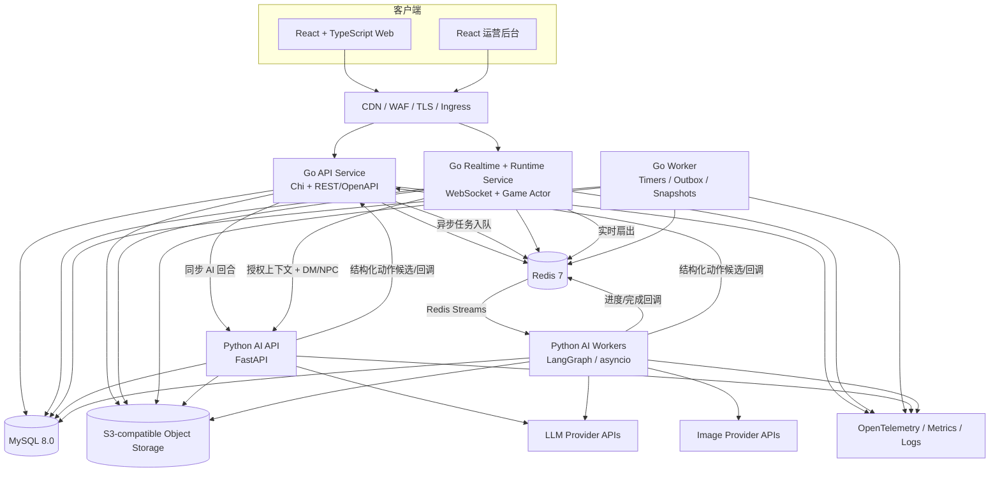

### 3.2 服务边界

| 服务/进程 | 主要职责 | 不承担 |
| --- | --- | --- |
| React Web | 页面、状态展示、用户输入、实时投影渲染 | 规则判定、权限最终判定、幂等 |
| Go API Service | 身份、用户、内容、工坊、房间、社区、运营 API、AI 代理 | 与具体模式耦合的规则 |
| Go Realtime + Runtime | WebSocket 接入、游戏命令执行、规则引擎、事件投影、断线重连 | 长文本生成、图片生成 |
| Go Worker | 计时器触发、Outbox 发布、快照压缩、异步维护任务 | 模型内容生成 |
| Python AI API | DM/NPC 回合、意图解析、授权切片内的上下文排序/摘要/裁剪、生成任务管理 | 修改权威状态或自行扩大上下文切片 |
| Python AI Worker | LangGraph 长任务、记忆整理、复盘生成、质量校验 | 直接写游戏表 |
| MySQL | 权威事实与不可变事件 | 临时锁与大规模广播 |
| Redis | 热缓存、任务流、Pub/Sub、在线状态和分布式租约 | 权威唯一事实 |
| Object Storage | 大文件、不可变产物、快照 | 客户端直接公开读取 |

### 3.3 Go 后端形态

MVP 采用 **Go 模块化单体 + 多进程部署**：

- 业务模块在同一代码库中，通过领域接口调用。
- 部署为三个进程：`api`、`realtime-runtime`、`worker`。
- 共享领域包、数据访问包和协议包。
- 不为用户、内容、房间和游戏分别建立网络服务。
- `realtime-runtime` 可独立扩容，避免 WebSocket 长连接和内容 CRUD 互相影响。
- `worker` 独立承载计时器、Outbox、快照和清理任务。

选择理由：

- PRD 的核心复杂度是领域一致性和规则正确性，不是服务数量。
- MVP 团队可以共享事务和代码，降低跨服务分布式事务。
- 游戏运行时仍单独进程隔离，避免 AI 或内容请求挤占长连接服务。
- 后续可将 `runtime`、`content-workshop` 或 `community` 拆出，不需重写领域接口。

### 3.4 部署拓扑

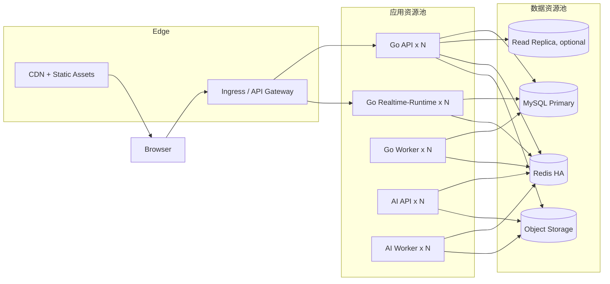

生产建议：

- API、Realtime/Runtime、AI API、AI Worker 使用独立资源上限和扩缩容指标。
- 读副本只服务推荐、搜索、历史等可容忍轻微延迟的读；游戏权威读回到主库或热缓存。
- MySQL、Redis、对象存储启用备份和恢复演练。
- WebSocket 服务保持无状态接入层；游戏运行时通过租约形成单局单写者。
- 所有内部服务使用 mTLS 或短期服务凭证，不暴露公网。

### 3.5 数据权威关系

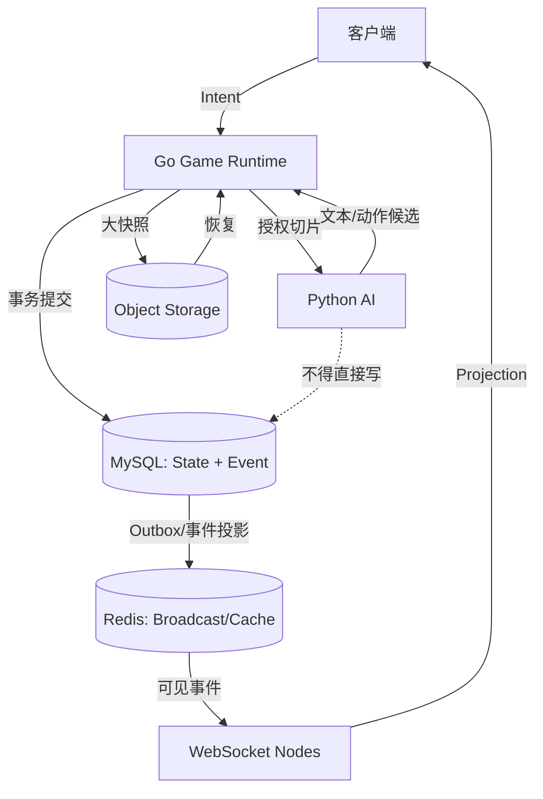

权威顺序：

1. MySQL 游戏事务、事件日志与版本号。
2. 对象存储中的不可变内容包、快照、生成产物。
3. Redis/内存中的实时缓存，可丢失、可重建。
4. 客户端显示的投影，始终可能落后于服务端。

---

## 4. React 前端架构

### 4.1 前端分层

```text
apps/web/src/
├── app/               应用入口、路由、Provider
├── pages/             路由级页面
├── features/          按业务域组织的交互与组件
├── components/        无业务归属的通用 UI
├── design-system/     Token、主题、版式、基础组件
├── stores/            Zustand UI/实时投影 Store
├── queries/           TanStack Query hooks
├── realtime/          WebSocket 客户端、投影 reducer、重连
├── api/               OpenAPI 生成客户端与请求适配器
├── generated/         Schema 生成类型，禁止手改
├── lib/               工具、错误映射、埋点
└── tests/             Vitest、RTL、Playwright fixtures
```

### 4.2 状态边界

| 状态类型 | 归属 | 示例 |
| --- | --- | --- |
| REST 服务端状态 | TanStack Query | 剧本详情、个人资料、历史列表 |
| 实时游戏投影 | Zustand + reducer | 当前阶段、计时、公开事件、本人私密视图 |
| 纯 UI 状态 | Zustand | 当前 Tab、抽屉、草稿输入、筛选面板 |
| 路由状态 | URL/React Router | 筛选、页面路径、房间 ID |
| 表单临时状态 | React 局部或小型 Store | 编辑字段、上传进度 |
| 权威状态 | Go 后端 | 身份、线索 ACL、投票、胜负 |

避免双写：

- 游戏首屏由 TanStack Query 获取快照。
- 快照写入 Zustand 的 `gameProjection`，并将 Query 数据标记为初始来源。
- 后续 WebSocket 事件只由 reducer 更新 Zustand。
- 重连快照会整体替换投影，而不是合并两套来源。
- 非游戏页面的服务端数据仍保留在 TanStack Query。

### 4.3 TanStack Query 使用规范

- Query Key 必须包含权限上下文相关 ID，例如 `['script', scriptId, viewerScope]`。
- 写操作通过 mutation 发送幂等键和版本。
- 房间、剧本、复盘等数据定义明确的 `staleTime` 和失效策略。
- 关键游戏操作不依赖乐观更新；先等待服务端确认，再更新状态。
- 非关键 UI（收藏、已读）可以做乐观更新，但失败必须回滚并提示。
- 禁止用 Query Cache 代替权威状态版本。

### 4.4 Zustand 使用规范

- Store 按页面域拆分，避免一个全局巨型 Store。
- `gameStore` 只保存当前游戏投影和 UI 焦点。
- 所有 WebSocket 事件按 `stream + seq` 更新；缺口触发快照请求。
- 断线时设置 `connectionState`，不停止用户查看已确认内容。
- 敏感投影只在内存保存，不写入 LocalStorage。
- 玩家注销或房间结束后清理私密 store。

### 4.5 WebSocket 客户端

状态机：

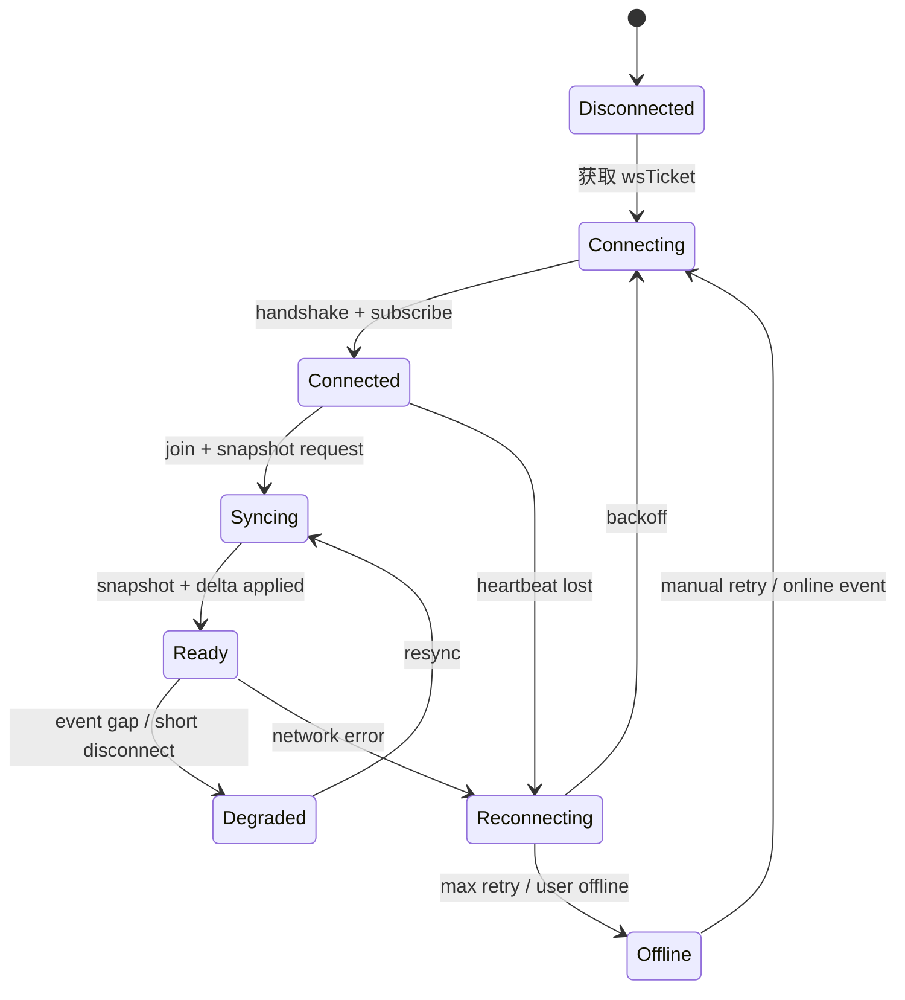

行为规范：

- 客户端不自行生成游戏事件序号。
- 同一 `eventId` 和 `seq` 去重。
- 收到较小 `seq` 的事件时忽略；收到缺口时停止应用增量并请求快照。
- 未确认操作显示“提交中”，不提前展示胜负或资源变化。
- 重连后先拉取投影快照，再应用 `lastSeq + 1` 之后的增量。
- AI 文本流与游戏状态流分离；AI 文本失败不能撤销已经提交的状态。

### 4.6 设计系统与 Motion

- Tailwind Token 分为颜色、字体、间距、层级、动效时长和语义状态。
- 游戏页使用低干扰动效；阶段切换、线索揭示、投票确认可使用 Motion。
- `prefers-reduced-motion` 生效时禁用非必要位移和缩放。
- 动画不能延迟按钮可操作时间；DM 生成动效不能覆盖当前阶段主操作。
- 关键状态必须同时有文字说明，不能只靠动画或颜色。

### 4.7 API 与类型生成

- REST API 定义 OpenAPI 3.1。
- WebSocket 消息和 GamePackage 定义 JSON Schema。
- 构建时生成：
  - TypeScript 类型和客户端。
  - Go 请求响应类型和校验器。
  - Python Pydantic 模型或校验适配。
- 生成文件标注 `Code generated. DO NOT EDIT.`。
- CI 检查生成结果与源 Schema 是否一致。

---

## 5. Go 核心后端架构

### 5.1 模块边界

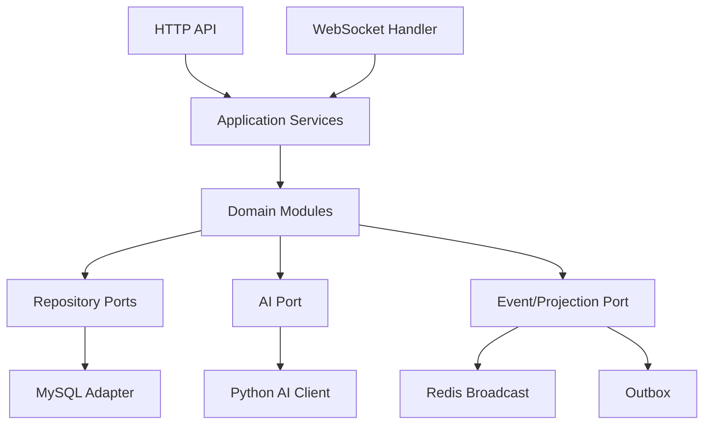

代码依赖规则：

- `domain` 不依赖 Chi、WebSocket、Redis 或 MySQL 客户端。
- `application` 编排事务、权限和领域服务。
- `adapter` 实现数据库、Redis、对象存储和 AI HTTP。
- Handler 只做协议转换、认证上下文提取和错误映射。
- 规则引擎只接收领域对象，不直接访问 HTTP 或数据库。

### 5.2 领域模块

| 模块 | 职责 | 权威数据 |
| --- | --- | --- |
| Identity | 登录、会话、账号状态 | `users`、`sessions` |
| Profile/Friends | 资料、隐私、好友、通知 | `profiles`、`friendships` |
| Content | 剧本元数据、版本、发布、审核 | `scripts`、`script_versions` |
| Workshop | 上传、任务、编辑器、局部重生成 | `parse_jobs`、`drafts` |
| Room | 创建、加入、准备、房主、席位 | `rooms`、`seats` |
| Runtime | 对局生命周期、意图、事件、投影 | `game_instances`、`game_events` |
| Engine | 三模式规则和状态机 | 纯 Go 领域实现 |
| AI Gateway | 上下文请求、DM/NPC、结构化候选 | 不持久化模型内部状态 |
| Realtime | 连接、订阅、心跳、广播 | 在线状态缓存 |
| Replay | 结算、复盘视图、分享卡片 | `results`、`review_reports` |
| Community | 评分、评论、收藏、举报 | `ratings`、`comments` |
| Admin | 审核、事故、干预、审计 | `moderation_cases`、`audit_logs` |

### 5.3 Go 进程角色

#### API Service

- REST/OpenAPI。
- 登录会话、用户、内容、工坊、房间前置操作、社区。
- 提供内部 AI 上下文 API 和回调 API。
- 管理生成任务状态投影。
- 通过 Outbox 入队异步任务。

#### Realtime + Runtime Service

- 建立 WebSocket，完成 WS Ticket 鉴权。
- 提供实时房间订阅。
- 读取、校验、裁决和持久化游戏意图。
- 管理游戏 owner lease 和本地运行时缓存。
- 生成按用户投影的事件并广播。
- 处理重连快照与事件补偿。
- 调用 AI DM/NPC 同步回合。

#### Worker

- 扫描计时器、触发阶段超时。
- 处理 Outbox 到 Redis Streams/PubSub。
- 定期生成游戏和记忆快照。
- 清理过期会话、邀请 token、运行时缓存。
- 处理房主迁移、离线宽限和异步复盘请求。

### 5.4 认证与会话

推荐流程：

1. 用户通过身份 Provider 登录。
2. Go 建立服务端 Session，使用 `HttpOnly + Secure + SameSite` Cookie。
3. REST 写操作使用 CSRF Token 和 Origin 校验。
4. WebSocket 连接先调用短时 `wsTicket` 接口；Ticket 有效期短、单次使用、绑定用户和房间。
5. WebSocket handshake 校验 Ticket、Origin、会话和账号状态。
6. 所有后续消息再次校验房间成员和 actor 权限，不只依赖握手结果。

会话不存储游戏秘密。会话状态可缓存 Redis，MySQL 保存可恢复会话和撤销状态。

### 5.5 数据库访问与事务

- 使用 `sqlc` 生成显式查询类型。
- Transaction 执行器由 Application 层控制，Repository 不自行开启嵌套事务。
- 单局命令事务顺序固定：
  1. `game_instances` 行锁或原子版本条件。
  2. 读取当前状态和幂等记录。
  3. 执行规则。
  4. 追加事件。
  5. 更新当前状态版本。
  6. 写 Outbox 或待广播记录。
  7. 提交。
- 不在事务内调用 AI、对象存储或其他网络服务。
- 大对象先写对象存储，再在事务中提交引用；失败时由清理任务回收孤儿对象。
- 关键状态更新必须校验 `affected_rows = 1`，否则视为版本冲突。

### 5.6 Outbox 与异步一致性

需要异步触发的业务使用 Transactional Outbox：

- 生成任务启动。
- AI 复盘生成。
- 分享卡片渲染。
- 通知发送。
- 缓存失效和快照请求。

流程：

1. 业务事务内写 `outbox_events`。
2. Worker 使用 `FOR UPDATE SKIP LOCKED` 拉取。
3. 发布到 Redis Streams/PubSub。
4. 标记已发布。
5. 消费者按消息 ID 幂等处理。

Redis 发布成功但标记失败时允许重复，消费者必须幂等。

### 5.7 内部 AI 调用封装

`InternalAIClient` 负责：

- 服务认证和请求签名。
- runId、traceId、idempotencyKey 传递。
- 超时、重试、熔断和限流。
- 流式响应转发。
- 结构化响应校验。
- AI 错误码映射。

Go 不把完整数据库对象直接序列化给 Python，而是调用 `ContextProjector` 生成授权知识切片。

---

## 6. Go 游戏引擎架构

### 6.1 设计目标

游戏引擎解决四类问题：

1. 统一房间、玩家、事件、快照和复盘的运行时基础。
2. 隔离剧本杀、狼人杀、RPG 三套规则。
3. 将多人并发操作线性化为可重复的权威状态。
4. 让所有客户端和 AI 只能提交意图，不能直接修改结果。

### 6.2 领域类型职责

| 类型 | 职责 | 是否持久化 |
| --- | --- | --- |
| `GameSession` | 单局运行时会话，绑定房间、席位、内容包、引擎版本、owner | 元数据持久化，连接和本地缓存不持久化 |
| `GameState` | 权威状态的通用信封，包含版本、阶段、玩家、计时和引擎私有状态 | 是，加密保存 |
| `GameEvent` | 不可变、可排序、可投影、可回放的游戏事实 | 是，永久或按策略保留 |
| `GamePhase` | 阶段定义、进入/退出条件、截止时间和保底动作 | 内容包和运行状态均记录 |
| `GamePlayer` | 席位、角色引用、在线/死亡/托管等运行时状态 | 是 |
| `GameContext` | 注入时钟、随机数、权限投影、事件收集和功能开关 | 否，单次执行上下文 |
| `RuleEngine` | 校验意图、计算结果、生成事件和终局判断 | 代码与版本固定 |
| `StateMachine` | 校验阶段转换、阶段超时和终止状态 | 与引擎配套实现 |
| `EventDispatcher` | 事务提交后做可见性投影、缓存和实时广播 | 否 |
| `SnapshotManager` | 生成、存储、加载和压缩状态/记忆快照 | 快照持久化 |

### 6.3 核心契约示意

以下仅为架构契约，不是业务实现代码：

```go
type GameEngine interface {
    Type() GameType
    Version() EngineVersion
    Create(ctx GameContext, input CreateGameInput) (GameState, []GameEvent, error)
    ValidateIntent(ctx GameContext, state GameState, intent GameIntent) ValidationResult
    ApplyIntent(ctx GameContext, state GameState, intent GameIntent) (DecisionResult, error)
    Tick(ctx GameContext, state GameState, serverTime time.Time) (TickResult, error)
    CheckEnd(ctx GameContext, state GameState) (EndResult, bool, error)
    ProjectState(ctx GameContext, state GameState, viewer Viewer) (ProjectedState, error)
}

type StateMachine interface {
    EnterPhase(ctx GameContext, state GameState, phaseID string) (GameState, []GameEvent, error)
    CanTransition(ctx GameContext, state GameState, targetPhaseID string) bool
    PhaseDeadline(ctx GameContext, state GameState) (time.Time, bool)
    FallbackTransition(ctx GameContext, state GameState) (GameState, []GameEvent, error)
}

type RuleEngine interface {
    ValidateAction(ctx GameContext, state GameState, actor ActorRef, action Action) ValidationResult
    ResolveAction(ctx GameContext, state GameState, actor ActorRef, action Action) (GameState, []GameEvent, error)
    ResolvePhaseEnd(ctx GameContext, state GameState, phaseID string) (GameState, []GameEvent, error)
    SettleGame(ctx GameContext, state GameState) (GameState, []GameEvent, EndResult, error)
}
```

约束：

- `Create`、`ApplyIntent` 和 `Tick` 返回新状态或不可变补丁，不在引擎内部直接写数据库。
- Application Service 负责在事务中持久化状态和事件。
- `ProjectState` 不返回完整状态，只返回 Viewer 可用 DTO。
- `GameContext` 不允许暴露数据库连接或 Redis 客户端。

### 6.4 通用状态信封

```json
{
  "gameId": "01J9Z3K4M7Q2R8T5V6W1X10000",
  "gameType": "script_murder",
  "engineVersion": "murder-engine-1.0.0",
  "contentPackageId": "01J9Z3K4M7Q2R8T5V6W1X20000",
  "schemaVersion": "1.0.0",
  "version": 17,
  "seq": 184,
  "phase": {
    "phaseId": "search_round_1",
    "startedAt": "2026-11-20T20:00:00Z",
    "deadlineAt": "2026-11-20T20:08:00Z",
    "fallbackAction": "advance_to_discussion"
  },
  "players": [
    {
      "seatId": "seat_1",
      "userId": "user_1",
      "roleRef": "role_a",
      "runtimeStatus": "active"
    }
  ],
  "engineState": {},
  "secretStateRef": "secret_state_version_17",
  "stateHash": "sha256:7bbf66d8a04b7b3a36f4a8f7b4c51f2bc3ef4d9a8e2a1df6c9a4f7d3312be1ab"
}
```

设计规则：

- 通用字段由共享运行时维护，`engineState` 由模式引擎定义。
- D2-D4 私密数据不放在普通 `engineState` 明文列，进入加密 `secret_state` 或独立密文载荷。
- `version` 仅在规则状态变化或定时状态推进时严格递增；纯聊天/DM 事件不得递增。
- `seq` 与最后一条成功权威游戏事件序号一致。
- `stateHash` 用于快照一致性、诊断和重建校验。

### 6.5 游戏意图处理流程

#### 6.5.1 接收

客户端只能提交：

- `gameId`、`roomId`、`intentType`。
- 结构化 payload。
- `expectedVersion`。
- `idempotencyKey`。
- 可选客户端时间，仅用于诊断。

不得提交：

- 任意新状态。
- 自造 GameEvent。
- 角色 ID 之外的身份属性。
- 绕过阶段动作列表的“自由度”。

#### 6.5.2 校验顺序

1. 认证会话和账号状态。
2. 校验房间成员和对局席位。
3. 校验 `gameType`、engine version、actor 与玩家绑定。
4. 查询幂等键；若已存在，返回原结果。
5. 校验 `expectedVersion`。
6. 校验阶段、计时、存活/在线/托管状态。
7. 调用模式规则引擎校验动作合法性。
8. 获取安全随机数或模板决策。
9. 产生新状态与事件。
10. 事务内追加事件、更新版本、写入幂等结果。
11. 提交后投影并广播。

校验失败不修改状态、不消耗资源、不广播“已成功”事件。资源类失败不扣除次数。

### 6.6 并发与线性化

#### 6.6.1 正确性基线

- 同一 `gameId` 的所有状态修改必须线性化。
- 使用 MySQL `game_instances` 行锁、版本条件或专用 command gate。
- 状态版本与事件序号由服务端分配，客户端时间无权威性。
- 即使两个请求来自不同 Pod，也只能由一个事务成功推进同一版本。

#### 6.6.2 推荐执行组合

MVP：

1. Realtime/Runtime 收到意图。
2. 校验该局 owner lease；非 owner 通过内部 HTTP 转发给 owner。
3. owner 在进程内使用 per-game mutex 串行处理。
4. MySQL 事务仍执行行锁和版本条件，作为跨进程最终防线。
5. 事务成功后更新内存投影和 Redis 热缓存。

Redis 锁只用于减少争抢，不作为正确性唯一保证。MySQL 唯一约束和事务不可缺失。

#### 6.6.3 热点与扩展

- 热门单局不共享全局锁。
- 游戏命令按 `gameId` 分区；房间管理可按 `roomId` 分区。
- RPG world 在 Phase 2-3 仍以世界实例单写者为主；未来按场景分区时必须保留世界级事务边界。
- 每次扩展分区方案都需要并发性质和回放测试，不得只按吞吐拆分。

### 6.7 幂等与重复事件防护

#### 6.7.1 幂等记录

表 `intent_records` 至少包含：

- `game_id`
- `idempotency_key`
- `user_id` 或 AI actor ID
- `intent_hash`
- `result_code`
- `result_payload_digest`
- `event_start_seq`
- `event_end_seq`
- `created_at`

唯一索引：

```text
UNIQUE(game_id, idempotency_key)
UNIQUE(game_id, seq)
```

规则：

- 同一幂等键和同一 payload 哈希返回原结果。
- 相同幂等键但 payload 不同返回 `IDEMPOTENCY_CONFLICT`。
- 只成功提交后才写幂等成功记录；失败校验可按策略短时缓存错误。
- WebSocket 重发、HTTP 重试和 worker 重投都经过同一逻辑。

#### 6.7.2 事件去重

- 事件 `eventId` 全局唯一。
- `gameId + seq` 唯一。
- 客户端以 `eventId` 或 `seq` 去重。
- 事件投影和广播使用同一个持久化事件 ID。
- 补偿事件创建新 ID，不覆盖旧事件。

### 6.8 事件模型

事件分为：

| 类别 | 示例 | 可见性 |
| --- | --- | --- |
| 房间事件 | 加入、准备、房主转移 | room scope |
| 游戏阶段事件 | 阶段开始、截止、结束 | public/role |
| 玩家动作事件 | 搜证、投票、技能 | public/private/runtime |
| 系统裁决事件 | 技能结果、死亡、胜负 | role/runtime/reveal |
| AI 表达事件 | DM 播报、NPC 台词 | public/private |
| 叙事候选事件 | AI 提议动作 | 不广播，交 Go 校验 |
| 事故事件 | 冻结、重建、终止 | 授权运营 |

事件持久化要求：

- 保存原始 payload、Schema 版本、actor、因果 ID、visibility 描述和 reveal gate。
- 对 D3/D4 payload 加密。
- 不把系统 Prompt、完整模型上下文或模型思维链写入事件。
- 事件写入与状态版本更新在同一事务中。

### 6.9 权限投影

`ProjectionService` 是 Go 运行时唯一的客户端状态出口。

输入：

- 权威 `GameState`。
- 当前阶段。
- Viewer（用户、角色、AI actor、审核主体）。
- reveal gates。
- 事件可见性。

输出：

- `GameProjection` DTO。
- 当前合法动作列表。
- 可见事件增量。
- 私密字段和脱敏版本。

投影规则：

- 先用 `viewerManifest` 判断对象级权限。
- 再执行字段级白名单。
- 再执行阶段揭示门控。
- 最后绑定合法动作集合。
- 客户端收到的 `availableActions` 与服务端规则校验来自同一个规则定义。

### 6.10 快照管理

快照触发：

- 每进入关键阶段。
- 每 N 条事件或达到大小阈值。
- 游戏暂停、结算前。
- owner 迁移前。
- 定期容灾检查点。

快照内容：

- 通用状态信封。
- 引擎私有状态。
- 加密 secret state 引用。
- 事件序号、状态版本和 `stateHash`。
- engine version、content package/Schema 版本。
- RNG 审计信息，不把可推导秘密暴露给客户端。

存储策略：

- 小快照压缩后存 MySQL。
- 大状态或含附件引用存对象存储，MySQL 保存引用、哈希和版本。
- 快照不可变；清理只删除超出保留策略的旧版本。
- 恢复时校验内容包版本和引擎版本兼容性。

### 6.11 断线恢复与状态补偿

1. 客户端重连并通过 `wsTicket` 鉴权。
2. 服务端校验房间成员、seat 和 game 归属。
3. 客户端发送 `lastSeq` 和 `lastVersion`。
4. 服务端读取权威最新状态，生成 Viewer 投影快照。
5. 服务端返回快照和 `snapshotSeq`。
6. 客户端丢弃旧未确认状态。
7. 服务端从 `lastSeq + 1` 查找可见增量。
8. 若事件差量过大、已压缩或权限视图改变，只发送快照并要求客户端从最新序号继续。
9. 对掉线期间托管执行的动作显示系统标记。

客户端不得用 LocalStorage 的旧状态与新快照做双向合并。

### 6.12 回放设计

回放使用：

- 不可变内容包版本。
- 对应 engine version。
- 最近快照。
- 后续事件日志。
- 结算结果。

回放分两种：

| 模式 | 说明 |
| --- | --- |
| 规则回放 | 逐事件重建状态，用于测试、事故和复现 |
| 展示回放 | 按角色视角展示已授权事件，不重新调用 LLM |

展示回放不得触发模型重新判断或补写新剧情。AI 点评是独立附加产物，引用 `eventId`，不改变回放轨迹。

### 6.13 阶段计时器

- 阶段 `deadlineAt` 写入 MySQL，是权威截止时间。
- Redis ZSET 或 Stream 用于快速调度，丢失后可由 MySQL 扫描重建。
- Timer Worker 获取 timer 任务后路由到 game owner。
- 同一 timer 使用 `timerId + expectedVersion` 幂等触发。
- 暂停时保存剩余时长；恢复时重新设置截止时间。
- `pause/resume` 使用独立 G09/G10、`game_id + expected_version + Idempotency-Key`，
  不得通过房间 host-actions 绕过 GameSession 锁。
- 服务器时钟由统一 NTP 校准；客户端倒计时仅显示参考。
- 阶段超时触发 `StateMachine` 的保底转换，不由 AI DM 判断。

### 6.14 三模式引擎实现

#### 6.14.1 ScriptMurderEngine

状态范围：

- 角色分配与阅读状态。
- 阶段、搜证次数、线索可见性。
- 私聊开放窗口。
- 投票、平票和揭示。
- 个人目标与最终结果。

关键约束：

- 独占线索通过原子资源状态避免多人同时获得。
- 私人线索和角色本不进入公共投影。
- 阶段流程由内容包声明，但只允许使用白名单 action/effect 类型。
- `CheckEnd` 判断投票和剧本配置的终局条件。

#### 6.14.2 WerewolfEngine

状态范围：

- 身份与阵营。
- 存活、死亡原因、技能状态。
- 夜晚行动窗口。
- 发言顺序与投票轮次。
- 技能链、遗言和胜负。

关键约束：

- 规则模板 ID + version 固定。
- 行动顺序、同守同救、毒杀、猎人触发和平票规则显式编码。
- AI 玩家与真人使用同一 `Intent` 和同一校验入口。
- AI 身份上下文由 projector 生成，不给模型 `roleAssignmentTable`。
- 技能链使用访问集合防止循环触发。

#### 6.14.3 InteractiveRPGEngine

状态范围：

- 世界时间、地点、势力、公共变量。
- 场景、队伍、玩家和 NPC 关系。
- 任务、道具、线索、事件和结局条件。
- 自由行动的 Intent proposal 结果。

关键约束：

- AI 只产生 `ProposedAction`，Go 校验可达性、资源、权限和场景状态。
- 条件表达式只支持已注册、可静态校验的 DSL，禁止 `eval` 任意代码。
- 关键世界改变必须生成公共事件或明确作用域事件。
- NPC 关系变化由 Go 规则决定上限和来源，Python 只提供候选与叙事。
- 多玩家同步使用世界实例单写者与事务。

### 6.15 规则不可被 LLM 修改

保证机制：

1. 内容包中的规则配置只包含白名单 action、condition 和 effect 类型。
2. Publish 前 Python 做 Schema 校验，Go 执行第二道确定性校验。
3. Go 引擎只加载已注册的规则模板和代码版本。
4. AI 输出不能包含可执行 SQL、Go 代码、脚本代码或系统路由。
5. AI 可以生成剧情描述和动作候选，但不能生成新的胜负函数。
6. 引擎版本和规则模板版本固定到 GameInstance。
7. 生产发布需要规则测试集和 Review，不允许运营后台直接修改运行中规则。
8. 所有规则变更只影响新创建对局。

---

## 7. Python AI 服务架构

### 7.1 服务职责

Python AI 服务负责：

- 文档解析和结构化。
- 角色、场景、线索、任务和剧情分支生成。
- 一致性与可玩性校验。
- 局部修复与人工修订辅助。
- AI DM 叙事、规则解释和提示。
- NPC 对话、关系表达和记忆候选。
- AI 玩家行为与发言生成。
- 复盘文本和推理对照。
- 生成评测、Prompt 版本、成本与 trace。

Python AI 服务不得：

- 直接修改房间、游戏、玩家、投票、技能和结算表。
- 直接发布剧本版本。
- 直接广播系统事件。
- 读取未由 Go 权限服务裁剪的知识切片。
- 生成并执行任意代码。

### 7.2 运行形态

```text
AI API Process
├── FastAPI
├── DM/NPC synchronous turn
├── intent parsing
├── job start/retry/cancel APIs
├── human-review resume APIs
└── health/readiness

AI Worker Process
├── Redis Streams consumer group
├── LangGraph workflow execution
├── checkpoint resume
├── memory compaction
├── evaluation/replay jobs
└── progress event publishing
```

同步 DM/NPC 请求与长生成任务分离：

- DM/NPC 有严格响应时限，使用独立并发池。
- 文档生成、图片生成和复盘属于长任务，不占用实时 AI 池。
- AI Worker 故障不阻塞游戏规则引擎。

### 7.3 FastAPI 模块

```text
ai_service/
├── api/
│   ├── dm.py
│   ├── npc.py
│   ├── intent.py
│   ├── workflows.py
│   ├── review.py
│   └── health.py
├── workflows/
│   ├── generation_graph.py
│   ├── state.py
│   ├── nodes/
│   └── checkpoints/
├── agents/
├── context/
├── memory/
├── providers/
├── prompts/
├── schemas/
├── safety/
├── observability/
├── workers/
└── evaluation/
```

### 7.4 LLM Provider 抽象

Provider 接口至少定义：

- `generate_structured`
- `generate_text`
- `stream_text`
- `embed`
- `generate_image`
- `health`

路由层负责：

- 根据任务选择模型档位。
- 处理超时、限流、供应商错误和熔断。
- 根据预算决定完整/精简/模板结果。
- 记录模型、Prompt 版本、Token 和成本。
- 输出统一 Usage 和 Error 类型。

Provider 配置不允许在代码中硬编码密钥。模型路由策略与 Prompt 版本进入版本化配置。

#### 7.4.1 Task 8 最小 Provider 与 Agent Runtime

当前实现提供两个 Provider：

- `mock`：确定性本地测试 Provider，默认用于开发和测试。
- `openai_compatible`：通过 `httpx` 调用 OpenAI-compatible
  `/chat/completions`，支持阻塞结果和流式 SSE 文本。

统一异步 Provider 接口包含模型生成、流式输出、超时、可重试错误分类和
Token Usage。`RetryingProvider` 负责有限指数退避。真实供应商 SDK 不进入
业务 Agent 层。

`agent_runtime` 使用 LangGraph 构建通用有限循环：

```text
START → model → tool → model → ... → validate → END
```

`model` 节点只返回结构化 action：

```json
{"action":"tool","tool_name":"mock_context_lookup","arguments":{"topic":"demo"}}
```

或：

```json
{"action":"final","output":{"answer":"...","confidence":0.9,"used_tool":true}}
```

工具必须已注册，并同时通过 `allowed_tools`、`allowed_permissions` 和
`allowed_actor_types` 校验。工具参数由 Pydantic Schema 校验，调用有独立
timeout；模型不能执行任意本地代码或任意外部系统访问。

Context Builder 只消费 Go 已授权的 `AgentRequest.context` 和短期 Memory View，
按 Token 预算裁剪并记录 section hash，不补查实体。Memory 端口是可替换、
非权威短期存储；MVP 不从 Python 写 Go Memory。

Trace 记录 context/model/tool/validate 步骤、耗时、Usage、状态和错误码。
工具参数只记录 SHA-256，普通日志不记录 Prompt、API Key、完整上下文或私密正文。

#### 7.4.2 Task 9/11 安全基线

- DQ-18 正式 Registry 以 `packages/contracts` 为唯一源，按
  `task_type + schema key + version` 绑定 Active Schema；失败返回安全
  `validation_errors`。
- DQ-19 内部安全 profile 使用 mTLS + `mv-hmac-sha256-v1`，包含 Key ID、
  timestamp、共享 nonce、双密钥轮换、KMS 抽象和 fail-closed 故障策略。
- 内部授权使用 Service Identity + operation/resource/tenant scope；认证成功
  不自动授予操作权限。
- 安全审计记录身份、Request ID、Key ID、认证/授权结果和 scope，不记录密钥、
  token 或业务正文。
- D3/D4 上下文默认不发送模型；SecretPayload 正式数据政策仍为 DQ-15/DQ-22。
- MCP/外部网络工具当前默认拒绝，高风险工具要求确认，工具结果按不可信数据限长。
- Run 元数据和 checkpoint 引用有进程内原型，正式持久化与恢复为 DQ-21。

GATE-AI 逐项状态见 `docs/architecture/gate-ai-checklist.md`。DQ-18/DQ-19
测试级实现已通过，但真实 CA、KMS、Redis 多实例和生产部署仍为 `NOT VERIFIED`；
外部 MCP、Run/Checkpoint 和真实 Provider 仍分别由 DQ-20/DQ-21/DQ-22 阻塞。
Registry 规则见 `docs/architecture/contracts-registry.md`。

### 7.5 Structured Output

- 所有影响后续流程的模型输出必须由 Pydantic 模型约束。
- 先做 JSON Schema/Pydantic 校验，再做业务约束校验。
- 校验失败仅允许有限修复重试。
- 修复不能覆盖已接受产物；生成新的候选版本。
- 安全分类结果、动作候选、校验问题和复盘引用都有明确 Schema。
- 模型原始文本不能直接进入 Go 领域对象。

### 7.6 Prompt 模板管理

Prompt 管理要求：

- 每个 Prompt 有 `promptId`、`version`、`hash`、owner 和变更原因。
- Prompt 源文件版本化，不通过任意后台文本框直接替换生产 Prompt。
- 运行时 trace 记录实际 Prompt 版本和变量哈希。
- 角色人设与安全策略分层，不拼成不可审计的大字符串。
- 用户输入作为不可信变量，放入明确的数据区，不与系统指令同层。
- Prompt 回归测试与模型路由版本绑定。

### 7.7 AI 与 Go 的两种交互

#### 同步回合

适用：

- AI DM 单次回答。
- NPC 单次对话。
- 自由行动意图解析。
- 规则 FAQ。

流程：

1. Go 生成 `AllowedKnowledgeSlice`。
2. Go 调用 Python，传递 actor、stage、version、runId 和幂等键。
3. Python 生成结构化响应。
4. Go 执行输出 Schema、规则冲突和泄漏检查。
5. Go 决定是否作为 AI 消息事件持久化。
6. Go 投影后广播。

#### 异步工作流

适用：

- 文档解析。
- 剧本生成与修复。
- 图片 Prompt/图片生成。
- 复盘生成。
- 记忆整理。

流程：

1. Go 事务写任务和 Outbox。
2. Worker 发布 Redis Streams 消息。
3. Python Worker 消费并执行 LangGraph。
4. Python 发布阶段进度到 Redis Streams。
5. Go 更新任务投影并通过 SSE/WebSocket 展示。
6. 完成后 Python 回调 Go 的 staging artifact 注册 API。
7. Go 校验 artifact 引用、哈希和状态。
8. 只有作者确认和发布 API 才会原子切换 `scripts.published_version_id`。

### 7.8 DM、NPC 与 AI 玩家边界

| 能力 | 输入 | 输出 | 是否可改变状态 |
| --- | --- | --- | --- |
| AI DM 叙事 | 已结算事件、阶段、DM 可见知识 | 台词、提示、事件引用 | 否 |
| AI DM 规则解释 | 规则模板摘要、当前投影 | 结构化说明 | 否 |
| NPC 对话 | NPC 人设、关系、记忆、场景投影 | 台词、关系候选、动作候选 | 候选须经 Go 执行 |
| AI 玩家发言 | 自身身份、公开信息、人格 | 发言文本、投票建议 | 发言可广播，行动须经 Go |
| 自由行动解析 | 玩家文本、场景和合法动作 | 结构化候选/澄清 | 否 |
| 复盘 | 结算事件、授权视角 | 解说和引用 | 否 |

PlayerContext 在 MVP 中每次从 Go 授权可见投影重建，不持久化快照。
Python 只能在 Go 提供的允许切片内排序、摘要、裁剪和组装。

### 7.9 AI 错误模型

| 错误类别 | 示例 | 对应策略 |
| --- | --- | --- |
| Provider | 限流、超时、5xx、鉴权失败 | 重试、备用路由、模板降级 |
| Schema | Structured Output 不合法 | 一次修复重试，失败返回结构化错误 |
| Safety | 敏感实体、违规内容、提示注入 | 阻止、替换、记录安全事件 |
| Context | 缺失切片、版本过期 | 拒绝执行，要求 Go 刷新上下文 |
| Budget | Token/成本超限 | 精简模式或终止长任务 |
| Workflow | Checkpoint 不兼容、节点异常 | 恢复到上一检查点或人工介入 |

---

## 8. LangGraph 剧本生成架构

### 8.1 Graph State

Graph State 使用 Pydantic v2 模型，所有字段可序列化、可校验、可版本化。建议分为六组：

| 分组 | 关键字段 |
| --- | --- |
| 身份与配置 | `workflowVersion`、`jobId`、`scriptId`、`threadId`、`mode`、`schemaVersion`、`config` |
| 输入 | `sourceDocumentRef`、`sourceHash`、`textBlocks`、`lockedFields`、`sourcePolicy` |
| 中间知识 | `storyBible`、`canonFacts`、`characters`、`relationships`、`scenes`、`timeline` |
| 游戏化产物 | `roles`、`clues`、`quests`、`plotGraph`、`ruleRefs`、`imagePrompts`、`images` |
| 质量与人工 | `validationIssues`、`repairRound`、`humanReview`、`approvalState` |
| 运行控制 | `status`、`progress`、`currentNode`、`errors`、`budget`、`attempts`、`artifactIdMap` |

状态约束：

- 节点只能返回声明过的状态补丁。
- 大文本和图片只保存对象存储引用与哈希，不在 Graph State 内反复复制。
- 敏感原文不写入 trace 或普通日志。
- `lockedFields` 是不可被 RepairNode 覆盖的对象路径集合。
- `schemaVersion` 与 `workflowVersion` 分离，分别控制产物结构和执行逻辑。

### 8.2 节点职责与输入输出

| 节点 | 输入 | 输出 | 重试/降级 |
| --- | --- | --- | --- |
| InputNode | 文件/文本/创意、目标模式、人数、时长、风格、权利声明 | 规范化任务参数、source ref、预算、初始状态 | 参数不合法直接终止 |
| ParsingNode | SourceDocument、格式、OCR 选项 | 章节树、文本块、表格/脚注、解析质量报告 | 单块重试；失败块可部分继续 |
| StructuringNode | ParsedDocument、Schema、锁定字段 | StoryBible、人物/事件候选、来源定位 | 最多一次自动重试 |
| CharacterNode | StoryBible、模式配置、锁定角色字段 | 角色卡、关系、自标、秘密、公开/私密权限 | 可局部重试；保留上一草稿 |
| SceneNode | StoryBible、地点/世界观、风格 | 场景、地图节点、视觉描述、场景可见性 | 可局部重试 |
| ClueNode | StoryBible、角色、场景、剧本目标 | 线索、搜证点、任务、隐藏信息、关联事实 | 结构校验失败进入 Repair |
| PlotNode | 角色、场景、线索、冲突、多结局配置 | 剧情分支、阶段、揭示节点、结局条件 | 分支不可达进入 Repair |
| ImagePromptNode | 场景、角色、风格、内容限制 | 安全图片 Prompt、负面 Prompt、引用 ID | 失败不阻塞主流程 |
| ImageGenerationNode | Image Prompt、供应商策略、配额 | 图片对象引用、尺寸、哈希、审核结果 | 可选；失败使用占位或异步补齐 |
| ValidationNode | 所有结构化产物、规则模板、Schema | 阻断/警告/信息问题、可推导性结果 | 确定性检查和模型评审混合 |
| RepairNode | 问题列表、目标对象、`lockedFields`、原产物 | 候选补丁、修复说明、剩余问题 | 最大轮次限制；不得改锁定字段 |
| HumanReviewNode | 通过自动校验的候选包、问题摘要、差异 | 接受/拒绝/补充修改指令 | LangGraph `interrupt`，可长期等待 |
| PublishNode | 已批准产物、Schema、版本和兼容策略 | GamePackage 对象、校验报告、发布候选引用 | 失败保留旧版本，不公开 |

### 8.3 工作流图

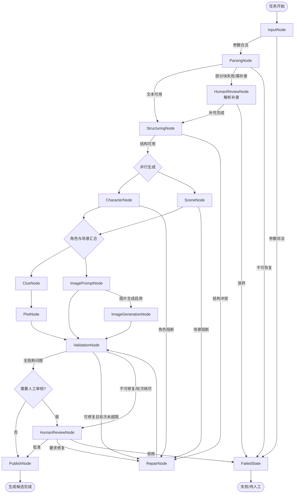

### 8.4 条件边

#### ParsingNode 之后

- `parse_usable_ratio >= threshold` 且无关键章节缺失：进入 Structuring。
- 存在可补录片段且主体可用：进入解析人工补录。
- 无可用文本、文件损坏或加密：失败。

#### StructuringNode 之后

- 人物/事件/时间线通过 Schema 和基础引用校验：并行生成角色与场景。
- 核心结构不可解析：进入 Repair；若无可修复来源则失败。
- 部分章节缺失：可带缺失标记进入生成，但 Validation 必须列为阻断或警告。

#### CharacterNode / SceneNode 之后

- 两者均满足最低结构要求：进入 Clue/Plot 阶段。
- 任一节点阻断且修复预算可用：进入 Repair。
- 修复超过上限：HumanReview。

#### ValidationNode 之后

- 阻断问题 = 0：进入质量/发布门。
- 阻断问题 > 0 且 `repairRound < maxRepairRounds`：Repair。
- 修复无新增有效改动或轮次耗尽：HumanReview。
- 仅警告：根据发布范围和作者配置决定是否人工确认。

#### 人工审核

- 接受：进入 Publish。
- 要求修复：将结构化修订指令和锁定字段带回 Repair。
- 拒绝：FailedState，不发布。

### 8.5 并行生成

并行策略：

- CharacterNode 与 SceneNode 在 Structuring 后并行。
- ImagePromptNode 与 ClueNode 可并行。
- ImageGenerationNode 在 Prompt 和场景稳定后执行，不阻塞 Text Package 校验。
- PlotNode 依赖 ClueNode，避免线索与剧情分支产生分叉。

并行控制：

- 每个节点使用独立 `runId` 和 trace span，最终由 Graph State reducer 汇合。
- 汇合使用显式 reducer，冲突字段必须产生问题而不是静默覆盖。
- 并行节点共享输入只读快照，不共享中间可变全局对象。
- 单节点失败不能取消已成功且可复用产物。
- 并行数受 Redis 队列、模型限流和 CPU/内存预算控制。

### 8.6 自检与自动修复

Validation 分三层：

1. **确定性检查**：JSON Schema、引用完整性、枚举、可达性、权限字段、版本。
2. **规则模拟**：剧本阶段能否走通、线索是否可达、角色目标是否可完成、RPG 结局是否可达。
3. **模型评审**：语义一致性、人物口吻、剧情连贯、风格匹配；评审模型只看允许切片。

Repair 规则：

- 只修复问题列表中定位到的对象和必要依赖。
- 已锁定字段、Canon 事实和发布规则模板不可修改。
- 每次 Repair 生成候选补丁与修复报告。
- 最大自动修复轮次默认 3 次，可配置但不得无限循环。
- 修复后再次执行完整阻断校验，不能只验证被修改字段。
- 无有效变更、重复相同问题或修复预算耗尽时转人工。

### 8.7 最大重试策略

| 层级 | 最大重试 | 触发 |
| --- | --- | --- |
| Provider 单次请求 | 2 次 | 429、5xx、网络超时 |
| LLM 节点 Schema 修复 | 1 次 | Structured Output 不合法 |
| 单节点执行 | 2 次 | 节点异常但输入可复用 |
| Repair 循环 | 3 次 | 可定位、可修复问题 |
| 人工补录循环 | 由用户驱动 | 解析缺失、人工拒绝修复 |

不可重试：

- 内容安全明确拒绝。
- 文件版权或授权状态错误。
- Schema major 版本不兼容。
- 人工明确拒绝。

### 8.8 人工介入

HumanReviewNode 使用 LangGraph `interrupt`：

1. Graph 到达人工审核节点并保存检查点。
2. 任务状态变为 `waiting_human`。
3. 前端显示差异、问题、锁定字段和审核操作。
4. 用户通过 API 提交 `approve`、`reject` 或 `request_repair`。
5. Worker 以同一 `threadId` 和 checkpoint 恢复 Graph。
6. 人工修改形成新的 artifact 版本，不覆盖原始 AI 候选。
7. 超过配置期限未处理可自动保持等待，不消耗模型预算。

人工操作必须带用户 ID、理由和版本，写入审计。

### 8.9 Checkpoint

Checkpoint 分层：

| 层 | 存储 | 用途 |
| --- | --- | --- |
| 热检查点 | Redis | Worker 重启快速恢复、短期状态 |
| 持久检查点 | MySQL AI schema | Redis 丢失后的持久恢复 |
| 大产物 | 对象存储 | StoryBible、候选包、图片、报告 |

Checkpoint 保存：

- Graph State 引用版本。
- 已完成节点和下一步节点。
- 并行分支完成状态。
- Artifact ID 和哈希。
- 当前重试次数、预算和错误。
- workflow/package Schema 版本。

每个 super-step 后保存一次。恢复时必须验证代码版本、Schema 版本和 checkpoint 兼容性。

### 8.10 任务取消

取消流程：

1. Go 将任务状态置为 `cancelling`。
2. Worker 收到取消信号或查询状态。
3. 在节点边界、模型流分片和安全检查点检查取消。
4. 可取消的模型请求主动 abort。
5. 已生成但未接受的 artifact 标记为 discarded。
6. 保存最后检查点并释放租约。
7. 最终状态为 `cancelled`。

取消不删除已发布版本或旧草稿，不自动扣除非已完成阶段的约定配额；具体计费由成本策略决定。

### 8.11 生成进度追踪

进度不是简单按节点平均：

- 每个节点声明权重和子步骤。
- ParsingNode 按分块进度。
- Character/Scene 并行节点合并进度，避免总和超过 100%。
- Validation/Repair 使用轮次权重。
- HumanReview 显示等待人工，不伪造进度。

进度消息：

```text
ai.workflow.started
ai.node.started
ai.node.progress
ai.node.completed
ai.node.failed
ai.repair.round_completed
ai.human_review.required
ai.workflow.succeeded
ai.workflow.failed
ai.workflow.cancelled
```

Go 对进度消息做幂等更新，并检查 `workflowVersion` 与 `jobId`。

### 8.12 部分失败恢复

可复用产物：

- 已解析文本块。
- 已完成 StoryBible。
- 已通过 Schema 的角色或场景。
- 已生成场景图片。
- 已记录的问题列表。

恢复规则：

- 从最近成功 checkpoint 继续。
- 只重跑失败节点及其依赖节点。
- 对已接受且锁定产物不重复生成。
- Artifact 哈希不同视为新候选，不原地覆盖。
- 恢复后重新检查 Graph State 的并行汇合条件。

---

## 9. 统一 Script Schema 与跨语言契约

### 9.1 设计目标

Python 生成的数据必须能被 Go 稳定解析、校验、编译和持久化。Schema 需要同时满足：

- 结构表达力足够覆盖剧本杀、狼人杀、RPG。
- 私密数据可标级、可加密、可投影。
- 与具体 LLM 输出格式解耦。
- 引擎版本兼容可检查。
- 历史内容可长期读取。

### 9.2 统一包信封

`GamePackageEnvelope` 建议结构：

```json
{
  "schemaVersion": "1.0.0",
  "packageId": "01J9Z3K4M7Q2R8T5V6W1X20000",
  "scriptId": "01J9Z3K4M7Q2R8T5V6W1X30000",
  "sourceVersion": "draft_17",
  "gameType": "script_murder",
  "engineContract": {
    "minimumEngineVersion": "murder-engine-1.0.0",
    "recommendedEngineVersion": "murder-engine-1.0.0"
  },
  "metadata": {
    "title": "雾港最后一班船",
    "language": "zh-CN",
    "players": {"min": 4, "max": 8},
    "durationMinutes": 90,
    "difficulty": "standard",
    "contentRating": "16+"
  },
  "canon": {
    "storyBibleRef": "s3://mysteryverse-prod/genesis/001/story-bible.json.gz",
    "factIds": ["fact_1", "fact_2"]
  },
  "payload": {
    "type": "script_murder",
    "ref": "s3://mysteryverse-prod/packages/001/0001/script-murder.json"
  },
  "assets": [],
  "validation": {
    "status": "passed",
    "reportRef": "s3://mysteryverse-prod/validation/001/0001/report.json"
    "blockingIssueCount": 0
  },
  "contentHash": "sha256:a3a57de1f05ef2cfcc0c62d8d7d9d3d75efdf3c20b2be19cd1d3b35a4a7af7e4"
}
```

### 9.3 模式 Payload

#### Script Murder Payload

- `roles`：角色卡、私人剧本、目标、秘密、关系、投票权。
- `clues`：可见性、揭示门控、关联事实、重复规则。
- `searchPoints`：阶段、位置、次数、可获得线索。
- `phases`：动作白名单、进入/退出、时限、保底动作。
- `truth`：仅 D4。
- `permissions`：角色视角矩阵。
- `narrativeTemplates`：DM 阶段播报和提示模板。

#### Werewolf Payload

- `ruleTemplateRef`：平台受控规则模板 ID/version。
- `theme`、`roleAliases`、`narrativeSkin`。
- AI 玩家可用的人格预设引用。
- 不包含任意生成的胜负函数和行动优先级代码。

#### RPG Payload

- `worldRules`：受控状态变量和条件 DSL。
- `locations`、`connections`、`scenes`。
- `npcs`、`personas`、`knowledgeScopes`、初始关系。
- `quests`、`items`、`events`、`endings`。
- `visibilityScopes` 和多人世界配置。

### 9.4 数据分级

Schema 中每个可投影对象必须声明：

- `visibility`：public、room、role、role_group、player、runtime、audit。
- `sensitivity`：D0-D4。
- `revealGate`：可空。
- `sourceRefs`：原文和 Canon 来源。
- `generated`：原文/确认/推断/待确认。

私密字段：

- 不进入普通索引。
- 不在 Graph 进度和 trace 中展示正文。
- Go 持久化时加密。
- Python 通过 Go 授权切片读取，不直接查询 Go 表。

### 9.5 Schema 版本策略

使用 SemVer：

- **Major**：不兼容字段删除、语义变化、引擎无法读取。
- **Minor**：新增可选字段、向后兼容的枚举扩展。
- **Patch**：文档、约束说明或非语义修复。

兼容规则：

- Go 引擎声明 `supportedPackageRange`。
- 发布时 Package 编译为引擎特定运行时配置。
- 老对局固定原 package 和 engine version。
- 新引擎必须能读取仍在保留期内的 Supported Major 版本，或通过显式迁移器转换。
- 未知字段默认拒绝或忽略必须由 Schema 明确，不能跨版本随意变化。
- Migration 必须保留来源版本、迁移器和结果哈希。

### 9.6 契约源文件

仓库中 `packages/contracts` 是唯一契约源：

```text
packages/contracts/
├── openapi/
├── json-schema/
│   ├── game-package/
│   ├── game-events/
│   ├── ws-messages/
│   └── ai-outputs/
├── examples/
├── compatibility/
└── codegen.yaml
```

生成目标：

- `apps/web/src/generated`
- `backend/internal/contracts`
- `ai_service/schemas/generated`

CI 验证：

- Schema 示例通过。
- Pydantic/Go/TS 生成无漂移。
- 跨版本 fixture 可读。
- Contract tests 可在 Go/Python 双侧运行。

### 9.7 发布前验证流水线

1. Pydantic 结构校验。
2. JSON Schema 校验。
3. 来源引用与对象 ID 完整性。
4. Canon 一致性。
5. 角色、线索、阶段、任务可达性。
6. 可推导性和无死局检查。
7. 模式规则模板兼容检查。
8. Go 确定性预编译校验。
9. 隐私泄露与提示注入静态检查。
10. 内容安全与版权相似检查。
11. 人工审核与发布确认。

Python 校验通过不等于可发布。Go 的第二道验证和审核结果是必要条件。

### 9.8 PublishNode 输出

PublishNode 产生：

- `GamePackageEnvelope`。
- 压缩 mode payload。
- `ValidationReport`。
- `diff` 与人工审核记录。
- 对象存储引用和内容哈希。
- `artifactManifest`。

PublishNode 只将结果注册为“可发布候选”，不直接更新公开状态。最终发布通过 Go Content API 完成。

### 9.9 Task 7 内容管理与运行时加载边界

Go `backend/internal/script` 是剧本 Draft、版本、发布和运行时内容读取的当前实现边界：

- `Service` 负责作者权限、幂等、版本事务、校验、发布和下架。
- `Validator` 只返回结构化问题；非空阶段 entry/exit DSL、非空组合结局条件和
  当前引擎不支持的投票策略返回 `state=unsupported`，阻断发布。
- `Loader` 是新开局和历史局读取内容包的唯一入口：
  - 新开局仅接受已冻结、校验通过且状态为 `published_private` / `published_public`
    的版本；脚本当前必须为 `published`。
  - 历史局可继续读取已绑定的 `unlisted` / `archived` 版本，但版本仍必须有冻结时间、
    校验通过状态和零阻断问题。
  - Loader 只返回 SecretPayload 引用，不返回密文或私密正文。
- `game/compile.Compiler` 不再直接查询内容表，只编译 Loader 返回的版本数据，并将
  `script_version_id`、engine version 和 package hash 固定到 GameSession。

章节、阶段、角色、线索、结局、资产和搜证点仍属于同一 `script_version_id` 作用域。
Python 只能通过 Go 授权的内部接口提交候选和读取裁剪后内容，不能直接写这些表。

---

## 10. Memory 记忆架构

### 10.1 目标

Memory 系统同时满足：

- 运行期低延迟读取。
- 当前对话和游戏阶段上下文。
- NPC 长期关系与经历。
- 游戏恢复和 owner 迁移。
- 多实例部署下不依赖本地共享磁盘。
- AI 记忆不冒充权威事实。

### 10.2 分层架构

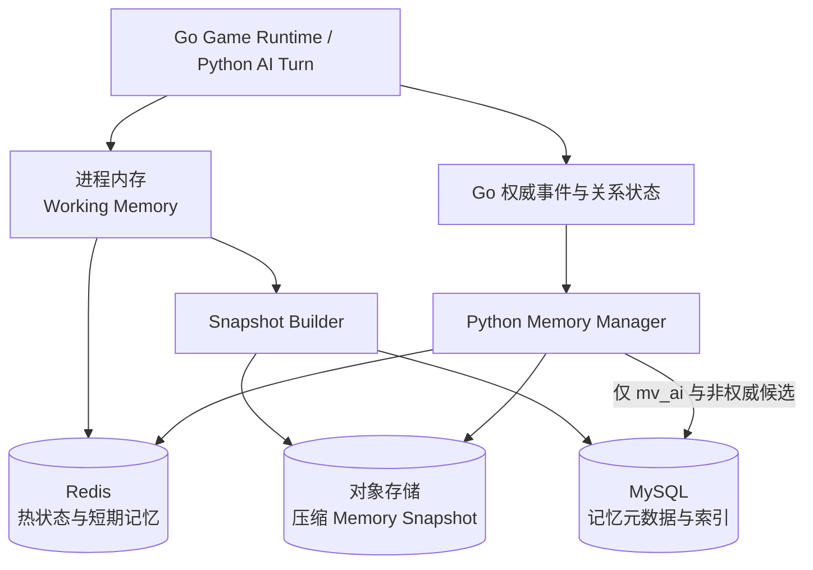

### 10.3 权威关系

| 数据 | 权威来源 | 记忆用途 |
| --- | --- | --- |
| NPC 当前关系数值 | Go game state | Python 只读授权投影 |
| 关键承诺/交易 | Go game event/state | 记忆摘要只能引用 |
| 玩家位置、背包、任务 | Go game state | 可进入短期记忆摘要 |
| NPC 人格与背景 | 内容包 | 长期人设 |
| 玩家自述 | 玩家聊天 | 标记“玩家声明”，不自动成为事实 |
| AI 总结 | Python Memory | 标记推断，不可覆盖权威事实 |
| 传闻 | 对话/事件来源 | 保留来源和置信度 |

当 Memory 与 Go 权威状态冲突时，以 Go 为准并标记记忆过期或待修复。

### 10.4 短期记忆

内容：

- 当前对话最近回合。
- 当前阶段和可见状态摘要。
- 近期 10-50 条相关事件。
- NPC 当前目标与临时情绪。
- 临时推理结果。
- 玩家本轮行动意图与澄清候选。

存储：

- 进程内 per-game LRU。
- Redis key 带 TTL，例如 `mem:short:{gameId}:{actorId}:{version}`。
- 仅作为加速；可从最近事件重建。

限制：

- 按 actor 和 game 隔离，禁止共享全房间聊天。
- 对话原文过期后只保留摘要或删除。
- 预算超限时先裁剪氛围文本，保留目标、规则和关键事件。

### 10.5 长期记忆

内容：

- NPC 人格与背景引用。
- 玩家/NPC 关系和态度历史。
- 重要剧情经历和承诺。
- 游戏历史摘要。
- 传闻、交易、帮助、背叛等语义记忆。

`MemoryRecord` 字段：

| 字段 | 说明 |
| --- | --- |
| `memoryId` | 稳定 ID |
| `gameId/worldId` | 所属对局/世界 |
| `ownerType/ownerId` | NPC、玩家或队伍 |
| `actorScope` | 可读取记忆的主体 |
| `version` | 记忆版本 |
| `summary` | 摘要 |
| `sourceEventIds` | 来源权威事件 |
| `sourceType` | event、dialog、inference、rumor |
| `authorityClass` | fact、player_claim、inference、rumor |
| `confidence` | 置信度 |
| `sensitivity` | D0-D4 |
| `createdAt/expiresAt` | 生命周期 |
| `supersedes` | 被替代记忆 ID |
| `contentHash` | 完整性校验 |

### 10.6 Memory Snapshot

> MVP 不持久化 PlayerContext 快照。本节描述 Phase 2 的长期 NPC Memory 能力，
> 启用前必须完成独立 ADR、作用域和恢复评审。

快照内容：

- 所属游戏、世界、actor 和版本。
- 短期对话摘要和近期事件 ID。
- 长期记忆 ID 列表、摘要和关系投影。
- 当前目标与临时状态。
- engine/game 事件序号。
- 来源哈希和格式版本。

格式：

- gzip/parquet/JSONL 择一，MVP 推荐压缩 JSON。
- 加密后写入对象存储。
- MySQL 保存 Snapshot Metadata 和对象引用。
- 快照不可变，通过 `snapshotId + version` 区分。

触发：

- 每 N 条已结算事件。
- 阶段/章节完成。
- NPC 重要关系变化。
- owner 迁移或正常停机。
- 每小时或每日压缩任务。

### 10.7 多实例与本地磁盘

多实例问题：

- Pod 本地盘不共享，Pod 重启后丢失。
- 不同 WebSocket 节点可能连接同一房间玩家。
- Runtime owner 可能迁移。

设计：

- 本地内存仅作为缓存。
- 本地 disk 可选 write-through cache，但必须在 Pod 丢失后可重建。
- 持久快照只写对象存储。
- MySQL 保存元数据和索引。
- Redis 保存短期共享状态。
- owner 迁移时新 owner 从最新快照 + 事件增量恢复。

### 10.8 恢复流程

1. 读取 Go 权威 GameState 和当前 `seq`。
2. 查询最新 Memory Snapshot Metadata。
3. 校验 snapshot 的 game/world、actor scope、Schema 和哈希。
4. 从对象存储加载快照。
5. 读取快照 `seq + 1` 之后相关权威事件。
6. 应用记忆增量，丢弃与 Go 状态冲突的推断。
7. 加载最近短期上下文到进程内存/Redis。
8. 记录恢复 trace 和耗时。

若快照损坏或不兼容，退化为从最近关键事件重建摘要，不影响核心规则。

### 10.9 记忆检索

MVP：

- 按 `gameId + actorScope + ownerId` 强制过滤。
- MySQL 查询最近、重要、关系相关记忆。
- 小规模嵌入向量存 BLOB，在 Python 中做精确相似度排序。
- 单 actor 候选集设置硬上限，不做跨用户全局向量搜索。

Phase 3 如规模证明需要，可引入专用向量索引，但仍必须强制 actor/game 过滤。

### 10.10 记忆更新

AI 只生成 `MemoryCandidate`，Go 是 Memory 元数据唯一权威写入者：

```json
{
  "candidateId": "01J9Z3K4M7Q2R8T5V6W1X30000",
  "gameId": "01J9Z3K4M7Q2R8T5V6W1X40000",
  "gameNpcId": "01J9Z3K4M7Q2R8T5V6W1X50000",
  "ownerActorScope": "npc:01J9Z3K4M7Q2R8T5V6W1X50000",
  "summary": "玩家承诺帮助寻找失踪的弟弟",
  "sourceEventIds": ["01J9Z3K4M7Q2R8T5V6W1X60000"],
  "authorityClass": "fact",
  "confidence": 0.93,
  "proposedExpiry": "game_end",
  "runId": "01J9Z3K4M7Q2R8T5V6W1X70000",
  "schemaVersion": 1
}
```

Python 通过内部 API 提交候选。Go Memory Service 负责：

- 来源事件存在且在该 NPC 可见范围。
- 摘要不包含未授权秘密。
- 关键承诺是否已在权威任务/交易中体现。
- 是否有重复记忆可合并。
- 关系变化是否超过规则上限。
- 版本、幂等、去重、审计和最终写入。

Python 不得直接访问 `mv_core.npc_memories` 或 `secret_payloads`。
Go 校验通过后写 Memory Metadata 和加密摘要引用；Memory 不改变游戏胜负和任务完成状态。

---

## 11. 实时通信设计

### 11.1 连接建立

1. 客户端调用 `POST /api/v1/realtime/tickets`。
2. Go 校验会话、账号状态、房间成员和目标房间。
3. 返回一次性 `wsTicket`，绑定 `userId + roomId + purpose + nonce`，短期有效。
4. 客户端携带 Ticket 建立 WebSocket。
5. Gateway 校验 Ticket、Origin、版本和连接限制。
6. 服务端分配 `connectionId`，加入内部连接注册表。
7. 客户端请求加入房间，服务端再次校验成员和游戏归属。
8. 返回 `connected`、`roomSeq`、`gameSeq` 和可选状态快照引用。

Ticket 不写入浏览器 LocalStorage，使用内存或安全上下文传递。

### 11.2 频道模型

浏览器不直接订阅任意 Redis Channel。逻辑频道由 Go 映射：

| 逻辑频道 | 可见内容 | 权限 |
| --- | --- | --- |
| `room:{roomId}:public` | 房间成员状态、公开系统消息 | 房间成员 |
| `room:{roomId}:game-public` | 所有公开游戏事件 | 房间成员 |
| `room:{roomId}:role:{roleId}` | 角色/阵营私密事件 | 指定角色 |
| `room:{roomId}:user:{userId}` | 个人私密视图、私聊、AI 回应 | 指定用户 |
| `ops:incident` | 运营事故事件 | 授权运营 |

私密事件不得只使用前端 Channel 名过滤。

### 11.3 消息信封

```json
{
  "event_id": "01J9Z3K4M7Q2R8T5V6W1X40000",
  "event_type": "game.clue_unlocked",
  "stream": "game",
  "stream_id": "01J9Z3K4M7Q2R8T5V6W1X10000",
  "seq": 184,
  "schema_version": 1,
  "game_id": "01J9Z3K4M7Q2R8T5V6W1X10000",
  "timestamp": "2026-11-21T10:00:00Z",
  "payload": {}
}
```

规则：

- `stream` 可为 `system`、`room`、`room_chat`、`game`、`ai_progress`、`ai_stream`。
- 同 `stream + stream_id` 的 seq 单调递增，不同 stream/stream_id 不可比较。
- 客户端按 `event_id` 去重，并按 `seq` 检测缺口。
- `game_id` 仅游戏级事件必填，等待房消息不得伪造。
- payload 已经是当前 Viewer 的权限投影。
- 不发送完整数据库实体。
- AI Token 流使用独立 `ai_stream` 类型，不写游戏 seq。

### 11.4 公共与私密广播

事务提交后：

1. EventDispatcher 读取已持久化事件。
2. ProjectionService 生成公共投影和私密投影引用。
3. 公共投影发布到 Redis Pub/Sub 公共频道。
4. 私密投影发布到用户/角色频道或通过 owner 定向发送。
5. 所有 WebSocket 节点根据本地连接索引推送。
6. 错过 Pub/Sub 的客户端通过 DB 事件补偿。

需要避免“公共频道先发，数据库事务后提交”。顺序必须是 DB commit → publish。

### 11.5 心跳

- WebSocket 协议 Ping/Pong 与应用心跳同时使用。
- 客户端 20-30 秒无 Pong 或应用心跳进入重连。
- 服务端按连接维护最后活跃时间。
- 超时后释放连接资源，但保留房间席位的离线宽限。
- 心跳失败不等同于立即退出游戏。

### 11.6 重连与补偿

客户端参数：

- `roomId`
- `gameId`
- `lastRoomSeq`
- `lastGameSeq`
- `lastVersion`
- 客户端协议版本

服务端步骤：

1. 重新鉴权和房间成员校验。
2. 校验席位和角色。
3. 读取权威状态和最新投影。
4. 计算事件差量大小。
5. 差额小且可见序列连续：返回快照 + 增量。
6. 差额大或压缩：仅返回新快照和新 seq。
7. 客户端清理旧游戏投影后应用快照。
8. 未确认命令由客户端以原幂等键重试；服务端返回原结果。

### 11.7 消息重复与乱序

- 服务端事件 `seq` 唯一。
- Redis 重复投递时，客户端按 `event_id` 去重。
- 旧 seq 事件不应用。
- 未来 seq 造成缺口时进入 `Degraded`，请求快照。
- 同一聊天消息使用 `clientMessageId + idempotencyKey`。
- 私密消息与公共事件的排序以各自 `stream + stream_id` seq 为准，不用客户端接收时间比较。

### 11.8 背压与限流

- 连接级消息队列有上限。
- 慢客户端超过队列阈值时丢弃可重放 UI 心跳类消息，不丢弃权威状态；必要时断开并要求重连快照。
- Chat 发送按用户和房间限流。
- AI 流式片段合并推送，避免逐 Token 高频扇出。
- 大快照通过 HTTP 或分片获取，不通过单条 WebSocket 消息塞入。
- 连接数和单 IP/账号并发连接数可配置。

### 11.9 横向扩展

- WebSocket Gateway 不保存权威游戏状态。
- 连接注册表可在 Redis 保存摘要，但本地索引用于实际写 Socket。
- Redis Pub/Sub 负责跨 Pod 扇出。
- 游戏 Runtime owner lease 决定命令执行节点。
- 非 owner 节点收到操作时，将 Intent 转发给 owner，不自行修改状态。
- owner 失效后，新 owner 从 MySQL/对象存储恢复，再从当前 seq 继续广播。

### 11.10 语音扩展边界

MVP 不实现语音。Phase 3 若引入语音：

- 需要独立媒体服务，不把音频放进 GameEvent payload。
- 语音权限必须与文本私聊一致。
- 需要录制、留存和审核策略。
- WebSocket 仅承载信令，媒体走 WebRTC/SFU。
- 本设计的权限投影和房间模型可复用，但需新增媒体授权服务。

---

## 12. 服务间通信与数据流

### 12.1 通信原则

- 浏览器只与 Go 公网接口通信。
- Python AI API 不直接暴露公网。
- Go 与 Python 使用服务身份认证。
- Python 通过 Go 内部 API 读取上下文和提交候选。
- 所有跨服务调用带 `traceId`、`requestId`、`runId`、`idempotencyKey`。
- 所有同步调用有 deadline。
- 所有异步消息可重复，消费者必须幂等。

### 12.2 Go → Python 同步接口

建议内部 API：

```text
POST /internal/v1/ai/dm-turn
POST /internal/v1/ai/npc-turn
POST /internal/v1/ai/parse-action
POST /internal/v1/ai/explain-rule
GET  /internal/v1/ai/runs/{runId}
```

请求包含：

- `actor`、`gameId`、`roomId`、`phaseId`。
- `stateVersion`、`eventSeq`。
- `allowedKnowledgeSlice` 或受控引用。
- 模式、规则摘要、输出约束。
- 预算、超时和 trace 信息。

响应包含：

- 结构化文本/动作候选。
- `referencedEventIds`。
- `safetyFlags`。
- Token/成本/延迟。
- `aiRunId` 和 Schema 版本。

### 12.3 Go → Python 异步任务

Redis Stream：

```text
Stream: ai.jobs.generation
Consumer Group: generation-workers
```

消息：

- `jobId`
- `workflowId`
- `scriptId`
- `jobType`
- `configRef`
- `schemaVersion`
- `idempotencyKey`
- `requestedAt`

消费者：

- `XREADGROUP` 读取。
- 执行业务后 `XACK`。
- 失败写重试计数和延迟队列。
- 最大投递次数后进 Dead Letter Stream。
- worker 崩溃时 Pending Entries 由 reclaim worker 处理。

### 12.4 Python → Go 内部接口

```text
POST /internal/v1/context/resolve
POST /internal/v1/ai/artifacts/register
POST /internal/v1/ai/progress
POST /internal/v1/ai/memory-candidates
POST /internal/v1/ai/intents/validate
POST /internal/v1/ai/intents/submit
```

`validate` 用于 AI 给出的动作候选做无副作用校验；`submit` 用于 AI 玩家/NPC 在规则允许时提交正式意图。两者都必须带 actor scope 和幂等键。

### 12.5 Context Resolve

请求：

- `actorType`：dm、npc、ai_player、player_context。
- `gameId/worldId`
- `viewerId`
- `phaseId`
- `version`
- `requestedTopics`

Go 返回：

- 已裁剪的 `AllowedKnowledgeSlice`。
- 允许披露的 entity 字段。
- 禁止披露的 entity ID hash 或通用 guard 列表。
- 可见事件 ID 和摘要。
- 合法动作列表。
- 上下文过期时间。

Python 不得通过猜测或额外查询扩大 Slice。
PlayerContext 在 MVP 中每次按当前可见投影重建，不持久化快照。

### 12.6 Artifact 注册

Python 生成完成后：

1. 上传对象存储。
2. 计算 SHA-256。
3. 调用 Artifact Register。
4. Go 校验 job 状态、workflow 版本、Schema 引用、文件大小和哈希。
5. Go 创建 `GenerationArtifact` staging 记录。
6. Python 发送完成回调。
7. Go 任务投影进入 `ready_for_review` 或失败状态。

注册与回调要求幂等。重复注册同一 artifact 返回现有记录。

### 12.7 分布式一致性

不采用跨 MySQL、Redis、对象存储和 AI 服务的分布式事务。

采用 Saga/Outbox：

- 业务事务写任务和 Outbox。
- 队列投递失败可重试。
- Python 产物先写对象存储。
- 注册失败时对象成为孤儿，由生命周期任务清理。
- Go 只在所有引用和校验通过后更新草稿版本。
- 发布再次由 Go 单事务原子切换。

### 12.8 错误传播

错误分类：

- `VALIDATION_ERROR`：客户端修复。
- `FORBIDDEN`：权限拒绝。
- `CONFLICT`：版本冲突。
- `AI_TIMEOUT`：可降级。
- `AI_SAFETY_BLOCKED`：替换输出。
- `PROVIDER_UNAVAILABLE`：熔断/备用/模板。
- `WORKFLOW_FAILED`：任务失败，可重试。
- `DEPENDENCY_ERROR`：基础设施故障。

客户端不接收 Python 堆栈或内部 Prompt。

### 12.9 服务认证

- 内部 API 通过 mTLS 或短期服务 Token。
- Service Token 绑定调用方、受众和允许操作。
- Python 回调签名包含 body hash、timestamp 和 nonce，防止重放。
- Go 对 body 大小、Schema 和幂等键做验证。
- 生产网络策略只允许必要服务互通。

---

## 13. 数据与存储架构

### 13.1 MySQL 数据分组

| 领域 | 主要表组 |
| --- | --- |
| Identity/Profile | `users`、`sessions`、`profiles`、`user_privacy`、`friendships` |
| Content | `scripts`、`script_versions`、`generation_artifacts`、`moderation_cases` |
| Workshop | `source_documents`、`parse_jobs`、`job_stage_projection`、`drafts`、`generation_artifacts` |
| Room | `rooms`、`room_members`、`seats`、`invitation_tokens` |
| Game | `game_instances`、`game_current_state`、`game_secret_state`、`game_events`、`game_snapshots` |
| Command | `intent_records`、`game_timers`、`outbox_events` |
| Replay | `game_results`、`review_reports`、`review_annotations` |
| Social | `ratings`、`comments`、`favorites`、`share_links`、`reports` |
| Admin | `audit_logs`、`incidents`、`feature_configs` |

Python AI 使用独立 schema，例如 `ai_runtime`：

- `ai_runs`
- `ai_steps`
- `ai_context_manifests`
- `ai_checkpoints`
- `ai_evaluation_runs`

Python 账号没有 Go 权威表的写权限。

### 13.2 关键唯一约束

```text
UNIQUE(room_members.room_id, room_members.user_id)
UNIQUE(seats.room_id, seats.seat_no)
UNIQUE(seats.room_id, seats.user_id) WHERE user_id IS NOT NULL
UNIQUE(game_instances.room_id)
UNIQUE(game_events.game_id, game_events.seq)
UNIQUE(intent_records.game_id, intent_records.idempotency_key)
UNIQUE(game_snapshots.game_id, game_snapshots.seq)
UNIQUE(script_reviews.user_id, script_reviews.script_version_id)
```

部分唯一条件依 MySQL 版本使用生成列或应用约束实现。

### 13.3 关键事务

#### 开局

1. 锁定 room 行。
2. 校验人数、准备、房主、内容版本。
3. 创建 GameInstance。
4. 固定 engine/rule/content package 版本。
5. 加密生成身份分配。
6. 写初始 GameEvent。
7. 更新 room 状态。
8. 写 Outbox 用于广播。
9. 提交。

#### 游戏命令

1. 锁定 game 行或执行版本条件更新。
2. 校验幂等。
3. 读取当前状态。
4. 运行规则。
5. 写 IntentRecord、GameEvent、CurrentState。
6. 更新 seq/version/hash。
7. 必要时生成快照引用。
8. 写 Outbox 或事件发布标记。
9. 提交。

#### 发布

1. 校验 `script_versions` staging。
2. 校验 Schema、Go 编译结果、审核和阻断问题。
3. 原子切换 `scripts.current_published_version_id`。
4. 写发布记录和审计。
5. 更新公开索引/缓存。

### 13.4 JSON 与规范化

- 高频查询字段、版本、seq、状态、权限、时间使用普通列。
- 模式私有 payload 使用 JSON，但必须有 Schema 版本。
- 不把关键唯一约束埋在 JSON。
- 大段私密文本或大对象使用密文列或对象存储引用。
- JSON 字段更新必须伴随版本和哈希，禁止无审计直接替换。

### 13.5 Redis Key 设计

```text
sess:{sessionId}
ws:ticket:{ticketHash}
room:presence:{roomId}
room:state:{roomId}
game:owner:{gameId}
game:cache:{gameId}:v{version}
game:timer:zset
stream:ai.jobs.generation
stream:ai.progress
stream:ai.jobs.deadletter
pubsub:room:{roomId}:public
pubsub:room:{roomId}:role:{roleId}
pubsub:room:{roomId}:user:{userId}
mem:short:{gameId}:{actorId}:{version}
```

TTL：

- Session 依据登录策略。
- WS Ticket 短时。
- Room Presence 需心跳续期。
- Game cache 只在对应版本有效。
- Short Memory 有硬 TTL。

所有 Redis 数据必须能从 MySQL 或对象存储重建，Session 无此要求但需可重新登录。

### 13.6 对象存储目录

```text
s3://mysteryverse-{env}/
├── source-documents/{scriptId}/{documentId}/original
├── generation/{jobId}/{workflowVersion}/{artifactId}
├── packages/{scriptId}/{versionId}/manifest.json.gz
├── images/{scriptId}/{assetId}
├── game-snapshots/{gameId}/{seq}.json.gz
├── memory-snapshots/{worldOrGameId}/{actorId}/{version}.json.gz
├── review-reports/{gameId}/{reportId}
└── exports/{userId}/{exportId}
```

对象元数据：

- owner、visibility、sensitivity。
- content type、size、SHA-256。
- created by、created at、retention。
- encryption key version。

客户端访问使用短期签名 URL，不直接暴露 Bucket。

### 13.7 备份与保留

- MySQL 每日全量 + binlog 增量，定期恢复演练。
- Redis 允许持久化但不是游戏权威，禁止把它作为唯一备份。
- 对象存储启用版本化、生命周期和跨区域策略（按预算）。
- 游戏事件按 PRD 的复盘与审计保留策略管理。
- 删除账号/项目通过可追踪的异步清理任务完成。
- 私聊和完整 AI context 使用更短保留周期与更严格权限。

### 13.8 数据隔离

- 所有查询带 `scriptId`、`roomId` 或 `gameId` 作用域。
- Python 查询 AI schema 仍按 project/job 隔离。
- 对象存储路径带作用域，签名 URL 不跨作用域复用。
- 运营后台通过独立查询接口，不复用玩家 API。
- 向量/嵌入数据按 game + actor 强过滤，无全局跨用户搜索。

---

## 14. 工程目录与开发环境

### 14.1 Monorepo 结构

```text
mysteryverse/
├── apps/
│   ├── web/
│   └── admin/
├── backend/
│   ├── go.mod
│   ├── cmd/
│   │   ├── api/
│   │   ├── realtime-runtime/
│   │   └── worker/
│   ├── internal/
│   │   ├── platform/
│   │   ├── identity/
│   │   ├── profile/
│   │   ├── content/
│   │   ├── workshop/
│   │   ├── room/
│   │   ├── game/
│   │   │   ├── engine/
│   │   │   ├── murder/
│   │   │   ├── werewolf/
│   │   │   ├── rpg/
│   │   │   ├── projection/
│   │   │   ├── snapshot/
│   │   │   └── replay/
│   │   ├── realtime/
│   │   ├── ai/
│   │   ├── replay/
│   │   ├── community/
│   │   ├── admin/
│   │   ├── outbox/
│   │   └── contracts/
│   └── migrations/
├── ai_service/
│   ├── pyproject.toml
│   ├── src/mysteryverse_ai/
│   │   ├── api/
│   │   ├── workflows/
│   │   ├── agents/
│   │   ├── context/
│   │   ├── memory/
│   │   ├── providers/
│   │   ├── prompts/
│   │   ├── schemas/
│   │   ├── safety/
│   │   ├── observability/
│   │   ├── workers/
│   │   └── evaluation/
│   └── tests/
├── packages/
│   ├── contracts/
│   │   ├── openapi/
│   │   ├── json-schema/
│   │   ├── examples/
│   │   └── compatibility/
│   ├── eslint-config/
│   └── tsconfig/
├── deploy/
│   ├── docker/
│   ├── compose/
│   ├── migrations/
│   └── observability/
├── scripts/
├── docs/
└── tests/
    ├── contract/
    ├── e2e/
    ├── load/
    └── security/
```

### 14.2 Go 项目结构

```text
backend/cmd/api/
backend/cmd/realtime-runtime/
backend/cmd/worker/
backend/internal/{domain module}/
│   ├── domain/
│   ├── app/
│   ├── ports/
│   ├── adapters/
│   ├── transport/http/
│   └── transport/ws/
backend/internal/platform/
│   ├── config/
│   ├── logging/
│   ├── tracing/
│   ├── database/
│   ├── redis/
│   ├── objectstore/
│   ├── auth/
│   ├── id/
│   └── clock/
```

规则：

- `domain` 只依赖标准库和领域类型。
- `app` 可依赖 `domain` 与 `ports`。
- `adapters` 实现 `ports`。
- `transport` 只做协议和错误映射。
- 所有跨模块调用通过应用接口，不直接引用对方内部 Repository。

### 14.3 Python 项目结构

```text
ai_service/src/mysteryverse_ai/
├── api/routes/
├── api/dependencies/
├── workflows/generation/
├── workflows/checkpoints/
├── agents/dm/
├── agents/npc/
├── agents/ai_player/
├── agents/review/
├── context/compiler/
├── context/guard/
├── memory/manager/
├── memory/snapshot/
├── providers/
├── prompts/registry/
├── schemas/
├── safety/input/
├── safety/output/
├── observability/
├── workers/
└── evaluation/
```

Python 模块禁止 import Go 客户端以外的业务数据库模型。所有 Go 内部 API 客户端集中在 `providers/go_core`。

### 14.4 React 项目结构

```text
apps/web/src/
├── app/router/
├── app/providers/
├── pages/home/
├── pages/auth/
├── pages/lobby/
├── pages/scripts/
├── pages/workshop/
├── pages/rooms/
├── pages/play/murder/
├── pages/play/werewolf/
├── pages/play/rpg/
├── pages/result/
├── pages/replay/
├── pages/me/
├── pages/community/
├── features/game-projection/
├── features/realtime/
├── features/ai-stream/
├── components/
├── design-system/
├── stores/
├── queries/
├── realtime/
├── api/
├── generated/
└── tests/
```

### 14.5 配置管理

Go：

- 环境变量 + 类型化配置包。
- 启动时校验必需配置。
- 密钥来自 Secret Manager/KMS，不进入 `.env` 提交文件。
- 配置带 schema version，不允许未知高风险开关。

Python：

- `pydantic-settings`。
- 模型 Provider 凭据只从密钥服务注入。
- Prompt/模型路由版本单独配置。

Web：

- Vite 环境变量只暴露公网配置。
- 不在前端打包任何模型密钥或数据库凭据。

### 14.6 日志与追踪

- Go 使用结构化 JSON 日志，包含 `traceId/requestId/gameId/roomId/eventSeq`。
- Python 使用结构化日志和 OpenTelemetry span。
- 日志字段有全局敏感级别，私密正文默认不落普通日志。
- trace 贯穿 Browser → Go → Python → LLM Provider → callback。
- 前端错误上报带 release version、route 和 request ID。

### 14.7 测试结构

Go：

- 领域单元测试。
- 规则表驱动测试与属性测试。
- MySQL/Redis 集成测试使用容器。
- 事务并发测试。
- 事件重放和快照恢复测试。
- WebSocket 协议测试。

Python：

- Node 单元测试。
- Graph branch/checkpoint/interrupt 测试。
- Provider fake 与 Schema 测试。
- Prompt 注入与输出泄漏测试。
- Workflow golden fixtures。
- 成本与 token 预算测试。

前端：

- Vitest + React Testing Library。
- MSW 模拟 REST/WS。
- Playwright 覆盖 18 个页面关键状态。
- Motion reduced-motion 测试。

跨语言：

- OpenAPI/JSON Schema contract tests。
- GamePackage fixture 由 Python 生成、Go 编译和投影。
- WS 消息 Schema 双端验证。

### 14.8 CI 流水线

1. Lint/format。
2. Unit tests。
3. Schema 生成漂移检查。
4. Go/Python contract tests。
5. Migration syntax/回归。
6. Security scan。
7. Build images。
8. Integration tests。
9. E2E smoke。
10. 规则引擎回归集。
11. AI 固定评测集与安全红队。

### 14.9 Docker 开发环境

```text
services:
  web
  admin
  go-api
  go-realtime-runtime
  go-worker
  ai-api
  ai-worker
  mysql
  redis
  minio
  otel-collector
```

要求：

- 每服务有健康检查。
- 首次启动自动执行 migration 和 MinIO bucket 初始化。
- 使用独立测试数据库和测试 Bucket。
- 本地数据卷只用于开发，不作为生产设计。
- 提供 `docker compose` 一键启动和最小 smoke test。

---

## 15. 关键流程时序图

### 15.1 剧本上传到生成可玩剧本

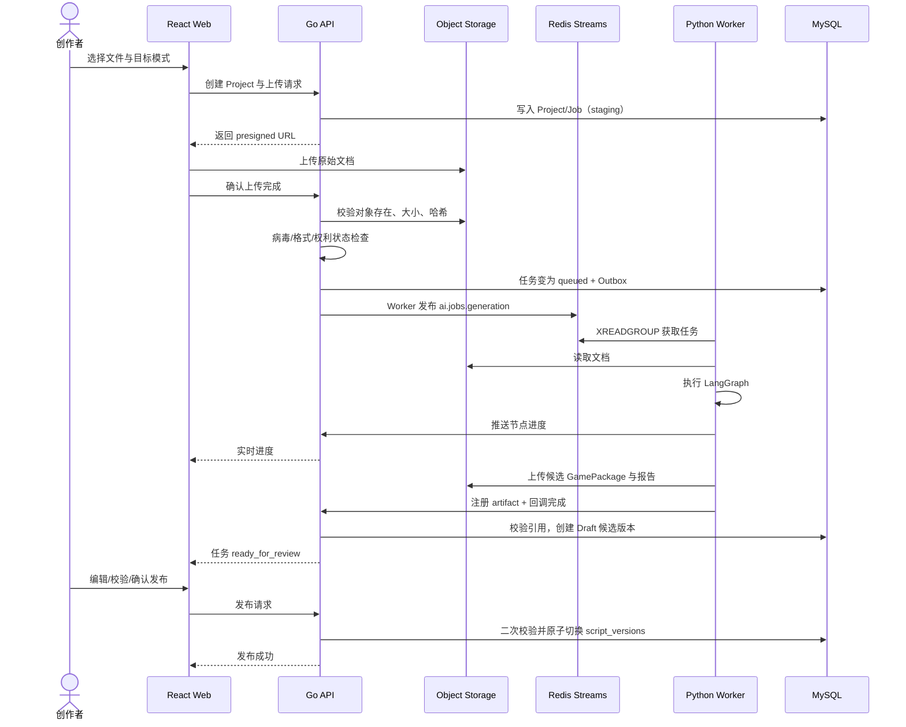

关键点：

- 上传前只创建 staging，不自动成为公开内容。
- Python 不直接发布。
- 生成候选与发布版本分离。
- 进度可追踪，任务失败可恢复。

### 15.2 LangGraph 完整执行

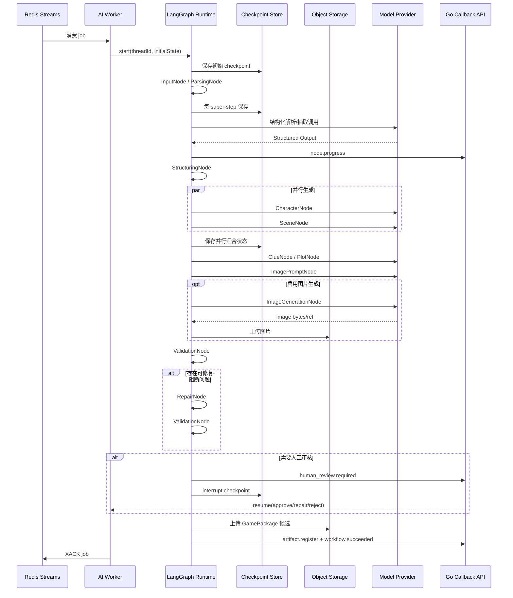

关键点：

- 人工审核使用 checkpoint 而非保持长连接。
- 每个并行分支独立 trace。
- 失败恢复从最近 checkpoint 开始。

### 15.3 Go 创建游戏房间

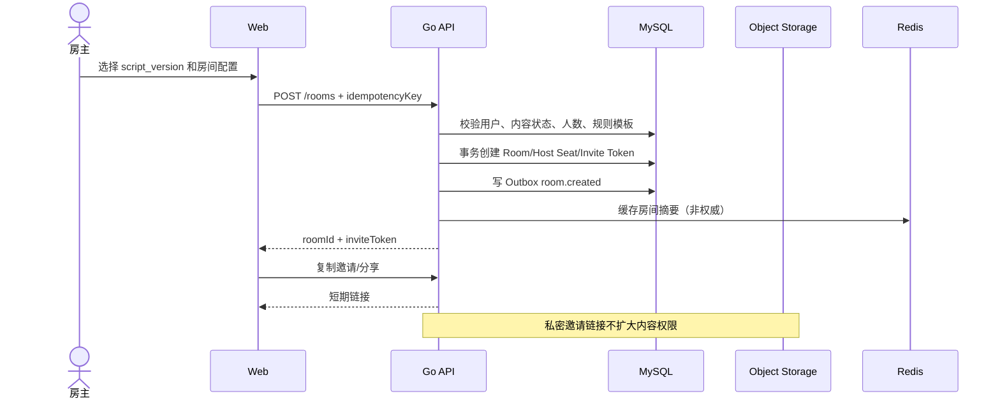

重复请求返回同一房间，不生成多个房主席位。

### 15.4 玩家进入游戏

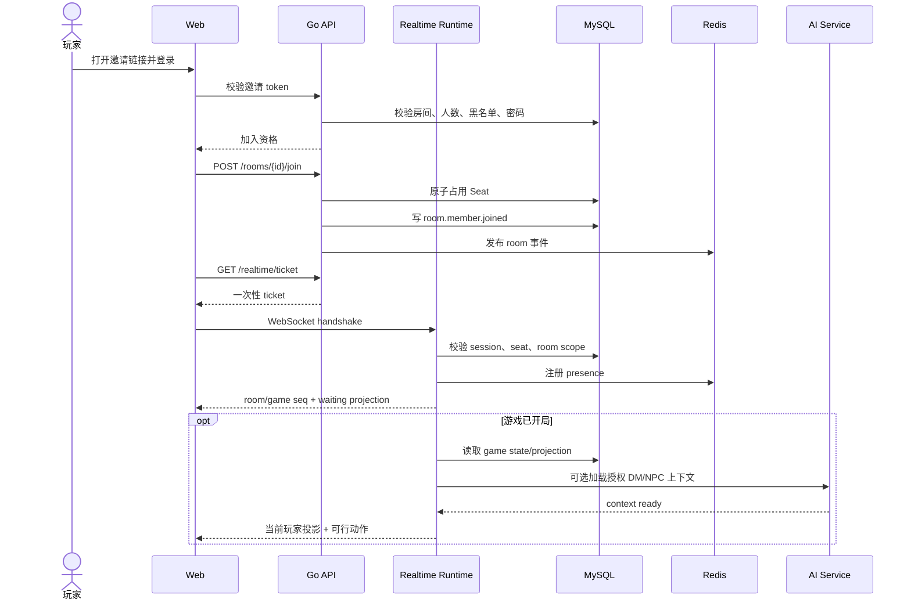

### 15.5 Go 调用 AI DM

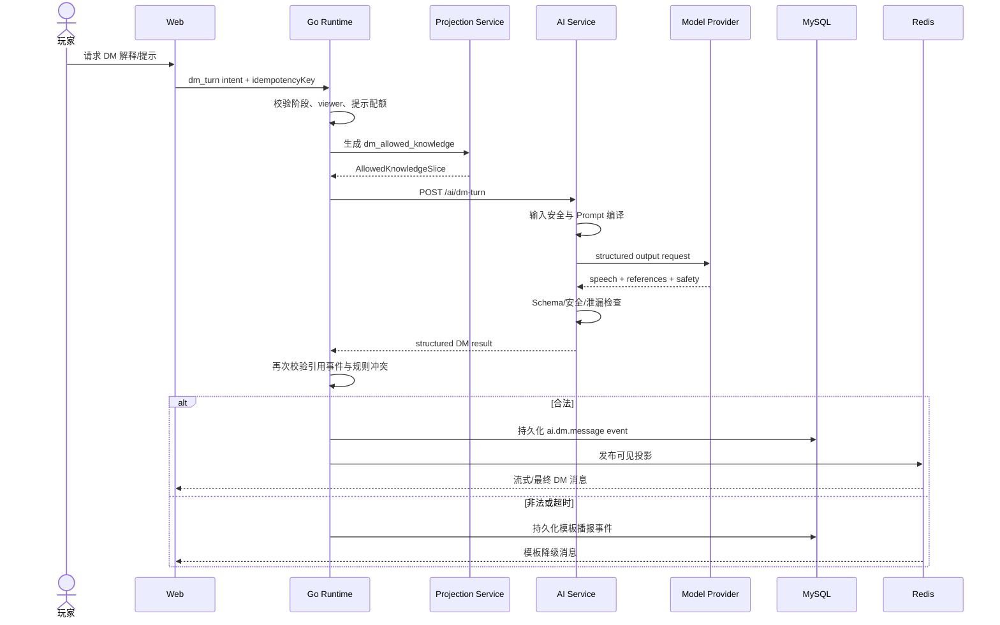

DM 永远不直接写状态或推进阶段。

### 15.6 NPC 记忆加载和更新

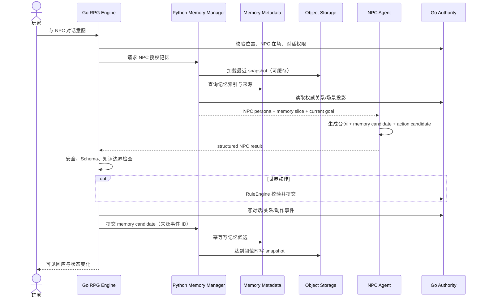

### 15.7 游戏事件保存

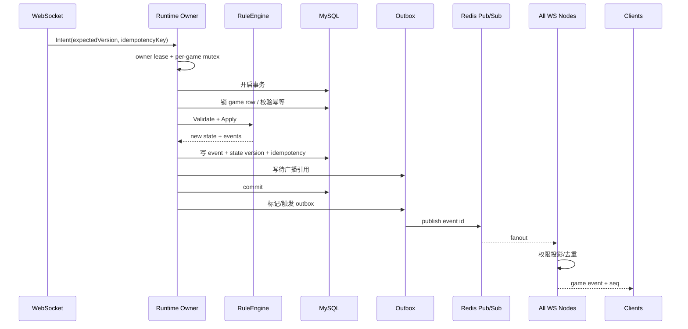

任何一步在 commit 前失败，都不广播成功事件。

### 15.8 断线恢复

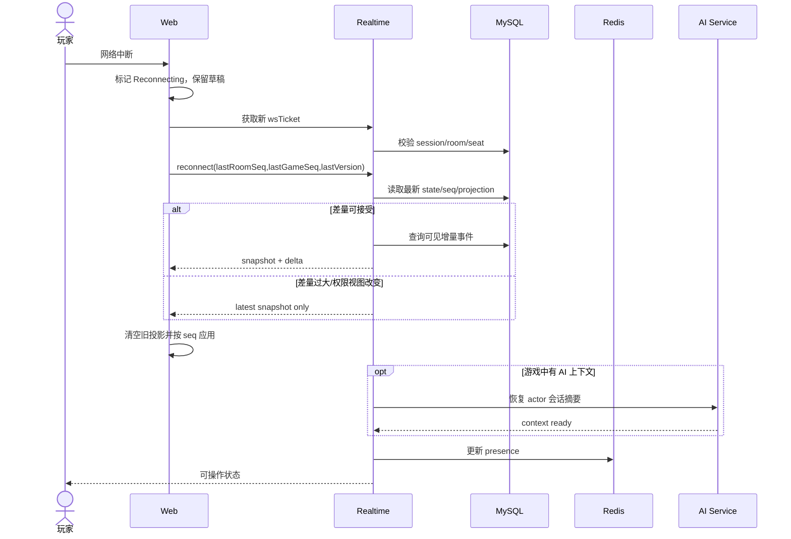

### 15.9 游戏结算和复盘

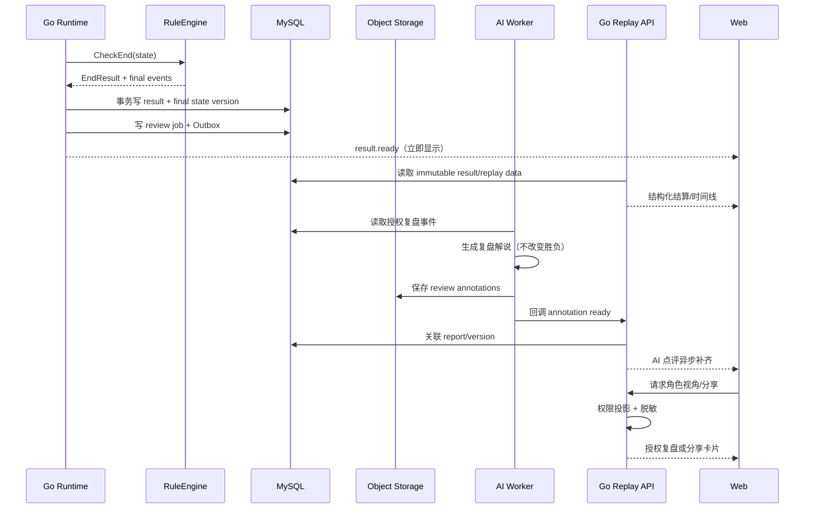

结算结果必须先于 AI 点评可见；AI 全部超时不影响规则结算。

---

## 16. 异常处理与服务降级

### 16.1 降级原则

- 先保确定性流程，再保 AI 叙事。
- 先阻止错误写入，再考虑用户等待。
- 降级必须有明确用户提示和可诊断事件。
- 任何降级不得绕过权限、幂等和规则。
- 自动重试只用于可能恢复的暂时错误。

### 16.2 故障矩阵

| 故障 | 检测 | 处理 | 用户影响 |
| --- | --- | --- | --- |
| DM 超时 | 同步 deadline | 模板播报；规则操作继续 | 叙事变短，流程不断 |
| NPC 超时 | 15 秒级 deadline | 人格化短句或结束回合 | 对话延迟/简化 |
| 模型限流 | 429/指标 | 重试、备用模型、预算降级 | 质量下降 |
| Provider 全故障 | 熔断 | 全量模板 DM/NPC | AI 表达不可用，核心可玩 |
| AI 输出 Schema 错误 | 校验 | 一次修复重试后拒绝 | 返回安全提示 |
| AI 泄漏/注入命中 | 输出/输入 guard | 阻断、替换、安全事件 | 私密信息不发送 |
| Redis 不可用 | 健康检查/超时 | 进入无缓存模式；实时依赖 DB 补偿；新任务暂缓 | 延迟增加，部分任务排队 |
| Redis Pub/Sub 丢消息 | 重连 seq 缺口 | 从 MySQL 事件补偿 | 需短暂同步 |
| MySQL 主库不可用 | 连接/事务失败 | 停止权威写；冻结受影响房间；只读降级 | 新操作暂停 |
| 单局事务异常 | 事务回滚 | 保留旧状态，返回可重试错误 | 当前操作失败 |
| 快照损坏 | 哈希/版本不匹配 | 从更早快照+事件重建 | 恢复时间增加 |
| owner Pod 崩溃 | lease 过期 | 新 owner 恢复；客户端重连 | 短时中断 |
| 对象存储不可用 | 上传/读取失败 | 长任务暂停；已发布内容依靠 CDN/缓存 | 生成和上传受阻 |
| WebSocket 节点故障 | 心跳/连接关闭 | 客户端重连其他节点 | 重建投影 |
| Outbox 堆积 | 指标阈值 | 扩容 worker；暂停非关键异步任务 | 生成/通知延迟 |
| Checkpoint 不兼容 | 版本检查 | 回退到兼容 checkpoint 或人工介入 | 任务恢复变慢 |
| 客户端协议过旧 | 版本握手 | 阻止不兼容操作，提示刷新 | 需刷新页面 |

### 16.3 权威状态异常

触发条件：

- 状态哈希与事件重放不一致。
- 两套冲突状态版本。
- 结算结果重复或缺失。
- 私密实体出现在公共投影。

处置：

1. 立即冻结 `gameId` 的新写入。
2. 停止实时广播，只发送“诊断中”状态。
3. 保存当前状态、事件和 trace。
4. 从最近可信快照重放事件。
5. 若重建一致，恢复并广播补偿事件。
6. 若无法恢复，安全终止对局并生成事故记录。
7. 按 PRD 红线进行安全复盘和回归测试。

### 16.4 AI 降级等级

| 等级 | 行为 |
| --- | --- |
| L0 Normal | 完整模型调用 |
| L1 Slim | 短上下文、短输出、低成本模型 |
| L2 Template | DM/NPC 使用模板；复盘隐藏 AI 点评 |
| L3 Core Only | 停止 AI 调用；规则、房间、线索、投票继续 |
| L4 Maintenance | 停止新对局和生成任务；保护进行中核心状态 |

降级按房间/任务/项目维度控制，避免全局一刀切。

### 16.5 重试与熔断

- 重试使用指数退避和 jitter。
- 只重试幂等请求。
- 429/5xx/网络错误可重试；4xx 业务错误不重试。
- 连续模型失败触发 provider 熔断。
- 熔断期间使用备用 provider 或模板。
- 重试预算写入 AIRun，防止一次失败无限消耗。

### 16.6 事务失败与孤儿资源

允许出现短暂不一致：

- 对象已上传、DB 引用未提交。
- Outbox 已写、队列尚未收到消息。
- Redis 已广播、客户端正在重连。

修复：

- 对象存储生命周期清理无引用 artifact。
- Outbox worker 持续重试。
- 客户端通过事件 seq 补偿。
- 不跨服务强求原子提交，不引入全局分布式事务。

---

## 17. 非功能设计与验证方案

### 17.1 容量数字的定位

PRD 中的 5,000 峰值在线、500 活跃房间等是 MVP 验收假设，不是本文对生产容量的承诺。最终容量结论必须来自同拓扑、同实例规格、同数据规模的压测和稳定性测试。

### 17.2 性能预算

| 路径 | 设计目标 | 测量点 |
| --- | --- | --- |
| 普通页面 API | PRD 目标 P95 ≤ 500ms | Ingress → Go → MySQL/Redis |
| 游戏命令 | P95 ≤ 300ms，不含模型 | Intent receipt → commit ack |
| 实时事件传输 | P95 ≤ 200ms 同区 | Commit → Redis → WS → client |
| 阶段广播 | P95 ≤ 500ms | 状态提交 → 全部在线连接 |
| 重连可操作 | P95 ≤ 5s | Ticket → snapshot → client ready |
| DM 首 Token | P95 ≤ 2.5s | Go 发起 → 客户端可见首片 |
| NPC 完整回应 | P95 ≤ 15s | Go 发起 → 安全检查完成 |
| 10 万字解析 | P95 ≤ 10min | 上传确认 → 解析结构化候选 |
| 编辑器保存 | P95 ≤ 800ms | PATCH → commit |

设计优化：

- 游戏命令避免任何同步 AI 或对象存储调用。
- 实时广播只传投影，不传完整 state。
- 首屏与游戏快照分离，关键 action 不等待图片/历史消息。
- 数据库热点写按 gameId 分区，读副本服务非权威读。
- AI 长任务独立资源池，不挤占游戏运行时。

### 17.3 并发验证

测试阶梯：

1. 基准：1x PRD MVP 目标。
2. 峰值：2x 目标。
3. 破坏性：5x 目标直到出现明确瓶颈。

场景：

- 同时创建大量房间。
- 500/1,000 个房间同时推进阶段。
- 单局 100 个并发重复意图。
- 多人抢最后席位、最后线索、同一投票。
- RPG 多玩家并发修改同一场景实体。
- WebSocket 断线风暴和重连风暴。
- 50 个文档生成任务并发。
- AI 慢响应与游戏高并发叠加。

指标：

- P50/P95/P99 延迟。
- 错误率、事务冲突率、锁等待。
- MySQL QPS/慢查询/连接池。
- Redis Pub/Sub 延迟、Stream 积压。
- WebSocket 连接数、消息丢失/重复。
- CPU、内存、GC、goroutine、文件描述符。
- AI 成本和每秒 Token。

退出标准：

- 无状态双写、重复结算、seq 缺口。
- 峰值测试错误率满足发布门槛。
- 过载时系统进入明确限流/降级而非崩溃。
- 压测结论可复现并记录实例规格。

### 17.4 WebSocket 规模验证

- 使用真实 WS 握手、鉴权和房间订阅，不只测 TCP 连接。
- 混合公共事件、私密事件、AI 流和聊天。
- 测算单 Pod 连接数、广播扇出和内存。
- 大规模断开后同时重连，验证 Ticket、Redis presence 和 DB 查询。
- 测试慢消费者、背压和消息积压。
- 校验客户端事件去重和缺口快照。

### 17.5 AI 成本验证

- 每个 workflow、DM、NPC、AI Player、复盘分别记录 Token 和供应商成本。
- 建立按模式的单局成本预算。
- 对长短剧本、长对话、多人房间做分布测试。
- 重生成和 Repair 轮次单独归因。
- 成本突增触发告警和熔断。
- 不把平均成本掩盖长尾高成本房间。

### 17.6 AI 超时验证

- 注入 5s/15s/60s 延迟。
- 注入 429、5xx、连接重置、流中断。
- 验证 DM/NPC 模板降级。
- 验证长任务 checkpoint 恢复。
- 验证 AI 失败不影响投票和结算。
- 验证重试不会重复写入 AI 消息事件。

### 17.7 游戏一致性验证

不变量：

- 同一 game 的 seq 无重复且只在成功事件中递增。
- 同一幂等键最多一个成功结果。
- 同一回合每名玩家最多一个有效投票。
- 同一房间最多一个有效 GameInstance。
- 结算结果只能生成一次。
- 进行中游戏固定内容包版本。
- 客户端投影不包含未授权实体。
- 事件重放后的 stateHash 与持久化状态一致。

测试方式：

- 表驱动规则测试。
- 属性测试生成随机意图序列。
- 并发压力注入和事务冲突。
- 事件重放一致性校验。
- 快照恢复与 owner 迁移。
- 旧 engine version 回放测试。

### 17.8 权限验证

- API、WebSocket、AI context、分享、导出、历史、运营后台全覆盖。
- 每个 D2-D4 字段至少 5 类主体越权尝试。
- 以房主、创作者、AI DM、AI NPC、AI Player、运营角色分别测试。
- 对 Redis 缓存和对象存储 URL 做旁路测试。
- 对模型输出做语义泄漏测试，不只做字段匹配。

### 17.9 资源隔离

- AI API 与 AI Worker 使用不同进程/资源池。
- 长任务 Worker 与实时 DM/NPC 使用不同并发限制。
- Go Realtime 与 Content API 独立部署和连接池。
- 每项目/用户有生成任务配额。
- 每房间有 AI 调用预算和并发上限。
- Redis Streams 按任务类型使用不同 Stream/消费组。
- MySQL 连接池按服务隔离并设置最大连接。
- 批量生成任务不得占满游戏运行时 CPU。

### 17.10 可扩展性验证

- 新增一种游戏模式只需新增 Engine、Schema payload、前端页面和投影规则。
- 新增 LLM Provider 不改 Agent 业务代码。
- 新增 Schema minor 版本不导致旧房间停止。
- 拆分 Runtime 为独立服务不需改变房间 API。
- 在不修改客户端协议的情况下扩展可选 WS 字段。

---

## 18. 数据权限、安全与隐私

### 18.1 权限模型实现

采用 RBAC + ABAC：

- RBAC：登录用户、房间成员、玩家、房主、创作者、审核员、运维。
- ABAC：project visibility、room membership、seat role、phase reveal gate、sensitivity、data owner。

服务端授权链：

```text
Session
→ Account status
→ Content visibility
→ Room membership
→ Seat/role binding
→ Object ACL
→ Field ACL
→ Reveal gate
→ Action permission
→ Projection
```

### 18.2 DTO 与投影

- API 不直接序列化数据库 Entity。
- 每个领域对象有 Public/Viewer/Private/Runtime DTO。
- 游戏页只用 `ProjectedState`。
- 历史、复盘、分享使用独立脱敏 DTO。
- OpenAPI 明确字段敏感级别。
- 自动测试检查 DTO 是否意外出现敏感字段名。

### 18.3 数据加密

- MySQL 静态加密。
- D2-D4 字段使用应用层信封加密或独立密文存储。
- 私密剧本、身份分配、真相、私聊、AI context 使用独立密钥版本。
- 对象存储服务端加密 + 应用层敏感对象加密。
- 密钥由 KMS/Secret Manager 管理。
- 日志不记录密钥、Cookie、Token 和完整私密正文。

### 18.4 AI 信息隔离

- Go `ContextProjector` 生成允许知识切片。
- 每次 AI 调用产生 `contextManifest`，记录实体 ID、来源、分级和哈希。
- Python 工具网关再次校验 actor scope 和 game version。
- 模型不能通过工具查询任意实体 ID。
- 输出安全检查包括实体名、别名、语义相似和跨字段组合泄漏。
- AI 缓存按敏感级隔离，D2-D4 不跨用户共享。

### 18.5 提示词注入防护

多层防护：

1. 输入清洗隐藏字符、伪造系统分隔和异常控制符。
2. 玩家文本放入明确 untrusted 数据区。
3. 系统 Prompt、权限策略和工具凭证不来自用户输入。
4. 工具白名单与短期凭证。
5. 权限在检索前执行，不依赖模型拒绝。
6. 输出 Schema 和敏感实体检查。
7. 对连续攻击限流、记录安全事件。
8. 对文件内 Prompt Injection 做文本特征和模型分类检查。

### 18.6 文件上传安全

- presigned URL 限定对象路径和操作。
- 上传后验证真实内容类型、大小和哈希。
- 压缩包和文档进入隔离区扫描。
- 禁止服务器执行上传文件。
- 文档解析 Worker 以低权限和隔离容器运行。
- PDF/DOCX 转换服务设置资源上限。
- 下载使用短期签名 URL 和权限校验。

### 18.7 内部服务安全

- 内部 API 不暴露公网。
- mTLS 或短期服务 Token。
- 请求签名包含 timestamp、nonce、body hash。
- AI 回调校验 job/run/actor/scope。
- 审计日志记录服务调用、敏感上下文访问和人工干预。

### 18.8 审计

必须审计：

- 登录、封禁、解封。
- 内容发布、下架、审核。
- 敏感后台查询。
- AI 输出安全拦截。
- 真相/D4 访问。
- 人工审核和修复。
- 发布版本切换。
- 事故冻结与恢复。

审计日志追加写，普通运维不可修改。

### 18.9 隐私

- 数据最小化。
- 私聊和分析数据不进入公共推荐。
- 模型供应商策略按数据等级选择。
- 不将私密内容用于跨用户训练或公共缓存。
- 用户注销、删除和导出通过异步可追踪任务完成。
- 数据保留周期按数据类别配置。

---

## 19. 可观测性、日志与成本治理

### 19.1 链路追踪

核心 span：

```text
http.request
ws.message.receive
game.intent.lock_wait
game.rule.validate
game.rule.apply
db.transaction.commit
event.project
redis.publish
ai.run
ai.node
llm.request
ai.guard.output
ai.artifact.register
snapshot.write
snapshot.load
```

关联字段：

- `traceId`
- `requestId`
- `userId`
- `roomId`
- `gameId`
- `eventSeq`
- `aiRunId`
- `jobId`
- `scriptId`
- `engineVersion`
- `packageVersion`

### 19.2 日志

日志级别：

- ERROR：影响正确性或用户可见故障。
- WARN：降级、重试耗尽、越权尝试、工作流修复。
- INFO：状态转换、发布、结算、任务里程碑。
- DEBUG：仅开发/短期采样，默认不记录私密原文。

禁止：

- 完整身份分配表。
- 私聊全文。
- 完整 Prompt/Context。
- Cookie、Token、密钥。
- 未脱敏的真相对象。

### 19.3 指标

业务：

- 活跃房间、完成对局、有效复盘。
- 断线恢复率。
- 生成任务成功/失败/重生成。
- 审核积压、举报数。

系统：

- HTTP P95/P99、错误率。
- WebSocket 连接、重连、事件缺口。
- MySQL 锁等待、慢查询、死锁。
- Redis Stream pending、延迟、Pub/Sub 投递。
- Outbox 积压。

AI：

- Provider 错误率、首 Token 延迟、总延迟。
- Token 和成本。
- Schema 失败率。
- 安全拦截。
- Repair 轮次。
- Context 大小。
- Agent 步数。

### 19.4 告警

P0：

- 私密实体泄漏。
- 双重结算/状态不一致。
- AI 读取 D3/D4。
- 数据库写入持续失败。

P1：

- 断线恢复率显著下降。
- WebSocket 大规模错误。
- Outbox/Stream 积压。
- 模型成本突增。
- 生成任务大面积失败。

P2：

- 非关键 API 延迟。
- 审核队列积压。
- 单个 Provider 失败。

告警必须带 runbook 和定位入口，不只发“错误率升高”。

### 19.5 成本治理

预算层级：

- 用户配额。
- 项目/任务预算。
- 房间/单局预算。
- 模型 Provider 日预算。
- 环境总预算。

控制：

- 小模型路由。
- 上下文裁剪。
- 摘要压缩。
- 安全缓存。
- 去重和限流。
- 熔断。
- L2/L3 降级。

成本看板必须区分：

- Prompt/Input。
- Output。
- 图片。
- Repair/重生成。
- Embedding。
- 供应商未计费失败请求的诊断记录。

### 19.6 质量监控

- AI 生成 Schema 合法率。
- 关键事实抽检准确率。
- 阻断问题漏检率。
- 越权泄露测试。
- 复盘引用有效率。
- 用户重生成率。
- 对局完成率。
- 投诉与事故分类。

---

## 20. MVP 与后续扩展边界

### 20.1 Phase 1 技术范围

必须：

- React Web 核心页面。
- Go API、Realtime/Runtime、Worker。
- 剧本杀 Engine。
- 用户、内容、工坊、房间、事件、投影、结算。
- Python AI API + AI Worker。
- LangGraph 文本生成工作流。
- 可选图片生成流程默认关闭或受配额。
- MySQL、Redis、对象存储。
- Redis Streams 任务和进度。
- DM 模板降级。
- MVP 仅使用每次重建的 PlayerContext 与非权威短期 Working Memory；
  持久 NPC Memory/Snapshot 属于 Phase 2。
- 权限、审计、观测和运行事故能力。

不进入 Phase 1：

- 狼人杀引擎。
- RPG 世界引擎。
- 持续共享世界。
- 语音。
- TypeScript AI 服务。
- gRPC 全量内部协议。
- 专用向量数据库。

### 20.2 Phase 2 扩展

- 新增 WerewolfEngine 和规则模板测试。
- 新增 InteractiveRPGEngine、地图、任务、NPC 对话。
- 启用 AI Player 混合对局。
- 启用完整 NPC Memory Snapshot 和关系恢复。
- 扩展生成工作流到狼人杀主题和 RPG。
- 根据容量拆出独立 Runtime Service。
- 根据调用压测决定是否引入 gRPC。

### 20.3 Phase 3 扩展

- 持久多人共享世界。
- 分区世界与场景级并发。
- 动态事件生成安全门。
- 高级 Memory/关系/日程。
- 专业向量索引或推荐服务。
- 语音与原生端。
- 付费/交易/版权治理扩展。

### 20.4 演进原则

- 不复制用户、房间、权限和事件基础设施。
- 新玩法必须新增 Engine、Package payload 和 Projection，不把规则塞进公共层。
- 引擎升级只影响新对局。
- Schema 变更必须保持历史对局可读。
- 扩服务前先证明模块边界和瓶颈，不能仅为“微服务化”拆分。

---

## 21. 技术风险与应对

### 21.1 风险矩阵

| 编号 | 风险 | 影响 | 触发信号 | 应对 |
| --- | --- | --- | --- | --- |
| T-01 | 游戏行锁/热点导致延迟 | 高 | P95 上升、锁等待 | 单局单写者；按 gameId 分区；压测；避免事务内 AI |
| T-02 | WebSocket 扇出瓶颈 | 高 | 广播延迟、内存增长 | 多 Pod；Pub/Sub；批处理；慢客户端断开；容量测试 |
| T-03 | Redis 失联导致实时中断 | 高 | Pub/Sub/Presence 异常 | DB 事件补偿；重连快照；Redis HA |
| T-04 | MySQL 事务死锁 | 高 | 死锁率上升 | 固定锁顺序；短事务；重试；事务指标 |
| T-05 | AI Provider 延迟/故障 | 高 | DM/NPC 超时 | 超时、熔断、模板、备用路由 |
| T-06 | AI 成本失控 | 高 | 单局成本长尾 | 预算、路由、摘要、降级、告警 |
| T-07 | Prompt Injection | 极高 | 安全事件、泄漏测试失败 | 输入隔离、最小 context、工具白名单、输出 guard |
| T-08 | Schema 漂移 | 高 | Go 无法解析、生成失败 | Schema 源、代码生成、contract tests |
| T-09 | LangGraph Checkpoint 不兼容 | 高 | 恢复失败 | 版本化 checkpoint、兼容检查、人工重跑 |
| T-10 | 长任务在 Pod 重启丢失 | 中 | job 卡住 | Redis pending reclaim + MySQL checkpoint + S3 artifact |
| T-11 | 本地 Memory 不一致 | 中 | NPC 记忆错乱 | Memory 非权威；owner 单写；快照+事件重建 |
| T-12 | owner 迁移造成重复事件 | 高 | seq 重复/游戏重放 | MySQL 锁、幂等、lease fencing token |
| T-13 | 对象存储引用不一致 | 中 | 孤儿对象/资产缺失 | staging、哈希、引用清理、生命周期 |
| T-14 | 规则代码回归 | 高 | 规则测试失败 | Engine 版本、规则矩阵、固定 fixture、灰盒发布 |
| T-15 | 历史回放不兼容 | 中 | 旧对局无法复盘 | 旧 engine/package 保留；Schema migration；回放测试 |
| T-16 | 私密 DTO 泄漏 | 极高 | 字段扫描/红队失败 | DTO Only、投影、字段 ACL、自动泄漏测试 |
| T-17 | 运营后台权限过宽 | 极高 | 敏感 query 异常 | RBAC、审批、双人复核、审计 |
| T-18 | 文件解析资源耗尽 | 中 | worker OOM/CPU 高 | 隔离容器、大小/页数限制、沙箱、队列配额 |
| T-19 | 供应商锁定 | 中 | 切换困难 | Provider 抽象、模型路由、兼容测试 |
| T-20 | 过度拆分微服务 | 中 | 交付变慢/跨服务事务复杂 | MVP modular monolith；按证据拆分 |
| T-21 | 生产多实例依赖本地盘 | 高 | Pod 迁移后状态丢失 | 禁止本地盘权威；S3 snapshots |
| T-22 | 观测成本与隐私 | 中 | 日志过大/敏感 | 脱敏、采样、分级、短期保留 |

### 21.2 风险治理

- 每个 P0 风险必须有 owner、监控指标和应急开关。
- 每次规则引擎发布必须跑固定回归集和随机模拟。
- 每次 Schema major 升级必须保留旧 fixture 并通过兼容测试。
- 每次 AI Prompt/模型路由变更必须跑安全红队和质量集。
- 每次状态机或并发模型变更必须重新验证线性化不变量。

---

## 22. PRD 合规性检查

### 22.1 章节映射

| PRD 章节 | 技术设计对应 | 符合情况 |
| --- | --- | --- |
| 1-6 产品目标、用户、场景 | 1、3、20 | 通过；架构以用户核心闭环和权限可信为目标 |
| 7-8 功能/信息架构 | 3、4、5、13 | 通过；服务、前端路由和数据边界覆盖 |
| 9 模块需求 | 4-13 | 通过；用户、内容、工坊、房间、AI、社区、复盘均有承载 |
| 10 三种玩法流程 | 6、8、15 | 通过；三模式各自引擎，规则独立，AI 不裁决 |
| 11 AI Agent 设计 | 7-10 | 通过；Provider、Structured Output、trace、成本、记忆和评测完整 |
| 12 十项核心业务规则 | 6、10、11、12、18 | 通过；幂等、单写、上下文隔离、快照、回放和降级落地 |
| 13 权限与信息隔离 | 5、6、11、18 | 通过；Go 投影、ABAC、知识切片、D3/D4 保护 |
| 14 页面交互与状态 | 4 | 通过；前端状态边界、WS、错误与 Query 设计 |
| 15 数据对象 | 9、10、13 | 通过；GamePackage、State、Event、Memory、数据库域 |
| 16 非功能需求 | 11、17-19 | 通过；实时、并发、安全、可观测性和测试方案 |
| 17 MVP 规划 | 20 | 通过；Phase 1-3 边界明确 |
| 18 功能优先级 | 20 | 通过；MVP 不含狼人杀/RPG/语音 |
| 19 验收标准 | 17、22 | 通过；测试和发布门槛映射 |
| 20 风险与解决方案 | 16、21 | 通过；技术与产品风险均有处理 |

### 22.2 PRD 红线逐项核对

| PRD 红线 | 技术保证 |
| --- | --- |
| 玩家只能读有权限信息 | Go ProjectionService + DTO + ABAC + WS 投影 |
| AI 不提前泄漏真相 | 真值不进常规上下文、Context Manifest、输出 guard |
| 生成内容与世界观一致 | Canon、来源、Schema、Validation/Repair |
| 防提示词注入 | untrusted 数据区、工具白名单、服务端 ACL |
| 多人状态一致 | 单局单写者、MySQL 锁、version、seq |
| 掉线恢复 | snapshot + delta + wsTicket + seq |
| 生成失败回滚 | staging artifact、checkpoint、原子发布 |
| 防死局 | 可达性校验、阶段保底、timer 和 incident |
| 三模式独立规则 | 三 Engine + 独立 Schema/Projection |
| 多人共享 RPG | 世界实例单写者、版本条件、分层事件 |
| 模型不直接改规则 | Go RuleEngine、模板版本、禁止模型代码 |
| AI 不是单点 | 模板 DM、规则核心与模型池隔离 |

### 22.3 设计未覆盖或待确认

以下不属于本次 TECH_DESIGN 最终确认，需在后续评审中定稿：

- 具体身份 Provider 和验证码供应商（Q-01）。
- 首发地区、数据驻留和合规部署区域（Q-02）。
- 对象存储供应商和 CDN 方案。
- LLM/Image Provider 合同、数据使用政策与配额。
- 具体容器编排平台与 MySQL/Redis 托管方案。
- 5,000 在线/500 房间是否作为生产容量目标或仅 MVP 验收值。
- 单局 AI 成本硬预算。
- 是否在未来启用 gRPC、专用向量索引和独立推荐服务。

