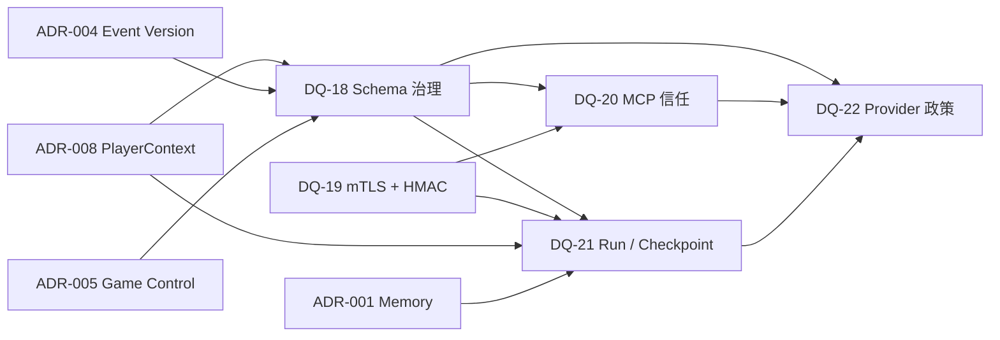

# DQ-18 至 DQ-22 AI Runtime 候选设计

> 状态：Candidate Design
> 日期：2026-11-23
> 批准状态：DQ-18/DQ-19 已批准并实施；DQ-20 至 DQ-22 仍未批准。
> 本文件不是 GATE-AI 通过证明。
> Task 11 更新（2026-11-25）：负责人授权“开始执行”后，DQ-18/DQ-19 按候选推荐
> 范围进入 APPROVED / IMPLEMENTED；生产基础设施按实际证据标记 NOT VERIFIED。

## 决策记录摘要

| ID | 状态 | 安全影响 | 兼容性 | 实施成本 | 依赖 | 验收标准 |
| --- | --- | --- | --- | --- | --- | --- |
| DQ-18 | APPROVED / IMPLEMENTED / VERIFIED | 防止任意 JSON 成为可信结果；业务 Schema 仍需逐项批准 | 正式 Registry、兼容基线和 Active 输出绑定已落地 | 中：Contracts 生成、Registry、回归 fixture | DQ-08～DQ-12、ADR-004、ADR-008、DQ-22 | 三端生成、版本选择、非法输出拒绝、历史兼容测试 |
| DQ-19 | APPROVED / IMPLEMENTED / TEST-VERIFIED；生产基础设施 NOT VERIFIED | 防伪造、篡改、重放和跨服务越权 | Internal API 安全 profile v1 已版本化 | 高：真实证书、KMS、Redis、ACL、轮换 | DQ-21 共享存储、DQ-22 部署区域 | mTLS+HMAC 失败、重放、轮换、ACL 测试 |
| DQ-20 | PROPOSED；本地 trust 原型 IMPLEMENTED；外部 MCP BLOCKED | 阻断 SSRF、恶意工具、注入结果和高风险副作用 | MCP 未启用，不影响现有 API；未来需新 Tool Schema | 高：MCP client、egress、身份、审计、人工确认 | DQ-19、DQ-22、ADR-001/008 | 信任等级、白名单、SSRF、注入、确认、审计测试 |
| DQ-21 | APPROVED / IMPLEMENTED / HOSTED-CI VERIFIED；Production NOT VERIFIED | 防重复执行、泄露、丢失更新和故障恢复失控 | MySQL 元数据、Redis Lease、DB Fencing、加密 Blob、Recovery/Cleanup 与 Restore 已验证 | 高：Release 部署与生产 KMS | ADR-001/008、DQ-19、DQ-22 | 最终 CI Run `45968540075` 全部通过 |
| DQ-22 | PROPOSED；Mock/兼容 HTTP adapter IMPLEMENTED；真实供应商 BLOCKED | 控制 D3/D4 外发、密钥、成本、区域和降级安全 | Provider 内部不变；正式模型政策影响 Prompt/Schema 兼容 | 中高：准入评审、预算、熔断、评测、合同 | DQ-15、DQ-18、DQ-19、DQ-20、DQ-21 | 白名单、区域、预算、D3/D4、降级、真实合同验证 |

`VERIFIED` 只覆盖测试环境中的代码路径。真实 CA、KMS、Redis 多实例和生产部署
仍必须标记 `NOT VERIFIED`。

## DQ-18：任务级输出 Schema

完整分类见 [`ai-runtime-schema-inventory.md`](./ai-runtime-schema-inventory.md)。

### 背景

Task 8 只有 `demo` 输出模型。模型生成任意 JSON 不能成为可信业务结果，不同
task_type 需要可追踪的 Schema 身份、版本、嵌套约束和拒绝证据。

### 当前实现

- `OutputSchemaRegistry` 按 `task_type + schema key + version` 注册 Pydantic 模型。
- Go 在 `AgentRequest` 中指定 `output_schema_key` 和 `output_schema_version`。
- 模型不参与 Schema 选择。
- Runtime 在返回成功前调用 `model_validate`，未知字段、枚举、范围和嵌套结构错误均失败。
- `AgentResponse` 返回实际 Schema 身份和安全的 `validation_errors`。

### 风险

- 仍未批准 AI DM、NPC、规则解释和生成任务的正式业务 Schema。
- Schema 版本升级可能影响历史 Run 重放。
- 若 Go 与 Python 维护不同版本表，会形成双重权威。

### 候选方案

1. 代码注册表：Schema 由 Python 代码注册，Go 通过 Contracts 请求 key/version。
2. 生成注册表：Schema 定义进入 `packages/contracts`，生成 Go/Python/TS 类型。
3. 动态远端 Schema：不推荐，模型或后台可注入任意 Schema，不符合可信输出边界。

### 推荐

方案 2 已获批准：`packages/contracts` 是唯一权威源，Registry 和 Python 运行时
绑定由生成器产出。`DemoAgentOutput@1` 是当前唯一正式 Active 输出 Schema，
AI DM/NPC 等业务 Schema 仍需逐项批准。

### 取舍

生成注册表增加契约变更成本，但避免跨语言漂移。代码注册原型发布更快，只适合
Demo 和安全机制验证。

### 影响

- Go：发送明确的 Schema key/version，并对结构化结果做第二道权限/规则检查。
- Python：拒绝未知 key/version，记录无输入回显的校验问题。
- Contracts：正式冻结时增加 Schema Registry/JSON Schema 生成规则。

### 测试要求

- 多版本注册、版本缺失、重复注册。
- 非法字段、枚举、必填、范围和嵌套结构。
- 模型返回任意 JSON、未知 Schema 和非法版本。
- Go/Python 对同一 Schema 版本一致。

### 已确认

1. 是否将业务 Schema 全部纳入 `packages/contracts`。
2. Schema 兼容规则是否要求旧版本永久保留。
3. Go 请求是否必须显式指定版本，还是允许默认 active 版本。

结论：业务 Schema 必须纳入唯一 Contracts 源；被历史事件/Run 引用的版本按保留
策略长期保留；客户端可显式选择 allowlist 版本，默认值只能来自服务端 Registry，
模型和客户端不能自造默认版本。

## DQ-19：服务间认证和请求完整性

### 背景

当前只有静态 Service ID/Token。该方案无法提供强身份、请求防篡改、重放防护或
平滑密钥轮换。

### 当前实现原型

- Token-only 开发模式继续保留。
- 配置签名密钥后，要求 `X-Request-Timestamp`、`X-Request-Nonce`、
  `X-Request-Signature`。
- HMAC-SHA256 覆盖 timestamp、nonce、service_id、HTTP method、path、query、
  body SHA-256。
- 时间窗口默认 300 秒；nonce 在窗口两倍时间内只能用一次。
- 支持 primary/previous 两把签名密钥的轮换重叠窗口。
- Go Client 自动产生 timestamp/nonce/signature；Python 验证篡改、过期和重放。

### 威胁模型

- 伪造 Go 服务身份。
- 修改 body/path/query 后重放。
- 截获请求重复提交。
- 跨服务越权调用其他操作。
- 密钥泄漏或轮换期间旧实例不可用。
- 中间人、DNS/网络劫持和证书伪造。

### 方案比较

| 方案 | 身份强度 | 完整性/重放 | 部署复杂度 | 结论 |
| --- | --- | --- | --- | --- |
| 静态 Token | 低 | 无 | 低 | 仅开发/过渡 |
| HMAC 请求签名 | 中高 | 有 | 中 | 推荐原型 |
| mTLS | 高 | 传输完整性与双向身份 | 高 | 生产推荐 |
| mTLS + HMAC | 最高 | 身份和每请求完整性/重放 | 最高 | 生产候选 |

### 推荐

生产方案已批准为 mTLS + HMAC 请求签名同时使用。mTLS 证明服务实例身份，HMAC 绑定
具体操作、body、时间和 nonce，防止已认证连接内的重放或日志外请求复用。

### 已确认

1. 是否生产强制 mTLS + HMAC。
2. 证书与签名密钥由何种 KMS/密钥系统管理。
3. 是否还需 body hash header 或服务 ACL scope。
4. previous key 的允许重叠时长。

结论：生产强制 mTLS + HMAC；证书和密钥由外部 KMS/Secret Manager 管理；HMAC
canonical 已包含 body hash；服务 ACL 使用 operation/resource/tenant scope；
Previous Key 只用于轮换窗口，正式时长由密钥系统策略配置。

### 影响

- Go：扩展证书、签名密钥、nonce、服务 ACL 和故障重试。
- Python：增加证书校验、nonce 存储（多实例不能只用进程内）。
- Contracts：不需要暴露密钥；认证 header 作为内部 API 规范版本管理。

### 测试要求

- body/path/query 篡改。
- timestamp 过期、nonce 重放。
- primary/previous 轮换。
- mTLS 证书错误、未知服务身份、权限 scope。
- 多实例 nonce 一致性和故障降级。

## DQ-20：MCP 信任机制

### 背景

Tool Registry 已限制本地工具，但外部 MCP Server 的身份、工具质量、网络访问、
结果注入和人工确认没有批准策略。

### 当前实现

- `ToolSpec` 声明参数 Schema、权限、actor type、timeout、来源、信任等级、
  外部网络标记、结果大小上限和人工确认要求。
- `ToolSource` 为未来 MCP adapter 边界。
- 非本地内建工具、外部网络工具和高风险未确认工具当前一律拒绝。
- 工具结果有大小上限，并以“不可信数据”注入模型上下文。

### 风险

- 恶意 MCP Server 返回提示词注入。
- 工具参数触发 SSRF、任意 URL、文件系统或内网访问。
- MCP 工具权限声明与平台角色不一致。
- 模型生成工具名即越权。
- 高风险写操作绕过 Go 权威状态。

### 推荐候选

1. MCP Server 必须注册 Server ID、证书/签名身份、owner 和 trust level。
2. 只允许显式白名单工具，禁止任意远程发现和动态权限提升。
3. 工具参数由本地 Pydantic Schema 验证，Server 自报 Schema 不能直接信任。
4. 外部网络默认拒绝，URL/域名/IP 必须白名单并阻止 metadata、内网、重定向绕过。
5. 工具结果视为不可信数据，限大小、限 Content-Type，并在模型上下文明确隔离。
6. 写操作、资金、账号、文件、外部发布等高风险工具必须人工确认。
7. 任何游戏状态变更仍提交为 Go Intent/Candidate，由 Go 规则引擎裁决。

### 影响

- Python：MCP client、信任注册表、网络 egress、nonce/审计和人工确认。
- Go：工具产生的动作只能是 Candidate/Intent。
- Contracts：若 MCP 跨 Go/Python 共享，需要正式 Tool Invocation Schema。

### 测试要求

- 伪造 Server、未知工具、权限提升。
- SSRF、内网、metadata、重定向和超大结果。
- Prompt Injection 结果。
- 高风险工具缺少确认。
- 工具超时、重复调用和审计。

## DQ-21：Run / Checkpoint 持久化

### 当前实现

- `AgentRunRecord` 原型保存 run_id、request_id、trace_id、输入 hash、Schema
  key/version、状态、Token、错误码和 TTL。
- `CheckpointReference` 只保存 checkpoint ID、版本、存储引用、hash 和 TTL。
- 当前为进程内实现，不保存完整 Context/Prompt/私密正文。
- Runtime 已按 Run 生命周期写入 running/terminal 元数据。
- 没有正式 LangGraph Checkpointer、恢复端点或 `mv_ai` 表。

### 生命周期

```text
running
→ succeeded | failed | timeout | cancelled
```

只有 running Run 可完成。相同 run_id 不得再次创建；幂等请求由 API 幂等层返回
首次结果。

### 候选方案

1. MySQL `mv_ai.agent_runs` 保存元数据，对象存储保存加密 checkpoint。
2. Redis 保存热 checkpoint，MySQL 保存恢复元数据和耐久引用。
3. LangGraph 内部 state 只保存在私有存储格式，不作为跨服务 DTO。

### 恢复规则

1. Go 重新认证 actor、game membership、角色权限、版本和授权 slice。
2. Python 校验 Run owner、checkpoint version、Schema/engine 兼容。
3. 旧权限或版本不匹配时不得恢复，必须创建新 Run。
4. Agent checkpoint 不得恢复为 Go GameState。
5. 无有效 checkpoint 时返回 `CHECKPOINT_UNAVAILABLE`。

### 待确认

1. checkpoint 存储、加密和保留周期。
2. 是否允许跨 Pod 恢复及 owner lease。
3. Schema/Graph 升级兼容窗口。
4. 失败重试是否同 Run 恢复还是新 Run。

## DQ-22：真实模型供应商政策

### 当前实现

- `mock` 与 `openai_compatible` Provider。
- Provider 配置来自 Settings，API Key 使用 `SecretStr`。
- 超时、有限重试、Token Usage 和错误分类已实现。
- D3/D4 消息默认不进入模型上下文；需要显式配置才允许。
- Mock 测试和 HTTP MockTransport 测试不能证明真实供应商生产可用。

### 风险

- 私密剧本/角色本发送到第三方模型。
- API Key 泄漏、供应商日志留存、跨境数据。
- 模型非确定性导致业务回归。
- Token/成本失控、429/5xx 放大。
- 供应商切换后 Prompt/Schema 不兼容。

### 推荐政策候选

1. Provider 与模型名显式白名单，禁止业务代码直接选择任意模型。
2. Key 由密钥服务注入，按环境/供应商/用途分域，不进入配置仓库。
3. D0-D2 内容可发送前仍需 Go 授权；D3-D4 默认禁止，必须单独政策批准。
4. 每次 Run 有总 Token、成本、时长和调用次数预算。
5. 速率限制、熔断、有限重试和模板降级由统一 Router 执行。
6. 记录 Provider、模型、Prompt 版本、Usage、延迟和错误，不记录正文。
7. 供应商切换必须通过固定 Prompt/Schema fixture 和回归测试。

### 待确认

1. 可使用的供应商、区域、数据保留和训练政策。
2. 是否允许任何 D3 数据进入真实模型。
3. 成本单位、默认预算和业务配额。
4. 备用 Provider 与主 Provider Schema 兼容策略。

## ADR 依赖

- ADR-001：Python Run/Memory 仍非权威；MemoryCandidate 未经 Go 不得成为事实。
- ADR-004/005：Agent Runtime 不解释或修改 event_seq/state_version/暂停协议。
- ADR-008：Context 是 Go 授权切片，Checkpoint 不得成为持久 PlayerContext 权威。

## 跨决策依赖



- DQ-18 ↔ DQ-21：RunResult/RunSummary 可进入 Contracts；LangGraph State 与完整 Context 不进入。Checkpoint 引用字段依赖 Run DTO 与保留策略。
- DQ-18 ↔ DQ-19：认证 header/canonical 是内部安全 profile，不需要业务 JSON Schema；稳定后可版本化写入内部 API 规范。
- DQ-18 ↔ DQ-20：跨服务 Tool Input/Output 必须来自 Contracts；MCP Server 自报 Schema 不能成为平台权威。
- DQ-19 ↔ DQ-20：外部 MCP 不复用 Go 内部服务身份；需要独立 Server trust、网络身份和 egress 策略。
- DQ-19 ↔ DQ-21：mTLS/签名密钥和 checkpoint 加密密钥都应由 KMS 管理，但 key purpose、权限和轮换周期应分离。
- DQ-20 ↔ DQ-22：MCP 返回数据和工具请求同样受 D1/D2/D3/D4 外发矩阵和区域政策约束。
- DQ-21 ↔ DQ-22：Run 成本、Provider 调用记录和 Usage 需要持久化到 Run/Step，但业务事实仍以 Go 事件为准。

### Blocking Dependencies

- DQ-15/ADR-008 未批准：不能冻结私密 Context/Checkpoint 数据边界。
- DQ-19 基础已批准并实现；真实 CA/KMS/Redis 多实例尚未部署验证。
- DQ-21 已批准并实现正式 `mv_ai` 结构；真实 MySQL/Redis 多实例与 Restore 仍
  未验证。
- DQ-22 未批准：不能接真实供应商或自动 fallback。
- DQ-20 未批准：不能开放外部 MCP。
- DQ-18 正式业务 Schema 未批准：不能接 AI DM/NPC 业务输出。

### Non-blocking Dependencies

- 本地 Mock Provider 和本地 Tool 可继续用于测试。
- Token-only 开发认证可与正式 HMAC profile 并存，但生产不得视为完成。
- 正式 Contracts Registry 已落地；新增业务 Schema 仍需逐项批准。
- 进程内 Run 元数据原型可验证状态机与清理语义，但不承诺恢复。

### Recommended Decision Order

1. `DQ-18`：先冻结 Schema 纳入规则、版本和 active policy。
2. `DQ-19`：冻结服务身份、mTLS/HMAC、nonce、KMS 和 ACL。
3. `DQ-21`：冻结 Run/Checkpoint 元数据、存储和 owner lease。
4. `DQ-22`：冻结供应商准入、区域、预算和 fallback。
5. `DQ-20`：最后开放外部 MCP，复用已批准的认证、数据边界和审计。

### MVP 最小安全能力

- 无外部 MCP。
- 无真实 D3/D4 外发。
- Mock Provider 或经过批准的低敏 Provider。
- Go 授权 Context。
- 版本化任务级输出。
- Go 二次校验。
- mTLS + HMAC 或批准的安全等价方案。
- 持久 Run 元数据、幂等和有限恢复。
- 成本、Usage、错误和敏感操作审计。
