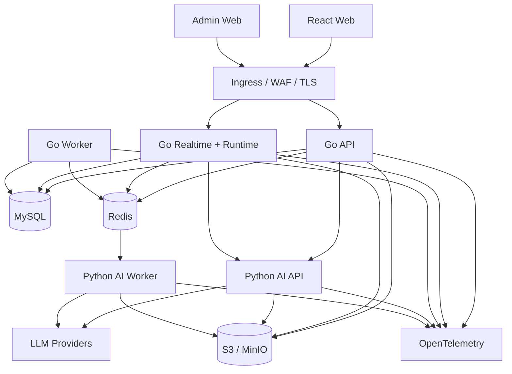

# MysteryVerse 系统架构

> 状态：Conditional Architecture Baseline
> 基线日期：2026-11-21
> 决策状态与批准门禁：`docs/architecture/DECISION-BASELINE.md`

## 1. 目标

MysteryVerse 是 AI Native 多人互动推理游戏平台，MVP 首先交付 AI 剧本杀闭环。
本架构旨在保证：

- Go 权威游戏状态不被 AI 或客户端绕过。
- Python AI 能力可独立演进、可追踪、可降级。
- 内容生成、实时对局、复盘和运营审核形成完整闭环。
- 权限投影、事件日志和状态恢复可证明。
- MVP 保持模块化单体，不因未来模式提前微服务化。

## 2. 开发入口

Codex 或开发者开始任务时按以下顺序阅读：

1. 根 `AGENTS.md`。
2. 本文件。
3. `docs/decisions/README.md` 和相关 ADR。
4. `docs/MysteryVerse-PRD.md` 对应功能范围。
5. `TECH_DESIGN.md`、`DATABASE_DESIGN.md`、`API_DESIGN.md`、`UI_DESIGN.md` 对应章节。
6. `docs/TASKS.md` 的目标任务和依赖。
7. `docs/architecture/open-questions.md` 中与任务相关的未决项。

## 3. 系统组成



## 4. 服务职责

| 组件 | 职责 | 禁止 |
| --- | --- | --- |
| React Web | 页面、交互、实时投影渲染、表单草稿 | 规则裁决、最终权限判定、幂等 |
| Admin Web | 审核、举报、处置、事故和审计查询 | 复用玩家权限读取秘密 |
| Go API | 身份、内容、工坊、房间、社区、后台 API、AI 代理 | 与模式耦合的规则实现 |
| Go Realtime/Runtime | WS、意图、规则引擎、事件、投影、重连 | 长文本或图片生成 |
| Go Worker | Timer、Outbox、快照、清理、异步维护 | LLM 内容生成 |
| Python AI API | 短回合 Agent、上下文组装、意图解析 | 修改权威状态 |
| Python AI Worker | LangGraph、解析、生成、校验、复盘、候选记忆 | 直接访问 `mv_core` |
| MySQL | 权威状态、事件、结算、审计、AI 元数据 | 纯缓存 |
| Redis | Session、Presence、租约、Pub/Sub、Streams、热缓存 | 唯一权威数据 |
| S3/MinIO | 原始文件、候选包、快照、图片、导出 | 未授权公开访问 |

详细边界见 [service-boundaries.md](./service-boundaries.md)。

## 5. 数据权威

权威顺序：

1. MySQL `mv_core` 中的业务事务、事件、状态、结果和审计。
2. 对象存储中的不可变 GamePackage、候选产物和大快照。
3. `mv_ai` 中的非权威 Prompt/Run/Usage/Checkpoint/Candidate 元数据。
4. Redis、进程内存和客户端投影。

Python 只拥有 `mv_ai` 写权限。Go 是房间、游戏、玩家、角色、投票、线索、
结算、Memory 元数据和运营处置的权威写入者。

## 6. 核心流程

### 6.1 剧本生成

```text
上传原始文档
→ Go 创建 job 与 Outbox
→ Redis Streams
→ Python LangGraph
→ 对象存储候选包
→ Go Artifact 注册与校验
→ 人工审核
→ Go 原子发布
```

### 6.2 游戏对局

```text
客户端意图 expected_version
→ Go 校验权限、幂等和版本
→ Go Engine Validate + Apply
→ MySQL 事务写事件/状态
→ Outbox
→ WS 授权投影
```

### 6.3 AI 回合

```text
Go 构建授权上下文
→ Python 生成结构化候选
→ Go 再做 Schema、规则和泄漏检查
→ Go 决定是否持久化正式消息事件
→ 授权投影广播
```

## 7. 架构决策状态

仅以下 ADR 已批准：

- [ADR-003](../decisions/ADR-003-resource-id.md)：纯 26 字符 ULID。
- [ADR-009](../decisions/ADR-009-async-enhancements.md)：图片/点评为 P1 异步增强。
- [ADR-010](../decisions/ADR-010-documentation-structure.md)：文档路径与权威结构统一。

以下 ADR 仍为 Proposed，不得作为实现冻结依据：

- ADR-001 Memory 权威写入。
- ADR-002 WebSocket Envelope。
- ADR-004 事件与状态版本。
- ADR-005 暂停与恢复。
- ADR-006 等待房聊天。
- ADR-007 运营后台公开门禁。
- ADR-008 PlayerContext 每次重建。

完整门禁见 [DECISION-BASELINE.md](./DECISION-BASELINE.md)。

## 8. 契约先行

`packages/contracts` 是唯一跨语言契约源。决策批准不等于 OpenAPI/JSON Schema
已经实现。实现开始前必须：

- 生成公共 OpenAPI。
- 生成 WS/SSE JSON Schema。
- 冻结 GamePackage 与 AI Output Schema。
- 生成 Go/TS/Python 类型。
- 运行 Schema lint、fixture、漂移和 breaking-change 检查。

GATE-API、GATE-WS、GATE-GAMESTATE 在对应 Proposed 决策获批，且契约文件、
生成物和测试实际存在前，
仍视为未通过。

## 9. MVP 技术范围

必须：

- React Web。
- Go API/Realtime-Runtime/Worker。
- MySQL、Redis、S3。
- Python AI API/Worker。
- LangGraph 文本生成。
- 剧本杀 Engine。
- AI DM 模板降级。
- 等待房聊天。
- 基础运营审核后台。
- 权限、审计、观测、重连、幂等和结算。

明确后置：

- 狼人杀与 RPG 完整玩法。
- 持久 NPC Memory 和 Memory Snapshot。
- 语音、付费、原生 App。
- 专用向量数据库。

